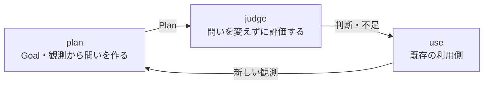

# Goal-derived evaluation: a two-function Unix proof

`plan(request, ports) -> Plan` produces diagnostic questions from the original Goal and observations. `judge(Plan, ModelPort) -> Judgments` evaluates those questions without rewriting them. Observations, catalog templates, limits and unresolved needs are data. The caller owns further observation, outcome verification and effects.



The engine is `core.mjs`: two exported functions, no service, registry, DSL, credential handling or case-ID/Goal-family branches. It reuses the existing JSON snapshot validator. The proof adapter uses the existing draft #528 Choice ModelPort and an already-authenticated native Claude CLI; it is not a live Jev/owner-entry proof.

## Plan v2 and the consumer report

Plan v2 (`ops.goal-evaluation.plan.v2`) adds three boundaries that the recorded v1 runs could not express:

- `clauses` are exact quotes from the Goal or a supplied source, typed `obligation`, `exception` or `alternative`. Every question names at least one obligation and carries the exceptions/alternatives that qualify it to the judge. The quote check is mechanical provenance only; it does not prove the clause list is complete or correctly read.
- `requiredRefs` may name only supplied observations. A necessary observation that was not supplied is a `needs` entry and makes that question `INCOMPLETE` before any call. In recorded v1 confirmation case v81 the free-text need was emitted as a `missingRefs` entry; its INCOMPLETE outcome matched the held expectation and is preserved, not reclassified as a false negative.
- `report(plan, judgments)` is a pure consumer view: every clause is `JUDGED_UNVERIFIED` or `UNASSESSED` with a reason, raw answers keep their type and value, rationales stay `verified: false`, supplied refs stay `support: NOT_VERIFIED`, and the next decision stays `CONSUMER_OWNED`. In recorded baseline w42 the Goal's shortening clause had no question; v2 lists it as unassessed instead of leaving it implicit behind `NOT_CERTIFIED`.
- A clause that the planner never quoted cannot be `UNASSESSED`. `unquotedGoalText` therefore lists, mechanically, every Goal span not covered by a Goal clause quote (UTF-16 offsets into `goal.content`; punctuation-only gaps are dropped). It judges no meaning: an unquoted span may be harmless wording or a dropped obligation.
- The answer type is `native-three-label` (problem/ok/unknown from a ModelPort). It is not the Jev Choice primitive and not a Noul value. Judgments record the port `{id, mode}` and a `planDigest` of the exact Plan answered; `report` refuses results for another Plan, labels outside the question's criteria and malformed per-question records, and re-derives the `missing` rows and `calls` count from the Plan and judgments instead of trusting the result's values. The focused tests run in CI as the `goal-evaluation-unix` check in `build/checks.jsonl`; CI success is functional evidence only.

`requiredRefs` is a declaration of which supplied observations a question depends on; it does not filter the judge input, which still receives the whole request plus the question's clauses. A question with `needs` is never judged under that Plan. Supplying a missing observation later changes the request and therefore the `planDigest`: it is a new Plan version and a new comparison identity, even if the question and criteria text are carried over unchanged. A quote match is mechanical provenance only; very short quotes pass it.

## Real-input preparer (`prepare.mjs`)

- `acquire({ref, url, list}, reader)` records one receipt per read: reference, URL, reader `{id, mode}`, observation time, actual HTTP status and, only for HTTP 200 with text, the complete content and SHA256. 404 is `NOT_FOUND`; 403/429/5xx, timeouts and empty bodies are `UNKNOWN`. A list read (`list: true`, e.g. PR comments) is OK only when the reader reports the `Link` header and it names no next page; otherwise it is `UNKNOWN` with `complete` false or null. Reader contract: GitHub omits the `Link` header when there is a single page, so a live reader reports an observed absent header as `link: ""`; it leaves `link` undefined only when it could not observe the headers at all. A non-OK receipt holds the case: no Plan input, snapshot or envelope. Readers are caller-owned ports; this file has no HTTP client or credential.
- The provided request must repeat the executor's own `subjectRevision` (node ID, body SHA256, `lastEditedAt`, edit count, `includesCreatedEdit`). Public reads do not return the edit fields, so they are never guessed from `updated_at` or defaults. `executorIdentitySnapshot` takes them only from the existing executor's admitted old-literal result comment for the caller's own expected command comment, run and runtime source: author `github-actions[bot]`, result marker and closed envelope, same repository/PR/node ID, literal observation, body SHA256 equal to the fetched body, and an exact `subjectRevision` round trip. Anything else is `HOLD` (`REVISION_UNOBSERVED`, `SUBJECT_DRIFT`, `EXECUTOR_IDENTITY_MISMATCH`, `INPUT_INCOMPLETE`, ...). A verified snapshot carries its target and `readerDeclaredLive`, which repeats the caller's reader declaration and is not evidence that an actual read happened. Actual acquisition is proved only in a live phase by R independently re-reading the same result comment ID and PR body digest. The `expected` command comment ID, run ID and runtime source are caller facts here; their own acquisition receipts belong to the next phase contract. Byte equality between the public REST body and the executor's GraphQL body is not yet observed; a difference would surface as `SUBJECT_DRIFT` or executor refusal.
- `project(plan, subject)` takes the target only from the verified snapshot and maps each obligation-bound question without needs to a v14 provided check. The wire question always asks whether the problem criterion holds and quotes the plan's question, so `true` = problem criterion and `false` = ok criterion cannot be inverted by an ok-phrased question; `unknown` is recorded as not lowered. Questions with needs are `NOT_PROJECTED: INCOMPLETE`, checks beyond six `NOT_PROJECTED: LIMIT`; no obligation is `NEED_CLARIFICATION`, nothing projectable is `HOLD`. Goal clauses stay in the local mapping; the Goal text goes on the wire only when it has no CJK, otherwise only its ref and digest are kept. CJK in the subject or in a projected check makes the whole case `UNSUPPORTED_CJK`; nothing is translated. `axis: Aligned` and the `concern` wording are fixed caller choices, not semantic claims. The output envelope is the existing `/jev-evaluate` provided request; `postingAuthorized` stays `false`.
- Every `project` outcome, HOLD included, keeps what the wire does not carry: `unprojectedClauses` (each clause no check covers, with kind and reason `NO_QUESTION` or `NOT_PROJECTED: <question> <reason>`), `unquotedGoalText`, the Plan's `missing` list (including the automatic Goal coverage need), `clauseIds` on each `notProjected` entry, and `offWireQualifiers` per check (the exceptions and legitimate alternatives whose text is not on the wire; R's fidelity review checks that the criteria text reflects them). The fixed problem-polar sentence still quotes the plan's question, which may be phrased in the ok direction; per-case fidelity review covers that wording.
- `emittable` is true only when the reader was declared live and a fidelity record supplied from outside (R's review reference, the exact `envelopeSha256` and a verdict per check) marks every check `FAITHFUL`. The code never assigns a verdict; without a record every check is `UNREVIEWED`. The record is caller-supplied, so `emittable` is not a posting permission (`postingAuthorized` stays `false`); before any live posting, the referenced R review must be read back and shown to contain the same `envelopeSha256` and verdicts.
- Tests use test-double readers only and check admission with the existing `admitIssueCommand` and the unchanged shipped `issue-actions.json`. They prove composition and refusal paths, not an actual acquisition, an executor run, R fidelity review or any semantic benefit. Live calls in this slice: 0.

The v2 changes are checked by `core.test.mjs` with test doubles and zero provider calls. The recorded `results/**` are v1 artifacts produced at their recorded sources and are not rerun or rewritten; `verify.mjs` still verifies them unchanged. No v2 plan has been produced by a live model yet, so v2 question quality, F1 method overconstraint and F2 overlap remain unproven.

## Fixed evidence and retained failures

The independent fixture author fixed Goal/observation inputs and expectations before seeing each trial's outputs. The native model receives only Goal/observations/catalog or the frozen question and observations, never the expectation files. Each CLI invocation uses a separate session with tools, automatic project/memory context and session persistence disabled. `run.mjs plan` and `run.mjs judge` are separate processes communicating through ordinary JSONL.

- Baseline: four synthetic cases / two Goal families; four planning and seven judgment CLI invocations. Two questions reuse a template; five are generated. All four qualitative case outcomes match the prewritten expectations. This does **not** mean all generated criteria are sound.
- Retained semantic failure: the baseline delivery plan unnecessarily treats a deduplication mechanism as mandatory. A redundant readback question adds an unproven extra call. See `review.md`; the original plans, judgments and unknowns are preserved.
- The repaired planner instruction evaluates outcomes without mandating an unrequested implementation technique and asks for minimal, nonredundant questions. Confirmation uses a separately authored, previously unused third Goal family. Its results are recorded under `results/confirmation/`, not used to overwrite the baseline.
- Independent functional tests exposed two byte-ceiling failures. Both were repaired and the original counterexamples remain in `core.test.mjs` and `functional-review.md`.

See `review.md` (both trials) and `functional-review.md` for the independent conclusions. Source commits, actual requests/responses, adapter-reported model labels, session IDs and CLI accounting remain available. Confirmation also automatically records source-file digests and the actual instruction used.

The completed confirmation has one generated question per new case. The sufficient existing JSONL-record case returns `ok`; the missing-result-record case returns `INCOMPLETE` before any model call. This is one semantic-model example plus one missing-input guard example, not two model-correct predictions. No database/server becomes a requirement in these two plans. Alternative combined-record layouts were not tested, so general removal of method overconstraints is not established.

Overall retained evidence: six cases / three Goal families, nine question instances (two reused, seven generated), eight live judgments and one pre-call incomplete result. Six planning plus eight judging CLI invocations use adapter-reported `claude-opus-5-5`, with 14 distinct sessions. All six qualitative case outcomes agree with the prewritten expectations, while the baseline criterion defects remain negative findings. CLI-reported cost totals USD 0.3443844; native HTTP counts and invoice cost are unknown. Independent functional checks pass 11/11, and `verify.mjs` checks the saved dataflow without inference.

The engine always returns `goalCoverage: NOT_CERTIFIED` and `authority: false`. Generated diagnostics do not set a new Goal, acceptance threshold or effect permission. Question discovery quality, whole-Goal coverage, independent-population performance, real business effects and reusable-Core admission require further evidence.

## Reproduction

```powershell
node --test experiments/goal-evaluation-unix/core.test.mjs
node experiments/goal-evaluation-unix/verify.mjs
node experiments/goal-evaluation-unix/run.mjs plan confirmation
node experiments/goal-evaluation-unix/run.mjs judge confirmation
```

The live commands require the existing native Claude authentication and intentionally refuse to overwrite existing evidence files. Do not replay recorded successful invocations as retries. Use a fresh worktree/trial output location for a newly authorized experiment. No CLI or HTTP client, credentials, secret route, provider environment or background executor is installed by this proof.

CLI-reported costs are not invoices; native HTTP-call counts are unknown. Synthetic observations describe a fixture world, not an actual notification delivery or operational recovery.

## Existing responsibility owners

- [ops #523](https://github.com/roccho-org/ops/issues/523): dynamic need discovery, diagnostic trials, fixed comparison, independent quality and outcome closure. This finite experiment does not complete P3/P4/P6.
- [ops #524](https://github.com/roccho-org/ops/issues/524): Core/Route/model/CLI locality. New questions are data; this experiment does not establish all primitive or model compatibility.
- [ADRS #392](https://github.com/roccho-dev/adrs/issues/392): variable state/question/rubric and raw typed judgment.
- [ADRS #497](https://github.com/roccho-dev/adrs/issues/497): reuse first, synthesize missing parts, verify outcomes and admit reusable capabilities separately.
- [ADRS #523](https://github.com/roccho-dev/adrs/issues/523): bounded evidence with provenance and explicit unknowns.

The proposed #523 boundary permitting diagnostic generation within a fixed exploration contract remains a proposal. The current user's instruction authorizes this finite synthetic local proof; it does not adopt generated criteria as policy or grant production effects.
