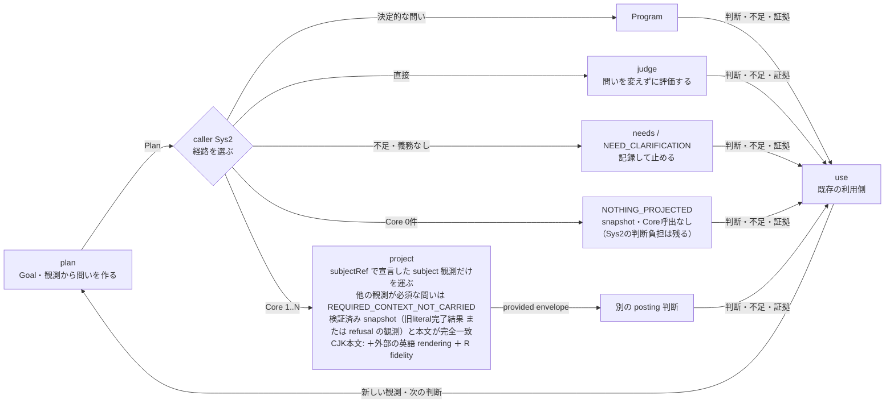

# Goal-derived evaluation: a two-function Unix proof

`plan(request, ports) -> Plan` produces diagnostic questions from the original Goal and observations. `judge(Plan, ModelPort) -> Judgments` evaluates those questions without rewriting them. Observations, catalog templates, limits and unresolved needs are data. The caller owns further observation, outcome verification and effects.



The engine is `core.mjs`: two exported functions, no service, registry, DSL, credential handling or case-ID/Goal-family branches. It reuses the existing JSON snapshot validator. The recorded proof runs used `run.mjs` with the existing draft #528 Choice ModelPort and an already-authenticated native Claude CLI; they are not a live Jev/owner-entry proof. That runner and its `../sys1-continuation/portable.mjs` adapter are not shipped here; they remain in the source history at `0426accc` (the #540 series).

## Plan v2 and the consumer report

Plan v2 (`ops.goal-evaluation.plan.v2`) adds three boundaries that the recorded v1 runs could not express:

- `clauses` are exact quotes from the Goal or a supplied source, typed `obligation`, `exception` or `alternative`. Every question names at least one obligation and carries the exceptions/alternatives that qualify it to the judge. The quote check is mechanical provenance only; it does not prove the clause list is complete or correctly read.
- `requiredRefs` may name only supplied observations. A necessary observation that was not supplied is a `needs` entry and makes that question `INCOMPLETE` before any call. In recorded v1 confirmation case v81 the free-text need was emitted as a `missingRefs` entry; its INCOMPLETE outcome matched the held expectation and is preserved, not reclassified as a false negative.
- `report(plan, judgments)` is a pure consumer view: every clause is `JUDGED_UNVERIFIED` or `UNASSESSED` with a reason, raw answers keep their type and value, rationales stay `verified: false`, supplied refs stay `support: NOT_VERIFIED`, and the next decision stays `CONSUMER_OWNED`. In recorded baseline w42 the Goal's shortening clause had no question; v2 lists it as unassessed instead of leaving it implicit behind `NOT_CERTIFIED`.
- A clause that the planner never quoted cannot be `UNASSESSED`. `unquotedGoalText` therefore lists, mechanically, every Goal span not covered by a Goal clause quote (UTF-16 offsets into `goal.content`; punctuation-only gaps are dropped). It judges no meaning: an unquoted span may be harmless wording or a dropped obligation.
- The answer type is `native-three-label` (problem/ok/unknown from a ModelPort). It is not the Jev Choice primitive and not a Noul value. Judgments record the port `{id, mode}` and a `planDigest` of the exact Plan answered; `report` refuses results for another Plan, labels outside the question's criteria and malformed per-question records, and re-derives the `missing` rows and `calls` count from the Plan and judgments instead of trusting the result's values. The focused tests run in CI as the `goal-evaluation-unix` check in `build/checks.jsonl`; CI success is functional evidence only.

`requiredRefs` is a declaration of which supplied observations a question depends on; it does not filter the judge input, which still receives the whole request plus the question's clauses. The provided route below carries less: only the declared subject text (and the Goal when it has no CJK). There, `project` withholds a question that requires any other observation instead of sending it without that observation. A question with `needs` is never judged under that Plan. Supplying a missing observation later changes the request and therefore the `planDigest`: it is a new Plan version and a new comparison identity, even if the question and criteria text are carried over unchanged. A quote match is mechanical provenance only; very short quotes pass it.

## Real-input preparer (`prepare.mjs`)

**When to use.** Use this caller when a real decision about a GitHub pull request depends on judging it against a Goal and the judgment must be repeatable and comparable. Japanese (and other CJK) Goals are first-class inputs: the Goal, its clauses, exceptions, alternatives, needs and unknowns are kept locally in full and never translated here. A CJK target concludes a zero-check projection like any other. With a Core check it needs, from outside this caller, a verified snapshot of the subject, an English rendering of it and R's fidelity record including a rendering verdict; this caller produces none of them. The snapshot can come from either of two existing sources:
- a completed old-literal result, through `executorIdentitySnapshot`. This needs a paid run on a pre-L1 runtime whose literal path does not refuse CJK (literal input `ops.semlint.input.v1`, as in `305b5321`); under this tree's L1 code a granted target's literal CJK command is refused instead;
- the executor's literal CJK refusal observation, through `refusalOrigin` and `refusalIdentitySnapshot`. This makes no provider call. Its code (#542, #547) is in this tree, but the live workflow still runs the pinned `305b5321`, so this route needs a separate activation first.

These sources say only how a snapshot can be obtained; neither has been obtained for a real target. No runnable old-literal baseline exists yet; this requirement is UNMET. The pinned `305b5321` is only the current live pin and the code provenance: it has no #536 target or guard entry, its ranges end at 103 and it accepts no target-bound range, so it cannot run a fresh #536 comparison. Before any model call, a future case-specific prospective scope must fix the exact runnable pre-L1 literal baseline: version, adapter, config and context bytes. The candidates discussed so far (M plus a fresh range, or this tree without the #536 grant) are proposals, not adopted versions or permissions. The baseline must never use this tree's added CJK refusal to produce an "old" HOLD. A completed authorized result of that baseline for the same revision can then be reused through `executorIdentitySnapshot` instead of forcing an extra L2 command; L2 stays an optional acquisition route. The Japanese Goal and target are used as they are; no English URL or translated Goal is required, and this caller is not a translator. Use Core checks only for qualitative questions with a real pending judgment, never just to show an effect. `NOTHING_PROJECTED` makes no semlint or Core provider call; it does not make the caller's own Sys2 reasoning free. Outside this module, the caller (Sys2) may route deterministic questions to a Program or judge directly. Here, questions whose required observations are missing stay recorded as needs (`NOT_PROJECTED: INCOMPLETE`), a plan with no obligation is `NEED_CLARIFICATION`, and only obligation-bound questions without needs become Core checks. The caller declares which supplied observation is the subject text (`subjectRef`). A question that requires any other observation (a runbook, a policy, other context) is not a Core check here, because the wire would not carry it. It stays `NOT_PROJECTED: REQUIRED_CONTEXT_NOT_CARRIED` with its refs, for a Program, the local `judge` (which receives every observation) or a direct route. A plan that yields no Core check concludes `NOTHING_PROJECTED` (status `HOLD`; the projection decision only) without a GitHub snapshot, a run or a paid result. A Core check additionally needs a verified subject snapshot (with a supplied English rendering when the body has CJK), an independent fidelity record and a separate posting decision.

Current limits: this module records and projects only. It never runs a Program, and it infers neither Program success nor the resolution of a need; a recorded need stays open until a new observation produces a new Plan. A Japanese Goal stays off the wire as its ref and digest, with its clauses and unquoted spans kept locally. No snapshot of a real CJK target from either source, and no rendering or rendering verdict, exists yet. The L1/L2 code in this tree is dormant: the live workflow runs the pinned runtime `305b5321`, and changing that is a separate activation; see the C1 section below.

- `acquire({ref, url, list}, reader)` records one receipt per read: reference, URL, reader `{id, mode}`, observation time, actual HTTP status and, only for HTTP 200 with text, the complete content and SHA256. 404 is `NOT_FOUND`; 403/429/5xx, timeouts and empty bodies are `UNKNOWN`. A list read (`list: true`, e.g. PR comments) is OK only when the reader reports the `Link` header and it names no next page; otherwise it is `UNKNOWN` with `complete` false or null. Reader contract: GitHub omits the `Link` header when there is a single page, so a live reader reports an observed absent header as `link: ""`; it leaves `link` undefined only when it could not observe the headers at all. A non-OK receipt holds the case: no Plan input, snapshot or envelope. Readers are caller-owned ports; this file has no HTTP client or credential.
- The provided request must repeat the executor's own `subjectRevision` (node ID, body SHA256, `lastEditedAt`, edit count, `includesCreatedEdit`). Public reads do not return the edit fields, so they are never guessed from `updated_at` or defaults. `executorIdentitySnapshot` takes them only from the existing executor's admitted old-literal result comment for the caller's own expected command comment, run and runtime source: author `github-actions[bot]`, result marker and closed envelope, same repository/PR/node ID, literal observation, body SHA256 equal to the fetched body, and an exact `subjectRevision` round trip. Anything else is `HOLD` (`REVISION_UNOBSERVED`, `SUBJECT_DRIFT`, `EXECUTOR_IDENTITY_MISMATCH`, `INPUT_INCOMPLETE`, ...). A verified snapshot carries its target and `readerDeclaredLive`, which repeats the caller's reader declaration and is not evidence that an actual read happened. Actual acquisition is proved only in a live phase by R independently re-reading the same result comment ID and PR body digest. The `expected` command comment ID, run ID and runtime source are caller facts here; their own acquisition receipts belong to the next phase contract. Byte equality between the public REST body and the executor's GraphQL body is not yet observed; a difference would surface as `SUBJECT_DRIFT` or executor refusal.
- `project(plan, subject, { subjectRef })` takes the target only from the verified snapshot and maps each obligation-bound question without needs, whose declared support the wire carries, to a v14 provided check.
  - `subjectRef` is the ref of the plan observation that is the subject text. Nothing is inferred from ref names or URLs. A value that is not a string naming one supplied observation (the Goal ref never is one) throws `INVALID_SUBJECT_REF`, after the plan's own validation and before any question or subject is looked at.
  - The order per question is: needs first (`INCOMPLETE`); then a question with any `requiredRefs` entry other than `subjectRef` becomes `{id, reason: 'REQUIRED_CONTEXT_NOT_CARRIED', requiredRefs, notCarried, clauseIds}`; then the six-check `LIMIT`, which only carried checks count against. Questions with `requiredRefs: []` are unaffected. Only `requiredRefs` are gated: K named only in `basisRefs`, behind a clause quoted from another observation, or not declared at all is not detected; that stays with the planner and R's fidelity review.
  - If no check remains, the case concludes `NOTHING_PROJECTED` before any subject, so a plan whose questions all need other observations never waits for a snapshot, a paid result or a command.
  - When `subjectRef` is declared and a check reaches the subject, that observation's content must equal the verified `snapshot.body` byte for byte. Otherwise the whole case is `HOLD` `SUBJECT_OBSERVATION_MISMATCH`, with no envelope and every local record kept. This applies even when the remaining checks have `requiredRefs: []`: the plan was built on other text. It is decided before any rendering or CJK check.
  - `ELIGIBLE` with a non-empty `notProjected` is a partial projection, not a complete assessment.
  - Migration: a caller that omits `subjectRef` keeps the old bytes only for questions without `requiredRefs`. Its questions with `requiredRefs` are withheld (fail closed). With a correct `subjectRef`, plans that need only the subject text keep the old bytes; questions that required another observation, which used to reach the wire without it, now change on purpose. The wire question always asks whether the problem criterion holds and quotes the plan's question, so `true` = problem criterion and `false` = ok criterion cannot be inverted by an ok-phrased question; `unknown` is recorded as not lowered. Questions with needs are `NOT_PROJECTED: INCOMPLETE`, checks beyond six `NOT_PROJECTED: LIMIT`. No obligation is `NEED_CLARIFICATION`; otherwise a plan with no projectable check is `HOLD` `NOTHING_PROJECTED` before any subject verification, since nothing would reach the wire. `NOTHING_PROJECTED` therefore does not mean the subject was observed or verified, and it is not an evaluation or Program result. Only when a check exists does an unverified subject hold the case (`REVISION_UNOBSERVED` or the subject's own cause). Goal clauses stay in the local mapping; the Goal text goes on the wire only when it has no CJK, otherwise only its ref and digest are kept. When any check exists, CJK in the subject or in a projected check makes the whole case `UNSUPPORTED_CJK` unless a valid English subject rendering is supplied (see C1 below); nothing is translated here. `axis: Aligned` and the `concern` wording are fixed caller choices, not semantic claims. The output envelope is the existing `/jev-evaluate` provided request; `postingAuthorized` stays `false`.
- Every `project` outcome, HOLD included, keeps what the wire does not carry: `unprojectedClauses` (each clause no check covers, with kind and reason `NO_QUESTION` or `NOT_PROJECTED: <question> <reason>`), `unquotedGoalText`, the Plan's `missing` list (including the automatic Goal coverage need), `clauseIds` on each `notProjected` entry, and `offWireQualifiers` per check (the exceptions and legitimate alternatives whose text is not on the wire; R's fidelity review checks that the criteria text reflects them). The fixed problem-polar sentence still quotes the plan's question, which may be phrased in the ok direction; per-case fidelity review covers that wording.
- `emittable` is true only when the reader was declared live and a fidelity record supplied from outside (R's review reference, the exact `envelopeSha256` and a verdict per check) marks every check `FAITHFUL` (and, with a subject rendering, carries R's `renderingVerdict` `FAITHFUL`; see C1). The code never assigns a verdict; without a record every check is `UNREVIEWED`. The record is caller-supplied, so `emittable` is not a posting permission (`postingAuthorized` stays `false`); before any live posting, the referenced R review must be read back and shown to contain the same `envelopeSha256` and verdicts.
- Tests use test-double readers only and check admission with the existing `admitIssueCommand` and the unchanged shipped `issue-actions.json`. They prove composition and refusal paths, not an actual acquisition, an executor run, R fidelity review or any semantic benefit. Live calls in this slice: 0. The declared-support tests reuse the plans of a witness recorded on unmodified M `da100ed3`, where a question requiring a runbook observation reached the wire without it. Plans that need only the subject text are compared with M's recorded output bytes. The witness plans themselves now withhold that question.

## Caller receipts for the live origin and fidelity (`expectedOrigin`, `fidelityFromReview`)

- `expectedOrigin` (N-a) derives the `expected` command comment ID, run ID and runtime source for `executorIdentitySnapshot` instead of taking them as caller facts. It binds a run to a command only through the executor's own plan-stage receipt (`commentId` and `run` id/number/attempt/workflowId) and requires agreement with three independent receipts: the approved posting response and the public readback of that comment (same ID, approved principal, exact literal body, target issue URL), the public run metadata (same run, `issue_comment`, attempt 1, approved workflow ID/path/repository, run number inside the approved range) and the workflow file read from exactly `https://raw.githubusercontent.com/<approved repository>/<run head_sha>/<approved workflow path>` (no other repository, fork, host, ref or query), whose two runtime pins must both equal the approved runtime source. That workflow must be byte-identical to the same path read the same way at the caller-approved `activationCommit` (a phase-contract fact, reviewed with the activation source; never derived from the run or the result); otherwise `WORKFLOW_DRIFT_FROM_ACTIVATION`, and a missing, invalid or non-canonical activation read is `HOLD`. Byte equality is the guarantee because text checks cannot see every way a later step could replace the pinned runtime (quoted, commented or differently spelled `uses:`, or a `run:` step that checks out another ref). The structural checks remain as additional checks only: the checkout `ref` pin counts only inside a `with:` block whose `repository` is the approved repository (otherwise `CHECKOUT_REPOSITORY_MISMATCH`), and exactly one `actions/checkout` step must exist and be that pinned step (otherwise `CHECKOUT_STEP_MISMATCH`). This code does not review the activation workflow itself. The plan receipt's `requestDigest` is required and returned as `planRequestDigest`, so a caller can also match it with the old-literal result's `requestDigest`. Actor, time proximity and the final result's self-identity are never used to bind. Any missing, non-OK, ambiguous or mismatched input is `HOLD`.
- The plan-stage receipt exists only in the run's job log, which is not publicly readable and has no provider digest. It is accepted only as a P-transported job log (`route: p-transported-job-log`, `providerDigest: null`) whose bytes match its own SHA256; it is cross-checked, never trusted alone. The result records this limit.
- `fidelityFromReview` (N-e) builds the external fidelity record only from the approved review ID on the approved PR: one `<!-- semlint-fidelity-v1 -->` marker followed by one fenced JSON block `{schema: ops.goal-evaluation.fidelity.v1, envelopeSha256, verdicts}` with the exact envelope digest and exactly the projected check IDs. A wrong review, missing or duplicate marker, extra keys, digest or check-set mismatch, or a non-OK receipt is `HOLD`. The GitHub author is a shared account and is never used as evidence of R; the approved R session and GO reference are carried as a declared origin to be checked in the live-phase R readback. A record still does not authorize posting.
- Both functions certify only the consistency of the supplied receipts. Their tests use synthetic observations and test-double readers; no command, run, job log or review was actually acquired. Live calls: 0.

## A CJK subject: refusal snapshot and supplied rendering (C1)

- Why: three pieces are involved, and this tree contains all three. None is active in the live workflow, which runs the pinned runtime `305b5321`.
  - Core v14 already accepted a producer-supplied `englishAuxiliary` for a CJK unit before this series. On the pre-L1 code, the GitHub provided-path payload check refused any auxiliary or any CJK with `INVALID_PROVIDED_REQUEST` (the later shared guard `AUDITED_AUXILIARY_REQUIRES_OWNER_ROUTE` was not reached first), and the executor had no CJK refusal for a literal `/jev-evaluate`.
  - L1 (#542, adopted here) refuses a granted target's literal command whose input contains CJK (`UNSUPPORTED_CJK`) before any claim, so no result comment carries the edit signals; it also admits a subject rendering on the provided path.
  - L2 (#547, adopted here) prints the edit signals in that refusal's plan receipt as `observed: {issueNodeId, subjectRevision}`.

  This caller consumes that composed GitHub path; the composition test below runs it end to end with stub ports.
- `refusalOrigin(args)` takes the same arguments as `expectedOrigin` and applies the same bindings through one shared helper: posting response, command readback, principal, issue URL, run, attempt 1, workflow ID and path, run range, workflow at the run head, byte equality with the activation workflow, the single pinned checkout and both runtime pins. The approved command must be the literal `/jev-evaluate` (otherwise `COMMAND_NOT_LITERAL`). It accepts exactly one plan-stage receipt with exactly the keys `schema, stage, outcome, cause, claimed, providerCalls, authority, commentId, run, observed`, with `NONE`, `UNSUPPORTED_CJK`, `false`, `0`, `false`, and `observed` exactly `{issueNodeId, subjectRevision}`. A post-stage echo is ignored. Two plan receipts, a `requestDigest`, a claim, any other key or a receipt without `observed` is `HOLD`; no digest is synthesized. The result is a distinct kind, `literal-cjk-refusal`, with the approved target and the plan observation and without `expected`, so it cannot replace `expectedOrigin`'s result, and `executorIdentitySnapshot` still requires a result comment.
- `refusalIdentitySnapshot({origin, pullRequestReceipt, target})` accepts only that kind and only for the origin's approved target. It takes the node ID and body only from the public PR and the edit signals only from the observation, through the same 5-part revision parser as the result path: the node must agree three ways, the body SHA256 must match and the revision must round-trip. Drift, malformed revisions and other origins are `HOLD`. `readerDeclaredLive` is true only when every public receipt used (command, run, workflow, activation, PR) was declared from a live reader port; the job log keeps its weaker provenance and never counts as live.
- What `VERIFIED` means here: the supplied receipts agree with the executor's observation at its refusal. It is not a later read. A public read cannot see an edit that restores the same body; a later provided command is admitted only if the executor's own read then gives the same revision. A refusal does not show that the body is CJK, and that the activated runtime prints this receipt is a phase fact this code cannot certify.
- `project(plan, subject, { subjectRef, englishAuxiliary })` accepts an English rendering of the subject only, supplied from outside: exactly `{text, sourceSha256}`, with non-empty CJK-free text and `sourceSha256` equal to the SHA256 of the whole observed body. Core v14 requires a unit's `englishAuxiliary` to be null exactly when its selected text has no CJK, so a rendering of an English body is `HOLD` `RENDERING_NOT_NEEDED`; any other invalid rendering is `HOLD` `AUXILIARY_INVALID`. Both keep every local record. The original body, span and revision stay on the wire unchanged, and the Goal context keeps `englishAuxiliary: null` (a CJK Goal stays off the wire). With a rendering, CJK may remain only in the original subject content; CJK in a question, a criterion or the rendering itself still makes the case `UNSUPPORTED_CJK`. `NEED_CLARIFICATION` and `NOTHING_PROJECTED` still conclude before any subject or rendering is inspected. Without a rendering, every output is unchanged.
- Rendering fidelity: for a rendered unit Core v14 gives the model the English text instead of the original, so the rendering decides what is evaluated. With a rendering, `emittable` also needs R's `renderingVerdict` `FAITHFUL`: R's judgment that the English text renders the complete original body with nothing missing, added or reversed. The code checks only its presence, its value (`FAITHFUL`, `UNFAITHFUL` or `UNKNOWN`) and the envelope digest; it never judges meaning or assigns the verdict. The supplied record is then `{reviewRef, envelopeSha256, verdicts, renderingVerdict}`; without a rendering, the old record without `renderingVerdict` is required. `fidelityFromReview({..., rendering: true})` reads the v2 block under the same marker: `{schema: ops.goal-evaluation.fidelity.v2, envelopeSha256, verdicts, renderingVerdict}`. The marker keeps its historical `v1` name; the schema decides. A v1 block for a rendered projection or a v2 block for a plain one is `FIDELITY_BLOCK_INVALID`, decided by the schema label even when the keys would fit the other shape. Pass `rendering: true` exactly when the projection carries a subject rendering (the same `englishAuxiliary` given to `project`); a record read the other way is refused later by `project` with `FIDELITY_RECORD_MISMATCH`. The rendering verdict is a separate member, so a check ID such as `subject.englishAuxiliary` cannot collide with it, and the record repeats no hashes: `envelopeSha256` already covers the original body, its span and digest and the English text.
- Tests:
  - The C1 tests use a hand-written plan receipt in the #547 shape and test-double readers to pin the caller's parsing and bindings, including shapes the producer never prints. Core v14 is used directly to show that it admits the rendered subject and refuses a rendering of an English body.
  - The rendering tests plan on the JA body they evaluate. Earlier versions planned on the English body while evaluating the JA body; that pair is now kept as a `SUBJECT_OBSERVATION_MISMATCH` negative.
  - One composition test runs the real L2 `planIssueCommand` with the shipped settings and stub ports (no network). It prints the receipt in the executor's `JSON.stringify` form behind a fixture runner timestamp (not the CLI process) and passes it to `refusalOrigin`, `refusalIdentitySnapshot`, `project` with a supplied rendering and the real L1 `admitIssueCommand`. The result is `ADMITTED` with the producer's own `subjectRevision`. A changed body, an edit-and-restore with a new edit count and a tampered rendering hash are refused; the hash case is asserted by status only, because L1's hash check and Core v14's `auxiliary()` both catch it.
  - This proves that the functions compose on this tree, not a workflow run, an actual acquisition, a rendering, R fidelity or a semantic benefit. No refusal snapshot, rendering, R fidelity review or semantic benefit exists for a real target. Live calls: 0.

The v2 changes are checked by `core.test.mjs` with test doubles and zero provider calls. The recorded `results/**` are v1 artifacts produced at their recorded sources and are not rerun or rewritten; `verify.mjs` still verifies them unchanged. No v2 plan has been produced by a live model yet, so v2 question quality, F1 method overconstraint and F2 overlap remain unproven.

## Fixed evidence and retained failures

The independent fixture author fixed Goal/observation inputs and expectations before seeing each trial's outputs. The native model receives only Goal/observations/catalog or the frozen question and observations, never the expectation files. Each CLI invocation uses a separate session with tools, automatic project/memory context and session persistence disabled. In the recorded trials, `run.mjs plan` and `run.mjs judge` were separate processes communicating through ordinary JSONL.

- Baseline: four synthetic cases / two Goal families; four planning and seven judgment CLI invocations. Two questions reuse a template; five are generated. All four qualitative case outcomes match the prewritten expectations. This does **not** mean all generated criteria are sound.
- Retained semantic failure: the baseline delivery plan unnecessarily treats a deduplication mechanism as mandatory. A redundant readback question adds an unproven extra call. See `review.md`; the original plans, judgments and unknowns are preserved.
- The repaired planner instruction evaluates outcomes without mandating an unrequested implementation technique and asks for minimal, nonredundant questions. Confirmation uses a separately authored, previously unused third Goal family. Its results are recorded under `results/confirmation/`, not used to overwrite the baseline.
- Independent functional tests exposed two byte-ceiling failures. Both were repaired and the original counterexamples remain in `core.test.mjs` and `functional-review.md`.

See `review.md` (both trials) and `functional-review.md` for the independent conclusions. Source commits, actual requests/responses, adapter-reported model labels, session IDs and CLI accounting remain available. Confirmation also automatically records source-file digests and the actual instruction used.

The completed confirmation has one generated question per new case. The sufficient existing JSONL-record case returns `ok`; the missing-result-record case returns `INCOMPLETE` before any model call. This is one semantic-model example plus one missing-input guard example, not two model-correct predictions. No database/server becomes a requirement in these two plans. Alternative combined-record layouts were not tested, so general removal of method overconstraints is not established.

Overall retained evidence: six cases / three Goal families, nine question instances (two reused, seven generated), eight live judgments and one pre-call incomplete result. Six planning plus eight judging CLI invocations use adapter-reported `claude-opus-5-5`, with 14 distinct sessions. All six qualitative case outcomes agree with the prewritten expectations, while the baseline criterion defects remain negative findings. CLI-reported cost totals USD 0.3443844; native HTTP counts and invoice cost are unknown. Independent functional checks pass 11/11, and `verify.mjs` checks the saved dataflow without inference.

The engine always returns `goalCoverage: NOT_CERTIFIED` and `authority: false`. Generated diagnostics do not set a new Goal, acceptance threshold or effect permission. Question discovery quality, whole-Goal coverage, independent-population performance, real business effects and reusable-Core admission require further evidence.

## Reproduction

```powershell
node --test experiments/goal-evaluation-unix/core.test.mjs
node experiments/goal-evaluation-unix/verify.mjs
```

Both commands are offline: the tests use test doubles and `verify.mjs` checks the recorded results without inference. No live runner is shipped; recorded successful invocations are not replayed, and any new live run needs its own authorized scope. No CLI or HTTP client, credentials, secret route, provider environment or background executor is installed by this proof.

CLI-reported costs are not invoices; native HTTP-call counts are unknown. Synthetic observations describe a fixture world, not an actual notification delivery or operational recovery.

## Existing responsibility owners

- [ops #523](https://github.com/roccho-org/ops/issues/523): dynamic need discovery, diagnostic trials, fixed comparison, independent quality and outcome closure. This finite experiment does not complete P3/P4/P6.
- [ops #524](https://github.com/roccho-org/ops/issues/524): Core/Route/model/CLI locality. New questions are data; this experiment does not establish all primitive or model compatibility.
- [ADRS #392](https://github.com/roccho-dev/adrs/issues/392): variable state/question/rubric and raw typed judgment.
- [ADRS #497](https://github.com/roccho-dev/adrs/issues/497): reuse first, synthesize missing parts, verify outcomes and admit reusable capabilities separately.
- [ADRS #523](https://github.com/roccho-dev/adrs/issues/523): bounded evidence with provenance and explicit unknowns.

The proposed #523 boundary permitting diagnostic generation within a fixed exploration contract remains a proposal. The current user's instruction authorizes this finite synthetic local proof; it does not adopt generated criteria as policy or grant production effects.
