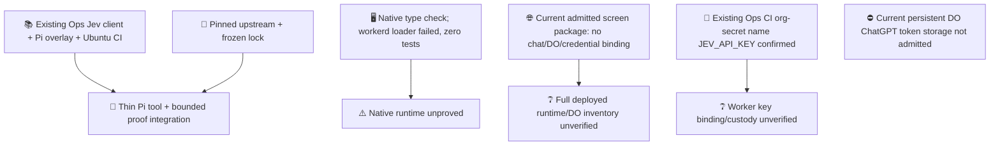
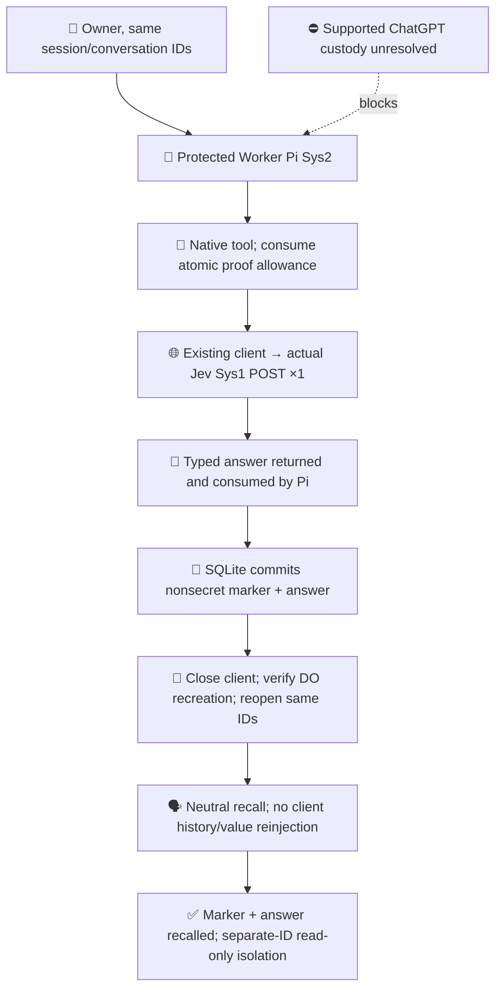
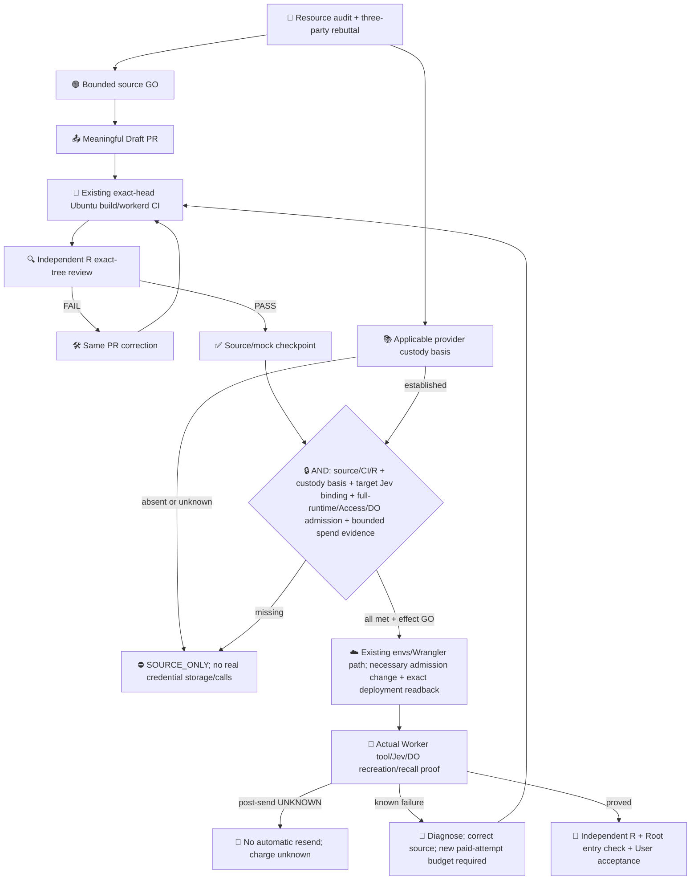

# Worker Pi → Jev proof

This is a source/mock checkpoint toward Worker-hosted Pi calling Jev and remembering its answer. It is not deployed ChatGPT inference, a quality experiment, or completion of ops#523.

Existing resources supply nearly everything:

| Reused resource | Remaining gap |
| --- | --- |
| `packages/jev/src/client.mjs` + `core.mjs`: typed named questions, fixed endpoint, one native POST, deadline and closed errors | Pi ToolRegistration and caller composition |
| Pinned upstream `dcb56ce2d174babb3f00112ac5b8cd597e58ab45`, its lock, pi-durable 1.2 | Register the tool using native extension/tools |
| Existing Harness document transactions and unsafe replay policy | One experimental allowance consumed before sending, shared across new tool tasks |
| Existing app WebSocket/SQLite/DO lifecycle tests and Ubuntu proof workflow | Exercise an actual mocked model tool call, typed result, recreation, interruption and isolation |

`apply.py` copies the canonical Jev client/core bytes into the generated upstream build; it does not maintain a client fork. The small declaration describes the used JS surface. No transport, decoder, auth framework, broker, daemon or general quota service is added.

An operator-provided `PI_JEV_PROOF_API_KEY` selects the bounded proof composition: only `ask_jev`, SDK retries zero and durable generation retries disabled. With no binding, legacy tools and retry/compaction defaults remain. No real key is supplied by this fixture. Model arguments contain only bounded state and question. The canonical decoder returns a fixed typed numeric assessment into transcript `output`.

The allowance is experiment-only, one per conversation, inherited as consumed by forks. Unsafe replay prevents rerunning an interrupted task; the persisted allowance also blocks new tasks. An uncertain result never restores it. UNKNOWN does not mean no charge. Adapter-returned failures ask the standard Harness to terminate. Engine-synthesized interruption on recovery may still cause model requests: the allowance bounds Jev POSTs, not all model activity. No exactly-once claim is made.

Current resources are separate evidence classes:

Conditional completion target:

Two user turns normally require three logical model requests: tool request, tool-result continuation, recall. Physical requests and hidden retries require independent observation. Mock fixtures prove transport/state behavior only; their scripted answers prove no model quality or general benefit.

Closure process:

The existing screen-only package/admission stays unchanged. Access GET302 proves a perimeter redirect, not origin version or deployed chat/DO behavior. Ubuntu CI does not repair or prove the separate native Nix workerd runtime.

Live credential storage remains blocked: [SIWC Terms §1–2](https://openai.com/policies/sign-in-with-chatgpt-terms/) distinguish local persistent token storage from user-controlled remote execution. [Self-hosted VM technical documentation](https://developers.openai.com/siwc/token-sharing-open-source/self-hosted-vms) does not establish an exception for this persistent DO store. Applicable app approval/basis is absent or unknown. No API-key substitute, credential transfer, real inference, deployment or merge is authorized by this source checkpoint.
