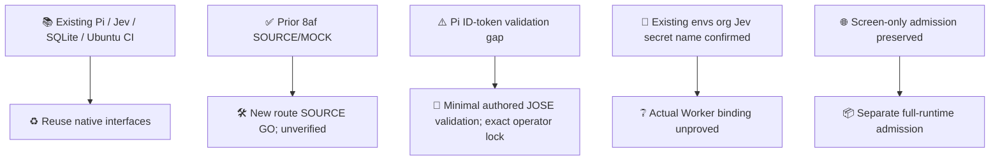
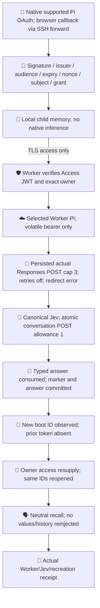
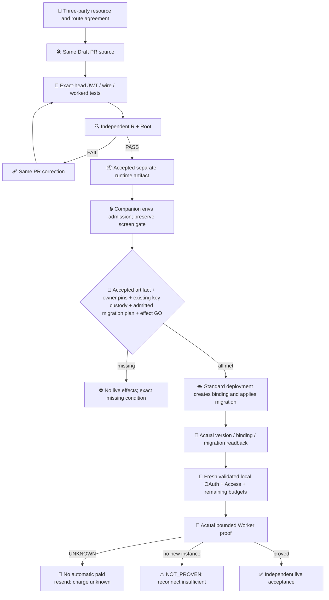

# Worker Pi / Jev bounded proof

Active route update (SOURCE GO only; new implementation not yet accepted).

Previous head 8af351a11c0b477d55f81cee791f298b9c83ed40 remains an accepted SOURCE/MOCK checkpoint: 100 mock tests; 21 checks terminal (14 SUCCESS / 7 SKIPPED). [CI](https://github.com/roccho-org/ops/actions/runs/39380346001), [R](https://github.com/roccho-org/ops/pull/608#pullrequestreview-5581517095), [Root](https://github.com/roccho-org/ops/pull/608#pullrequestreview-5581504291). Mock counts 2 inputs / 3 model requests / 1 Jev POST. Native workerd failed before tests; OAuth screen NOT_PROVEN. No live/quality/merge acceptance.

Three-party route rebuttal completed. Local candidate normally merged proposals 17b8fb08d86a9de470cb172f546e984f619be7a5, preserving accepted history. New source and exact-head CI are pending.

Single-owner internal dedicated runtime, same connected app/user, not offered to others, no pooling or SIWC charge: Terms section 1 restricts persistent token storage; section 2 permits user-controlled remote runtime. Transient access-only processing is an explicit interpretation, not provider endorsement or an assumed exception. Persistent DO OAuth storage is rejected. DevKit code is excluded due its separate license condition; independently authored Pi/JOSE validation does not inherit its noncommercial restriction.

Reuse canonical Jev transport/decoder/deadline and existing Pi model transport/SQLite/CI. Add only validated local OAuth composition, volatile selected-proof bearer, supported wire hook, physical-request bound, recreation witness and separate keyless runtime package. Preserve legacy unselected behavior and screen packaging. No new framework, inference proxy, global installation or credential bridge.

Required source: exact JOSE/ws lock and derived SDK bytes; required exp/sub/nonce and strict JWT negatives; supported native-fetch injection, no global monkeypatch; HTTP only; Access JWT signature/issuer/audience/exact owner before bearer attachment; no remote refresh/ID tokens, bootstrap, secret logs or persisted WS headers. New instance/expiry fails closed until resupply. Actual auth, deployment, secret writes and inference are outside SOURCE GO. Standard cloudflared local cache is separate from SIWC token custody. No auth has occurred.

Policy roccho-dev/adrs@6e4abcd22dbee397105625b6041ce1a0d4720182; native /work/repos/ops.git/.worktrees/pi-jev-worker-20261020. No ops#523 or quality completion claim.

Current new candidate: 0415575686f932987f63f4dbb12d4923be3e0bff. Shared validator and volatile/runtime composition published; native JWT helper tests and regenerated overlay type check passed. Exact-head CI, derived-login integration, focused runtime tests and operator proof orchestration remain pending; no new SOURCE/MOCK acceptance.

Primary basis: [SIWC Terms](https://openai.com/policies/sign-in-with-chatgpt-terms/), [ID-token validation](https://developers.openai.com/siwc/token-sharing-open-source/sign-in), [preview wire limitations](https://developers.openai.com/siwc/token-sharing-open-source/preview-limitations), [Cloudflare origin JWT validation](https://developers.cloudflare.com/cloudflare-one/access-controls/applications/http-apps/authorization-cookie/validating-json/). CF owner login/pin preparation is separate from expiring ChatGPT OAuth, which occurs after runtime deployment/readback.
