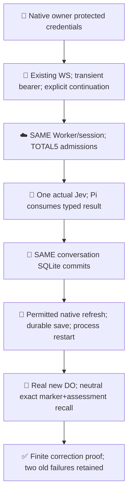
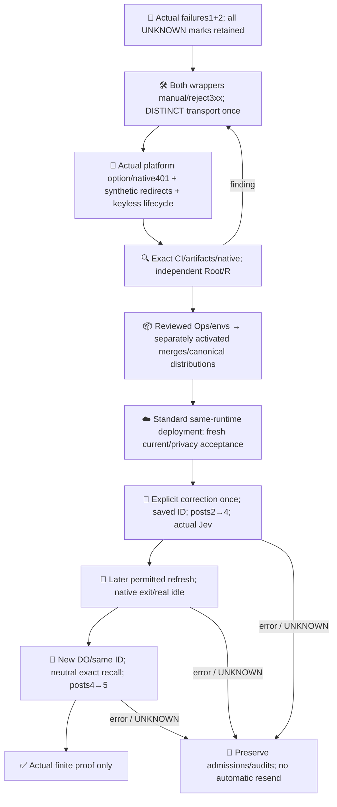

# Worker Pi / Jev finite correction proof

Inference stays on the existing Cloudflare Worker. SQLite conversation history is durable; ChatGPT access is volatile. The native owner runs explicit commands with protected local credentials, no daemon/keepalive, Tunnel, new auth API, local inference or replacement session.

[PR619](https://github.com/roccho-org/ops/pull/619) records canonical source/runtime/privacy evidence and the two retained failed model admissions. [Source decision6305587796](https://github.com/roccho-org/ops/pull/619#issuecomment-6305587796) authorizes this correction, keyless tests and new PR only. Actual User continuation/budget authority is recorded separately; source acceptance alone never sends a prompt or deploys.

## Actual transport gap

[Cloudflare Request](https://developers.cloudflare.com/workers/runtime-apis/request/) supports only `follow` and `manual`: `error` throws TypeError during Request construction, including inside fetch. The old Responses and Jev proof wrappers used unsupported `redirect: "error"`. Replacement fetch fixtures had ignored those options, hiding the platform gap. Actual attempt2 was recorded TRANSPORT/httpnull; source diagnosis does not invent its historical provider status, completion or billing.

Both existing wrappers now use native `manual` and reject every3xx without reading Location/body/cookies or following. Responses records its actual HTTP status BEFORE that guard; the guard is outside the native-fetch catch, so HTTP307/308 cannot become TRANSPORT. Canonical Jev client and the existing terminal redaction callback remain unchanged. A per-stream trace associates the same terminal message through frozen lazyStream/Harness; absent association is UNKNOWN, never provider-text inference.

Tests separate actual workerd Request/error rejection + native manual401 via the existing no-egress backstop from synthetic307/308 wrapper behavior. The latter stubs must construct native Request(input,init), check manual and one call/no follow. Frozen plugin has no legacy fetchMock; no MSW/dependency/config is added and native307 is not claimed.

## Protected credentials and finite continuation

Custody remains `/home/dev/.config/pi-worker-owner/registration.json`, directory0700/file0600, native owner1001 under the same OS flock. Root/same-UID readers are trusted. Every initial/returning exchange and permitted refresh uses durable SAME-record IN_DOUBT before token POST, then fsync/private temporary/rename/directory-fsync atomic replacement. Unknown results survive restart without rotating-token replay. No code/PKCE/auth URL is stored.

The frozen MIT Pi OAuth derivation retains validated subject/issued-client/host and actual expiry/earliest metadata, reuses the issued client, validates optional refreshed identity without an old nonce, rejects native token redirects and redacts diagnostics. Workspace association is registered-client semantics, not an invented subject/email workspace claim. Existing Worker Access verification is unchanged. No DevKit implementation is imported/copied. Independently authored numeric-seconds/ISO timing uses [pinned provider schema evidence](https://github.com/openai/sign-in-with-chatgpt-devkit/blob/0a36fefeb913055c8c7a1a29b63d82b96b2e841a/packages/local/src/index.ts#L100), waits for BOTH actual expiry and earliest permitted bound, and rejects unknown/malformed timing.

Existing login/reauth/refresh stages and prior seed/reconcile/forensic/history evidence remain. A WS/open can resume paid engine work BEFORE a prompt; it is never called read-only. No UNKNOWN prompt is automatically resent.

The correction candidate permits **5 TOTAL model admissions**: two retained historical failures plus three prospective Responses for seed2 and recall1. Jev remains1 per SAME conversation. This is four overall user inputs including the two old failures, not an original clean two-input execution. Counter/allowance is never reset/refunded, and no operational/unattended product budget is claimed.

`seed --continue --recover-transport-once` consumes a DISTINCT protected mark; it never rearms old `--recover-seed-once`. SAME lock requires the retained original UNKNOWN/reconciliation/forensic/history and consumed seedRecovery UNKNOWN with its already saved actual conversation ID. Effective access >30s is checked BEFORE durable admission. Marker presence even null/false refuses. The whole old proof remains nested in the new mark; local failure/crash/restart consumes it.

Actual authorized upgrade must report canonical boot/prior-token=false/posts2. Only the same saved ID in a unique eligible existing inventory can be opened once. Its current two-user/two-error/no-completed/no-Jev/no-pending/activity snapshot is revalidated before a fresh high-entropy prompt. Entries must map exactly pi.user/pi.system/pi.assistant to single message roles: user/system/error,user/[clock-only system]/error. Frozen clock rendering may add that second minute delta; static/tool patches, edits/head/reset or other entries refuse. The latest assistant must contain the trusted own attempt2/TRANSPORT/httpnull envelope, never provider prose.

Healthy new seed requires two distinct completed responses, one correlated typed actual Jev result and Pi consumption; offset2 is saved. A subsequent actually permitted local refresh/native restart and real DO recreation must witness new boot/priorfalse/posts4, reopen that SAME ID and neutrally recall exact marker AND typed assessment without values/history reinjection, ending posts5 with three distinct successful response IDs. Any error/UNKNOWN stops; no create/fork/new session or retry.

Keyless independent-process/crash/loopback and real Session workerd fixtures do not prove actual credential rotation, Jev or live durable memory. Source/CI acceptance grants no effects; actual current receipts remain separate. CI uses the existing normal/selected/privacy suites and exact source/checksum manifests; no native workerd PASS is inferred from Ubuntu CI. Only the new branch is added to the existing workflow watcher and its strict ci.intent declaration.

Policy adrs@6e4abcd22dbee397105625b6041ce1a0d4720182. No ops523/Jev-quality/full-product completion claim. Primary basis: [SIWC Terms](https://openai.com/policies/sign-in-with-chatgpt-terms/), [registration/identity](https://developers.openai.com/siwc/token-sharing-open-source/sign-in), [profiles/serialized rotation](https://developers.openai.com/siwc/token-sharing-open-source/profiles-and-sessions), [token reference](https://developers.openai.com/siwc/token-sharing-open-source/token-reference), [VM guidance](https://developers.openai.com/siwc/token-sharing-open-source/self-hosted-vms). Managed-DO credential custody remains unestablished; selected native custody/transient same-user/app access is an interpretation, not endorsement or blanket remote-storage conclusion.
