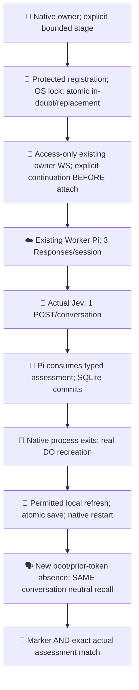
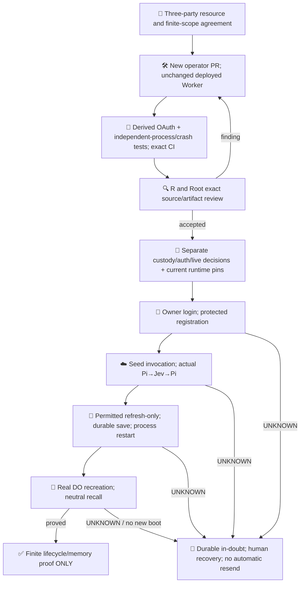

# Worker Pi / Jev bounded proof

This experiment keeps inference on the existing Cloudflare Worker. Its SQLite transcript is durable; ChatGPT access is volatile. The owner uses native commands only when needed, with no daemon, keepalive, Tunnel, token API or local inference.

[PR608](https://github.com/roccho-org/ops/pull/608) records the accepted source/runtime provenance and independently reviewed provider UI observability evidence. API observability `null` remains UNKNOWN; it is never normalized to off. [The three-party lifecycle design](https://github.com/roccho-org/ops/pull/608#issuecomment-6300038289) and [source authorization](https://github.com/roccho-org/ops/pull/608#issuecomment-6300229085) distinguish this finite proof from an ongoing product.

## Native credential lifecycle

The installed native Pi1.0.4 [AuthStorage](https://github.com/earendil-works/pi/blob/v1.0.4/packages/coding-agent/src/core/auth-storage.ts) provides cross-process locking, but writes in place after its callback; it cannot durably mark an uncertain refresh before sending. The operator therefore reuses the frozen MIT Pi OAuth/callback/PKCE implementation with a small native protected-record adapter. No coding-agent store is copied or full application imported.

Proposed owner custody is `/home/dev/.config/pi-worker-owner/registration.json`, directory0700/file0600. Root/same-UID processes remain trusted readers. All entrypoints take the same standard OS flock, reread current state, reject unsafe metadata/symlinks, write an exclusive private temporary file, fsync, rename and fsync its directory. An IN_DOUBT mark in the SAME registration is durable before initial/returning authorization or refresh. Only a complete validated atomic replacement becomes READY. Unknown results and failed persistence stay blocked across process restart; no rotating-token replay. A validated callback's issued client ID is persisted before token exchange, enabling explicit same-registration reauthorization after a lost initial response. No code, PKCE verifier or authorization URL is stored.

The deterministic derived SDK retains its original bytes and changes only native compatibility seams: validated subject/issued-client binding, retained ID token and actual expiry/earliest-refresh metadata; issued-client reauthorization; optional refreshed ID validation without an old nonce; redirect:error and generic token diagnostics. Workspace association is the registered-client binding, not an invented subject/email workspace claim. Optional ID-token hint is omitted from human URLs. Existing Worker Access validation behavior is unchanged.

The token reference names `earliest_refresh_at`; [pinned provider schema evidence](https://github.com/openai/sign-in-with-chatgpt-devkit/blob/0a36fefeb913055c8c7a1a29b63d82b96b2e841a/packages/local/src/index.ts#L100) establishes numeric Unix seconds or a timestamp string. Independently authored parsing accepts finite numeric seconds or a validated ISO instant, preserves the original field, and refuses malformed/unknown values. No vendor implementation is imported/copied or magnitude heuristic used. Explicit refresh waits until BOTH actual access expiry and this earliest bound; absent earliest uses actual expiry. No fake expiry, background loop or keepalive.

## Finite operator stages

After independent source/CI acceptance and separate custody/auth/effect decisions, run the native `operator/owner.mjs` with existing owner-terminal, URL/session/host/cloudflared arguments and explicit `--stage`:

- `login` creates a validated registration; `reauth` explicitly reuses its issued client/host.
- `seed --continue` authorizes bounded Worker recovery BEFORE bearer attachment, submits exactly one seed prompt, correlates the actual Jev call/result and Pi consumption, saves local expectations and exits.
- `refresh` performs only one permitted local renewal and atomic replacement; it never connects to the Worker.
- A later native process `recall --continue` requires that durable rotation, observes a different DO boot/prior-token absence on resupply, opens the SAME conversation and submits a neutral recall with no marker, assessment or history reinjection.

No native command retries a prompt after UNKNOWN. A socket connection may resume a persisted Harness task and is explicitly paid continuation, not a read-only status query. The existing Worker cap remains three pre-send Responses admissions per selected session and one Jev allowance per proof conversation. Reconnect does not refund/reset it. No new operational budget or unattended/browser-only product is claimed. If prior work consumed the cap, this proof stops; it never creates a silent replacement session.

Keyless Node tests use synthetic private directories and real independent child processes, including SIGKILL after the premark and after a synthetic token response. They do not prove provider refresh, native custody, Worker inference or durable live memory. The existing Ubuntu workerd suite remains the mock-runtime evidence; known native workerd loader failure is not relabeled PASS. Artifacts contain explicit source/derived files only, never custody directories.

Policy remains roccho-dev/adrs@6e4abcd22dbee397105625b6041ce1a0d4720182. Source/CI results grant no merge, deployment, credential creation or paid-call authority. No ops#523 or Jev quality completion claim.

Primary basis: [SIWC Terms](https://openai.com/policies/sign-in-with-chatgpt-terms/), [registration/identity/atomic storage](https://developers.openai.com/siwc/token-sharing-open-source/sign-in), [issued-client reauthorization and serialized rotation](https://developers.openai.com/siwc/token-sharing-open-source/profiles-and-sessions), [token reference](https://developers.openai.com/siwc/token-sharing-open-source/token-reference), [VM custody guidance](https://developers.openai.com/siwc/token-sharing-open-source/self-hosted-vms). The VM guidance and Terms persistent managed-storage wording do not establish DO credential admission. This design selects owner-native persistence and transient same-user/app Worker access as an explicit interpretation, not provider endorsement or a blanket claim about all remote custody.
