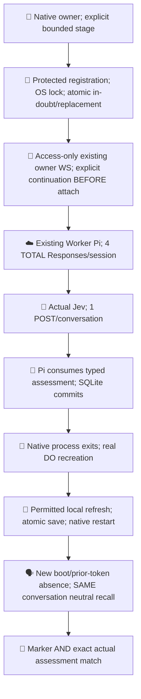
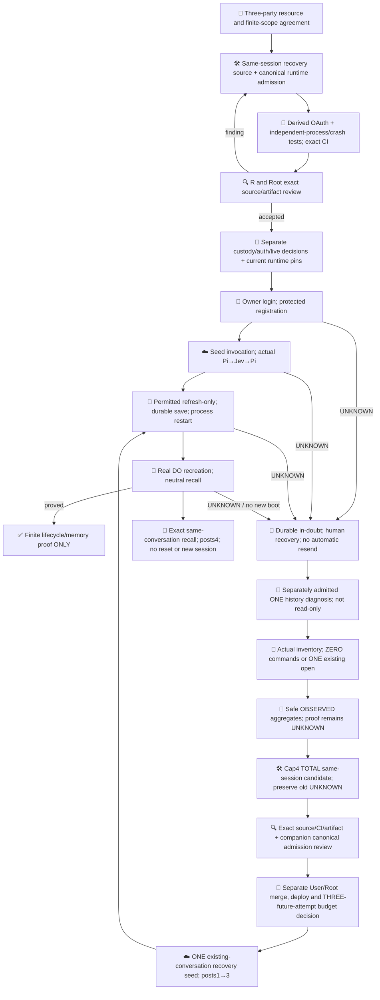

# Worker Pi / Jev bounded proof

This experiment keeps inference on the existing Cloudflare Worker. Its SQLite transcript is durable; ChatGPT access is volatile. The owner uses native commands only when needed, with no daemon, keepalive, Tunnel, token API or local inference.

[PR608](https://github.com/roccho-org/ops/pull/608) records the accepted source/runtime provenance and independently reviewed provider UI observability evidence. API observability `null` remains UNKNOWN; it is never normalized to off. [The three-party lifecycle design](https://github.com/roccho-org/ops/pull/608#issuecomment-6300038289) and [source authorization](https://github.com/roccho-org/ops/pull/608#issuecomment-6300229085) distinguish this finite proof from an ongoing product.

## Native credential lifecycle

The installed native Pi1.0.4 [AuthStorage](https://github.com/earendil-works/pi/blob/v1.0.4/packages/coding-agent/src/core/auth-storage.ts) provides cross-process locking, but writes in place after its callback; it cannot durably mark an uncertain refresh before sending. The operator therefore reuses the frozen MIT Pi OAuth/callback/PKCE implementation with a small native protected-record adapter. No coding-agent store is copied or full application imported.

Proposed owner custody is `/home/dev/.config/pi-worker-owner/registration.json`, directory0700/file0600. Root/same-UID processes remain trusted readers. All entrypoints take the same standard OS flock, reread current state, reject unsafe metadata/symlinks, write an exclusive private temporary file, fsync, rename and fsync its directory. An IN_DOUBT mark in the SAME registration is durable before initial/returning authorization or refresh. Only a complete validated atomic replacement becomes READY. Unknown results and failed persistence stay blocked across process restart; no rotating-token replay. A validated callback's issued client ID is persisted before token exchange, enabling explicit same-registration reauthorization after a lost initial response. No code, PKCE verifier or authorization URL is stored.

The deterministic derived SDK retains its original bytes and changes only native compatibility seams: validated subject/issued-client binding, retained ID token and actual expiry/earliest-refresh metadata; issued-client reauthorization; optional refreshed ID validation without an old nonce; redirect:error and generic token diagnostics. Workspace association is the registered-client binding, not an invented subject/email workspace claim. Optional ID-token hint is omitted from human URLs. Existing Worker Access validation behavior is unchanged.

The token reference names `earliest_refresh_at`; [pinned provider schema evidence](https://github.com/openai/sign-in-with-chatgpt-devkit/blob/0a36fefeb913055c8c7a1a29b63d82b96b2e841a/packages/local/src/index.ts#L100) establishes numeric Unix seconds or a timestamp string. Independently authored parsing accepts finite numeric seconds or a validated ISO instant, preserves the original field, and refuses malformed/unknown values. No vendor implementation is imported/copied or magnitude heuristic used. Explicit refresh waits until BOTH actual access expiry and this earliest bound; absent earliest uses actual expiry. No fake expiry, background loop or keepalive.

## Finite operator stages

After independent source/CI acceptance and separate custody/auth/effect decisions, run the native `operator/owner.mjs` with existing owner-terminal, URL/session/host/cloudflared arguments and explicit `--stage`:

- `login` creates a validated registration; `reauth` explicitly reuses its issued client/host.
- `seed --continue` authorizes bounded Worker recovery BEFORE bearer attachment, submits exactly one seed prompt, correlates the actual Jev call/result and Pi consumption, saves local expectations and exits.
- After an unlocalized seed UNKNOWN, a separately authorized `reconcile --continue` attaches to the SAME session and receives only its automatic root snapshot/inbox; it sends ZERO client commands. Attachment can resume paid engine work within the unchanged cap. Only posts=0 plus the complete root-only empty snapshot, empty activity/usage/inbox and no run/generation/tasks can save RECONCILED_EMPTY, retaining the original UNKNOWN. Nonempty, incomplete or ambiguous state stops. This is a current empty-state certificate, not proof of zero historical effects. After close/native exit and idle without probes, a separate first-seed GO authorizes another upgrade; changed boot/prior-token=false/posts=0 must be checked DURING that authorized upgrade BEFORE create/prompt. Idle alone does not prove eviction. There is no reset, automatic seed or replay.
- After the first reconciliation UNKNOWN, only separately authorized `reconcile --continue --forensic-once` can consume one forensic admission. The SAME lock requires retained seed UNKNOWN, first reconciliation UNKNOWN and no forensic marker; effective access must exceed now+30s before admission. The SAME record durably marks forensicOnce UNKNOWN BEFORE the CF child/WS, so local failure/crash/restart consumes it. Repeated flags and an ordinary reconcile refuse. EMPTY retains the current durable premark as originalUnknown, including both histories; no reset/refund/session change. This is one explicit potentially paid attempt, never an automatic retry.
- If forensic inspection observes nonzero admissions, separately authorized `history --continue` can consume ONE distinct same-record historyInspection UNKNOWN admission after fresh effective-expiry validation. It preserves seed/reconciliation/forensic audits and never marks EMPTY or SEEDED. Actual root-only history uses automatic frames with ZERO commands. Only root plus exactly one source-proven ownerless/no-parent nonroot, with actually empty root and activity, permits ONE existing conversation.open for that inventory ID. Multiple/task/fork/foreign/ambiguous state stops, with no first/latest guessing. Attachment/open may resume paid work within unchanged caps; no prompt/create/fork is sent. Only safe OBSERVED counts/fixed classifications are saved; no prompt, marker, assessment or provider error/body is published. Typed Jev evidence must correlate call ID/name, successful tool result and valid finite noul; the generic persisted model-error mask cannot identify its lost HTTP cause. No automatic seed recovery follows aggregate evidence. If a failed pre-Jev attempt consumed one admission, remaining2 cannot fit a fresh seed2 plus recall1; no new-session or budget permission is implied.
- The source candidate adds `seed --continue --recover-seed-once` ONLY after an inspected error-only history: one old user/one error assistant, zero completed/Jev, no pending/activity. Under the same lock, fresh effective access is checked before a durable consumed recovery mark retains the full prior UNKNOWN audit. Actual upgrade must report posts=1/prior-token=false; only root plus one eligible existing conversation with empty root may be opened once. Its actual error-only snapshot is revalidated and its current ID pinned before a new seed prompt. The old history did not retain an ID; no historical byte-equality is claimed. No create/fork/reset/refund or repeated recovery is allowed. The new seed needs two actual distinct completions and one correlated consumed Jev result; a later permitted refresh/native restart/recreated same-conversation neutral recall consumes the fourth TOTAL admission. This is three overall user inputs including the historical failed input, not a clean original two-input run. This candidate grants no added live budget or deployment authority.
- `refresh` performs only one permitted local renewal and atomic replacement; it never connects to the Worker.
- A later native process `recall --continue` requires that durable rotation, observes a different DO boot/prior-token absence on resupply, opens the SAME conversation and submits a neutral recall with no marker, assessment or history reinjection.

No native command retries a prompt after UNKNOWN. A socket connection may resume a persisted Harness task and is explicitly paid continuation, not a read-only status query. This source candidate raises the selected Worker cap to four TOTAL pre-send Responses admissions per selected session (the historical failed admission plus at most three new attempts) and one Jev allowance per proof conversation. Reconnect does not refund/reset it. No new operational budget or unattended/browser-only product is claimed. If prior work consumed the cap, this proof stops; it never creates a silent replacement session.

Future failed model messages are unconditionally redacted by the selected existing afterResponse hook. A per-provider-stream trace captures only its own pre-send admission and actual fetch response status/transport failure, then associates the SAME terminal object before the frozen Models.lazyStream/Harness receives it. Missing association is UNKNOWN; no global latest-status, provider-body/text fallback, extra attachment or debug API. HTTP200 is not completion. Native output accepts only the strict own failure envelope from that connection's terminal message; historical generic masks remain irrecoverable. Tests include interleaved lazy streams, HTTP401, HTTP200 named-SSE/failed events, transport exceptions, forged provider envelopes/private echoes and missing association. The deployed old cap3 runtime is unchanged until separately accepted canonical publication; candidate tests are keyless only.

Fixed phase-entry labels, observed numeric HTTP status, literal allowlisted error codes (OTHER/UNKNOWN otherwise), and upgradeSeen101 localize future failures without raw errors, frames, URLs, headers or tokens. AUTOMATIC_ROOT_WAIT begins only after socket open. A constructor error or actual socket event supplies diagnostics; no code/status means no causal or zero-effect conclusion. Phase entry is not completion or zero-effect evidence. The frozen pi-durable 1.2.0 real Session fixture asserts the automatic empty root baseline before any client command; native parser negatives and real loopback sockets separately verify strict reconciliation and ZERO outbound commands.

Keyless Node tests use synthetic private directories and real independent child processes, including SIGKILL after the premark and after a synthetic token response. They do not prove provider refresh, native custody, Worker inference or durable live memory. The existing Ubuntu workerd suite remains the mock-runtime evidence; known native workerd loader failure is not relabeled PASS. Artifacts contain explicit source/derived files only, never custody directories.

Policy remains roccho-dev/adrs@6e4abcd22dbee397105625b6041ce1a0d4720182. Source/CI results grant no merge, deployment, credential creation or paid-call authority. No ops#523 or Jev quality completion claim.

Primary basis: [SIWC Terms](https://openai.com/policies/sign-in-with-chatgpt-terms/), [registration/identity/atomic storage](https://developers.openai.com/siwc/token-sharing-open-source/sign-in), [issued-client reauthorization and serialized rotation](https://developers.openai.com/siwc/token-sharing-open-source/profiles-and-sessions), [token reference](https://developers.openai.com/siwc/token-sharing-open-source/token-reference), [VM custody guidance](https://developers.openai.com/siwc/token-sharing-open-source/self-hosted-vms). The VM guidance and Terms persistent managed-storage wording do not establish DO credential admission. This design selects owner-native persistence and transient same-user/app Worker access as an explicit interpretation, not provider endorsement or a blanket claim about all remote custody.
