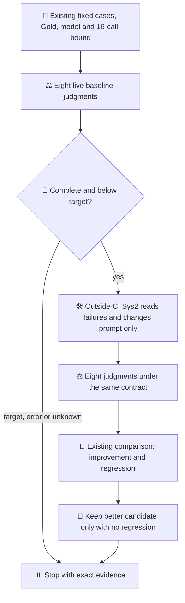

# One paired Jev development trial

Parent: [Ops523](https://github.com/roccho-org/ops/issues/523).
Design: [views 9–11](https://github.com/roccho-org/ops/issues/523#issuecomment-6262275138).

The 2026-10-19 User instruction authorizes a development PR and the improvement
loop through actual Jev evidence. This trial reuses the existing role-boundaries
development suite, evaluator, Gold and Jev client without changing them. Baseline
is eight calls; only a complete failed baseline allows one new prompt and eight
more calls. No retry or allowance refill. No old unused allocation is added.
Historical progress remains unchanged until actual execution can be reconciled.

`next.mjs` only selects the next decision from existing scored reports. It does
not execute models, persist a second ledger, change scoring, or make an unknown
result retryable. The workflow calls the existing evaluate/score commands and
keeps the key only in the evaluation step. A fresh output directory and native
first-attempt restriction prevent an ordinary rerun from spending again.

These are public, previously used development examples. New inference proves
only this finite paired trial, not unseen performance, independent Gold,
causal product benefit or autonomous CI-to-Sys2 resumption. Manual coordination
remains manual. Model drift/errors stop the trial; mock tests do not prove
quality. No merge, production adoption, provider configuration, secret copying,
new authentication, comment-trigger expansion or safety-refusal bypass.

Exact observations, source/run/artifact identities, all denominators, false
positives/negatives, tokens, time and unknown monetary costs belong in the PR.
