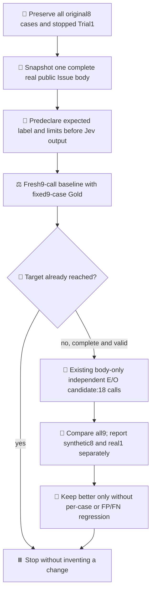
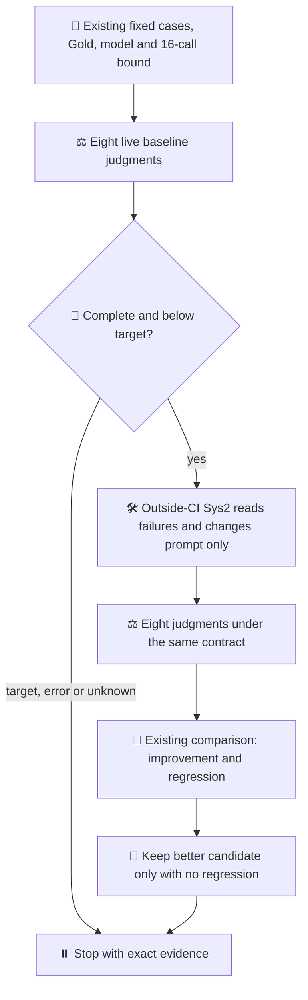

# One paired Jev development trial

Parent: [Ops523](https://github.com/roccho-org/ops/issues/523).
Design: [views 9–11](https://github.com/roccho-org/ops/issues/523#issuecomment-6262275138).

The 2026-10-19 User instruction authorizes a development PR and the improvement
loop through actual Jev evidence. This trial reuses the existing role-boundaries
development suite, evaluator, Gold and Jev client without changing them. Baseline
is eight calls; only a complete failed baseline allows one new prompt and eight
more calls. No retry or allowance refill. No old unused allocation is added.
Historical progress remains unchanged until actual execution can be reconciled.

## Trial 1 stop and explicit next finite trial

Fresh baseline run39219472578: 5/8, FP1/FN2, eight calls. Prompt-only
candidate run39220305535: 7/8, FP0/FN0, eight calls; resolves three mistakes
but regresses the observation-only case. Old Best is retained. This trial
stops at16; the higher score is not adoption or improvement without regression.
The paired observation is in-sample and provider nondeterminism is not excluded.

Under the same User instruction to continue until a finite improvement is
demonstrated, root selects a separate preregistered comparison using the
existing single-choice versus body-only independent E/O implementation and
existing binary-eo-v3 candidate. Before activation, the prospective24-call/40-total
draft was superseded to include a real case required by the development goal:
all original8 cases and Gold remain byte-for-byte prefixes, and one complete
public Issue482 body is added. DS acquired all6417 UTF-8 bytes; root separately
read back identical provider bytes. Its expected body_observation label and
basis were fixed before any new Jev output. This is body-role classification,
not completion of Issue482 consumer-quality work. It is not independent Gold.

The new baseline is9 calls and candidate18, with target9/9 and no regression.
Cases, Gold, model, labels, target and scoring are fixed within the new trial.
Original16-call Trial1 is untouched. The old80-call session default is preserved;
this new session explicitly binds27. Four native first-attempt phase runs bound
cumulative use to43 including Trial1. No fifth
phase, retry, automatic refill, new hidden allowance or experiment relabeling.
The next decision additionally rejects an increase in the existing FP/FN counts.
Those counts concern the specified violation classes, not every possible
multiclass confusion; correctness and individual regressions remain mandatory.
The new treatment changes question decomposition, body-only projection and
test-time compute together (9 versus18 calls). Any observed delta concerns that
combination, not a single-factor causal effect or lower cost. The finite bound
assumes the explicitly trusted owner controls this branch and keeps Actions
history; it is not isolation from a malicious owner or a provider quota.
Only the fixed role-boundaries and new all-task/complete nine-case suite are admitted. Deterministic archive
or incomplete-input short circuits are not model judgments or independent
quality. The split call plan now counts those branches without charging them
as model calls; the old fixed model pin is checked for this suite before use.

The fresh-consumer whole-plan deadline fixture failed at a fractional timer
boundary. A test-only clock advance now deterministically reaches expiry after
the first abort. Original no-second-fetch/accounting assertions and the real
per-call timeout control remain unchanged. This fixture checks deadline control
with an injected clock; it does not measure actual whole-plan elapsed time.
Production entry/client bytes are unchanged by that fix. Exact provided-byte
consumer CI must confirm it; local fixture success is not live Jev evidence.

Required CI correctly rejected the initially undeclared/unclassified workflow.
Root should have checked the effect boundary before the first live run. The
next live phase stays stopped until an explicit separate finite-proof boundary,
negative admission tests, independent readback and required CI pass. Existing
Issue-command/Environment rules are unchanged, not disabled or broadened.

`next.mjs` only selects the next decision from existing scored reports. It does
not execute models, persist a second ledger, change scoring, or make an unknown
result retryable. The workflow calls the existing evaluate/score commands and
keeps the key only in the evaluation step. A fresh output directory and native
first-attempt restriction prevent an ordinary rerun from spending again.

These are public, previously used development examples. New inference proves
only this finite paired trial, not unseen performance, independent Gold,
causal product benefit or autonomous CI-to-Sys2 resumption. Manual coordination
remains manual. Model drift/errors stop the trial; mock tests do not prove
quality. No merge, production adoption, provider configuration, secret copying,
new authentication, comment-trigger expansion or safety-refusal bypass.

Exact observations, source/run/artifact identities, all denominators, false
positives/negatives, tokens, time and unknown monetary costs belong in the PR.
