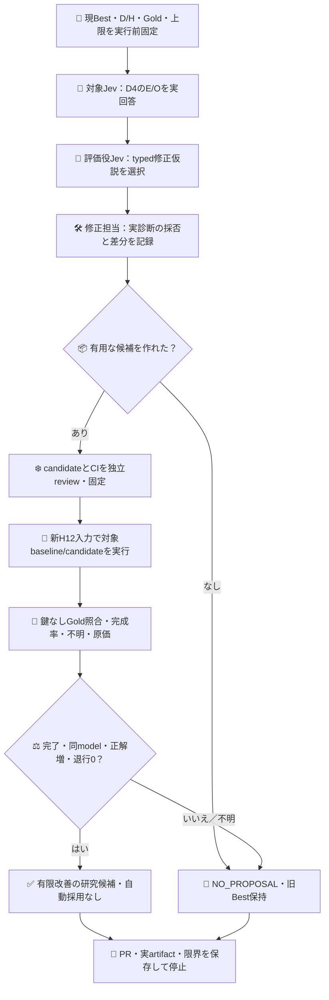
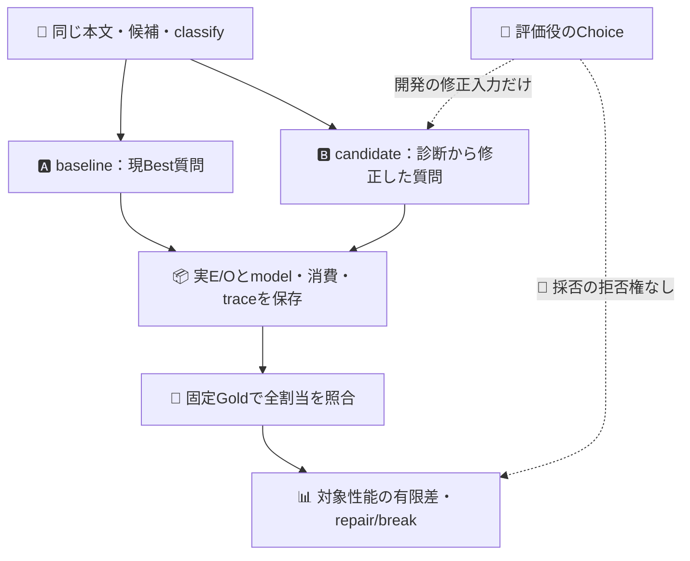

# 対象Jevを評価役の助言で改善する有限ループ

## 目的・役割・主張

対象JevはIssue本文のE（要求の存在）/O（観測の存在）を分類する。評価役Jevは対象の開発回答を点検し、既存Choice契約で修正仮説を選ぶ。修正担当local subがその実Choiceを採用/棄却して対象の質問設定を一度変更する。固定Goldとの通常コード照合が成果を評価する。評価役の合格は採用条件ではない。モデル重み更新、Apps接続、自動製品採用は行わない。

PR603は保存済み回答への評価役18判定の校正であり、対象改善の実証ではなかった。今回も旧43call・18call試行を再開しない。現Bestのbinary-eo-v3をbaselineとし、候補集合・本文投影・後段のclassifyは固定する。変更できるのは対象Jevの質問instructionsのみ。評価役自体の設定は同じ比較中に変更しない。

## 一周の有限契約

新しい架空の運用課題D4件・H12件とE/OのGold・根拠をfeedback-corpus.jsonに実行前固定する。旧9件の出力や言い換えを再採点する試行ではない。同じ意味課題familyの小標本であり、著者は修正担当と非独立。Hは今回のモデル実行・candidate選定には未使用だが、公開sourceで修正担当から読める。秘匿、学習未曝露、著者独立のholdoutとは呼ばない。外部採点は別のコード経路でありGold著者の独立性を意味しない。

Goldの適用範囲は当該機能への要求/現実の観測である。『実施を報告しない』『どちらも宣言しない』等の文書の読み方を限定するメタ説明を、それ自体で機能の進捗観測O=yesとは数えない。引用された語彙、架空の台詞も発話対象へ要求/観測として適用されているかで区別する。これは事前の意味契約であり、曖昧な場合は実行前にrootが反証できる。出力後にGoldを有利に変えない。

1. development: baseline E/O 2POST×4件=8、評価役診断1POST×4件=4、上限12。評価役はbodyと対象E/Oのみを見る。case ID/Gold/basis/過去正誤はmodel requestに渡さない。自由文rationaleは取得しない。
2. developmentの生Choice・source/run/artifactを保存。修正担当が各診断の採用/棄却とinstructions差分の対応をfeedback-candidate.jsonに記録する。candidateは事前に作らない。全no_change/有用な診断なしならNO_PROPOSALとしてこの周を閉じてよい。
3. candidate/sourceとCIを独立rootが確認後、confirmation: H12の新入力でbaseline/candidate E/Oを2POST×12件×2arm=48。caseごとにarm順を交替、candidate変更・Gold結果参照・best-of-k・retry/refillなし。上限はこの一周全体60POST、15秒/POST、各job16分。
4. 全回答完了後、鍵なしscoreで固定Goldに照合。全割当の完成率・正解/誤り/不明・repair/break・tokens/所要時間を保存。金額と人手原価はUNKNOWN（0ではない）。unknownのある実行はINCOMPLETEで採用不能。
5. 同じ報告model=jev-1.13.0、全件完了、candidate正解数増、baseline正解→candidate誤答0件かつ各caseの既存正解E/O軸の破壊0件なら有限改善の研究候補。それ以外は元Best保持。baselineが合成ラベルでは既に誤答でも、その中の正しい軸を壊して相殺する変更は受容しない。aliasはimmutable buildの証明ではない。有限例退行0を普遍的無退行・偽陽性0と呼ばない。

今回の2条件では対象設定変更の有限差だけを測る。評価役助言そのものの寄与はNOT_IDENTIFIED。次に必要なら同修正役・同予算の助言なし条件を設けるが、今回には追加しない。H結果を見て修正する場合はHを開発へ降格し、新しい集合・予算・source契約が必要。この一周で自動補充しない。

各armのE/O軸ごとにTP/TN/FP/FN/unknownを出し、分類合計だけで誤検出と見逃しの移動を隠さない。DではGold軸と実回答から期待診断を通常コードで算出し、実診断の一致・誤指摘・見逃し・誤軸・uncertain・unknownを報告する。対象2軸が完了して診断だけ失敗した場合、対象の観測済み正誤は保持し、phaseは未完了とする。confirmation前にはdevelopment実行sourceとのnative Git差分と実artifactから、corpus/Gold・baseline・評価役・実行器が不変で、追加が候補と証拠だけであることをrootが照合する。

## 実行・証拠境界

local subがW、rootが独立R。同じmodel/effortの追加はUser明示指示、旧DSは中断したまま再発火しない。DSの設計3round・source反証・artifact読戻しと関連調査を継承したが、DSの経験的成功や既存GOを捏造しない。policy0dd39ca41718fafe40e58c6927a2ebb0ea297eee共通契約。専用bare/.worktrees、専用branch、新PR、merge/close/配置/鍵変更なし。

標準Actionsはmarkerだけのpushで各phase一度起動。最初のdevelopment history1件、confirmation history2件で先行成功を確認し、attempt1のみ。native Git親・差分でreview sourceとactivationを対応させ、手転記blob SHA gateは追加しない。これはtrusted ownerの誤操作防止であり悪性owner/runnerの暗号attestationではない。既存Org JEV_API_KEYを評価stepだけに渡し値を取得/コピー/表示しない。旧workflowと必要checkは変更しない。

各attempt・answer・diagnosis・rowを逐次artifact用eventsとnative logへ保存。部分終了は終端不明のactualCalls:null・INCOMPLETEを残す。runner喪失時のuploadは保証しない。失敗・作用不明で同じphaseを再送しない。実artifact保存後はkeylessで再計算可能にする。現時点ではactivation未作成、実モデル0POST。
