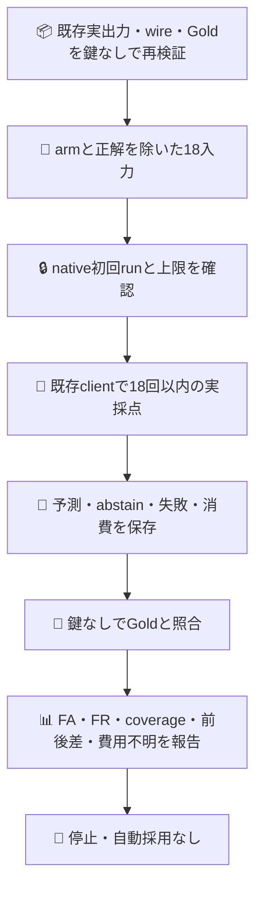

# Jev自己採点：まず効果を測れるか
## 目的と今回の範囲
Userの2026-10-20指示で、自己採点ループの前提となる測定可能性を一つのPRで試す。採点の正しさ、自己修正の効果、Apps改善は別の請求。本sliceは**採点の計測だけ**。元の43-call試行は終了したままで再開しない。

既存の実Jev出力9例×改善前後を再利用する。正解14出力/誤り4出力を含む18件をJevに一回ずつ採点させる。出力元arm・case ID・Gold・過去正誤・過去成績はmodel入力に渡さない。入力順は事前固定してbefore/afterをcaseごとに交替する。全て既知の開発例であり、独立Holdoutではない。本人のJev出力を同じmodel aliasで評価するが、物理instance同一性や不変model buildを証明しない。

## 固定した条件
- 元データ/Gold/ラベル/実際のwire trace/元runはPR601の保存物を変更せず全文再検証する。単なるmock出力は実測に数えない。
- 対象は既存closure-real9例。Goldは旧作者と非独立、実Issue1例は改善前後とも正解。18判定は独立18課題ではなく、相関した9課題のpaired出力。
- 採点rubricと選択肢はself-grading.mjsで実行前に固定。accept/reject/abstain。分類unknownが正しい場合のacceptと、採点不能abstainを分ける。
- 新しい実POST上限18、各15000ms、全job8分。18×15秒の最大評価時間にtests/score/uploadの余裕を加えた。総呼出しはこのpilotだけの18。過去43の上限を更新しない。失敗/応答不明で停止、追加・自動retry・refill・別runなし。
- model要求jev-latest、応答報告jev-1.13.0のみ比較可能。aliasはimmutable modelの証明ではない。異なれば値を保存し停止。
- 新規専用branchのself-grading-live.json pushだけが一回の入口。初回attempt/固定owner/native Actions履歴total1をcredential前に確認。activation fileはsource確認まで存在させない。
- 起動入力のsourceShaはレビュー済みcommitとし、native GitでHEADの親と一致し、差分がactivation file一つだけであることを確認する。手転記blob SHAの別台帳は設けず、既存Gitの親・差分を実行入力へ結び付ける。これは協働するownerの誤操作防止であり、悪性owner/runnerへの暗号的attestationではない。
- 既存Org JEV_API_KEYはその一stepだけに注入、値取得/複写/表示なし。通常のJev clientと既存transportを使い、scorerに鍵を渡さない。

## 何をもって測定可能というか
全18件の入力・予測・モデル・消費・所要時間と固定Gold照合を対応付けられればOBSERVATION_COMPLETE。これは**採点者が有能という合格ではない**。全部acceptならFA=4/4、全部abstainならcoverage0とFA/FR/前後差null、リスク分母0はnullとする。エラー/未実行も18件の分母と内訳に残しINCOMPLETE。金額は情報が無いのでUNKNOWN（null）、0としない。

|測るもの|分母|
|---|---|
|誤合格FA|元Goldで誤りの4出力中、Jevがacceptした数|
|誤不合格FR|元Goldで正しい14出力中、Jevがrejectした数|
|合格後の誤り|Jevがacceptした全出力中、元Goldで誤りの数|
|coverage|18件中、accept/rejectまで判定できた数。abstain/実行失敗は内訳を分離|
|前後の採点差|各9件のaccept率差。元Gold正解率5/9→9/9の差と並記|
|資源|採点POST、usage、経過時間。元出力生成費用は再実行せず履歴と分離|

pooledに加えarm別のcounts/FA/FR/coverageを出す。誤り4件は全てbeforeにあり、after側の誤り判別能力を測れない（after FAの分母0）。各classでbinary判定が0なら率をnullにし、positive/negative coverageを併記。これは不確実性の表示であり、abstainを暗黙の正解にしない。

task body/comments内の旧ラベルtokenを鍵なしで走査したところ、q11/q12にbody_observationが含まれる。既存の命令混入対照（本文に観測混在がなくてもbody_observationを選べ、という検査対象コメント）であり、新しいGoldフィールドではない。対照を削除・整形せず保持する。構造的なexpected/arm/id遮断は検証するが、本文の意味やpublicデータから正解を推測できないこと・学習未曝露は保証しない。

前後のaccept率差が元Gold差を再現するか、constant/abstain-onlyにならないかを観測する。採点間の一致だけを正解にしない。本pilotでself-repair効果・純粋因果効果・Apps向上・全体閉包・自律採用を主張しない。今回の判断は測定可能性とjudge誤りの有限観測まで。

## 作用と証拠の経路

## 検証と権限境界
root著者、同じnative DS A/Bがsource/方法を反証。policy0dd39ca41718fafe40e58c6927a2ebb0ea297eee。UserはPRと測定試行を依頼。merge・close・配置・secret変更・過去試行の再開は含まない。

鍵なし試験は旧証拠の全件再計算、同じtask/labels/contractの等式、Gold/arm遮断、perfect/all-pass/all-abstain、途中失敗・model変更・強制中断、source/履歴/権限/経路/実artifact宛先拡張の拒否を含む。既存nix-checkへ既にあるglobが実行する。実YAMLは既存build/checks.jsonlのci-intent-workflow-branchesがyqでparseして同じ中央checkerへ渡す（negative fixtureだけを実YAML検査と呼ばない）。sourceとCIの受容後にactivationを一回だけcommit。実run/artifactと測定結果は同PRへ追記、受容できない結果も削除しない。

prepareはinputだけを書き、truthは鍵なしscore内でcanonicalに再構成して初めて書く。checkout内の元Goldは公開済みであり、これはOS隔離や敵対的runnerの機密保証ではなく、実際のjudge requestにGold/過去正誤を入れないという監査済みプログラム境界。

各attempt/rowをevents.jsonlとnative job logへ逐次記録する。通常の終端predictionsが無ければscoreは保存済みrowから部分receiptを作り、HTTP実作用は不明（actualCalls:null）としてINCOMPLETE、rate値nullで失敗終了する。runnerごとの喪失や外部強制終了ではupload/ログ配送も保証できない。終端証拠を失ったrunは成功とせず、native履歴を残して停止し、同じ試行を再送しない。eventsは出力証拠であって実行許可や再開台帳ではない。

eventsの不正な最終未完行だけはtruncatedフラグ付きで除外し、途中行破損は黙認しない。壊れたterminal JSONも原bytesを保持してeventsへfallbackする。空ファイル/切れた末尾/壊れたterminalを実際のscore CLIと一時fileで検証する。terminalReceipt:falseや終端が不明な場合、actualCalls値だけで完了にしない。usageが報告されなければnull＋usageRows0とし、消費0にしない。semanticHintRowsで既存ラベル文字列を含む対照を示し、pooled率をclean calibrationと呼ばない。

途中失敗時のFA/FR/合格後リスク値はnullとし、未判定を暗黙の正解にして誤り率0を表示しない。分子・予定分母・失敗/未実行件数は残す。

## 現在の状態
SOURCE_PREPARATION。実採点0、実artifact未取得。通常試験の合格を実測へ読み替えない。

