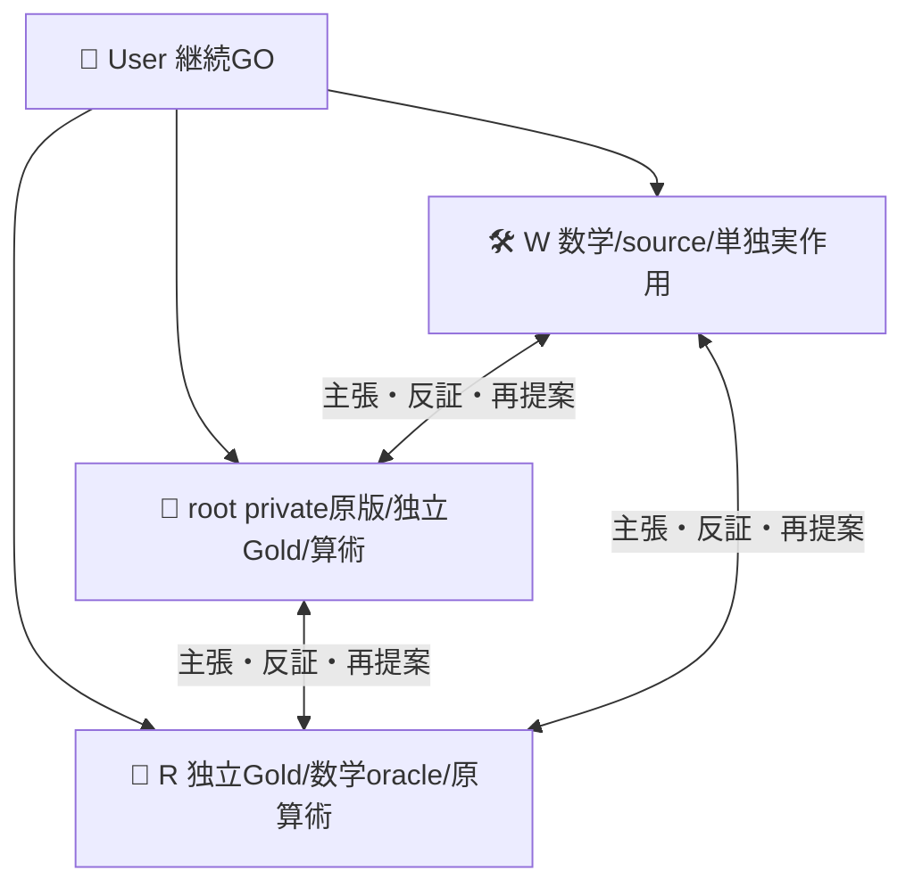
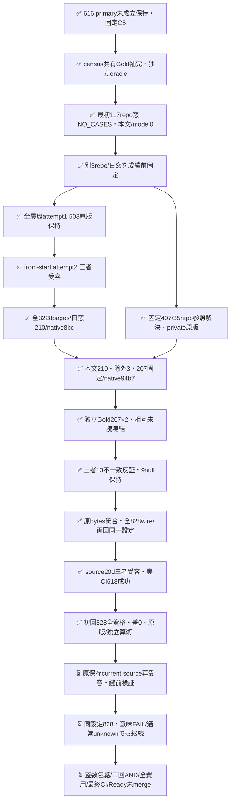

# 固定AND設定のcensus設計と別cohort契約

[PR616](https://github.com/roccho-org/ops/pull/616) は事前primaryで二回とも未成立、元Best維持・未採用の記録である。このsourceは同23を新式で採択救済せず、固定C5を変えないprospective設計と整数包絡を実装する。最初の117repo時間窓はsource8fの契約に従いmetadataのみ125呼出しで完了し、354 unique Issueのうちwindow内0/prefix0、NO_CASESとなった。本文取得・モデル呼出しは0。原247fileはnative `a74b93bd0ebf19ba87e46ac1f910e864c6e1aabd` に保持し、`metadata-zero/` のcompletion/prefixはその原bytes、custodyは出典を記す。予定窓に新対象がなかった結果であり、改善の実証ではない。

旧式はGoldnullをcase単位で独立の修復/破壊へ広げた。今回は同じcaseのBest/候補に**同じGold変数**を割り当て、既知E/Oに矛盾しない最大4補完を列挙し、完全正答差δと「以前正答だったいずれかの軸を破壊した」Rの可能範囲を保持する。同じ予測ならGold未知でもδ/Rは0。caseごと許す補完集合の直積に対して、差の最小/最大とR最小/最大のcase和は正確なcensus包絡になる。これは無作為抽出の信頼区間ではない。case間の意味的Gold整合制約を追加すればさらに狭まる可能性があり、sharpは宣言した許容集合に対しての意味である。

`feasible.mjs` はこの数学部品と全物理資格/モデル安定を分離する。欠測したmodel出力をGold補完で埋めず、技術unknown時の全体boundはnull。別軸Goldがnullでも既知軸の破壊を保持し、可能な退行だけなら観測退行と偽らずrobust受入を拒否する。数学fixtureは人工入力であり、実モデルの準拠や実gain証拠ではない。固定C5/fullwire/共有Eへの結合は後のnative reader責務で、任意設定をこの純粋関数の成功だけで実行許可しない。

## 現在の実データと初回の負結果

固定C5・Gold補完式・事前の三repo/UTC日窓/prefix300を変えず、全履歴metadata attempt2を正常終端した。5回の標準gh GraphQLコマンド、3228 Issue pages＋前後visibility2=3230観測response、322718 unique Issueから日窓210/prefix210。内部HTTP試行数はunknownで、コマンド数やpage数を実wire試行数と偽らない。原11files/52,326,302bytesはnative `8bc883c3607aba1b3a02c6e38f4e9d6ab3395301`。旧503原版は不変、DESC/provider-prefix代案は採用しなかった。

続く本文取得は標準gh212回（210 body＋前後visibility）で完了。knownID0/priorExactBody0/empty1/oversize2を全prefixに記録し、補充なしの全eligible **207件**をGold前に固定した。native `94b7a1ae68aee940c57f6304b5ff8c21f529839d` に217 body原filesとbody-only viewを保持。root/Rは全原応答・source/order/exclusions・実D5/H1の独立原requestを基に全4wireを再計算し一致した。公開のmetadata-complete-2/body-complete-1とDATA_PATHS六原fileの出典は `actual-data-custody.json` に記す。private全履歴/範囲外prior情報は公開しない。原receiptのAWAITING_NATIVE_RETAINは作成時点のstatusで、後のnative保存と独立受容を上書きしない。

root/Rは元split.mjsのE/O rubricだけで全207本文を互いの初稿・モデル予測未読のまま採点し、両初稿をnative `e7ad27694d2df0734eadc9a8a9e080e9eb28e27a` へ凍結してから比較した。194一致/13不一致をWも全本文で第三反証し、Testing参照を現在調査報告と読むか関連参照と読むか解消できない5軸と、既一致の4未確定を維持した。**9件が少なくとも一軸null**のまま全207に残る。同モデル・候補既知の採点者であり完全盲検や独立人間Goldとは称さない。外部画像/リンク先を補わず、候補criteriaをGoldの正本にしない。

corpus/合議の最初のnativeは `cbc49e606b5ff96fcc9e23546506c43fb215364a`。rootのschema綴り誤りだけを `b320e75b1c52ed33d0a54c11b3654b58fa1bf51e` で既存契約へ訂正し、旧原稿/全Gold/basis/body/source/order/初稿は不変。root/Rが訂正差分と全207値を独立照合した。Wはこの原bytesをそのまま統合し、validator/候補/selectionを変更していない。

自然構成はvscode150/nixpkgs50/cli7、Gold E=yes156/no51、O=yes188/no10/null9。repo等重みへ変更せず1 Issue一weightであり、O負例が少ない分布を全開発案件へ一般化しない。両回の全1656標準wireを鍵なしで構築し、stateはbodyだけ、最大serialized bytesはbestO20581/c2O22071/c4O21447/sharedE20530で全24000未満だった。Gold採点はprojectだけ、prepareはGold形式/原版結合検証だけを行い、判定/出典/rep情報はprovider stateへ送らない。

根拠: [実metadata原版](https://github.com/roccho-org/ops/pull/617#issuecomment-6299409804)、[実本文/Gold三者counter](https://github.com/roccho-org/ops/pull/617#issuecomment-6299825483)、[root code-only review](https://github.com/roccho-org/ops/pull/617#pullrequestreview-5589917376)、[R code-only review](https://github.com/roccho-org/ops/pull/617#pullrequestreview-5589886305)。source20dは三者受容と実618/618・consumer/health成功を閉じ、固定 **828 POST×2回=1656** の初回を一度実行した。初回は差0で未成立、二回目と全体の再確認は未完、未採用を維持する。全通常CIの最終exacthead終端・全raw/費用記録・Ready未mergeも残る。

## 固定初回の実結果（第二回前の保存）

[run39488014201](https://github.com/roccho-org/ops/actions/runs/39488014201) はsource20dのrequest-only child0fa7139c、push/attempt1、job118853422304。鍵前Ubuntu全keyless618/618→旧D5/native全raw prepare→標準client828→鍵なしproject→原artifactの全stepを正常終端した。artifact12295085396は782194bytes、GitHub digestと自己ZIP SHA256一致。

原input/predictions/events/attempt/projectionを `../results/census-and-pass1-20261021/` へ原bytesで保持し、provider実来歴・W再投影・root別算術を添えた。root/Rは各自取得したZIPと独立raw reader/期待request/Gold補完算術で全投影を再現した。**828全資格・modelStable、207論理case/Gold完全解決198・一軸null以上9、完全正答172→172、修復0/破壊0**。BestとANDのE/Oは全207で一致し、δ=[0,0]/207、R=[0,0]/207、NOT_ESTABLISHED。未確定9件を除いて差を作ることも、共通Gold補完式を後付け変更することもない。

物理input1,732,081/output25,668、total_tokensは828全件未提供でunknown。回内sharedEは一物理receipt。論理運用相当inputはBest=sharedE388,153+bestO392,086=780,239、AND=sharedE388,153+c2O498,070+c4O453,772=1,339,995。この二値の和はEを二重計上するため物理費用合計に使わず、金額や内部計算費用は不明。差0を追加資源による改善とは称さない。

次はこの原結果保存のcurrent sourceを独立受容し、影響分の鍵なし検証と既存CI同一性根拠を確認して、同じ全207/Gold/C5/全4wireの固定二回目828へ進む。意味未成立を理由に取消・候補変更・良い回選別しない。実model driftだけ既存技術停止。新通常CIは起動し、最終exactheadの必要全checks終端を維持する。

## 最初の時間窓契約とNO_CASES

候補は616で実D5から固定した `../reserve/and-selection.json` のC2/C4 ANDのまま。新候補生成も追加Dも行わない。既存native metadataの117 repo IDを使い、旧cutoff `2026-10-20T00:00:00Z` より後、新固定cutoff `2026-10-20T16:57:23Z` までにcreatedされた非PR Issueをmetadataだけで列挙する。createdAt＋immutable issue ID順の先頭最大300を**本文前に**固定し、全文eligibleで減っても補充しない。その全eligibleを新有限cohortのcensusとする。window全体への代表性、無作為抽出、意味/作者/案件の統計独立性は主張しない。

`metadata.mjs` の固定GraphQL queryは全OPEN/CLOSED Issueのid/number/createdAt/updatedAt/__typenameだけを選択し、body/title/comments/labelsを取得しない。[field選択](https://docs.github.com/en/graphql/guides/forming-calls-with-graphql#about-queries)と[cursor pagination](https://docs.github.com/en/graphql/guides/using-pagination-in-the-graphql-api)の一次根拠はRが独立調査した。標準ghの全終端と原APIを保持し、Search1000上限やupdated-sinceをcreated窓に代用しない。純粋readerは全117 ID/公開/page形状/終端とfield whitelistを検証するが、provider全件性・実gh正常終端・実native来歴を単独で証明しない。各native呼出しの固定query・非secret variables・exit・原replyを保持し、afterが直前endCursorに等しいchainをroot/Rが独立照合する。token付きHTTP debug/proxyは加えない。実collectorの事前受容は別であり、queryの存在をAPI作用許可にしない。

処理順はwindow内non-PR→immutable ID dedup（衝突はINVALID）→createdAt/locale非依存ordinal IDでsort→prefix300をnative固定→usedID/priorbody/empty/4wireのeligible除外→補充0。全既使用immutable Issue IDを現在repoに関わらず除外し、全既使用bodyの完全同bytesも除外する。根拠はproduct5c6の全retained experiments JSON、native034のframe全JSON/capture001..117の1376全raw body/typed Issue（afterCutoff/oversize等の除外も含む）、native256443の旧known-used-identitiesと034 frameのschema既知knownIssueNodeIds配列。この407blob recipeを今回cohortの取得前に固定し、今回のmetadata/prefix/body原版をpriorへ追加して自己除外しない。既存recursive prior抽出だけでprimitive ID配列を落とさず、型付き原意味を明示unionする。原本文をWへ再配送せずroot/Rが原bytes/全集合を独立照合し、scope外/private情報は公開manifestへ入れない。

タイトル/コメント/リンク先を補わずwholebody、全4wire24000 serialized bytes未満、切詰めなし。新Issue identityでも意味的新規性・言い換え/引用なし・pretraining未見・同作者/同template独立性は保証しない。新frame内の同bodyは各Issue一weightを保ち、template構成/Gold整合を記述・裁定し、意味dedupしない。createdAt・metadata updatedAt・実body updatedAt/retrievedAtを保持し、metadata固定後に編集されても取得版の観測として固定し、成績を見た除外をしない。原候補全件と除外理由を保持する。root/Rは予測と相互初稿を未読で独立Goldをnative凍結後に比較・合議/null、Wへは固定cohort原版だけを渡す。実MをGold/予測前にnative固定する。M0ならNO_CASES/作用0を保存し、窓を後付け拡大して成功へ救済しない。

採取は既存gh/原API保持/全pagination終端/1時間境界を再利用する。固定IDの公開状態を本文前後で観測し、変更/不明は全frame invalid。非原子的認証APIのvisibility raceを絶対0とは言わず、失敗原版は私的保持して公開/実測へ渡さない。新認証/独自executor/ledgerを増やさない。

固定二回は各4M/max1200 POST、合計max2400。回内sharedE・回間別receipt、両component必須・no短絡なし・資格不明ならderived unknown、native/derived/論理費用を区別する。全物理資格・expectedmodel・δmin>0・Rmax=0を**両回**必要とし、平均/良い回/意味結果で二回目を取消さない。j4は継続履歴でありalpha resetや95%/将来性能保証をしない。実際の原scope/wholebody/fullwire/native来歴の受容は後段の条件。

旧170/250分jobをそのまま使えない。1200×15秒=300分＋鍵前検証/prepare/project/upload余裕30分でubuntu-24.04/330分を実装した。通常hosted上限[6時間](https://docs.github.com/en/actions/reference/limits)と[timeout規則](https://docs.github.com/en/actions/reference/workflows-and-actions/workflow-syntax#jobsjob_idtimeout-minutes)の範囲内だが、完了保証ではない。一次資料はRの独立調査、root/Wはその根拠と実sourceを反証する。workflow/秘密境界はdd99でcode-only受容済み。今回の実データ統合source/必要CI/三者受容前の実作用は0。

## 別cohortの事前契約（外部公開開発案件）

元windowは広げず、別の `external-plan.json` に `cli/cli`・`NixOS/nixpkgs`・`microsoft/vscode` を内容/Gold/予測未見で固定する。CLI・package infrastructure・editorという選択理由は便宜的な対象宣言で、代表性や作者/意味の独立性の根拠ではない。欠落/private/不明でも差替え・追加・削除しない。英語やIssue様式の分布差を記述し、Ops/Appsや言語全体の改善と称さない。

`external.mjs` のrepository metadata-only queryをfbd sourceで標準ghから一回ずつ計3呼出し実行し、3つのpublic/issue-enabled immutable IDを確認した。root/Rが全query/variables/exit/repliesを別再生し、native `2881999e43ff27d45efae7506bd4130c1eb62829` に7原fileを保持。`external-scope/` に同7原bytesとcustodyを保存した。そのscope確認時点ではIssue metadata/本文/モデル呼出しは0だった。このscope確認の受容を、後段の取得・実測許可へ読み替えない。

新windowは前UTC完了日 `2026-10-19T00:00:00Z <= createdAt < 2026-10-20T00:00:00Z` とし、件数を見る前に固定。3repo合同のcreatedAt/ordinal Issue ID prefix300を本文前に保持、既使用/全文/wire除外後に補充しない。高流量repoがprefixを占め得るが、結果を見たrepo別割当へ変更しない。既知407原版の530 Issue ID/1708 bodyに、同原版の2211参照URLから3scope内で型解決したIssue IDを本文前に加える。参照を本文既読と同一視せず、PR型やscope外/private情報を公開Issue manifestへ混ぜない。

C5・原Best・式・二回AND・全分母/資格/未知・最大2400/330分案は不変。NO_CASESならその契約も保持し、日付やrepoを後付け変更して救済しない。三者反証で、追加のupdatedAt>=createdAt仮定を要するsince案は採用せず、全履歴標準cursor終端を1時間のtechnical capで取得する方式を選んだ。Search/updated-since/日付による途中停止なし。未完はINVALIDで原版保持し、早く得た分だけをprefixにしたり再送・別repoへ切替えたりしない。全3scope公開状態を前後確認し、各query/非secret variables/exit/原replyとcursor chainをroot/Rが検証する。1時間は完了の保証ではない。

`issue-pages.mjs` は旧117と新3scopeのpage形状/field whitelist/UTC filter/ordinal prefixだけを共有するpure reader。旧default queryと境界は維持し、旧native a74の117 raw全再生で354/window0/prefix0と全既存出力・query一致を確認した。`external-issues.mjs` は保存された3scope原capturesを再生し、実scope ID・元名称・mode/window/max300/1時間へ拘束する。providerの完全性・実after=前endCursor・公開確認・native来歴はpure reader単独では証明せず、標準host原traceの独立検証を必要とする。原pageをtraceとcaptureへ二重物理複写せず、traceからメモリpagesを作ってreaderへ渡してよい。本文materializerは後段のpure sourceとして実装済みで、実body host/provider入口の受容は別段階である。

追加counterとして全typed Issue IDのmetadata整合性をwindow filter前にも検証する。同IDのoutside→insideやoutside同士のfullrow矛盾をINVALIDとし、同一duplicateは原row/既存window内countを保持する。updatedAtは可変なので差分をprovider不正と断定せず、非原子的capture内の版整合が成立しない技術状態として扱う。source30ed取得は途中再起動せず原source/rawを保持したが、call01860のHTTP503でFRAME_INVALIDとなり受容可能prefixはない。成功した原replyも新readerとroot/Rの独立full-ID mapで診断するが、partialからframeを作らない。原30edがこの強化を元から保証したとは称さず、矛盾なしの実再生後だけprefix不変を受容し、再取得や除外で整えることはしない。

既使用参照の型解決は全history取得とは別の1時間以内のmetadata-only stageとして本文前に行う。`prior-references.mjs` の標準queryを使い、固定407由来の参照2211から全distinct repo名（現在35）をmetadata IDへ解決してからscope IDで絞る。直接名一致が0でもこの段階を省かない。scope内だけIssueOrPullRequestをIssue/PullRequest別fragmentで問い合わせ、typename/idと子の現在repositoryを検証する。子repoのID/name/publicが親と固定scopeへ一致しなければ、移管/redirect/private/nullをINVALIDとして原版を保持し、推測で現在publicとしない。Issue IDを既知530へunion、PRは混ぜない。null/不明・private/outside原metadataは私的保持し、既知scope aliasの未解決・矛盾ID・scope内型解決失敗はINVALIDとする。`knownScopeAliases` は原版で結合が証明されたname/expected repositoryIdの組だけをroot/Rが渡し、現在scopeの元名も対応するexact IDに拘束する。別scope IDやnull/privateへの変化も拒否する。全global既知ID集合はprivate resolutionとして保持し、case除外へ使う。公開projectionは現在の公開scope内typed参照/同Issue IDと集計だけに分け、scope外/private IDや存在情報を増やさない。標準hostでの全入力・query/variables/原応答・全coverageの受容は別に必要である。

## 最小系列と完成条件

### 全history取得失敗と別の事前回復契約

source30edの一回取得は2026-10-20T17:45:22.085Z～18:20:50.705Z、call01860のHTTP503でFRAME_INVALIDとなった。成功1859 replyと失敗argv/variables/stdout/stderr/exit等1863原fileはnative `cd3d2a1f244c43b63eb9ca6721b70252de229ae9` に保持する。`metadata-failed-1/attempt.json` と `invalid.json` は原bytes。完了prefix/本文/Gold/model測定はなく、partial採択・再開で救済しない。

`external-recovery-plan.json` は同じ評価contract2/round4の別metadata attempt2を事前に定める。変更は標準 `gh api graphql --paginate --slurp` によるfrom-start一回と、標準GraphQL extensionsへの読み取り整合だけで、三repo/日窓/全履歴/全ID整合/prefix300/1時間/C5/407prior/Gold/判定基準を変えない。query/初期variables/CLI版とargv、全slurp原stdout/stderr/exitを保持し、正常終端時だけ全pageを再生する。CLIの三Issue＋前後二visibilityの五GraphQL起動と、観測response page数を区別し、内部HTTP試行数はunknown。503再送機能を標準CLIが保証するとは言わず、失敗時は全attempt INVALIDを保持し自動retryしない。新captureは別source/時刻であり旧30edの完走ではない。failed metadataを同cohortの既固定priorへ足して自己除外もしない。

実成功replyにあった警告は[GraphQL標準extensions](https://spec.graphql.org/September2025/#sec-Extensions)であり、旧readerのroot data-only制約は潜在的不整合だった。新readerはroot optional map extensionsを選択dataと分けて許容し、dataのfield whitelist/型/日時/identity検査は保つ。extensions原文は私的保持し公開prefixへ投影しない。[GitHubのID二形式](https://docs.github.com/en/graphql/guides/migrating-graphql-global-node-ids)を理由にIDをdecode/自動置換したりmigration headerを加えたりしない。原失敗の直接終端原因はHTTP503であり、後から警告だけの失敗へ書き換えない。回復の実host/三者受容前に新APIを開始せず、本文/provider経路も引き続き別途受容する。

### 計測部品と固定native entry（実207件・初回828原版保持）

`measurement.mjs` は既存reserveの四物理request/厳格資格/会計を、閉じた二contextだけで共有する。旧reserveは23件/92POST・旧schema/全fieldsetを保ち、新censusだけ受容済corpusからM=1..300・4Mを導く。任意schema/上限/endpoint/constructorを入力から選ばせない。標準recorderの実経路をdummy keyとfetch stubで通し、最大1200POST、欠測、モデル変化、既知軸退行と欠測の併存を検査する。人工fixtureは実HTTPやgain証拠ではない。

新projectionは原input/report/eventsと同じcorpus/Gold/固定selectionから毎回再構成する。二回の集計もrep/ID/分母/資格情報を照合するが、これだけではnative来歴やGold不変を証明しない。固定native entryは原sourceのcorpus全値・body/Gold・実D5 fullwireへ結合し、両回の原rawを再投影する。実frame/Gold・通常CI・独立受容は別に必要である。意味FAILや通常unknownで予定二回目を取消さず、実model driftは技術停止として保持する。新workflowは固定branch上のrequest-only childだけを受け、census1/2のnative履歴と実Git親/requestを拘束する。原corpusは実frame全eligible行のid/bodyをそのまま使い、sourceへ残り全属性を保持する既存real-case-corpus.v1/round4/frameSizeMである。第二回では初回provider.sourceのGit値とcorpus/body/Gold/selection全値を比較し、同じ点数だけで同一と見なさない。prepare鍵前に旧実D5全raw/native/selectionを再生し、秘密は標準clientのevaluateだけへ渡す。330分は最大1200×15秒=300分＋鍵前/保持余裕30分というcapで完了保証ではない。実corpus/Gold207件を原bytesで配置した。request-only childで初回828を実行済み。次のrequestは固定二回目だけで、同じ初回の再送は許容しない。

### 本文materializer（実取得と独立原版照合を完了）

`body.mjs` / `body-contract.json` はmetadataとpriorの実原版受容後のwholebody段階を実装する。metadataの自称statusだけを採用せず、同native revision由来のcompletion/prefix/source/count/time一致・invalid不在を要求する。pure関数はcallerが与えたnative文字列自体を認証できないため、標準hostが実Git原版・無invalid・全query/cursor原traceの独立受容を結合する。新copied-SHA gateや別台帳は作らない。private prior ID union/body集合も固定407＋実型解決の受容済み原版から渡す。

prefixの既知IDは本文前に除外し、残りだけをimmutable Issue node queryで元順に一回取得。本文を切詰めず、exact prior body→empty→全4wire24000 bytes未満の順で判定し、除外理由を全prefix分残して補充しない。子repoのID/現在名/public、Issue ID/number/createdAtを照合、metadata updatedAtと取得本文updatedAt/retrievedAtを別保持する。前後両snapshotが同じ別名でも固定3repo元名への一致を要求し、全capが公開観測内/全1hに収まることを検証する。非原子的raceは絶対0と称さない。

C5検証は既存reserveのfrozen configurationをexport aliasで再用し、旧関数本体/23行schema/92予算は変えない。標準request builderとkeyless wire captureでactual selectionの全4templateと各本文の上限を検証し、Jevの実network/資格情報を使わない。新frame内同bodyはIssueごとのweightを保つ。original Gold rubricでの独立初稿/native凍結/三者合議を完了し、9件の未確定を残した。provider/native entryはdd99でcode-only受容・Linux実617 tests/通常16 checksを完了した。今回の実data統合sourceは独立reviewと影響分の必要CIを別に閉じ、人工fixtureや旧CIを新head全成功・実gainへ読み替えない。

未使用の証拠範囲は、実保持した530 typed Issue ID/1708 exact bodyと今回の公開scope内追加型解決との非重複である。35repo名のID解決だけでは、scope外の旧Issue URLが移管/redirectで新scopeへ入った可能性まで排除しない。参照URLは本文観測と同じではなく、未解決/scope外の2211参照残余は私的metadataとして保持する。「全参照Issueを世界全体で未使用」「全actorの生涯未読」「意味/学習未見」と称さない。この限界を隠す全2211追加問い合わせや、本文/成績を見た除外変更は行わない。

参照型解決の実stageはsource4bで正常終端した。固定407原版を再構成して全530 ID/1708 body/2211 refs一致を確認後、全35repo名を標準ghでmetadata解決し、現在3scope内参照0/typed問い合わせ0、本文/model0。root/Rは全query/variables/reply/型・privacy projectionを独立再生し、native `38d5ef5bb3233fa4976a7f74dd83102bdafc2e4f` に40原fileを保持した。`prior/completion.json` は原bytes、`public-manifest.json` はprivate resolution内publicManifestのJSON値投影であり、private全体blobのbytecopyと偽らない。global530 IDs/原1708 bodiesとscope外/private応答は公開せず、本文除外のprivate入力として保持する。全history metadataの別source30edは503で失敗原版を保持し、当時は受容可能prefixがなく本文API0だった。その失敗原版を保持したまま、別attempt2で全履歴終端・実本文207 eligibleの原版受容を完了した。

同repo/Issue523、同policy0dd39、同三者・W sole writer。baseは616最終source5c6d9c44d786d9af054768a62272c84fa9802871。この一PRを、実数学→metadata/body取得契約/collector→native原frameと独立Gold→固定二回→全raw/独立算術/費用/最終CI/Ready未mergeの順に進める。後続PR番号や成功を先に作らない。cross-PR gateは `fixed-c5-prospective-census-closure` とし、入力は616不変原版/actualC5 proofと当PR最終tree・新cohort native/両回raw、失敗条件は旧判定改変/設定drift/不完全原版/資格不明/片回未達/未閉CIである。既存native原版・通常CI・独立reviewの結合条件を説明する名称で、独自管理・台帳・別基盤を追加しない。固定native entryは実装済みで、実データ統合の独立受容と必要CIを実作用前に必要とする。

C5は元BestよりO呼出しを一つ多く使う追加資源bundle。新二回で得るのも固定集合の観測精度差と未確定Goldに対するrobust整数包絡であり、同原価改善・モデル重み向上・backend固定・未来期待性能・実製品E2E・費用改善は未証明のままにする。

通常技術FAILは同三者で是正する。取得/モデル作用は新source・原版・必要CI・三者受容を閉じてから。結果不明はnative実体を読戻しblind resendしない。616通常CIの新FAILがあればupstream是正を優先し、下流を整列・再検証する。未達やM0も保存し、採用/mergeは別許可のまま。

