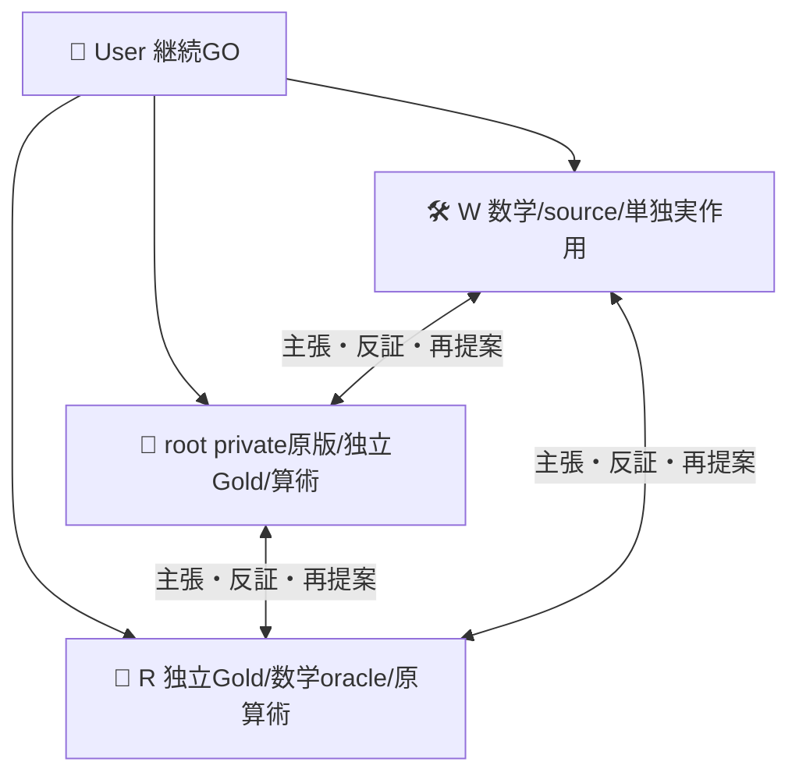
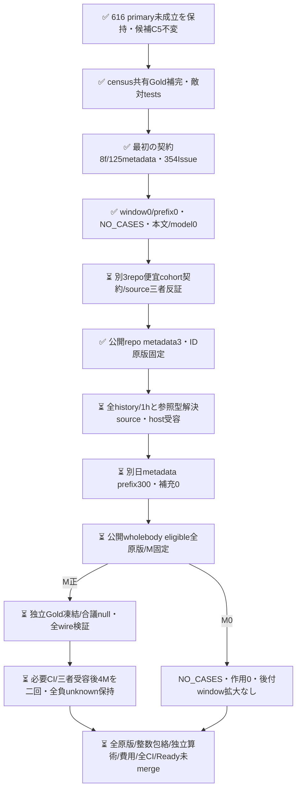

# 固定AND設定のcensus設計と別cohort契約

[PR616](https://github.com/roccho-org/ops/pull/616) は事前primaryで二回とも未成立、元Best維持・未採用の記録である。このsourceは同23を新式で採択救済せず、固定C5を変えないprospective設計と整数包絡を実装する。最初の117repo時間窓はsource8fの契約に従いmetadataのみ125呼出しで完了し、354 unique Issueのうちwindow内0/prefix0、NO_CASESとなった。本文取得・モデル呼出しは0。原247fileはnative `a74b93bd0ebf19ba87e46ac1f910e864c6e1aabd` に保持し、`metadata-zero/` のcompletion/prefixはその原bytes、custodyは出典を記す。予定窓に新対象がなかった結果であり、改善の実証ではない。

旧式はGoldnullをcase単位で独立の修復/破壊へ広げた。今回は同じcaseのBest/候補に**同じGold変数**を割り当て、既知E/Oに矛盾しない最大4補完を列挙し、完全正答差δと「以前正答だったいずれかの軸を破壊した」Rの可能範囲を保持する。同じ予測ならGold未知でもδ/Rは0。caseごと許す補完集合の直積に対して、差の最小/最大とR最小/最大のcase和は正確なcensus包絡になる。これは無作為抽出の信頼区間ではない。case間の意味的Gold整合制約を追加すればさらに狭まる可能性があり、sharpは宣言した許容集合に対しての意味である。

`feasible.mjs` はこの数学部品と全物理資格/モデル安定を分離する。欠測したmodel出力をGold補完で埋めず、技術unknown時の全体boundはnull。別軸Goldがnullでも既知軸の破壊を保持し、可能な退行だけなら観測退行と偽らずrobust受入を拒否する。数学fixtureは人工入力であり、実モデルの準拠や実gain証拠ではない。固定C5/fullwire/共有Eへの結合は後のnative reader責務で、任意設定をこの純粋関数の成功だけで実行許可しない。

## 最初の時間窓契約とNO_CASES

候補は616で実D5から固定した `../reserve/and-selection.json` のC2/C4 ANDのまま。新候補生成も追加Dも行わない。既存native metadataの117 repo IDを使い、旧cutoff `2026-10-20T00:00:00Z` より後、新固定cutoff `2026-10-20T16:57:23Z` までにcreatedされた非PR Issueをmetadataだけで列挙する。createdAt＋immutable issue ID順の先頭最大300を**本文前に**固定し、全文eligibleで減っても補充しない。その全eligibleを新有限cohortのcensusとする。window全体への代表性、無作為抽出、意味/作者/案件の統計独立性は主張しない。

`metadata.mjs` の固定GraphQL queryは全OPEN/CLOSED Issueのid/number/createdAt/updatedAt/__typenameだけを選択し、body/title/comments/labelsを取得しない。[field選択](https://docs.github.com/en/graphql/guides/forming-calls-with-graphql#about-queries)と[cursor pagination](https://docs.github.com/en/graphql/guides/using-pagination-in-the-graphql-api)の一次根拠はRが独立調査した。標準ghの全終端と原APIを保持し、Search1000上限やupdated-sinceをcreated窓に代用しない。純粋readerは全117 ID/公開/page形状/終端とfield whitelistを検証するが、provider全件性・実gh正常終端・実native来歴を単独で証明しない。各native呼出しの固定query・非secret variables・exit・原replyを保持し、afterが直前endCursorに等しいchainをroot/Rが独立照合する。token付きHTTP debug/proxyは加えない。実collectorの事前受容は別であり、queryの存在をAPI作用許可にしない。

処理順はwindow内non-PR→immutable ID dedup（衝突はINVALID）→createdAt/locale非依存ordinal IDでsort→prefix300をnative固定→usedID/priorbody/empty/4wireのeligible除外→補充0。全既使用immutable Issue IDを現在repoに関わらず除外し、全既使用bodyの完全同bytesも除外する。根拠はproduct5c6の全retained experiments JSON、native034のframe全JSON/capture001..117の1376全raw body/typed Issue（afterCutoff/oversize等の除外も含む）、native256443の旧known-used-identitiesと034 frameのschema既知knownIssueNodeIds配列。この407blob recipeを今回cohortの取得前に固定し、今回のmetadata/prefix/body原版をpriorへ追加して自己除外しない。既存recursive prior抽出だけでprimitive ID配列を落とさず、型付き原意味を明示unionする。原本文をWへ再配送せずroot/Rが原bytes/全集合を独立照合し、scope外/private情報は公開manifestへ入れない。

タイトル/コメント/リンク先を補わずwholebody、全4wire24000 serialized bytes未満、切詰めなし。新Issue identityでも意味的新規性・言い換え/引用なし・pretraining未見・同作者/同template独立性は保証しない。新frame内の同bodyは各Issue一weightを保ち、template構成/Gold整合を記述・裁定し、意味dedupしない。createdAt・metadata updatedAt・実body updatedAt/retrievedAtを保持し、metadata固定後に編集されても取得版の観測として固定し、成績を見た除外をしない。原候補全件と除外理由を保持する。root/Rは予測と相互初稿を未読で独立Goldをnative凍結後に比較・合議/null、Wへは固定cohort原版だけを渡す。実MをGold/予測前にnative固定する。M0ならNO_CASES/作用0を保存し、窓を後付け拡大して成功へ救済しない。

採取は既存gh/原API保持/全pagination終端/1時間境界を再利用する。固定IDの公開状態を本文前後で観測し、変更/不明は全frame invalid。非原子的認証APIのvisibility raceを絶対0とは言わず、失敗原版は私的保持して公開/実測へ渡さない。新認証/独自executor/ledgerを増やさない。

固定二回は各4M/max1200 POST、合計max2400。回内sharedE・回間別receipt、両component必須・no短絡なし・資格不明ならderived unknown、native/derived/論理費用を区別する。全物理資格・expectedmodel・δmin>0・Rmax=0を**両回**必要とし、平均/良い回/意味結果で二回目を取消さない。j4は継続履歴でありalpha resetや95%/将来性能保証をしない。実際の原scope/wholebody/fullwire/native来歴の受容は後段の条件。

旧170/250分jobをそのまま使えない。1200×15秒=300分＋鍵前検証/prepare/project/upload余裕30分でubuntu-24.04/330分を次実装案とする。通常hosted上限[6時間](https://docs.github.com/en/actions/reference/limits)と[timeout規則](https://docs.github.com/en/actions/reference/workflows-and-actions/workflow-syntax#jobsjob_idtimeout-minutes)の範囲内だが、完了保証ではない。一次資料はRの独立調査、root/Wはその根拠と実sourceを反証する。新workflow実装・秘密境界受容前の実作用は0。

## 別cohortの事前契約（外部公開開発案件）

元windowは広げず、別の `external-plan.json` に `cli/cli`・`NixOS/nixpkgs`・`microsoft/vscode` を内容/Gold/予測未見で固定する。CLI・package infrastructure・editorという選択理由は便宜的な対象宣言で、代表性や作者/意味の独立性の根拠ではない。欠落/private/不明でも差替え・追加・削除しない。英語やIssue様式の分布差を記述し、Ops/Appsや言語全体の改善と称さない。

`external.mjs` のrepository metadata-only queryをfbd sourceで標準ghから一回ずつ計3呼出し実行し、3つのpublic/issue-enabled immutable IDを確認した。root/Rが全query/variables/exit/repliesを別再生し、native `2881999e43ff27d45efae7506bd4130c1eb62829` に7原fileを保持。`external-scope/` に同7原bytesとcustodyを保存した。Issue metadata/本文/モデル呼出しは0。このscope確認の受容を、後段の取得・実測許可へ読み替えない。

新windowは前UTC完了日 `2026-10-19T00:00:00Z <= createdAt < 2026-10-20T00:00:00Z` とし、件数を見る前に固定。3repo合同のcreatedAt/ordinal Issue ID prefix300を本文前に保持、既使用/全文/wire除外後に補充しない。高流量repoがprefixを占め得るが、結果を見たrepo別割当へ変更しない。既知407原版の530 Issue ID/1708 bodyに、同原版の2211参照URLから3scope内で型解決したIssue IDを本文前に加える。参照を本文既読と同一視せず、PR型やscope外/private情報を公開Issue manifestへ混ぜない。

C5・原Best・式・二回AND・全分母/資格/未知・最大2400/330分案は不変。NO_CASESならその契約も保持し、日付やrepoを後付け変更して救済しない。三者反証で、追加のupdatedAt>=createdAt仮定を要するsince案は採用せず、全履歴標準cursor終端を1時間のtechnical capで取得する方式を選んだ。Search/updated-since/日付による途中停止なし。未完はINVALIDで原版保持し、早く得た分だけをprefixにしたり再送・別repoへ切替えたりしない。全3scope公開状態を前後確認し、各query/非secret variables/exit/原replyとcursor chainをroot/Rが検証する。1時間は完了の保証ではない。

`issue-pages.mjs` は旧117と新3scopeのpage形状/field whitelist/UTC filter/ordinal prefixだけを共有するpure reader。旧default queryと境界は維持し、旧native a74の117 raw全再生で354/window0/prefix0と全既存出力・query一致を確認した。`external-issues.mjs` は保存された3scope原capturesを再生し、実scope ID・元名称・mode/window/max300/1時間へ拘束する。providerの完全性・実after=前endCursor・公開確認・native来歴はpure reader単独では証明せず、標準host原traceの独立検証を必要とする。原pageをtraceとcaptureへ二重物理複写せず、traceからメモリpagesを作ってreaderへ渡してよい。本文materializerとprovider入口は未実装である。

既使用参照の型解決は全history取得とは別の1時間以内のmetadata-only stageとして本文前に行う。`prior-references.mjs` の標準queryを使い、固定407由来の参照2211から全distinct repo名（現在35）をmetadata IDへ解決してからscope IDで絞る。直接名一致が0でもこの段階を省かない。scope内だけIssueOrPullRequestのtypename/idを問い合わせ、Issue IDを既知530へunion、PRは混ぜない。null/不明・private/outside原metadataは私的保持し、既知scope aliasの未解決・矛盾ID・scope内型解決失敗はINVALIDとする。`knownScopeAliases` は原版で結合が証明されたname/expected repositoryIdの組だけをroot/Rが渡し、現在scopeの元名も対応するexact IDに拘束する。別scope IDやnull/privateへの変化も拒否する。全global既知ID集合はprivate resolutionとして保持し、case除外へ使う。公開projectionは現在の公開scope内typed参照/同Issue IDと集計だけに分け、scope外/private IDや存在情報を増やさない。標準hostでの全入力・query/variables/原応答・全coverageの受容は別に必要である。

## 最小系列と完成条件

同repo/Issue523、同policy0dd39、同三者・W sole writer。baseは616最終source5c6d9c44d786d9af054768a62272c84fa9802871。この一PRを、実数学→metadata/body取得契約/collector→native原frameと独立Gold→固定二回→全raw/独立算術/費用/最終CI/Ready未mergeの順に進める。後続PR番号や成功を先に作らない。cross-PR gateは `fixed-c5-prospective-census-closure` とし、入力は616不変原版/actualC5 proofと当PR最終tree・新cohort native/両回raw、失敗条件は旧判定改変/設定drift/不完全原版/資格不明/片回未達/未閉CIである。既存native原版・通常CI・独立reviewの結合条件を説明する名称で、独自管理・台帳・別基盤を追加しない。実entryは未実装。

C5は元BestよりO呼出しを一つ多く使う追加資源bundle。新二回で得るのも固定集合の観測精度差と未確定Goldに対するrobust整数包絡であり、同原価改善・モデル重み向上・backend固定・未来期待性能・実製品E2E・費用改善は未証明のままにする。

通常技術FAILは同三者で是正する。取得/モデル作用は新source・原版・必要CI・三者受容を閉じてから。結果不明はnative実体を読戻しblind resendしない。616通常CIの新FAILがあればupstream是正を優先し、下流を整列・再検証する。未達やM0も保存し、採用/mergeは別許可のまま。

