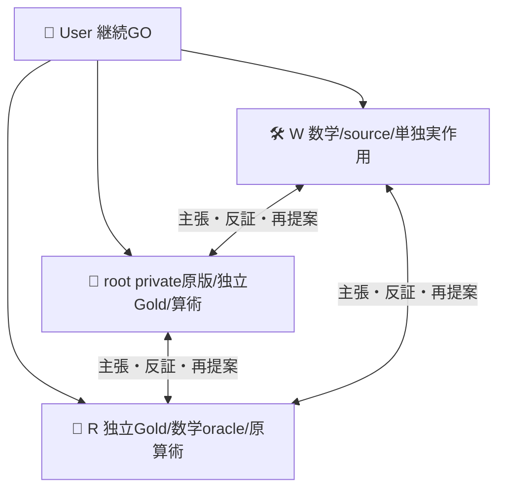
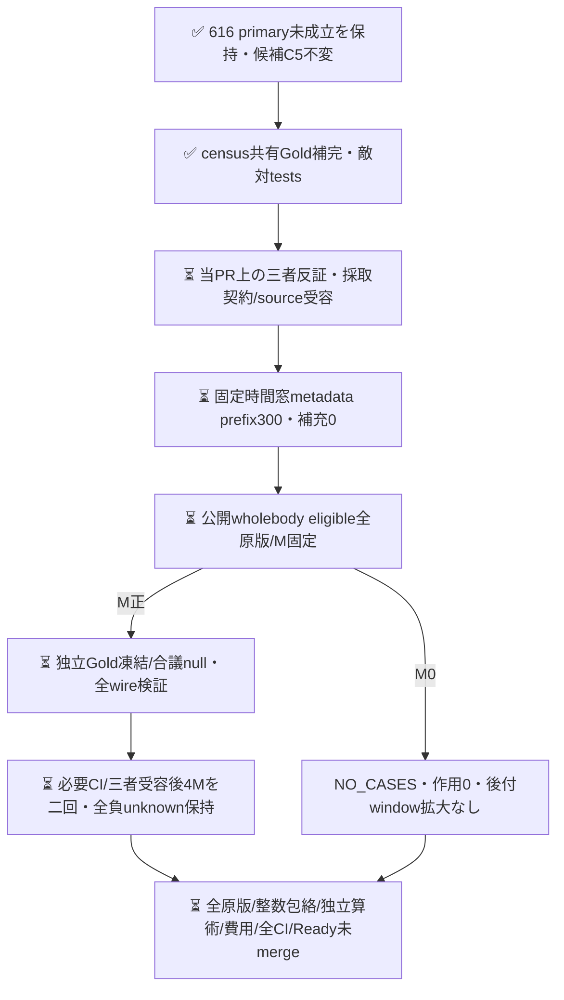

# 固定AND設定の新時間窓census設計

[PR616](https://github.com/roccho-org/ops/pull/616) は事前primaryで二回とも未成立、元Best維持・未採用の記録である。このsourceは同23を新式で採択救済せず、固定C5を変えない次のprospective設計と整数包絡を実装する。新metadata/本文API/モデル作用は0。collector/native入口は未実装・未受容で、現sourceだけで取得や実測を開始しない。

旧式はGoldnullをcase単位で独立の修復/破壊へ広げた。今回は同じcaseのBest/候補に**同じGold変数**を割り当て、既知E/Oに矛盾しない最大4補完を列挙し、完全正答差δと「以前正答だったいずれかの軸を破壊した」Rの可能範囲を保持する。同じ予測ならGold未知でもδ/Rは0。caseごと許す補完集合の直積に対して、差の最小/最大とR最小/最大のcase和は正確なcensus包絡になる。これは無作為抽出の信頼区間ではない。case間の意味的Gold整合制約を追加すればさらに狭まる可能性があり、sharpは宣言した許容集合に対しての意味である。

`feasible.mjs` はこの数学部品と全物理資格/モデル安定を分離する。欠測したmodel出力をGold補完で埋めず、技術unknown時の全体boundはnull。別軸Goldがnullでも既知軸の破壊を保持し、可能な退行だけなら観測退行と偽らずrobust受入を拒否する。数学fixtureは人工入力であり、実モデルの準拠や実gain証拠ではない。固定C5/fullwire/共有Eへの結合は後のnative reader責務で、任意設定をこの純粋関数の成功だけで実行許可しない。

## 次の有限cohort（本文取得前の契約）

候補は616で実D5から固定した `../reserve/and-selection.json` のC2/C4 ANDのまま。新候補生成も追加Dも行わない。既存native metadataの117 repo IDを使い、旧cutoff `2026-10-20T00:00:00Z` より後、新固定cutoff `2026-10-20T16:57:23Z` までにcreatedされた非PR Issueをmetadataだけで列挙する。createdAt＋immutable issue ID順の先頭最大300を**本文前に**固定し、全文eligibleで減っても補充しない。その全eligibleを新有限cohortのcensusとする。window全体への代表性、無作為抽出、意味/作者/案件の統計独立性は主張しない。

全既使用immutable issue IDを現在repoに関わらず除外し、全既使用bodyの完全同bytesも除外する。タイトル/コメント/リンク先を補わずwholebody、全4wireが24000 serialized bytes未満、切詰めなし。新Issue identityでも意味的新規性やpretraining未見は保証しない。原候補全件と除外理由を保持し、semantic難易度で選別しない。root/Rは原取得をprivate native保持して独立Gold初稿→凍結→合議/null、Wへは固定cohort原版だけを渡す。実MをGold/予測前にnative固定する。M0ならNO_CASES/作用0を保存し、窓を後付け拡大して成功へ救済しない。

採取は既存gh/原API保持/全pagination終端/1時間境界を再利用する。固定IDの公開状態を本文前後で観測し、変更/不明は全frame invalid。非原子的認証APIのvisibility raceを絶対0とは言わず、失敗原版は私的保持して公開/実測へ渡さない。新認証/独自executor/ledgerを増やさない。

固定二回は各4M/max1200 POST、合計max2400。回内sharedE・回間別receipt、両component必須・no短絡なし・資格不明ならderived unknown、native/derived/論理費用を区別する。全物理資格・expectedmodel・δmin>0・Rmax=0を**両回**必要とし、平均/良い回/意味結果で二回目を取消さない。j4は継続履歴でありalpha resetや95%/将来性能保証をしない。実際の原scope/wholebody/fullwire/native来歴の受容は後段の条件。

旧170/250分jobをそのまま使えない。1200×15秒=300分＋鍵前検証/prepare/project/upload余裕30分でubuntu-24.04/330分を次実装案とする。通常hosted上限[6時間](https://docs.github.com/en/actions/reference/limits)と[timeout規則](https://docs.github.com/en/actions/reference/workflows-and-actions/workflow-syntax#jobsjob_idtimeout-minutes)の範囲内だが、完了保証ではない。一次資料はRの独立調査、root/Wはその根拠と実sourceを反証する。新workflow実装・秘密境界受容前の実作用は0。

## 最小系列と完成条件

同repo/Issue523、同policy0dd39、同三者・W sole writer。baseは616最終source5c6d9c44d786d9af054768a62272c84fa9802871。この一PRを、実数学→metadata/body取得契約/collector→native原frameと独立Gold→固定二回→全raw/独立算術/費用/最終CI/Ready未mergeの順に進める。後続PR番号や成功を先に作らない。cross-PR gateは `fixed-c5-prospective-census-closure` とし、入力は616不変原版/actualC5 proofと当PR最終tree・新cohort native/両回raw、失敗条件は旧判定改変/設定drift/不完全原版/資格不明/片回未達/未閉CIである。gateの実entryは未実装。

通常技術FAILは同三者で是正する。取得/モデル作用は新source・原版・必要CI・三者受容を閉じてから。結果不明はnative実体を読戻しblind resendしない。616通常CIの新FAILがあればupstream是正を優先し、下流を整列・再検証する。未達やM0も保存し、採用/mergeは別許可のまま。

