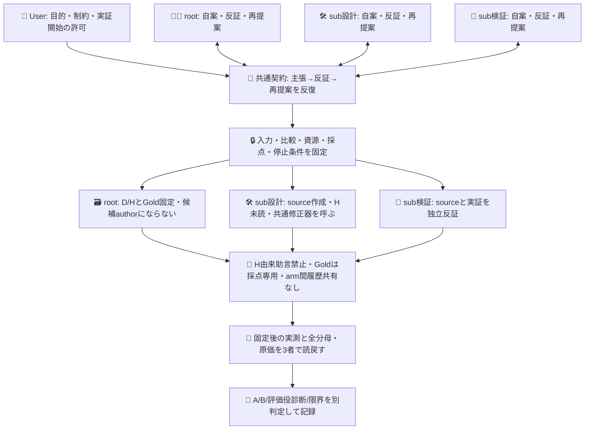
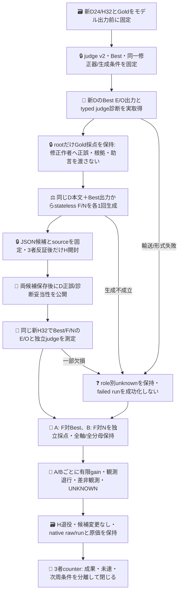

# 評価役の追加差を分離する有限実証

## 目的と現状

PR605 exact `0b49ebf4ed37dcdec0b93323cf321e565d09683d` の598呼出し系列は閉じた記録として維持する。そこでは対象設定のH45→46/48を観測したが、修正はGold/Sys2由来、評価役の追加価値は未証明、入力tokenは約61.5%増だった。本系列はその未達を隠さず、**固定評価役の助言を追加することで、同じ修正器が作る一般設定の性能が変わるか**を測る。H回答そのものを修正する実験ではない。

現sliceはモデルを呼ばない純粋な入力投影・候補形式検証・A/B採点と反証テストである。新D24/H32、judge v2設定、native実行source、CI、3者review、生成条件が揃うまでは実呼出しを開始しない。設計図の将来nodeを達成済みの証拠にしない。merge・現Bestの更新・配置・認証追加は含まない。

適用版はADRS `0dd39ca41718fafe40e58c6927a2ebb0ea297eee`。User指定local sub、rootと既存sub2名の3者が全員、主張・反証・再提案を担う。既存DSの権限やGOを推定継承せず、Userの本系列開始指示を権限とする。

## 3者の組織と知識境界

全員counterは全員共同authorという意味ではない。rootはHを知って候補を修正せず、source担当はHを読まない。F/Nを別subに生成させると専門性・履歴が交絡するため採用しない。

## 比較の固定

- 対象Bestは既存の一般E/O設定。新D24本文とそのBest実出力を両修正armへ共通入力として渡す。Eは機能要求に限定せず、元のsplit.mjsと同じ必要な状態・責務・入出力対応・要件・受入条件の宣言を扱う。D/H item Gold、basis、採点結果はjudge・修正器のmodel入力へ渡さない。rootが候補生成前にDをGold採点しても、その結果はprivate保持し、W/修正器にcase別正誤・根拠・Gold由来の修正助言を渡さない。両候補保存/freeze後だけD採点を公開する。
- judge v2は旧v1がBestの実誤答9/9を見逃した失敗に対し、proposed回答を見せる構造を変更する。旧開発資料で設定を校正してよいが、新D出力を見る前に固定し、本比較中は変更しない。`judgeRequest`はbodyだけからE/O4組合せを既存Choiceで一回独立分類し、その実receipt後にコードでBest出力との差をtyped診断へ導く。先に読むよう指示するだけで同promptにproposedを混ぜない。自由文rationaleを創作せず、独立分類由来のtyped診断だけを助言とする。診断unknownを`uncertain`回答へ書き換えない。Goldによる誤診断採点は別で、judgeがGoldになるわけではない。
- F/Nは**同じnative OC/DS model・同じbase設定・履歴のない独立stateless要求・同じ修正prompt/Best/D出力・候補数1**。差分はFにtyped助言を添付し、Nには添付しないことだけ。片armの候補や診断を他armへ渡さない。生成失敗、同一候補、変更なしでも再抽選しない。モデルaliasはimmutable backend版の証明ではない。
- 修正器へ外部toolを使わせず、一般instructionsだけのJSON1本を受ける。既存Best prefix維持、6000byte以内。個別解答・ID lookup・Hでの追加修正は不可。生成物の適否はH開封前に3者で反証し、失敗を手修正した候補で置換しない。
- native OC2.0.30の既存NixOS dev UID1001/Console認証と `opencode/deepseek-v4.1-flash` aliasを使う。native catalogでmodel/provider/limitをread-only確認した。rootのcwdを継承したauth list500/standalone spawn拒否はdev cwd `/home/dev` とprivate `--standalone` で解消し、Console storedを確認した。再認証・新key・OCI復活は行わない。修正器にJev Choiceの自由記述能力を捏造しない。
- 標準 `opencode api --standalone POST /api/experimental/generate --data <payload>` のone-shotを2要求だけ使う。[公式V2 API](https://opencode.ai/v2/docs/api/#generate) と [Generate節](https://opencode.ai/v2/docs/build/plugins/#generate) はsession/history/toolsを使わない経路を示す。version対応の [core generate.ts](https://github.com/anomalyco/opencode/blob/v2.0.30/packages/core/src/generate.ts)、[server handler](https://github.com/anomalyco/opencode/blob/v2.0.30/packages/server/src/handlers/generate.ts)、[protocol](https://github.com/anomalyco/opencode/blob/v2.0.30/packages/protocol/src/groups/generate.ts) でも、明示modelの解決→単一generate→text返却を読んだ。native実行物と当該tagのbyte同一性は未確認で、観測version label以上に主張しない。
- `repair-route.mjs` はF/Nの同一model/common入力と助言だけの差を固定する。標準APIの公開契約はprompt/model→data.textで、usage、finish_reason、内部provider試行数や推論hardmaxを返さない。その非露出値はunknownとし、6000byteを推論hardmax設定済みと偽装しない。これは候補受入上限でありpromptにも明示する。既存base/default設定を両要求で同じまま使い、同総費用・効率は主張しない。生textに`</think>`/code fence/余分な説明が混ざっても後処理で救済せずinvalid、候補null/比較UNKNOWNを保持する。
- 予定外向け要求はJev D72＋H192＋H独立judge32=296と標準generate2。標準generate2要求をprovider内部2HTTPと断定しない。内部試行数/usageの非露出分はunknown。独自plugin/proxy/新ログbrokerは作らず、実取得rawと標準metadataを保持する。追加judge費用は差分として記録し、効率優位へ読み替えない。

## 実行sourceの現在範囲

現在実装するnative workflowはD72だけ。`request.json`未作成なので作用は始まらない。source/必要CI/3者受容後のrequest-only childを、同branch/owner/attempt1/native単一history/親commit/変更pathで照合してから既存org secretを最後のモデルstepだけへ渡す。手転記hash台帳や新credentialは作らない。既存strict client/model/probability検証を維持し、資格拒否はそのroleのunknown、judge失敗を別targetの停止理由にしない。model変更は比較不成立として以降を止める。raw receipts/全24分母を保持し、Goldなしprojectionを再生する。

H phaseは候補固定後の別source受容で追加する。caseごとのBest/F/N順を事前循環ローテーションし、各軸を1回ずつ取得。独立judgeはbodyだけから1回、候補修正には返さない。H本文/Goldはその前に開封しない。

## D72取得と次段の実入力固定

[Native run39374003138](https://github.com/roccho-org/ops/actions/runs/39374003138) はreview済みsourceのrequest-only childを一回実行し、72 POSTでSUCCESS。artifact12241898715 (22491-byte ZIP)を取得しprovider digest/sizeと実bytesを照合、全投影を鍵なし再生して同値を確認した。24件のE/O48回答と独立judge24回答がqualified、modelStable=true、repair入力が成立した。これは資格・輸送の確認であり、正答率や診断性能の成功宣言ではない。DのGold/正誤は候補freeze前のW/修正器へ非開示のまま。

`../results/counterfactual-development-20261020/` にraw5fileとprovider metadataを保持し、`repair-payloads.json` はその実投影からコードで生成したF/N2要求である。修正入力はここで固定し、D正誤を見た選択や手修正を加えない。

`native-repair.mjs` は既存CLIを直接起動して2要求を保存する小さいcaptureである。N→F順を前もって固定し、既存native dev/cwd/Console経路、公開version/catalogと非秘密configfileのstatを前後で照合する。これはその観測metadataが一致した証拠であって、Global config全内容、provider defaultやweightsの不変証明ではない。raw stdout/stderrはnative私的保存、公開には資格確認したdata.textと安全receiptを用いる。標準CLI起動数、API応答成立、provider内部HTTP/usage不明を区別し、timeout/失敗でも盲再送しない。無効armをBestへ代入しない。新しいcredential reader、HTTP proxy、plugin、汎用executorは追加しない。現時点でこのcaptureは未実行、生成はまだ0要求。

## H開封前の設定identityと測定計画

`confirmation.mjs` のpure planは生instructions完全一致だけで、Best→F→Nの順に有効unique設定とrole aliasを固定する。意味同等やtrimを後付け推定しない。同一設定は各case/軸で1回だけ実測し、aliasは同一native receiptを指す。資格unknownも全aliasへ同じく伝播し、usage/原価はunique traceだけで集計する。N=BestならA/Bは同じ実観測対であり独立2検証ではない。

A/B両比較とも同一instructionsなら`IDENTICAL_CONFIGURATION_NO_TREATMENT`をrawdeltaより優先する。F=Nから別々の推論揺らぎで助言gainを作らず、F=Bestから対象設定改善を作らない。invalid候補はBestへaliasしない。F有効かつBestと異なればNinvalidでもK2/160要求でAを測定しB UNKNOWN、F無効なら両UNKNOWNとしてH未開封省略、F=Best/NinvalidならA no-treatment/B UNKNOWNで省略する。全有効設定が同じK1でもH未開封/未実行とし、HjudgeはNOT_MEASUREDのままDから代入しない。実測する場合の事前上限は32×(2K+judge1)、K2=160/K3=224である。H本文はまだ未読、この純粋計画以外のH実行sourceは次段で受容する。

## 完成状態と閉包

`comparison.mjs` は固定Goldをmodel入力から独立して採点する。AはFの完全正答case数>Best、Bestで正しかったE/O軸の観測破壊0、比較する全assigned targetがqualifiedで有限受入。Bは同じ条件をN比で満たすこと。case/axis修復と破壊を両比較に残す。controlだけ欠損してもAを消さずB UNKNOWNとする。診断失敗だけからtargetの成否を推定しない。

有効比較で差≤0は「今回追加gain非観測」。天井や誤答不足による検出力不足、輸送/形式不成立、Gold未確定は区別する。Aだけ成立なら対象改善の有限成果、Bだけ成立ならN比の有限差でありBest改善ではない。両成立でも**この固定比較で対象改善とfeedback追加差を観測**まで。安定したjudge-loop、統計的有意、人口精度、再現性、Apps効果は別の事前設計・反復なしに完了扱いしない。反復を追加してもcase×repeatを独立ケース数へ水増ししない。

token、呼出し、失敗、既知金額、人手時間を全roleで保持し、欠損を0にしない。費用閾値を後付けして採用を主張しない。Nの改善も独立target成果として保存し、judge寄与へ加算しない。H結果を見て候補/Gold/主評価を変えず、次周には新Hと新事前契約が必要。native run/raw receiptを正本とし、新ledgerや汎用executorを作らない。
