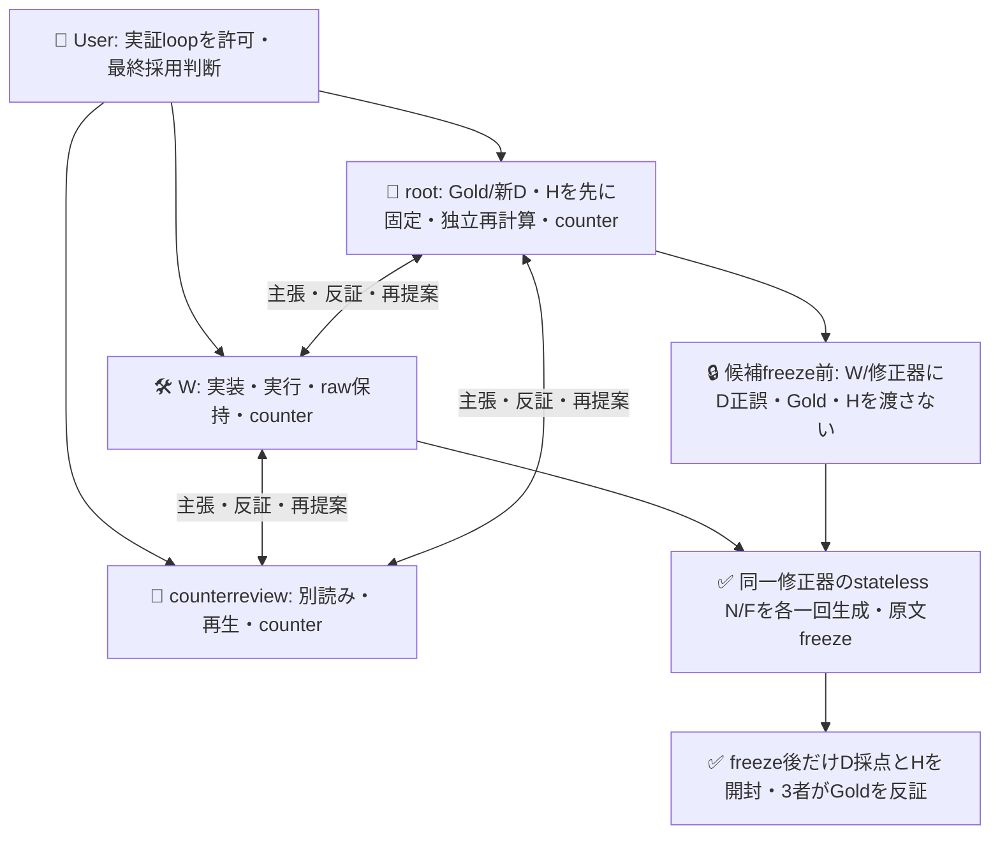
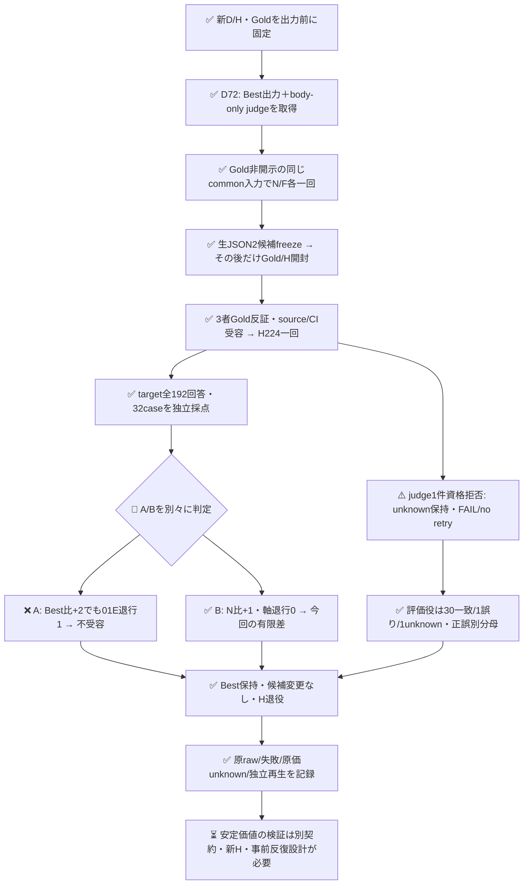

# 評価助言あり・なしの有限比較

**助言ありFはBest29→31/32、助言なしN30/32を上回ったが、Bestの正答を1件壊したため採用しない。Bestを保持する。** Bの助言あり・なし差1件は今回の有限観測であり、安定した因果効果ではない。Hは退役し、候補/Goldを変更せず閉じる。

PR605の旧598呼出しは不変。本PR606は別系列で、Jev296 POSTと標準OpenCode generate2要求を一度ずつ実行した。H workflowはjudge1件の資格拒否によりFAILのまま保持し、再実行していない。対象192回答は全件qualifiedで、judge失敗から対象比較を失敗/成功と推定しない。

## 3者の組織と知識境界

User指定のroot＋sub2名は、全員が主張・反証・再提案を担った。成果物の担当は分けたが、賛成役/反対役には固定しない。適用policyはADRS `0dd39ca41718fafe40e58c6927a2ebb0ea297eee`。

rootは候補authorにならず、Wは両候補freezeまでD正誤とHを読まなかった。これはtrusted actorsの知識分離で、同UIDのOS秘匿ではない。修正器を別subへ割り当てる履歴/作者交絡を避けた。

## 比較対象と採点契約

- **対象Jev**: Bestまたは修正instructionsでbodyのE/Oを判定する。Eは適用された必要状態・責務・要件・仕様、Oは現実の発生・確認状態。重み再学習ではない。
- **評価役Jev v2**: proposedを見ずbodyだけをChoice4で独立分類し、保存後にコードが対象回答との差をtyped診断へ変換する。自由文rationaleを創作しない。Gold oracleではない。
- **修正器**: 既存native OpenCode2.0.30の明示`opencode/deepseek-v4.1-flash`。同じBest/D本文・対象出力・共通promptからN/Fを各一回生成、Fだけtyped助言が異なる。
- **独立採点**: 先に固定したGoldと通常コード。評価役との一致は採用gateではない。

AはF対Best、BはF対N。それぞれ完全正答case数が増え、比較先で正しかったE/O軸の破壊0、全assigned target qualifiedなら有限受入。case/axisの修復・破壊を両比較に残す。欠測/モデル変更は比較別UNKNOWN。同じinstructionsならNO_TREATMENTを優先し、意味同等やtrimで同一視しない。invalid候補はBestへ代入しない。今回Best/F/NはK3でaliasなし。

## 実経路・証拠

|段階|実体|結果|
|---|---|---|
|D固定|root commit `f88b3612df80f854f640bd7808477ad97e5c5a66`|新D24/H32とGoldを出力前に固定|
|D実行|[39374003138](https://github.com/roccho-org/ops/actions/runs/39374003138)、source e2ac8ccb/activation91777c06|72POST、SUCCESS/attempt1|
|修正|source24fb0641の標準native helper、N→F各一回|両API成立・strict JSON valid、F2936/N3746 UTF8bytes|
|候補freeze|`2528eb9cb20cbfc315281189f5cd6e5556dc7d95`|Gold正誤/H開封前、両原文固定|
|H source|8625940a、[3者source review](https://github.com/roccho-org/ops/pull/606#pullrequestreview-5581127921)|44関連tests/407全tests/fresh-consumer成功|
|H実行|[39376630329](https://github.com/roccho-org/ops/actions/runs/39376630329)、activation7dcf84e9|224POST/attempt1、judge資格拒否1でFAILを保持|
|H原ZIP|artifact12243702088、72912bytes、SHA256 `038640155985adbd2d30936ead61b592466f506d070757636503e1871df15f9b`|provider digest/size一致、原5raw保存・canonical再生一致|

`../results/counterfactual-development-20261020/`、`../results/counterfactual-repair-20261020/`、`../results/counterfactual-confirmation-20261020/` に原文/receipt/投影/独立root再計算を保持する。D/H Goldはf88のnative bytesそのまま。モデル入力はbody/id/familyのGold-free投影のみで、Gold/basisは採点側に残す。

既存標準client/認証/秘密隔離workflowを再利用し、credential reader、plugin、proxy、汎用executor、手転記SHA台帳を追加していない。request-only child、owner/branch/push/attempt1、native historyの元D＋一度のH、prior D identityをcredential前に検査した。H224×15秒deadline=56分の失敗枝でも保存へ到達する余裕としてjob70分を設定し、20分を拒否する境界testを追加した。権限/回数/資格基準は緩めない。

## 実結果と反証

|H32|Best|F:助言あり|N:助言なし|
|---|---:|---:|---:|
|完全正答|29|31|30|
|qualified / unknown|32 / 0|32 / 0|32 / 0|
|E FP / FN|2 / 0|1 / 0|2 / 0|
|O FP / FN|0 / 1|0 / 0|0 / 0|

**Aは不受容**。3件を修復（12O/17E/21E）した一方、Bestが正しかった01のEを壊した。Nも同じ01Eを壊しており、後付けでNへ勝者選択しない。総数+2や全体FP減だけで無退行と判定しない。01は「展示パネルの語彙見本」と適用を否定した本文で、Gold E=no/O=noは変更しない。Fの一般的scope補足をH後に修正しない。

**Bは有限差を観測**。Nに対して17Eだけを修復し、case/軸退行0、差+1。A不受容をB成立で上書きせず、FもNもBestへ採用しない。一候補ずつの確率的生成・固定順・同aliasの時間差が残るため、安定した評価役の因果価値とは呼ばない。

|評価役v2|D24|H32|
|---|---:|---:|
|Gold分類一致|23|30|
|qualified / unknown|24 / 0|31 / 1|
|対象実誤答|3|3|
|検出 / 見逃し / 誤scope|2 / 1 / 0|2 / 1 / 0|
|対象正答群の誤警報 / unknown|0 / 0（21件）|0 / 1（29件）|

H06 judgeはHTTP200・model/key一致・finite/range/max成立でも、確率和0.9900000000000001で既存strict条件を拒否した。unknownをuncertainや正答へ変えず、その一件も再送しない。残りtargetを止めず取得し、workflowのFAILを成功へ書換えない。旧v1とは課題/標本が違い、D/Hの数値をv1比の向上率へ読み替えない。

## 呼出し・原価

|役割|実POST/標準要求|取得済みinput tokens|取得済みoutput tokens|
|---|---:|---:|---:|
|D対象|48|48632|1488|
|D評価役|24|22600|1171|
|H Best|64|64894|1984|
|H F|64|100606|1984|
|H N|64|119038|1984|
|H評価役|32試行/31qualified|29220（31件小計）|1512（31件小計）|
|標準修正器|2要求|unknown|unknown|

Jev実296=対象240＋評価役56、qualified295＋拒否1。拒否1のusage、API非露出のtotal_tokens、修正器の内部provider試行/usage/hardmax、金額、人手時間はunknownで0ではない。H FはBestより入力35712tokens増（約55.0%）であり、効率改善を主張しない。N/FのCLI時間79.094/22.939秒も速度効果の証拠ではない。observed version/catalog/config-stat一致はその観測の証拠に限り、config全内容/immutable backendの同一性証明ではない。候補内のliteral backslash-nも原文のまま実入力し、実改行へ整形していない。

標準経路は[公式Generate API](https://opencode.ai/v2/docs/api/#generate)、[stateless/toolなしの公式説明](https://opencode.ai/v2/docs/build/plugins/#generate)、[v2.0.30 generate source](https://github.com/anomalyco/opencode/blob/f16ef9ad8878279ea2be3cfab7baeed97aef61aa/packages/core/src/generate.ts)を確認した。native version labelと公式tagのbyte同一性やprovider内部試行まで証明したとはしない。

## 完成状態・閉包フロー

実証経路と今回のA/B測定は完了し、採用gateが実際の退行を拒否した。普遍的な偽陽性/偽陰性ゼロ、統計的有意、安定再現、人口精度、Apps改善、収益効果は未証明。syntheticかつ明示scope-markerが多い均衡8family集合で、Gold著者/構成への依存がある。次周は新Hと事前契約が必要で、このHで再選択しない。最新通常CIの終端は[PR checks](https://github.com/roccho-org/ops/pull/606/checks)を正本とし、merge・Best更新は行わない。
