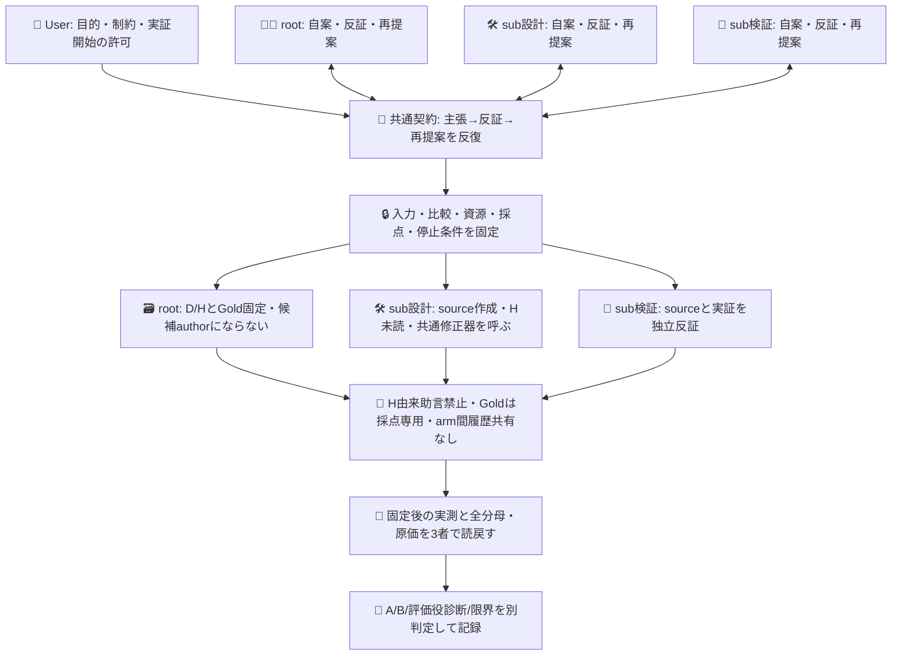
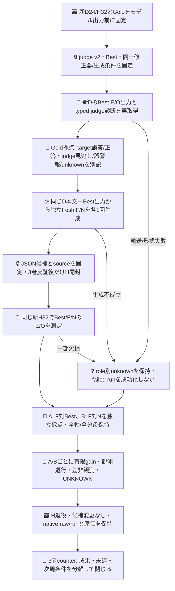

# 評価役の追加差を分離する有限実証

## 目的と現状

PR605 exact `0b49ebf4ed37dcdec0b93323cf321e565d09683d` の598呼出し系列は閉じた記録として維持する。そこでは対象設定のH45→46/48を観測したが、修正はGold/Sys2由来、評価役の追加価値は未証明、入力tokenは約61.5%増だった。本系列はその未達を隠さず、**固定評価役の助言を追加することで、同じ修正器が作る一般設定の性能が変わるか**を測る。H回答そのものを修正する実験ではない。

現sliceはモデルを呼ばない純粋な入力投影・候補形式検証・A/B採点と反証テストである。新D24/H32、judge v2設定、native実行source、CI、3者review、生成条件が揃うまでは実呼出しを開始しない。設計図の将来nodeを達成済みの証拠にしない。merge・現Bestの更新・配置・認証追加は含まない。

適用版はADRS `0dd39ca41718fafe40e58c6927a2ebb0ea297eee`。User指定local sub、rootと既存sub2名の3者が全員、主張・反証・再提案を担う。既存DSの権限やGOを推定継承せず、Userの本系列開始指示を権限とする。

## 3者の組織と知識境界

全員counterは全員共同authorという意味ではない。rootはHを知って候補を修正せず、source担当はHを読まない。F/Nを別subに生成させると専門性・履歴が交絡するため採用しない。

## 比較の固定

- 対象Bestは既存の一般E/O設定。新D24本文とそのBest実出力を両修正armへ共通入力として渡す。D/H item Gold、basis、採点結果はjudge・修正器のmodel入力へ渡さない。
- judge v2は旧v1がBestの実誤答9/9を見逃した失敗に対し、proposed回答を見せる構造を変更する。旧開発資料で設定を校正してよいが、新D出力を見る前に固定し、本比較中は変更しない。`judgeRequest`はbodyだけからE/O4組合せを既存Choiceで一回独立分類し、その実receipt後にコードでBest出力との差をtyped診断へ導く。先に読むよう指示するだけで同promptにproposedを混ぜない。自由文rationaleを創作せず、独立分類由来のtyped診断だけを助言とする。診断unknownを`uncertain`回答へ書き換えない。Goldによる誤診断採点は別で、judgeがGoldになるわけではない。
- F/Nは**同じnative OC/DS model・同じ設定・独立fresh session・同じ修正prompt/Best/D出力・候補数1・生成上限**。差分はFにtyped助言を添付し、Nには添付しないことだけ。片armの候補や診断を他armへ渡さない。生成失敗、同一候補、変更なしでも再抽選しない。モデルaliasはimmutable backend版の証明ではない。
- 修正器へ外部toolを使わせず、一般instructionsだけのJSON1本を受ける。既存Best prefix維持、6000byte以内。個別解答・ID lookup・Hでの追加修正は不可。生成物の適否はH開封前に3者で反証し、失敗を手修正した候補で置換しない。
- native OC2.0.30の既存NixOS dev UID1001/Console認証と `opencode/deepseek-v4.1-flash` aliasを第一候補とする。read-onlyでrunのprivate `--standalone`/fresh session/model/json入口と、devのcwd `/home/dev` におけるConsole storedを確認した。実生成の同設定・tool禁止・上限は未確認のため、route成立をまだ主張しない。rootのcwdを継承したauth list500/standalone spawn拒否を、本人認証不足と読み替えない。再認証・新key・OCI復活は行わない。Jev Choiceに自由記述修正能力を捏造しない。
- 予定Jev実呼出しはD24×(E/O+judge)=72、H32×Best/F/N×E/O=192、Hの独立judge32で296。これにfresh修正2sessionを加えるが、session数をmodel HTTP件数と同一視せず、内部retry/継続/tool往復を実receiptで数える。共通の修正資源上限/再抽選禁止はlive前に固定する。呼出し数同額ではなく修正資源上限を揃える。追加judge費用は差分として記録し、効率優位へ読み替えない。

## 完成状態と閉包

`comparison.mjs` は固定Goldをmodel入力から独立して採点する。AはFの完全正答case数>Best、Bestで正しかったE/O軸の観測破壊0、比較する全assigned targetがqualifiedで有限受入。Bは同じ条件をN比で満たすこと。case/axis修復と破壊を両比較に残す。controlだけ欠損してもAを消さずB UNKNOWNとする。診断失敗だけからtargetの成否を推定しない。

有効比較で差≤0は「今回追加gain非観測」。天井や誤答不足による検出力不足、輸送/形式不成立、Gold未確定は区別する。Aだけ成立なら対象改善の有限成果、Bだけ成立ならN比の有限差でありBest改善ではない。両成立でも**この固定比較で対象改善とfeedback追加差を観測**まで。安定したjudge-loop、統計的有意、人口精度、再現性、Apps効果は別の事前設計・反復なしに完了扱いしない。反復を追加してもcase×repeatを独立ケース数へ水増ししない。

token、呼出し、失敗、既知金額、人手時間を全roleで保持し、欠損を0にしない。費用閾値を後付けして採用を主張しない。Nの改善も独立target成果として保存し、judge寄与へ加算しない。H結果を見て候補/Gold/主評価を変えず、次周には新Hと新事前契約が必要。native run/raw receiptを正本とし、新ledgerや汎用executorを作らない。
