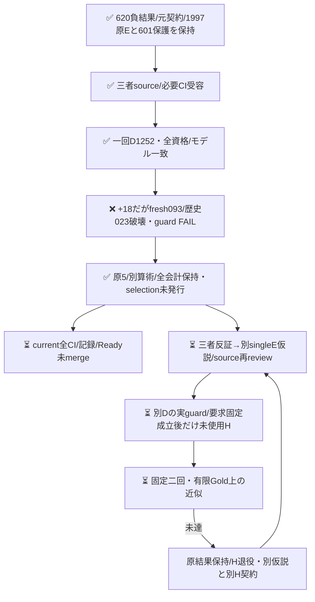

## 実D結果：不受容、未使用集合は未開封

[一回の実run](https://github.com/roccho-org/ops/actions/runs/39511728760)は全1252物理E要求が資格・expected modelを満たした。fresh primaryのcomplete正答は476→494（修復19/退行1）、E正答は583→602（修復20/退行1）だった。しかしfresh Eのcensus-093を破壊し、歴史601保護内のcensus-023も破壊したため、事前guardはDEVELOPMENT_GUARD_FAIL。正差18で退行を相殺せず、このOR構成は不受容とした。機械first complete477は診断のみでprimaryへ置換しない。O未確定17を全626分母に保持する。

原5fileはresults/expectation-or-development1-20261021/へ無変更で保存した。root/Rは各自provider ZIP/native来歴を取得し、別readerで全Core/資格/flags/guard/会計を再計算して一致、Wは標準製品投影の全値再生と原bytesを確認した。実job鍵前659/659試験成功とjob全step成功は、意味guard成功を表さない。selection/成功要求freezeは発行せず、新H count/body/Goldを開かなかった。保存後のcurrent全通常CI/記録/Readyは別に閉じる。

当回物理会計は1252 E要求のみ、input2,673,006/output38,812。total_tokensは1252件全て不明で、input+outputで補完しない。歴史O/E aliasを新費用に加算せず、金額・内部計算量は不明。失敗構成のH作用は0、実seriesも1252である。

次は023の機能IO宣言と093の再現/症状報告の役割を三者で反証し、別の意味あるsingleE仮説をsource化してから再reviewする。同OR盲再送や閾値/Gold変更による救済はしない。今回の正答も次guardへ引き継ぎ、原3249 E receiptsの全履歴保護は604となる（次sourceで固定・検証する）。

# 固定2EのOR構成を別の未使用集合で検証する

PR620のH1は差8/119・退行0、H2は差7/119・E退行1で二回ANDはNOT_RECONFIRMED。両回の正差と052退行を全て保持し、119件をDへ退役する。本案で旧判定を救済しない。

[三者が新件数/本文/Gold/予測前に固定した契約](https://github.com/roccho-org/ops/pull/620#issuecomment-6303139999)に従い、元BestE/currentEの文面は変えずqualified ORだけを一候補とする。真正help-requestの言い換えを同時に試して勝者を選ばない。Eno正解では片方のfalse positiveでORが退行し得る。追加計算の構成であり単一モデルの重み/同原価/Apps改善とは称さない。

当初のsource sliceは原raw再生からD626・物理E1997receipt・正答保護601を導出し、fresh2Eの1252要求をGold無しの入力へ準備するpure sourceだった。旧4群1014に成功D507と新119の4E476を加え、旧Dで獲得した8正答も保護する。shared歴史Oは同じ固定値を両側へ使う。primaryは当回freshBestE対当回qualified OR、機械firstは別診断であり成績後のbaseline選択はしない。O未確定17も全626に残す。freshbaseline悪化を理由に601保護を緩めない。

rootは601外のE=no caseで当回BestEが新たに正答しcurrentEがyesなら、他caseの修復2で退行1を相殺してpure初案がeligibleになる反例を提示した。Wはこの反証を受容し、出力前に「当回freshBestEから既知E退行0」も別ANDへ強化した。historical Oが誤答/nullでもE破壊を記録し、joint正差で相殺しない。後段native入力/資格readerはqualified数と両成分原receiptを厳格に結合し、pure引数の自己申告を資格根拠にはしない。

ORは両成分の資格必須でyes+missingもunknown。入力/全attempt/post/flags/answer/failure/expected modelを標準client/既存資格で拘束する。code-only D入口は新branchのrequest-only child/history1と、元4群の4run＋旧D/H1/H2の3runの実API/Git親/phaseを鍵前に結合し、原1997資格/601保護を再生する。当時のsource公開ではREQUESTを未配置にし、受容後のrequest-only childで一回だけ起動した。b841の必要CI/三者受容と620技術閉包後にDを実行したが、後続H入口は未実装。derived ORをprovider応答・確率・費用へ偽装せず、BestEのbaseline兼成分利用を物理二重計上しない。

人工626 body/Gold・dummy key・fetch stubで実standardRecorderを通し、全1252資格の正差、無改善、片成分不正でunknown、601外freshE破壊、既知破壊と欠測の併存、global drift後停止を確認した。rootの製品scorer/constructor/qualifierをimportしない別readerでも保存4モードの全原版/投影が一致。これは実provider/modelの改善証拠ではない。350分の6step profileは従来の厳格checkerへ固定名で接続し、keyless tests→prepare→唯一のsecret評価→keyless project→always raw保持を保つ。b841のLinux必要CIは659/659・consumer・health成功を三者が実ログで確認してDを開始した。結果保存後の新head全通常CIは別途必要。

次Hは受容済8bc metadata内のOct18全日、同3repo、日時/ordinal Issue ID順の最大300prefixを本文前固定し補充しない。全122既取得本文を含むprior862typed/2033exactbodyと2371参照を使い、metadata-only IDを自己除外へ混ぜない。私的native e727e0459ad614e3c780b6140c561cd79c49a2c7のexpectation-or-prior-1/inventory.jsonに元5prefixと全集合を保持し、公開側へ私的全ID/本文を複写しない。便宜窓/既観測metadataの有限targetであり全日snapshot・無作為・意味/作者/学習未見は保証しない。新Hのcount/body/Gold/API/modelは0のままである。M0ならNO_CASES/作用0を保持し、窓を後から拡張して救済しない。

系列最大3052は事前の有限割当であり実消費ではない。今回Hは起動しない。通常loopは同GO内で続け、追加User予算/再認証待ちを設けない。
