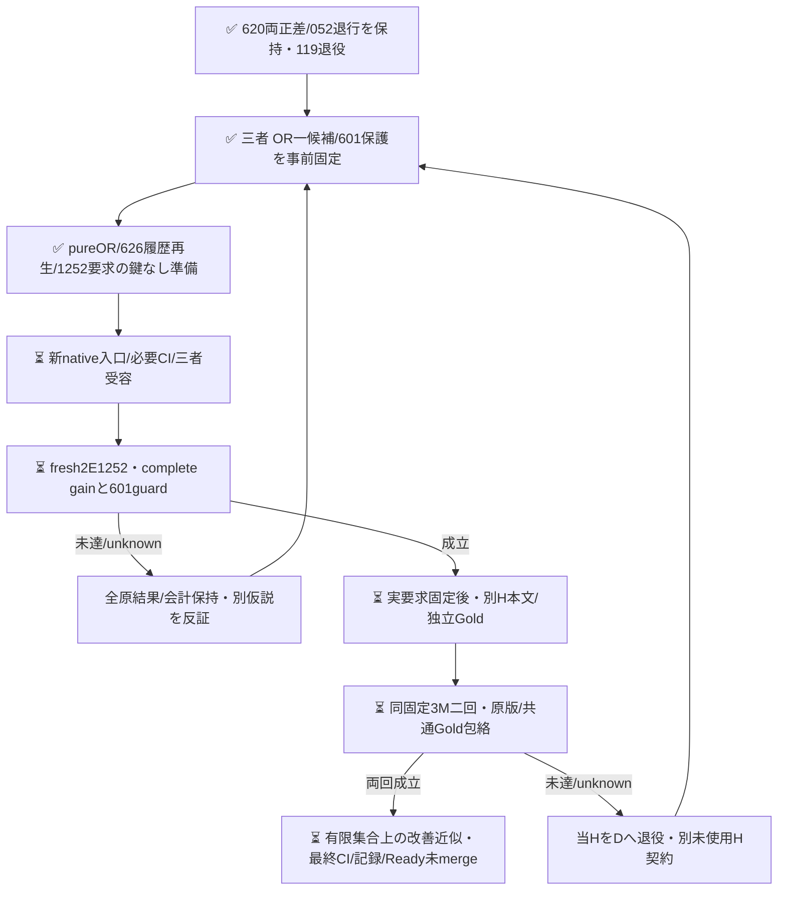

# 固定2EのOR構成を別の未使用集合で検証する

PR620のH1は差8/119・退行0、H2は差7/119・E退行1で二回ANDはNOT_RECONFIRMED。両回の正差と052退行を全て保持し、119件をDへ退役する。本案で旧判定を救済しない。

[三者が新件数/本文/Gold/予測前に固定した契約](https://github.com/roccho-org/ops/pull/620#issuecomment-6303139999)に従い、元BestE/currentEの文面は変えずqualified ORだけを一候補とする。真正help-requestの言い換えを同時に試して勝者を選ばない。Eno正解では片方のfalse positiveでORが退行し得る。追加計算の構成であり単一モデルの重み/同原価/Apps改善とは称さない。

初sliceは原raw再生からD626・物理E1997receipt・正答保護601を導出し、fresh2Eの1252要求をGold無しの入力へ準備するpure sourceである。旧4群1014に成功D507と新119の4E476を加え、旧Dで獲得した8正答も保護する。shared歴史Oは同じ固定値を両側へ使う。primaryは当回freshBestE対当回qualified OR、機械firstは別診断であり成績後のbaseline選択はしない。O未確定17も全626に残す。freshbaseline悪化を理由に601保護を緩めない。

rootは601外のE=no caseで当回BestEが新たに正答しcurrentEがyesなら、他caseの修復2で退行1を相殺してpure初案がeligibleになる反例を提示した。Wはこの反証を受容し、出力前に「当回freshBestEから既知E退行0」も別ANDへ強化した。historical Oが誤答/nullでもE破壊を記録し、joint正差で相殺しない。後段native入力/資格readerはqualified数と両成分原receiptを厳格に結合し、pure引数の自己申告を資格根拠にはしない。

ORは両成分の資格必須でyes+missingもunknown。入力/全attempt/post/flags/answer/failure/expected modelを標準client/既存資格で拘束し、native入口で現source/原history/必要CIを結合する。初sliceではその新入口はまだ未実装で、pure sourceを実作用許可へ読み替えない。derived ORをprovider応答・確率・費用へ偽装せず、BestEのbaseline兼成分利用を物理二重計上しない。

次Hは受容済8bc metadata内のOct18全日、同3repo、日時/ordinal Issue ID順の最大300prefixを本文前固定し補充しない。全122既取得本文を含むprior862typed/2033exactbodyと2371参照を使い、metadata-only IDを自己除外へ混ぜない。便宜窓/既観測metadataの有限targetであり全日snapshot・無作為・意味/作者/学習未見は保証しない。新count/body/Gold/API/modelはまだ0。

系列上限3052・D350分/H各250分は有限assignment/timeoutの明示で完了保証ではない。必要checkを弱めず、同GOの通常loopを新User予算/再認証待ちにしない。公開/作用は620技術閉包と次source/CI/三者受容を満たしてから行う。
