# 十一の負結果を保持し、依存ラベル照合の固定入口を検証する

## D12：元E基準の引用と依存checker（code-only）

[D11負保持と三者counter](https://github.com/roccho-org/ops/pull/624#pullrequestreview-5595854426)から、fresh BestEの実yes/noが元E真偽条件に一致するかを別native binary checkerで判定する一候補を選んだ。最初の英語定義案は元BestEとの定義・言語差を同時に含むというroot/R反証で未採用とし、元BestEのinstructions598字とyes/no91字を無編集JSON referenceとして囲んだ。外側metaと末尾は、引用された直接E判定でなく提示ラベルの正誤を回答するtaskだと明示する。checker instructions1578字/正誤criteria335字、両label全文wireを三者がsource前に固定した。元O説明混在、二種類のyes/noの混同、同意bias、誤反転、同一backendの相関は残る。

新verification固定contextだけが各caseのBestE→checker依存順を使う。qualified BestEの実choiceだけをJSON文字列stateのproposedEへ渡し、本文は原bodyのまま、confidence/Gold/O/ID/旧履歴を入れない。checker yesなら維持、noなら反転するが、両nativebinary資格が必要。Noは“不一致というモデル判断”であり、説明不足や技術UNKNOWNを反転せず、hidden uncertaintyの検出や自己正しさ証明を主張しない。独立Gold・618歴史保護・freshE退行0・完全joint正差・全1252資格/expectedmodelは別ANDのまま。

BestE通常欠測時はcheckerをattempt/postせずdependency-skip（baseline-unqualifiedとdependsOn）を原eventsへ残し、derived Eはunknown、次caseへ継続する。checkerだけ欠けてもEを補完しない。旧binary modelChanged停止では残tailをmodel-stop未attemptとして区別する。これは実異version報告の証明でなく旧binary停止規則であり、旧11loop/SDK/recorder/qualifierは変更しない。新projectorは各attempt/post/資格/skip/rowの依存順を原記録から再構成し、旧prefixloopを流用しない。skipは新loopのobserveのみで、標準recorder自体の変更ではない。

原checkerは“Eラベルの正誤”のprovider回答でありnative Eではない。verifiedEはproviderAnswer:falseで両元post/choicesと実proposedEへ結合し、確率/model/usageを作らない。BestEはbaseline兼componentとして一回だけ送信・計上する。最大1252HTTP＝626BestE＋626checkerで、baseline欠測なら実postは減るが全626分母・assigned1252を保持し、attempt/post/qualified/unknown/unattemptedを別記する。新履歴へ加えるならnative BestEとboth-qualified derived verifiedEを区分し、checker原答をnativeBinaryEへ足さない。

鍵前に旧全17016 qualified E（14517binary/621role4/各626split・partition・lines）/physical17021/invalid5/618orderedを元contextで再生し、19native runsと固定D6 failed-job、実Git親/REQUEST phaseを検査する。鍵下inputは固定8field、元全body/Best/4templates/expectedmodel/executionを結合する。BestE/sharedOとchecker両labelの全実wireは24k未満、stateは既標準binaryのJSON文字列。新transport/auth/executor、任意profile/override、追加再試行はない。

prospective-plan12の16824は実消費13772＋新D最大1252＋将来H最大1800の有限割当で、実費や追加User予算gateではない。既13772postのinput/output各5欠測・total全欠測を保持する。source-onlyではREQUESTのdevelopment11/1d13を変更しない。新source必要CI/三者exact受容後のみ直子REQUEST-only activation12を一回行う。中間負保持headのReadyを追加前提にせず、目的最終current全通常CI/会計/三者記録/Ready未mergeを最後に閉じる。

Hはまだcount/body/Gold0、成功D12原版と実要求freeze三者受容後だけ既事前Oct18窓/priorへ進む。H eligibilityはBestE/sharedO/checkerYes/checkerNoの4wire、実割当は最大3MHTTP/3M原binary回答（E/正誤/O）である。同body/Gold/Mと両条件template/policyは両回固定するが、当回baseline choiceによりchecker実stateはrep間で異なり得るため実payload全同値とは呼ばず、各choiceへ結合する。ordinaryunknown/意味FAILでも予定H2を取消さず、missingmodelと実othermodelを区別するH専用capture→資格→H2 admissionは別sourceで検証する。両回全資格と共通Gold Δ下限>0/任意軸R上限0が必要で、D反復選択・ever-correct保護は不偏推定や一般品質保証ではない。

~~~mermaid
flowchart TB
 A[✅ D11原負/元Gold/全費用を保持] --> C[✅ 三者反証: 不支持と不一致を分離/元E全文引用]
 C --> B[code-only: 固定626 BestE→条件checker]
 B --> Q{BestE strict資格?}
 Q -->|通常unknown| S[checker未attempt/skip原記録/derived unknown→次case]
 Q -->|yes/no| K[実labelを固定checker branchへ結合]
 K --> V{checker strict資格?}
 V -->|unknown| U[反転せずderived unknown]
 V -->|qualified yes/no| E[providerAnswer:false verifiedE/両post追跡/費用一回]
 E --> G[⏳ 必要CI/三者exact→一回D12/全guard]
 G -->|FAIL/unknown| N[原版保持・別仮説counter/未採用]
 G -->|全PASSと実要求freeze| H[🔒 未開封H/同条件policy/二回AND]
 H -->|未達| N
 H -->|両回成立| Z[目的最終current全CI/記録/Ready未merge]
~~~

以下D11節の未固定・未実装という記述は負保持時点の記録であり、上のD12 code-only実装と区別する。

## D11：合成対比追加でもfresh2/歴史10退行で未採用

[run39555236373](https://github.com/roccho-org/ops/actions/runs/39555236373)をsource1d136e71/REQUEST-only activationddd10a59/development11・history11から一回実行した。BestE626＋native binary contrastE626＝1252HTTP/1252原回答は全資格/modelStable、unknown0。原job119073367838の鍵前752/752fail0、prepare/execute/project/uploadはSUCCESSだが意味合格でない。

joint477→500・修復25/退行2、E584→608・修復26/退行2。freshE退行はcensus-072/expectation-027、歴史618保護破壊はheld-158、census-023/072/093/173/210、expectation-004/024/027/028の10件。正差で退行を相殺せずDEVELOPMENT_GUARD_FAIL/未採用、O-null17/全626/元Goldを保持。selection/実要求freeze無し、未使用H count/body/Gold0。

root/Rが自己provider ZIP/nativehistory11/全1252Core・strictbinary資格・全618/freshguard/usageを独立再算術し、全8projection fieldsがW再生と一致。原5全28,787,939B＋provider/readback/root原reportをresults/expectation-contrast-development11-20261021/へ原bytes保持、新closed1で全投影を再現する。effect/REQUEST/全旧plans/raw/Gold/SDK/client/Core/batch/recorder/qualifier/YAML不変。[root source/必要CI](https://github.com/roccho-org/ops/pull/624#pullrequestreview-5595655750)・[R source/必要CI](https://github.com/roccho-org/ops/pull/624#pullrequestreview-5595614822)。現保持head全通常CI成功を先取りせず、実作用source1d13の752成功と区別する。中間負保持CI/Readyを次sourceのgateにせず、目的最終current全CI/会計/記録/Ready未mergeは最後に閉じる。

当回input3,004,786/output38,812が全1252HTTPで既知、total_tokens全1252・金額/内部計算量は不明。candidate原binary回答はprovider receiptそのものでOR/枝usage複製はない。D1..D11累積physicalHTTP13,772/qualifiedHTTP13,767、input既知小計28,440,211/output既知小計495,545・各5post不明、total_tokens全13,772不明を保持する。

三者が原10本文/元E rubricと選択を読戻してGold維持。7FNは自己の必要行為/表示IO・引用された真正指示/機能と利用条件/HTML提出指示の宣言を落とし、3FPは症状・観測回避・欠落だけから未記載要求を補ったもの。3対比で全coverageを得た証拠はなく、英語/長さ/基底/経路bundleの原因分離もできない。旧D3を再採用/救済せず、適応D過適合と同一case反復を記録する。

次履歴17016 qualified E evidence＝14517binary＋621role4derived＋626splitderived＋626partitionderived＋626linesderived、physical17021/invalid5別、全618/追加0。旧D11guardに遡及せず、ever-correct保護を不偏性能や達成保証と呼ばない。

次はrootが分類→ラベル正誤照合を提案し、W/Rが『支持不足/不確かは逆ラベルの真でない』と反証。構造案は、元BestEの当回実yes/noが元E真偽条件に一致するかを別nativebinaryで判定し、両strict資格後だけ維持/反転するderivedEとして精密化した。qualified Noは“不一致というモデルの判断”であり、hidden uncertaintyをコードが検出できる保証や自己正しさ証明ではない。technicalUNKNOWNは反転しない。Wが旧回転順のままではchecker先行不可、baseline欠測時のgapped schedule/未attempt未post/継続を新閉contextで明示し、旧loop/rawを変えないとcounter。両labelの全文wireを実測前固定し、実baseline choiceへ依存を結合する必要がある。

この別構造は三者が支持方向だが、literal/全Core/実装は未固定・未実装。順序/共有/ラベル照合/合成は一packageで、同意bias/誤反転/相関・元意味難度/同原価非保証は残る。Gold/閾値/旧負結果/H窓を変えて救済せず、独立Goldの全guardを次候補にも適用する。実guardPASS/原版/実要求freeze三者後だけ封印Hへ進み、有限固定Gold条件付きの二回AND近似と共通raterbias等の限界を維持する。

~~~mermaid
flowchart TB
 A[✅ D11全文固定/752必要CI/三者] --> B[✅ 一回1252nativebinary/全資格]
 B --> F[❌ fresh2/歴史10退行・未採用]
 F --> R[✅ 原5/全8投影/Gold/費用保持]
 R --> C[⏳ 別構造counter/両label全文固定]
 C --> D[最小閉context/必要CI/別固定D]
 D -->|未達/unknown| R
 D -->|全guardPASS/実要求freeze| H[🔒 未使用H/盲検Gold/二回AND]
 H -->|未達/unknown| RET[当H退役/別仮説・未使用契約]
 RET --> C
 H -->|両回成立| Z[目的最終current全CI/記録/Ready未merge]
~~~

以下はD11 source公開時点までの記録。モデル0/CIpending等は当時の状態である。

## D11 code-only：未実施のcoverage介入を一packageとして固定する

D10の原負保持を[root](https://github.com/roccho-org/ops/pull/624#pullrequestreview-5595524998)と[R](https://github.com/roccho-org/ops/pull/624#pullrequestreview-5595524958)が原ZIP/Git全bytes/全投影から独立受容。Wも両最新全文をprovider自読した。旧十候補のFAIL/Gold/guard/原plans/rawは不変、新モデル・H count/body/Gold0。

次処置比較ではrootがD9のreport内機能関係の局所role境界是正を提案、Rが元文にもas-specification条件があり論理矛盾/特定一句原因とは断定できないと反証しroot撤回。Wは旧D3基底＋未実施の3合成対比を対案とし、Rの小さい局所案にもrequestFP/HTMLFNの直接改善機構がないとcounter。三者は今回は未実施coverage介入一packageを選ぶが、旧D3の成績を勝者採用する意味ではない。旧D3を現在618保護へ診断すると当時607下の3件ではなく11全FNがあり、3例で十分とは言えない。

原D3 EXAMPLE native binary Coreの885字instructions＋半角space1つ＋固定815字英語対比＝1701字をcandidate contrastEとする。D3のyes/no全criteria・共通instructions・E suffix・286字の既5例・BestE/sharedOを全bytes保持。新3対比は現在形責務vs実施、引用された機能用途vs観測結果、婉曲な改善要求vs結果報告で、末尾ANY reminderは本人の必要行為やHTML/テンプレの真正提出指示も維持する。原case本文/ID/固有句は例に使わず、時制/語句/疑問形/引用形式だけの規則やcase lookupは作らない。no例が他所の宣言を取り消さない。

英語・例・長さ・基底/経路復帰のbundleであり、単一要因の原因証明ではない。11FN全解消/新FP0/品質改善は未保証、表面cue/語彙類似/長文化/適応D過適合のリスクがある。モデルの内部理由は測らない。封印Hの両回・固定Gold条件付き近似以前に改善効果を主張せず、同系列候補既知評定者の共通偏り/意味的未見・母集団・Apps E2E・同原価非保証を残す。

三者はsource前に自己actualD3 qualified Coreからliteralを独立固定し、Best/O・全criteria・885字基底と815字appendを全値照合した。rootのnative SDK直candidate626＋placeholder626、Rの全1252本文入り＋1252placeholderは元Coreに一致、maxBest20805/contrast23539B<24000。原通信全bytes捕捉ではなく標準SDKのoffline再構成である。製品sourceも全626×2 wireを鍵前復元し、超過はINVALID、除外/切詰め/補充/fallback0。

candidateはstateがJSON文字列の元native2択で、既standardRecorder/askJevChoice/provider15s/strict資格をそのまま使う。新physical bestE/contrastE各626＝1252HTTP/1252原回答、候補は実provider choice/model/usageであってproviderAnswer:falseのORではない。named2/4択/branchGold/候補O/latent分類/偽確率は追加しない。旧SDK/client/Core/batch/YAML/secret六stepは変更0、新任意profile/schema/key/executor/transport/credentialなし。新固定CONTRAST descriptorとnamedwrapperは旧十contextsを全field再生のまま共有loopへ加えるだけ。

history11は原D1..10＋current、鍵前18native runs＋固定D6 failed-jobを元Git親/REQUESTphaseと結合。新secret inputは既8fieldだけ、原attempt/max1252/source/execution/全body/Coreを鍵下にも固定する。全15764 qualified E evidence＝13265binary＋621role4derived＋626splitderived＋626partitionderived＋626linesderived、physical15769/旧invalid5別、全618ordered ID保護/追加0。旧610/611等guardへ遡及せず、歴史ever-correct618破壊0とfreshE退行0は独立AND。全1252資格/expectedmodel/complete joint正差、O-null17/全626/first診断も維持する。15764は独立案件ではなく保護達成可能性/不偏性能を証明しない。

最大15572＝既実12520＋新1252＋将来H最大1800HTTP。D11は1252原回答、将来HはBestE/contrastE/sharedOの3MHTTP＝3M原回答/passで、旧named2の1878/4Mと混同しない。topusage一post一回、input/output各5post欠測・total/金額不明は原のまま。新User予算/auth承認gateではない。source-only REQUESTはdevelopment10/source c717原bytesのまま、新source必要CI/三者の最新全文読戻し後だけREQUEST-only直子development11一回。

旧binary missingmodel時停止は変更せず、その停止を実異version報告と断定しない。実成功/原要求freeze三者後だけ固定Oct18/prior862typed2033exact2371refs/prefix300補充0のHを開く。成功contrastのみHへ接続、失敗lines/OR prototypeを公開並設しない。H専用model三値はcapture→catch/loop→資格再生→H2admission全段で同じreported-other述語へ揃え、通常unknown/意味FAILで予定H2を取り消さず、actualdrift/取消/timeout/raw欠落は技術停止。両回samebody/Gold/Core/M、各全資格/model・共通GoldΔ下限正/R任意軸上限0をAND、平均/2M独立化/事後dedup/救済0。body前の余計CIgate/中間負保持Readyを追加せず、目的最終current全CI/記録/会計/Ready未mergeは最後に閉じる。

~~~mermaid
flowchart TB
 NEG[✅ 十候補の負原版/Gold/費用保持] --> C[✅ D9境界案とD3coverage対比案を三者counter]
 C --> F[✅ D3Core＋815字固定/各自己期待nativewire]
 F --> S[⏳ exactsource/必要CI/三者]
 S --> D[⏳ 別一回1252 native binary]
 D -->|未達/unknown| NEG
 D -->|全guardPASS/原版freeze| H[🔒 未使用H/盲検Gold/二回3M AND]
 H -->|未達/unknown| RET[当H退役/別仮説・別未使用契約]
 RET --> C
 H -->|両回成立| Z[目的最終current全CI/会計/記録/Ready未merge]
~~~

以下はD10負保持時点までの記録。新候補の実測/必要CI成功を先取りしない。

## D10：行配列でもHTMLの提出指示FNと観測の過剰採用が残った

[run39551405894](https://github.com/roccho-org/ops/actions/runs/39551405894)をsource c717249e/REQUEST-only activation2a2b19e4/development10・history10から一回実行した。BestE626＋named2 linesE626＝1252HTTP/1878原binary回答は全資格・modelStable、unknown0。原job119061205402の鍵前745/745 fail0、prepare/execute/project/uploadはSUCCESSだが、意味判定はDEVELOPMENT_GUARD_FAILである。

joint477→500・修復30/退行7、E584→608・修復31/退行7。freshE退行はcensus-072/100/146/161、expectation-005/027/102。歴史618保護破壊はcensus-072/093/100/146/161、expectation-004/005/027/028/102の10件。正差で退行を相殺せず未採用。O-null17/全626と元Goldを保持し、selection/実要求freezeは未発行、未使用H count/body/Gold0。

root/Rは自己provider ZIP/nativehistory10/全1252 Core・可逆LF配列/strict原2mapとsnapshot/全618/freshguard/usageを独立再算術し、全9projection fieldsがW再生と一致した。原5全26,230,116Bとprovider/readback/root原reportをresults/expectation-lines-development10-20261021/へ原bytes保持、新closed1で全投影を再現する。原effect/REQUEST/旧plans/raw/Gold/SDK/Core/client/batch/YAMLは変更しない。[root source/必要CI](https://github.com/roccho-org/ops/pull/624#pullrequestreview-5595354790)・[R source/必要CI](https://github.com/roccho-org/ops/pull/624#pullrequestreview-5595355129)。現保持head全通常CI成功は先取りせず、実作用source c717の745成功と区別する。中間負保持CI/Readyを次sourceの追加gateにせず、目的最終current全CI/会計/記録/Ready未mergeは最後に閉じる。

当回input2,509,086/output57,592は全1252HTTPで既知。total_tokensは全1252不明、料金/内部計算量も不明。named2 topusageは一post一回、二枝/派生ORへ複製しない。D1..D10累積physicalHTTP12,520/qualifiedHTTP12,515、input既知小計25,435,425/output既知小計456,733・各5post不明、total_tokens全12,520不明である。

全10本文/各branchを元rubricで読み直しGold維持。8FPは症状/見出し、回避操作、観測された因果・能力、欠落や不満を要求/仕様へ補ったもの、2FNはHTMLコメント内の真正な提出/記入指示であり、行配列でHTMLの不可視性を直したとは言えない。旧D9からの選択差は対照BestEも583→584と変動しており、状態表現だけの因果効果を証明しない。既jsonでもHTML全体はliteral、fragmentation/token増やFPを直接解く機序がないという出力前反証を残す。

次履歴15764 qualified E evidence＝native binary13265＋role4derived621＋decompositionderived626＋partitionderived626＋linesderived626、physical15769/旧invalid5別、保護618/追加0。元D10guardに遡及適用せず、行はcase/票/独立情報にしない。ever-correctは工学的保護であり、反復Dの過適合/偶然や達成可能性を保証しない。

次の処置はまだ未選択・未実装。原負結果を三者で閉じてから別仮説を相互反証し、全Core/入力/資格/来歴/有限割当を出力前固定する。同候補の盲再送/閾値/Gold/窓変更で救済しない。実guardPASS/原版/実要求freeze三者後だけ未使用Hを開き、有限固定Gold下の二回AND近似と同系列候補既知評定者の共通偏り/未見・母集団・Apps E2E・同原価非保証を保つ。

~~~mermaid
flowchart TB
 A[✅ state-only全文固定/745必要CI/三者] --> B[✅ 一回1252HTTP/1878原回答資格]
 B --> F[❌ fresh7/歴史10退行・未採用]
 F --> R[✅ 原5/全投影/Gold/未知費用を保持]
 R --> C[⏳ 別仮説を三者反証・全文固定]
 C --> D[最小source/必要CI/別固定D]
 D -->|未達/unknown| R
 D -->|全guardPASS/実要求freeze| H[🔒 未使用H/予測前Gold/二回AND]
 H -->|未達/unknown| RET[当H退役/別仮説・別未使用契約]
 RET --> C
 H -->|二回成立| Z[目的最終current全CI/記録/Ready未merge]
~~~

以下はD10 source公開時点までの記録。モデル0/CI pending等は当時の状態である。検査数の帰属と派生fieldの序数表現は本保持batchで精密化した。

## D10 LINES（code-only、D10モデル/H未実測）

候補の意味質問/選択肢/native順序はD9のまま、candidate state.bodyだけを文字列からoriginalBody.split(LF)の順序付き文字列配列へ変える。一codeunit LF(U+000A)区切りのみで、trim/normalize/filter/番号/意味label/役割hint/抽出/HTMLrenderを加えない。CRは前要素に残し、leading/trailing/consecutive LFの空要素とempty body=['']を保持、join(LF)が原UTF16 codeunitsと完全一致する。行は新case/票/独立標本ではなく、元626caseを同じ重みで採点する。

WがD9のHTML提出指示FN等から表現変更案を提案し、root/Rは「以前もJSON文字列にHTML全体がliteralで入っている」「機序未証明」「FPを直接解決しない」「fragmentation/token/wire増」を反証、W受容。rootの単一predicate再定式化案にはRがD1..5/D7との差分が弱いと反証しroot撤回。三者は効果が未証明の弱い仮説であっても、D9質問を一切変えないstate-only比較として限定する。内部attention改善/不可視HTML修復/一般性能を主張しない。[root原負/三者counter](https://github.com/roccho-org/ops/pull/624#pullrequestreview-5595262154)・[R独立原負/counter](https://github.com/roccho-org/ops/pull/624#pullrequestreview-5595262246)。

三者は製品source前に自己actualD9 Coreから新stateだけを独立固定した。rootは既SDK offlinepoststubのcandidate1261要求（626本文＋626placeholder＋9端例）を確認。R/Wは全1252本文入り＋1252placeholderの標準wireと端例split/joinを別々に検査した。これらの全値が一致し、maxBest20805/lines21681B<24000/Gold-free。端例は空/末尾/連続LF/CRLF/孤立CR/HTML/code/table/Unicode結合文字/U+2028/NUL/孤立surrogateを含む。原通信全bytes実捕捉ではなく、標準SDKによる再構成である。

LINES_QUESTIONSは元PARTITION_QUESTIONSをそのままimportし、declaration1159字/request1268字、options/model/orderは全bytes不変。原2names declaration/request、native10s/diagnoseRejection:true、strict原2資格AND後のみOR、one model/one topusage per post、旧binary15s/BestE/sharedO/Core/SDK/client/batch/YAMLは不変。新physical linesE/schemaだけでstate配列を認め、旧splitE/partitionEのstringstate資格を緩めない。新受信前検査はcurrentpost idをinput.rowsの原bodyへ結合し、state.bodyがそのsplit(LF)全値であることを要求、空array/nonstring/別body/非canonical分割を拒否する。これは新sourceの固定分岐で任意schema/profile/key/endpoint/executor/credentialは追加しない。

local初回16mode検査が、共有askSplitに旧stringassertが残り新candidateがpost前UNKNOWNになる不足を検出。新lines固定contextだけ原body分割へ結合し旧pathを維持、失敗した16modeだけ再検証PASS。試験builderのbacktick構文誤りも製品を生成する前に修正した。経路検査は品質実証ではなく、旧九原wrapperの全fields再生/new7/workflow1＝17実行、native17runs＋固定D6job/実Git親phase、exact8field/全Core/原attemptdigest/max1252を別結合する。

14512 qualified E evidence＝12639binary＋621role4derived＋626decompositionderived＋626partitionderived、physical14517/invalid5別、保護618/追加0を原rawから固定。618は過去ever-correctの工学保護であり、14512は独立案件数でも不偏推定でもない。Dの反復選択/過適合/偶然を排除せず、現在D9guardを将来条件で採点し直さない。freshBest対same compound strictOR＋fixed historicalO、全1252資格/expectedmodel・completejoint正差・歴史618破壊0・freshE退行0を別ANDし、first診断/O-null17/全626を保持する。

新raw named2/splitNative/SDK全entry結合と派生field linesEは既strictcoreを固定wrapperだけで共有する。片yes＋他unknownはwholeEunknown/短絡0、派生ORはproviderAnswer:false/原postと両choiceのみで確率/confidence/model/usage/Oを作らない。受信した不資格postのtopusageも一度だけ、post前失敗/実post欠測/未割当を区別する。compound未報告modelはUNKNOWN継続、報告された非空otherだけ停止、旧binary未報告停止を実異versionと断定しない。knownFAIL表示に後driftを隠さず原flags/modelStableを使う。

development10/history10は原D1..9＋currentだけ。鍵前17native runs＋固定D6job1と全原版、鍵下8field原body/Core/execution、project原attempt/全資格を検証。source-only REQUESTはD9/source d0ea原bytes維持、現source必要CI/三者受容後だけREQUEST-only直子を一回実測。最大14320＝既実11268＋新D1252＋futureH1800HTTPで、原binary回答1878/将来4M/passをHTTPに加算せず、新User予算/auth gateではない。旧九plan/raw/Gold不変、350min/既六step/再送resume0。全payloadが鍵前に完全復元/<24000を満たさなければINVALID、超過case事後除外/補充/別表現fallback0。

全guardPASS/原native/raw/実要求freeze三者受容後だけ、固定Oct18/prior862typed2033exact2371refs/prefix300無補充からHを開く。成功linesEだけをfresh3M HTTP/原4M answersの二回へ接続。bodyview/相互未読predictionblind初稿native/裁定null保持→最終data/Core/source必要CI/三者を初回モデル前に一回結合し、body前の余計CIgateを加えない。H専用model三値capture/loopstop/資格再生/H2admissionを同predicateで連結、ordinaryunknown/semanticFAILでH2取消0、actualreporteddrift/取消/timeout/raw欠落は技術停止。両回samebody/Gold/Core/M、別々の全資格/model・共通Gold Δ下限正/R任意軸上限0をAND、平均/2M独立化/事後dedup/窓Gold変更0。M0はNO_CASES/model0→別未使用契約を事前固定する。

改善効果の近似は封印Hの二回条件と固定有限Goldの射程でのみ主張する。同系列候補既知rater共通偏り、意味的未見、母集団/Apps E2E/独立human真理/同原価は未保証。中間負保持CI/Readyを次source追加gateにせず、目的最終current全通常CI/証拠/会計/記録/Ready未mergeを最後に閉じる。

~~~mermaid
flowchart TB
 N[✅ D9原負/Gold/費用保持] --> C[✅ state-only案を三者反証/弱い機序とリスク保持]
 C --> F[✅ 全question不変/原UTF16join/全wire24k事前]
 F --> S[⏳ source必要CI/三者]
 S --> D[⏳ D10一回1252HTTP/1878原回答]
 D -->|未達/unknown| R[原版保持/別仮説counter]
 R --> C
 D -->|全guardPASS/実要求freeze| H[🔒 未使用H/予測前Gold/同3M二回AND]
 H -->|未達/unknown| RET[当H退役/別未使用契約/別仮説]
 RET --> C
 H -->|成立| Z[目的最終全CI/会計/記録/Ready未merge]
~~~

以下はD9負保持時点までの記録。現D10未実測と旧時点のモデル0/pendingを区別する。

## D9：旧FN三件を修復したが、fresh6/歴史9退行で未採用

[run39547583152](https://github.com/roccho-org/ops/actions/runs/39547583152)をsource d0ea8162/REQUEST-only activationd736fabb/development9・history9から一回実行した。BestE626＋native named2 partition626＝1252HTTP/原binary回答1878が全資格/modelStable、unknown0。job119049149461の鍵前737/737fail0、prepare、execute/project/uploadはSUCCESSだが意味合格ではない。

joint476→501・修復31/退行6、E583→609・修復32/退行6。freshE退行はcensus-072/146/161/178、expectation-005/027、歴史618保護破壊はcensus-072/093/146/161/178、expectation-004/005/027/028の9件。DEVELOPMENT_GUARD_FAIL/未採用、正差で退行を相殺しない。O-null17/全626、全旧負結果/Goldを維持し、selection/実要求freezeは未発行、未使用H count/body/Gold0。

root/Rは自己provider ZIP/nativehistory9/全1252Core・strict named2原snapshot/map・両資格AND/OR・618/freshguard/usageを独立再算術し、全9projection fieldsがW再生と一致した。原5全26,118,482B＋provider/readback/root原reportをresults/expectation-partition-development9-20261021/へ原bytes保持、新closed1で全fields再現。effect/REQUEST/旧8plans/raw/Gold/SDK/Core/client/batch/YAMLは不変。[root源/必要CI](https://github.com/roccho-org/ops/pull/624#pullrequestreview-5595110063)・[R独立源/必要CI](https://github.com/roccho-org/ops/pull/624#pullrequestreview-5595106648)。保持head現全通常CI成功は先取りせず、実作用d0eaの737成功とSHAを区別する。中間負保持CI/Readyは次sourceの追加gateにせず、目的最終current全CI/記録/会計/Ready未mergeは最後に閉じる。

当回BestE input1,251,054/output19,406、partition input1,146,087/output38,186、合計input2,397,141/output57,592が全1252HTTPで既知。total_tokensは全1252不明、named2のtopusageは一post一回で枝とORへ複製しない。D1..D9累積physicalHTTP11,268/qualifiedHTTP11,263、input既知小計22,926,339/output既知小計399,141・各5post不明、total_tokens全11,268不明、料金/内部計算量は不明。

三者が9本文/各branchを元rubricで読み直しGold維持。旧D8 FNのheld-158/census-023/210は今回修復されたが、保護破壊9件は症状/見出し・観測回避/実施因果・不満/欠落だけを要求へ補う7FPと、真正HTML提出/記入指示の2FNでありtrade-offを隠さない。branchGold/内部原因/単一要因は測っていない。次履歴は14512 qualified E evidence＝native binary12639＋role4derived621＋decompositionderived626＋partitionderived626、physical14517/旧invalid5別。保護618/追加0で、元D9guardを遡及変更しない。ever-correctは工学的保護で不偏性能推定や達成保証でない。

次は原負結果を三者で受容してから別の意味ある仮説を比較し、wholeCore/原入力表現/資格/来歴/有限割当を出力前固定する。今は新処置未選択・未実装、同候補盲再送/閾値/Gold/窓変更で救済しない。実guardPASS/原版/実要求freeze三者後だけ未使用Hを開く。Hの固定有限Gold条件付近似と、同系統候補既知評定者の共通偏り/意味的未見/母集団/Apps E2E/同原価非保証は維持する。

~~~mermaid
flowchart TB
 A[✅ D9全文事前固定/737必要CI/三者] --> B[✅ 一回1252HTTP/全1878原回答資格]
 B --> T[旧FN3修復・新trade-off保持]
 T --> F[❌ fresh6/歴史9退行/未採用]
 F --> R[✅ 原5/独立全9投影/Gold/会計保持]
 R --> HYP[⏳ 別仮説counter/全文事前固定]
 HYP --> S[最小source/必要CI/三者/別固定D]
 S -->|未達/unknown| R
 S -->|全guardPASS/実要求freeze| H[🔒 未使用H/盲検Gold/二回AND]
 H -->|未達/unknown| RET[当H退役/別仮説・別未使用契約]
 RET --> HYP
 H -->|二回成立| Z[目的最終current全CI/会計/記録/Ready未merge]
~~~

以下はD9実行前source時点までの記録。当時モデル0/pendingと現在のD9負結果を区別する。

## D9 PARTITION（code-only、D9モデル/H未実測）

候補は既native named2のまま、declarationを本文が仕様として宣言する責務/能力/機能IO/許容/受入条件、requestを必要・所望state/actionと真正な行為/回答/改善/回復/提出依頼へ再分割する。自分自身の必要行為は他者への命令を要しない。仕様はformal/future/must/採用済みを要せず、再現や報告中の宣言を実測結果で消さない。一方で実施操作→観測結果/症状/因果から未記載仕様や願いを補わず、heading/recipient/疑問符/命令形式だけでは要求にならない。元Eの和を覆う仮説であり、branchの重複yes可・下位Gold/下位精度/内部推論/独立性/改善保証はない。

rootはD8 request中心が自己必要行為を狭めた仮説を提案し、宣言側UI仕様FNを扱えないと自己反証した。3述語に分離するroot案へWは、既request FPを直接抑えない/ORのFP増幅/全枝strictANDのunknown機会/原回答数増を反証しroot撤回。Wの二再分割をR/rootが元ANYと架空coverageで反証し、能力仕様と観測因果、自己必要と症状推測を文脈で分ける全文v1を固定した。request FPの役割精密化も含むため、2文面/options/意味分割が一packageであり1枝単独・内部原因の証明ではない。need/request混在、再現命令の用途曖昧さ、same-post干渉、長文化、片FPがORへ入るリスクを残す。原case語句/ID/新例/役割hint0。[root原負/三者反証](https://github.com/roccho-org/ops/pull/624#pullrequestreview-5595037667)・[R原負/独立反証](https://github.com/roccho-org/ops/pull/624#pullrequestreview-5595039190)。

三者は製品source前に宣言1159字/request1268字と全options/orderを各自の原Coreへ独立固定した。Rは自分の期待封筒でinstruction/instructionsを混同した誤りをoffline stubで検出し、誤v1保持→正規v2へ訂正しただけでliteral/製品は変更0。既judgeNamedChoicesの実offlinepoststubでnative wire/type/criteria/instructions/object state/2question order/10000ms/diagnoseRejection:trueを全値確認し、root/Rの正規期待だけを次source照合に用いる。

原2names declaration/request、state={body}のみ、native10s/options無変更forward、strict原2資格AND→固定OR、commonmodel/topusage1回、旧binary15s/BestE/sharedO全Core/SDK/client/batch/YAMLは不変。新physicalkey partitionEを第九の閉contextへ結合し、原D8 splitE schema/usage/617guardを新618へ遡及しない。受信snapshotとSDK normalized全entry、unknown原fieldlistとの集合全一致、当postだけのstage/status/model/usageを検査する。同じprivate named2資格coreを固定splitE/partitionE wrappersで共有し、任意profile/key/schema/endpoint/executor/credentialを公開しない。両回答strict資格後だけEを派生しproviderAnswer:false/両sourcechoice/実postを保持、片yes＋otherunknownはunknown、短絡0。派生確率/confidence/model/usage/候補Oを作らない。

新compoundの未報告/型不正/空modelはUNKNOWN継続、非空で異なる実報告identifierだけglobalstop。旧binaryの未報告停止を変えず実異versionと断定しない。全資格とno reported driftは別条件。将来Hは成功候補に限り現在post rawmodel/postIdから三値を全physical経路へ結合し、capture→catch/loopstop→資格再投影→H2admissionで同一reported-other述語を使う専用contextとする。旧binary verifierの!modelMatchesだけを新Hへ流用しない。この将来設計を現D8/旧rawの改変理由にしない。

鍵前は旧16run＋固定D6job1/実Git親REQUESTphase/全旧原版、鍵下exact8field/body/全Core/execution、原attemptdigest/max1252を閉じる。development9/history9は原D1..8＋currentだけ、D6failure専用例外と他success来歴は不変。source-only REQUESTはD8/source8c61原bytesを保持し、新source必要CI/三者受容後だけrequest-only直子を一回実行する。中間負保持headのReady/CIを余分なgateとせず、目的最終current全通常CI/記録/Ready未mergeは維持する。

固定DはfreshBest626＋compound626＝1252HTTP/原binary回答1878で、同fixed historicalOによりfreshBest対derivedORを比較する。全資格/expectedmodel・completejoint正差・全歴史618破壊0・freshE退行0を別AND、mechanicalfirstは診断/O-null17/全626保持。13260 qualified E evidence＝12013binary＋621role4由来＋626decomposition由来、physical13265/invalid5別、全旧8contextで原fieldsを再生する。618ever-correctは工学的保護で不偏性能推定や実現可能性保証ではない。

有限最大13068＝既実10016＋次D1252＋futureH1800HTTP、料金/内部計算量/新User予算認証gateではない。旧plan1..8原形維持、350min・既六step・再送/timeoutresume0。新compoundの受信済usageは不資格postでも一度だけ会計し、post未到達と実post欠測を別保持、unknownを0にしない。source前W独立期待→全626×2標準payload1252＋同数placeholderは全一致/maxBest20805/partition21354B<24000/Gold-free、HTTP全bytes実捕捉とは称さない。

成功D9全guard/原native/raw/実要求freeze三者受容後だけ、未開封の固定Oct18/prior862typed2033exact2371refs/prefix300/noRefillからHを開く。成功partitionEだけ既3M HTTP（原回答4M/pass）へ接続し、native bodyview→予測盲検相互未読初稿native→裁定null保持→H最終data/Core/source必要CI/三者をモデル前に一回結合する。body前の余分CIgateは加えない。ordinaryunknown/意味FAILは予定H2非取消、reporteddriftや取消/timeout/原版欠落は技術停止として保持、knownreg表示に後driftを隠さない。二回とも同body/Gold/Core/M、別々に全資格/model・共通Gold Δ下限正/任意軸R上限0をANDし、平均/2M独立化/窓変更/Gold変更/事後除外0。M0はNO_CASES/model0から別未使用契約を事前固定。有限固定Gold条件付近似までで、母集団/Apps E2E/同原価/同系統rater偏り解消/独立human真理を主張しない。

~~~mermaid
flowchart TB
 A[✅ D8負原版/Gold/費用保持] --> R[✅ root3枝案をW反証/撤回]
 R --> L[✅ W二再分割をR/root反証/全文v1事前固定]
 L --> C[原named2/一HTTP/一usage]
 C --> Q{両strict資格と全entry結合?}
 Q -->|NO| U[UNKNOWN/partial保持/短絡0]
 Q -->|YES| E[providerAnswer:false/固定OR/両sourcechoice]
 E --> S[⏳ 現source必要CI/三者→D9一回1252HTTP]
 S -->|未達/unknown| A
 S -->|全guardPASS/実要求freeze三者| H[🔒 未使用H/盲検Gold/同3M二回AND]
 H -->|未達/unknown| RET[当H退役/別仮説/別未使用契約]
 RET --> L
 H -->|二回成立| Z[目的最終current全CI/記録/Ready未merge]
~~~

以下はD8負保持時点までの記録。次D9未実測と旧D8モデル0の過去記述を混同しない。

## D8：二質問の全資格は成立、fresh2/歴史5退行で未採用

[run39544246271](https://github.com/roccho-org/ops/actions/runs/39544246271)をsource8c61479a/REQUEST-only activation1ff58270/development8・history8から一回実行した。BestE626＋native named2 candidate626＝1252HTTP、原binary回答1878が全資格/modelStable、unknown0。実job119038698614の鍵前730/730fail0、prepare、execute/project/uploadは成功したが、意味合格を示さない。

joint476→505・修復31/退行2、E583→613・修復32/退行2。freshE破壊はcensus-072/178、既617保護破壊はheld-158、census-023/072/178/210の5件でDEVELOPMENT_GUARD_FAIL。正差で既知破壊を相殺せず、O-null17/全626、旧七負結果/Goldを保持。selection/実要求freezeは発行せず、未使用H count/body/Goldは0。

root/Rは各自己provider ZIP/nativehistory8/全1252Core・strict named2原map/snapshot/資格/617guard/topusage一回を独立再算術し、全9projection fieldsがW再生と一致。原5全25,324,605B＋provider/readback/root原reportをresults/expectation-decomposition-development8-20261021/へ原bytes保存した。旧七context/schema/全fields/guards/plans/raw/REQUEST/Goldは変更しない。[root source/必要CI](https://github.com/roccho-org/ops/pull/624#pullrequestreview-5594887537)・[R独立source/必要CI](https://github.com/roccho-org/ops/pull/624#pullrequestreview-5594902348)。保持head全通常CI成功は先取りしない。中間の負原版ごとのCI/Ready待ちを次source/作用の追加gateとせず、目的最終currentの全通常CI/会計/記録/Ready未mergeは最後に閉じる。

当回input2,349,565/output57,592は全1252HTTPで既知、total_tokensは全1252不明。BestEはinput1,251,054/output19,406、named2 candidateはinput1,098,511/output38,186。原2回答のtopusageを二重計上せず、派生ORにprovider確率/confidence/model/usageを付けない。D1..D8累積physicalHTTP10,016/qualifiedHTTP10,011、input既知小計20,529,198/output既知小計341,549・各5post不明、total_tokens全10,016不明。料金/内部計算量/同原価は不明。

W/root/Rが5本文と両branch choiceを元rubricで自読しGold維持。自己の必要行為2件と表示中の機能IO仕様1件は両branchがno、症状＋FeatureRequest見出しと報告＋Notify見出し/mentionの2件はrequestだけyesだった。形式/単語や個別IDをruntime例外にしない。branchGoldや下位精度・内部推論は測っておらず、この診断から内部原因を断定しない。次履歴はqualified E evidence13,260＝native binary12,013＋role4由来621＋decomposition由来626、physical13,265/旧invalid5別。次保護618/追加expectation-024で、現D8の617guardへ遡及適用しない。ever-correctは工学的保護であり、不偏性能推定/達成可能性保証ではない。

次の処置は三者で別仮説を反証しwholeCore/資格/原来歴/有限割当を事前固定する。現在まだ新処置未選択/未実装、同候補盲再送・閾値/Gold変更による救済はしない。成功D原版/全guard/実要求freeze三者受容後だけ未使用Hを開く。Hは固定有限集合/Gold条件付近似で、同系統候補既知raterの共通偏り/意味的未見/母集団/Apps E2E/独立human検証を保証しない。

~~~mermaid
flowchart TB
 A[✅ 七負原版/Gold固定] --> B[✅ D8 source/730必要CI/三者]
 B --> C[✅ 一回1252HTTP/1878原回答/全資格]
 C --> D[❌ fresh2/歴史5退行・未採用]
 D --> E[✅ 原5/別ZIP独立算術/費用・Gold保持]
 E --> F[⏳ 別仮説を三者反証/全文事前固定]
 F --> G[最小source/必要CI/三者/別固定D]
 G -->|未達/unknown| E
 G -->|全guardPASS/実要求freeze| H[🔒 未使用H/盲検Gold/二回AND]
 H -->|未達/unknown| R[当H退役/別仮説・別未使用契約]
 R --> F
 H -->|二回成立| Z[目的最終current全通常CI/会計/記録/Ready未merge]
~~~

以下はD8実行前source時点の原説明。当時の未実測/モデル0/pendingは上記の現負結果と区別する。

## D8 DECOMPOSITION（code-only、まだモデル/H未実測）

候補は本文の仕様/責務/必要・所望条件と、本物の行為/回答/改善要求をnative declaration/request二質問へ分け、**両回答が厳格資格を満たした後だけORでEを派生**する一package。二branchの重複yesは許し、元Eの和を覆う仮説であり、下位Gold/下位精度/内部推論/回答間の独立性は主張しない。片方のFPもORへ入るリスクを歴史617/freshE退行0で反証する。単なる操作/症状/因果から要求を補わず、仕様としてのIO/現在形責務/真正な条件付き提出や回答依頼を形式で落とさない。実case語句/ID例外/新fewshot0、元body/Gold/BestE/sharedOを保持する。

rootがtask decompositionを提案、Wが既native named2questions/1POSTを自読確認、Rがnormalize単独ではmodel/usageを失いmap無し/subset/outofrange/sum不正も通る反例を提示した。Wは旧live/二値choiceへのOR偽装を拒否、rootは原2map資格AND/原postと両choice追跡/1usageを要求。literalの命令形/見出しだけを除外する誤読をrootが反証し、実際の要求を文脈で判定する正文へ精密化。三者が最終v2 declaration1093字/request939字と全options/orderを出力前に別々の期待Coreへ固定し、既batchのoffline実呼出しでnative wire同値を確認した。[root三者counter/原負](https://github.com/roccho-org/ops/pull/624#pullrequestreview-5594728802)・[R独立counter/原負](https://github.com/roccho-org/ops/pull/624#pullrequestreview-5594728349)。

既judgeNamedChoices/bindJev/Coreを使う固定分岐のみで新transport/executor/credentialを足さない。candidate stateはliteral bodyだけのobject（旧binaryのJSONstringからの実差）、named2原回答/common model/topusageを現在postの受信境界snapshotへ保存し、model/type/choice/confidence/exact2mapのfinite/range/sum/selectedmax・余計keys・SDK normalized全entryを厳格結合する。normalize成功を資格としない。旧binary recorder/SDK/15s/answer shapeと旧七context/raw/plans/guardsは不変。候補の実observation.answerはnamed2 answers/model/usageで、架空のlegacy choiceを作らない。ORは別providerAnswer:false/source両choice/実postで、確率/confidence/model/usageを派生偽造しない。候補Oは測らない。

有効な一方がyesでも他方が欠測/不正なら候補Eはunknown、短絡0。rawpartialはsnapshotへ残し、既に受信したtopusageがあれば不資格postでも一度だけ会計可能とし、枝へ複製しない。新flagsはmodelReported/modelMatches/modelDriftを分け、missing/nonstring/empty modelはstrictUNKNOWN継続、報告された非空の異identifierだけglobalstop。既batchが例外を閉じてmodelChangedを失っても**現在postの原snapshotだけ**から復元し、前postのflags/stage/usageやエラーメッセージを流用しない。旧binaryのraw model不一致時停止は変えないため未報告時の経路非対称を明記し、旧停止を実異version観測とは断定しない。

候補はnative optionsをbound.postへ無変更転送するのでdeadline10000ms/diagnoseRejection:trueが有効、旧binary15000msは不変。二質問/文言/同時判断文脈/stateobject/実deadlineのpackage差で、単一要因の効果や同原価を主張しない。source前固定の実要求と標準batch payload再構成を照合するもので、過去HTTP全bytes捕捉とは称さない。

固定DはBestE626post＋candidate626post＝1252HTTP、原binary回答の割当は1878（Best626＋candidate1252）、派生E追加call0。同じfixed historicalOでfreshBest対derivedORを比較し、全1252資格/expectedmodel・complete joint正差・歴史617破壊0・freshE退行0を独立AND、first診断/O-null17/全626を保持。原12008 qualified E evidenceはbinary11387＋role4由来621、physical12013/旧invalid5は別。各過去原wrapperで全fieldsを再生し、未来617で旧採点を変えない。ever-correctは工学保護で不偏性能推定/到達保証でない。

第八private context/namedwrapper/development8/history8だけを既ループへ追加。鍵前は旧15run＋固定D6job1/実Git親/REQUESTphase/全原版、鍵下exact8field/body/Core/実行identity、投影は原attemptdigest/max1252を結合する。source-onlyは旧D7/sourceE8a REQUEST bytesを保持、現在モデル0。新source必要CI/三者後にREQUEST-only直子を一回だけ起動する。最大11816＝実8764＋次1252＋futureH1800はHTTP有限割当で実費/新User承認gateではない。350min、再送/timeout後resume/窓救済0。中間582946通常CI/Readyを別の前提にしない。

成功D8原版/全guard/実要求freeze三者受容後だけ、固定Oct18/prior862typed2033exact2371refs/prefix300noRefillからHを開く。成功splitEだけ既3M HTTPへ接続（原binary回答4M/pass）、二回とも同body/Gold/Core/selection全値。モデル前にH最終data/source必要CI/三者を一回結合し、body前の余計CIgateを作らない。ordinaryunknown/意味FAILでH2選別せず、nativeconclusion/rawpartition/生modelStableとstopreasonを検証、cancel/timeout/raw欠落の偽装0。共通Gold/nullの両回別々の全資格/model・Δ下限正/任意軸R上限0、平均/2M化/事後dedup/Gold変更0。M0はNO_CASES/model0→別未使用契約を事前固定する。有限Gold条件付の改善近似までで、同系統rater共通偏り/意味的未見/母集団/Apps E2E/同原価は未証明。

~~~mermaid
flowchart TB
 N[✅ 七負原版/Gold固定/会計] --> C[✅ 三者分解仮説/全文v2事前固定]
 C --> RAW[原named2回答/common model/topusage1回]
 RAW --> Q{両strict資格・SDK全entry結合?}
 Q -->|NO| U[UNKNOWN/原partial・費用保持/短絡0]
 Q -->|YES| OR[providerAnswer:false/固定OR/両sourcechoice]
 OR --> G[⏳ 新source必要CI/三者→別D1252HTTP/1878原回答]
 G -->|未達/unknown| N
 G -->|全guardPASS/実要求freeze| H[🔒 H/fresh3M HTTP・4M原回答/二回AND]
 H -->|未達| RET[当H退役/別仮説・別未使用契約]
 RET --> N
 H -->|成立| END[目的最終current全通常CI/会計/記録/Ready未merge]
~~~

以下はD7原負保持と旧source時点の固定記録。当時のpendingや次未選択を現D8 code-onlyと区別する。

## D7：全二値資格は成立、既知退行で未採用

[run39539156188](https://github.com/roccho-org/ops/actions/runs/39539156188)はsource e8a9c9b6 / REQUEST-only activation5c054e57 / development7・history7で一回実行した。native binary BestE626＋role2626＝1252postが全資格/modelStable、unknown0。実job119022661211は鍵前722/722fail0とprepare後、execute/project/uploadまでSUCCESS。native成功は意味合格を意味しない。

joint475→503、pair修復31/退行3、E582→611・修復32/退行3。freshE退行はcensus-072/108/178、617保護破壊はheld-086、census-023/072/108/178/210の6件で、固定guardはDEVELOPMENT_GUARD_FAIL。正差で退行を相殺せず、O-null17/全626を保持、selection/実要求freezeを発行しない。未使用Hのcount/body/Goldは0のまま。

root/Rは各自己ZIP/nativehistory7/全1252Core・flags・資格/617guard/費用を独立再算術し全8projection fieldsがW再生と一致。原5全24,502,968B＋provider/readback/root原reportをresults/expectation-role2-development7-20261021/へ原bytes保持。旧六projection/schema/Core/guards/plans/raw/REQUEST/Goldは不変で、D6の5invalidを遡及補正しない。[root source/必要CI反証](https://github.com/roccho-org/ops/pull/624#pullrequestreview-5594580683)・[R独立source/必要CI反証](https://github.com/roccho-org/ops/pull/624#pullrequestreview-5594573949)。現保持head全通常CI成功は先取りせず、目的の最終current全CI/記録/Ready未mergeを残す。中間負原版ごとのCI/Ready待ちは次source/作用の追加gateにしない。

当回usage input2,372,526/output38,812は1252全件既知、total_tokensは全1252不明。D1..D7累積physical8764/qualified8759、input既知小計18,179,633/output既知小計283,957・各5post不明、total_tokens全8764不明。料金/内部計算量は不明、missingを0扱いしない。今回は全nativebinary資格が通ったという観測までで、D6の同5応答の反事実や将来のbinarysum正常・単一原因・同原価は証明しない。旧4map周辺和による救済は0。

W/root/Rが6本文を元rubricで読み直しGold維持。3FNは現在の責務境界、表示中の機能IO宣言、明示された必要行為。3FPは症状＋見出し、実施阻害/原因推測、侵害状況＋Notify見出し/mentionだけ。見出し/時制/疑問符だけを規則にせず、case語句やIDを次promptへコピーしない。次履歴は12008 qualified E evidence＝native binary11387＋role4由来621、physical12013/既invalid5は別、617ordered保護は追加0。新保護でD7を遡及採点しない。ever-correctは工学的保護で、不偏性能推定や達成可能性保証でない。

次は意味ある別の構造処置を三者反証し、wholeCore/資格/原来歴/有限割当を出力前固定して一回測定する。下位役割分解等はまだ未選択/未実装、同候補盲再送や閾値救済はしない。成功候補の実guard/原版/要求freeze三者受容後だけ、固定窓/priorからHを開く。Hの有限Gold条件付改善近似・同系統評定者偏り・意味的未見/母集団/Apps E2E未保証は維持する。

~~~mermaid
flowchart TB
 PRE[✅ 六負原版/全Core/三者反証] --> SRC[✅ E8a source/722必要CI/三者]
 SRC --> RUN[✅ D7一回1252/全二値資格/原8投影]
 RUN --> FAIL[❌ fresh3/歴史6退行・未採用]
 FAIL --> RAW[✅ 原5/別ZIP独立算術/欠測会計/Gold固定]
 RAW --> HYP[⏳ 別構造仮説を三者反証/出力前固定]
 HYP --> CODE[⏳ 最小source/必要CI/三者/別有限D]
 CODE -->|未達/unknown| RAW
 CODE -->|実guardPASS/要求freeze| H[🔒 未使用H/予測前Gold/fresh3M二回AND]
 H -->|未達/unknown| RET[当H退役/別仮説・別未使用契約]
 RET --> HYP
 H -->|二回条件成立| END[目的の最終current全CI/会計/記録/Ready未merge]
~~~

以下はD7 code-only source時点の原説明。当時の未実測/pendingは現D7負結果と区別する。

## D7 ROLE2（code-only）

D6のE1118字/O581字・ANY共存を全文保持し、intro第一文の出力指定だけをEの有無のyes/noへ変え、criteriaを元D5のyes/no114字へ戻す。instructions2295字の一packageで、BestE/sharedO/body/Gold/model/client/questionkeyは不変。latent4分類を内部実行した証明、候補O診断、保存4確率からのmarginal観測や二値確率は作らない。候補Eはnative provider二択でありproviderAnswer:falseという派生偽装をしない。4map資格を緩和せず出力を変える新処置だが、binaryでもsum契約/同じ意味誤り/O干渉は残り得る。語句/fewshot/個別bodyhintの追加0。

Wは4class argmaxとE側massの違いを反証し、root/Rは実9mapでは単純.5massでも破壊が解消しないことを独立確認した。rootはjoint役割定義付きnative2案を提示、Rは出力2から内部4/Oを観測したとは言えない点をcounter、Wは2択sum正常も未保証・D6failure偽装不可をcounterした。intro第一文+元criteriaのみというliteralを三者全文確認し、Wliteralとroot/R各自己原Coreの期待値が出力前一致。[root原負と次案](https://github.com/roccho-org/ops/pull/624#pullrequestreview-5594492241)・[R原負と次案](https://github.com/roccho-org/ops/pull/624#pullrequestreview-5594487546)。

旧9509binary+Best626binary+qualified role4 E射影621=10756 qualified E evidenceで617ordered保護、追加0。binary10135とrole4由来621を区別し、physical全10761とは同一でない。invalid5はunknownEvidenceに保持し全626を削除しない。旧六schema/Core/guards/outcomes/plans/raw/Goldは不変で、過去FAILを再採点/正規化して救済しない。freshBestE/role2各626=1252新native二択と同じfixed historicalOで比較し、全資格/model・complete joint正差・歴史617破壊0・freshE退行0を独立AND、機械firstは診断、O-null17全分母保持。ever-correctは工学目標で不偏性能推定や達成保証ではない。

旧13run success契約を保ち、D6だけ原1252post/1247qualified/HTTP200 sum≈.99の5unknown/modelStable/knownFAILを全raw再構成して限定failureとして結合する。14run API+実Git親/REQUESTphaseに加え、D6だけjobs API一回で同じ単一run/job/9番号付きsteps（鍵前/prepare成功、execute/projectfailure、upload成功）を照合。任意failure/cancel/timeout/unknownonlyは通さない。jobs APIにexitcode欄は無く、actualexit2は既受容原joblogの限定再用とraw/source挙動整合でありAPI値を捏造しない。標準binaryrecorder/qualifier/SDK/transport/workflow六stepは一字も変えず、第七private context/namedwrapper/nativehistory7だけを追加、鍵前全原版/鍵下exact8field/fullCore/attempt1252の境界を維持する。

source-onlyは旧D6/sourceD560 REQUESTを保持し、次のREQUEST-only activation7だけが一回起動する。最大10564=実消費7512（無効5も含む）+新最大1252+将来H1800、実会計と別、新User予算/認証gate無し。**中間8765保持のCI/Readyを次sourceや作用の追加前提にしない。新sourceの必要CI/三者技術受容を満たして直進し、全目的の最終current headだけ全通常CI/記録/Ready未mergeを閉じる。**

Hは既窓/prior/noRefillを維持し、実D7guardPASS/原版/実要求freezeの三者受容前にcount/body/Goldを開封しない。成功したrole2だけ既3Mへ固定contextを足し、失敗role4 Hprototypeを並設しない。freshBestE/role2/sharedO各1×同cases二回、ordinaryunknown/knownFAILはrep2を取消さず、actualdriftはrawmodelStableで停止する。cap350のprospective改訂/予測前Gold/null/全bodyGoldCore値照合を維持、固定有限Gold条件の改善近似までで、同系統候補既知raterの共通偏り/意味的未見/母集団やApps E2E/同原価は保証しない。

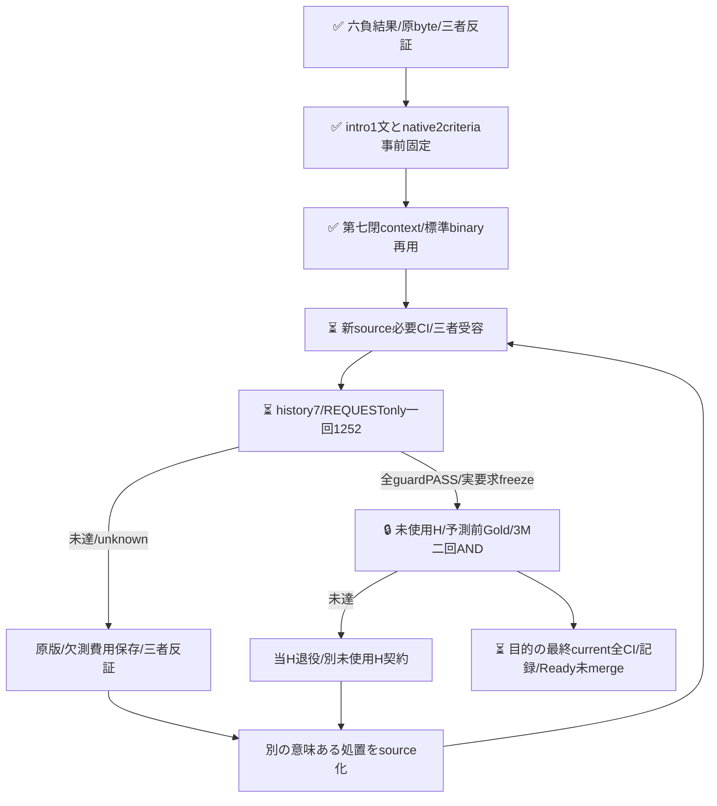

次source/実測は現時点code-onlyで、以下はD6原負保持時点と旧sourceの固定記録。当時のpendingは現時点と区別する。

## D6負保持時点の記録

## D6：known退行FAILと5件の技術欠測を併記

[run39535134680](https://github.com/roccho-org/ops/actions/runs/39535134680)は受容source d5606a19 / REQUEST-only activation e6cfad83 / development6・history6で一回実行した。全1252post（binaryBestE626+native role4 626）、適格1247（BestE626+role4 621）/unknown5/modelStable。四択原mapの5件はHTTP200・finite/range/count4/selectedmax/model一致だが、sum≈0.99で既定strict確率契約を満たさずresponse-probabilities AssertionError。実受信snapshotを保存し、丸め補正・正規化・choiceへの昇格・再送をしない。未知はE/Oともnullで、NEITHERやE=noにはしない。実job119009925015は鍵前714/714fail0の後、execute/projectが各exit2、artifact保存SUCCESS。

原固定guardは既知退行によりDEVELOPMENT_GUARD_FAIL。baselineJointCorrect477/candidateKnownJointCorrect496は別々の既知件数で、その差19をpaired gainとは呼ばない。既知pair修復28/退行5のnet23と一致しないのは候補欠測5があるためで、全資格の改善効果は未成立。Eはbaseline584/candidateKnown603、fresh退行5（held-044/188/251、census-072/078）、歴史617保護内破壊9（held-044/086/158/188/251、census-023/072/078/210）。unknownProtected5（held-001/011/146、census-188、expectation-114）も別保持。O-null17/全626の分母は不変。正差や候補O診断で破壊を相殺しない。

root/Rは各自己provider ZIP/nativehistory/全1252Core・flags・4map/snapshot・資格/617guard/usageを独立再算術し、W製品再生と全9projection fieldsが一致した。原5全24,911,546Bとprovider/readback/root独立reportをresults/expectation-role4-development6-20261021/へ原bytes保持、旧五投影/guards/原plans/REQUEST/Goldは不変。成功selectionや実要求freezeを発行せず、H count/body/Goldは0。現保持head全通常CI/記録/Readyは別残件で、sourceD560の714成功と混同しない。

当回物理1252に対してusage既知1247の小計input2,386,363/output51,085、各5post不明、total_tokens全1252不明。D1..D6累積physical7512/qualified7507、input既知小計15,807,107/output既知小計245,145・各5post不明、total_tokens全7512不明。missingを0扱いせず、候補E/O射影や歴史aliasを追加call/usageに数えない。9312は最大割当で実費ではなく、料金/内部計算量は不明。原qualified Coreと標準clientからpayloadを再構成した照合であり、実HTTP body全bytes捕捉の主張ではない。

9全文をW/root/Rが元rubricで読み直しGold維持。8FNは責務/境界・完了報告内の不変条件・表示IO・明示expected状態・必要行為を落とす一方、1FP census-072はFeatureRequest見出しとuninstall不能報告から要求を補った。held-158のhave to re-installとcensus-210のneed to stop all...はliteral必要行為があり、単なる症状推論というroot初期まとめは訂正した。個別case例を新promptへコピーしない。四択argmax後のE射影とE側massは別規則だが、この9原mapでは単純.5周辺和でも誤答は変わらないという負counterで、後付救済はしない。

次工学保護は旧9509binary E+当回binaryBest626+qualified role4 E射影621=10756 qualified E evidence、binary10135/role4由来621を区別、保護617orderedIDs/追加無し。全10761をbinary原応答と呼ばず、当回invalidrole4 5はpost/unknownとして別保持して全626から除外しない。未来617へ今回採点を変更しない。ever-correctは不偏推定/達成可能性保証でない。

次案はE1118/O581/ANY共存を保持し、最初の出力指示とcriteriaだけをnativeyes/noへ変える一package。Wは周辺和閾値案との差を反証、rootは4map厳格資格を後付緩和せずに出力形式を変える案を提示、Rはnative二択からlatent4分類/O診断を観測したとは言えない点をcounterし三者受容した。原D6確率やGoldを補正せず、binaryでも資格/意味誤り/O干渉は残り得る。内部4分類の実行やmarginal同等性・改善原因は未証明。次literal/Core/source必要CI/公開exact三者受容後の別一回であり、現D6のretry/再採点でない。D6のnativeconclusion failure/execute-project exit2/原1247+5unknown+knownFAILを正直に検証する専用prospective admissionが必要、旧五success前提は保持する。まだ次製品実装/モデル作用は0。

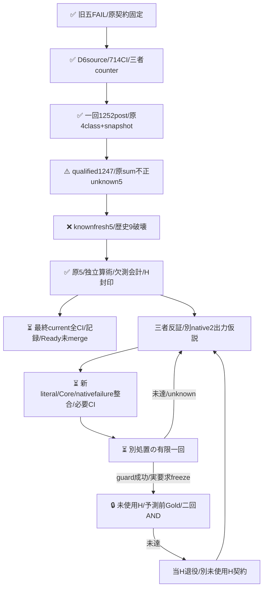

Hは観測した862typed/2033exact/2371canonical参照規則と固定Gold上の有限改善近似までで、意味的未見/Gold無謬/独立標本/母性能/Apps E2E/同原価を証明しない。以下はD6 source時点と旧負処置の固定記録で、当時のpendingを現況と混同しない。

## D6 source時点の記録

## D6 ROLE4（code-only）

候補はnativeのE_ONLY/O_ONLY/BOTH/NEITHER四択で、E_ONLY/BOTHをE=yesへ、それ以外をE=noへ機械射影する。D5のE1118字とyes/no114字は全文保持し、Oの存在定義と四つの真理値条件を加えた2198字instructionsを固定。BestE/sharedO・本文/Gold・model/client・question keyは全値保持。候補Oは診断だけで、primaryの歴史Oや将来の当回sharedOを代用しない。言語だけの効果やE-only binaryモデルの改善ではなく、E/O負荷と文面も伴う構造packageであり、混合軸干渉や四択の複雑化がEを壊す可能性を残す。

Wは五処置の負結果を受け単純な追記/短縮の盲再送を避け、root/Rは観測onlyへの明示的な出力先を持つ四択構造を反証して支持した。Rは確認表/HTMLの形式だけでOにする穴を指摘し、実際の行為・現状を報告する用途へ限定してv1を保存しv2へ事前固定した。Wは四確率のsum/max/selectedだけでは非選択二値の相殺swapを見逃す反例を提示し、root/Rも独立validatorで確認した。実受信時のrole4Native snapshotとSDK typed map全entryを照合する。双方同時偽造は既存native原版/bytes照合の境界であり、独自hash gateを追加しない。[root負保持と構造counter](https://github.com/roccho-org/ops/pull/624#pullrequestreview-5594130357)・[R独立counter](https://github.com/roccho-org/ops/pull/624#pullrequestreview-5594132982)。

標準recorder/SDK/transport/secretを再用し、exact4roleだけ原confidence/probabilitiesとresponse-flagsの4field snapshotを保持する。invalid原型は補正せずunknown/failureとして残し、qualified時だけ4keys/range/sum/selectedmax・flags・typed/snapshotの全entryを結合する。旧binary return/event形・旧五投影の全fieldは不変で全原版再生する。原9509binary Eから617caseを保護、freshBestE626+native role4 626=1252physical（E/O射影0call）。derivedE/OにはproviderAnswer:falseとrun/case/key/post/sourceChoiceのみを結び、provider確率/confidence/model/usageを捏造・複製しない。原mapは原answerに一回保持、候補Oは診断枝。独立した二定義は意味誤りやGoldの独立性を保証しない。

fresh617保護とfreshE退行0、全1252資格/model、完全joint正差を別AND。固定historicalOとの非同時D診断で、O-null17も全626へ保持する。GoldO-nullはrole4原資格/E射影を不明化しない。ever-correct保護は工学目標で、不偏性能推定や達成可能性保証ではない。新history6/native13/8field secret-safe input/attemptdigest1252を閉固定し任意profileを公開しない。source-onlyで旧D5 REQUESTを変更しない。最大9312=消費6260+新1252+将来H1800、実会計と別、追加User予算/認証待ちは無い。原D1..D5のschema/guards/plans/raw/Goldは不変、617を遡及しない。未開封Hのprospective capは旧250から同job350へ明示改訂し、unknownとなる時間を延ばす技術変更として扱う。品質/15秒/3M/二回/再送禁止は不変、完走保証や事後延長は無い。

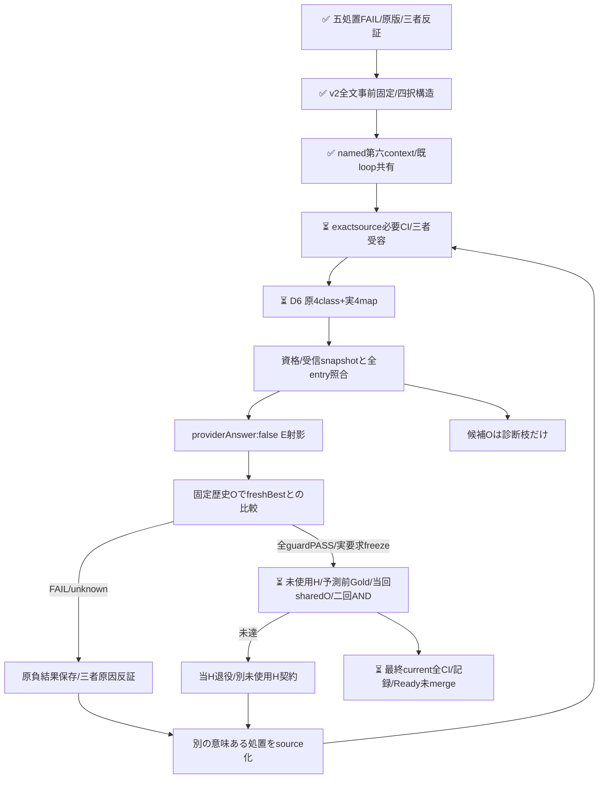

D6実作用/新H count/body/Goldは0。以下はD5負保持と旧sourceの固定記録。

## D5英語再定式化：正差24でもfresh退行8・歴史破壊10で不受容

[development5の一回の実run](https://github.com/roccho-org/ops/actions/runs/39530464600)はsource e86b9b8 / REQUEST-only activation bd28a3f / phase development5・履歴5で実行した。全1252要求が資格とexpected modelを満たしunknown0。fresh complete475→499（修復32/退行8）、E582→607（修復33/退行8）。fresh退行8（census-072/078/080/108/146/153/178、expectation-027）と、原611保護内破壊10（同8＋census-023/093）によりDEVELOPMENT_GUARD_FAIL。正差24で相殺しない。機械first477/E585は別診断、O-null17/全626分母を保持する。

root/Rは各自provider ZIP/native実Git親/REQUEST phase5を取得し、別readerで全1252期待Core/flags/資格/611guard/usageを再計算した。W原bytes/製品再生も一致。原5全22,289,214Bをresults/expectation-declaration-development5-20261021/へ保存。実job118994928968全stepsSUCCESS・鍵前704/704は意味受容ではない。selection/成功要求freezeを発行せず、新H count/body/Goldは未開封。旧4と新D5の原604/607/607/610/611・schema/Core/全projection/outcomeを固定再生し、後の保護で過去失敗を救済しない。

当回物理1252/input2,227,920/output38,812、total_tokens全1252欠測。PR624 D1..D5実消費は6260/input13,420,744/output194,060、total_tokens6260欠測。8060はD5 source時点の最大割当で実消費ではない。歴史8257 E/O aliasや未実施Hを新費用へ加算せず、料金/内部計算量は不明。原qualified Coreと標準clientからpayloadを再構成した照合であって、実HTTP body全bytesを捕捉したとは言わない。旧Best維持・未採用、現head最終通常CI/記録/Readyは別に閉じる。

失敗10本文を元rubricで再読しGold不変。fresh8は観測・不満・実施報告等を要求へ昇格したFP7と、明示された期待条件を落とすFN1。残るUI宣言FNと操作観測FPも保持。英語3fieldsの一体変更は部分修復と破壊を伴い、英語単独/圧縮単独の因果は特定できない。Wは3literalをsource前固定し、root/Rは各自己原Coreから独立期待Core/payloadを固定して照合したという担当の違いを明示する。

次の工学的保護は原9509 Eから617へ（追加held-158、census-117/173/210、expectation-004/028）。W/root/Rの全ordered保護ID一致は次sourceだけの出力前条件で、今回611へ遡及しない。ever-correctは不偏性能推定/到達保証ではない。次は文字列追記だけでなく、E_ONLY/O_ONLY/BOTH/NEITHERの四択role分類→E固定射影という課題構造を反証する。candidateOは診断だけで、D原historicalO/H当回fresh sharedOを置換しない。原4choice/4確率/model/usageを保存し、derivedEへproviderのconfidence/probability/model/usageを捏造しない。混合軸干渉再導入/複雑化リスク、資格形式変更と旧全原版不変を、literalと実sourceで三者反証してから次処置を固定する。新作用/H開示はない。

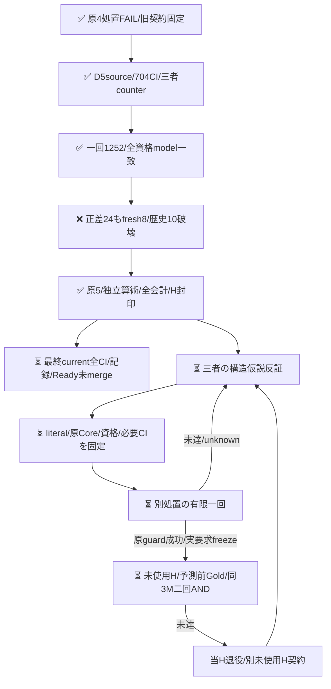

Hは観測した862typed/2033exact/2371canonical参照規則と固定Gold上の有限改善近似に限り、意味的未見/Gold無謬/独立標本/母性能/Apps E2E/同原価を保証しない。以下はD5 source時点と旧処置の固定記録であり、当時の未完表示を現状と混同しない。

## D5 source時点の記録

## D5固定DECLARATION context（code-only）

候補instructionsとyes/no criteriaだけを1118字の英語説明＋114字のyes/noへ一体で全置換する。旧日本語suffix/5例をappendせず、question/key/二択の形・BestE/sharedO・model/client・全本文/Goldは全値保持する。言語/文言/圧縮/役割構成のbundleであり、英語や短文化単独の原因を主張しない。本文へ役割hintやID/語句例外を追加しない。

Wは例の継ぎ足しより全体整合を反証する別案として選択し、完了状態という表現が実施報告をEへ昇格させる穴を指摘した。rootは因果的な観測をIO仕様へ昇格させる穴を反証し、Rはnoが列挙された観測等だけの否定になる穴をANYの完全否定へ是正した。HTML commentsの入力境界、formulas、IOが本文でspecificationとして提示される役割をW/root/Rで精密化し、元の真正な提出/回答/回復/婉曲依頼・現責務を狭めない3literalをWがsource前固定し、root/Rが各自己原Coreから期待全文を独立固定した。specificationは公式文書/採用済み/future/must必須という意味ではない。観測結果や回避だけから未記載要求を補わず、引用/例も形式でなく本文の用途で判断する。[root原負保持と次仮説](https://github.com/roccho-org/ops/pull/624#pullrequestreview-5593939574)・[R独立反証](https://github.com/roccho-org/ops/pull/624#pullrequestreview-5593941852)。

原8257 Eの全626 case/611正答を保護し、freshBestEと候補E各626=1252を同じfixed historicalOで比較する非同時D診断。全資格/expectedmodel・完全joint正差・歴史611破壊0・freshE退行0を別AND、機械firstは別診断、O-null17を全分母に残す。旧4contextの604/607/607/610・Core/schema/historyScope/guard/outcome/usageScopeは全field再生して不変、611へ遡及しない。ever-correct保護は不偏性能推定/到達可能性保証ではない。

既workflow/350分/sixstep/secret/clientへ閉development5のみ追加、原4run＋currentのhistory exact5・全12native API/実Git親/source/REQUESTphaseと原8257資格を鍵前結合する。secret下はexact8field/fullbody/Core/template/execution、投影で原attempt digest/max1252を再照合。任意profile/schema/max/endpoint/constructorは公開しない。source-onlyは旧phase4/dd98 REQUESTを一字も変更せず、新source必要CI/公開exact三者受容後のactivation5だけがrequestを変更し一回起動する。意味FAILは原来歴を保った別処置を取消さず、原技術不成立は拒否する。

prospective-plan5の最大8060=消費済5008+新最大1252+将来H最大1800と実会計は別で、追加User予算/認証待ちのgateを設けない。旧4plans/旧raw/Goldは原文保持。未使用Hは既Oct18窓/prior/noRefill/同3M二回ANDを変えず、実D5guard成功/原版/実要求freeze受容前のcount/body/Goldは0。Hcap250→350は別held sourceで開封前改訂して受容し、旧plan通り成功したとは言わない。

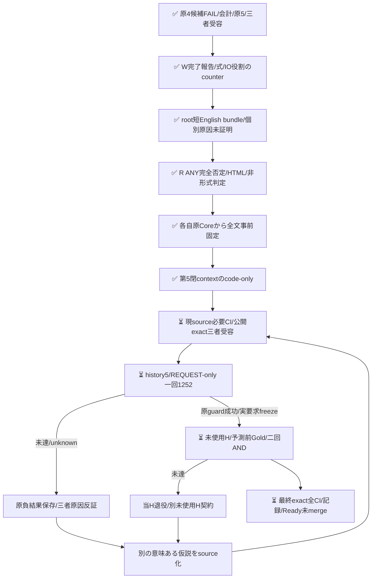

以下はD4負保持と旧sourceの固定記録。新D5 source/必要CI/実gain/新H/最終current全CIは未完。

## D4 O向け対比削除：正差22でもfresh退行2・歴史破壊5で不受容

[development4の一回の実run](https://github.com/roccho-org/ops/actions/runs/39527554272)はsource dd98d10 / REQUEST-only activation a5d8631 / phase development4・履歴4で実行した。全1252要求が資格とexpected modelを満たしunknown0。fresh complete476→498（修復24/退行2）、E583→606（修復25/退行2）。freshE退行census-034/090と、原610保護内の破壊5（census-023/034/090/093、expectation-020）によりDEVELOPMENT_GUARD_FAIL。正差22で相殺せず、機械first477/E585は別診断、O-null17を全626分母に残す。

root/Rは各自provider ZIP/native実Git親/REQUEST phase4を取得し、別readerで全1252 Core/flags/資格/610guard/usageを検証した。W原bytes/製品再生も一致。原5全26,229,134Bをresults/expectation-focus-development4-20261021/へ保持。実job全stepsSUCCESSと鍵前696/696は意味受容ではない。selection/成功要求freezeを発行せず、新Hの件数/本文/Goldを開かなかった。旧D1/D2/D3の原604/607/607と今回610を固定したまま全projectionを再生し、後の保護やGoldへ遡及変更しない。

当回物理1252/input2,793,198/output38,812、total_tokens全1252欠測。PR624のD1+D2+D3+D4実消費は5008/input11,192,824/output155,248、total_tokens5008欠測。6808はD4 source時点の最大割当で実費用ではない。歴史7005 E/O aliasや未実施Hを新費用へ数えず、料金/内部計算量は不明。原qualified Coreを標準clientから再構成したpayload照合であって、実HTTP body全bytes捕捉とは言わない。旧Best維持・未採用、現head最終全通常CI/記録/Readyは別に閉じる。

全5失敗本文を再読した。UIの入力目的宣言、next stepsの真正対応指示、婉曲な表示改善提案、HTMLコメントの提出条件を落とす一方、操作と観測/回避だけの報告を要求と数える誤りが残る。元Gold/本文は変更しない。O対比削除によるheld-086修復も保持するが、混合軸干渉の単独原因は証明しない。次の工学的保護は原8257 Eから611へ（追加expectation-014）、これは次sourceだけの出力前契約で今回610へ遡及しない。

次仮説は候補Eのinstructionsとyes/noを短い英語の役割/存在判定へ一体再定式化する案。英語/圧縮/文言/構成のbundleで因果分離はなく、4choice資格変更や日本語例の追加継ぎ足しは混ぜない。元ANYの責務/IO/条件付き提出/真正依頼を狭めず、観測だけから未記載仕様を補わない。exact全文は三者反証して出力前に固定し、必要CI/三者受容前の新作用はない。

H未使用とは862typed/2033exactbody/2371canonical参照規則で確認可能な観測範囲で、意味・全引用・学習の未見を保証しない。同系統かつ候補既知評定者の盲検Goldは共通偏りを消さず、固定有限集合/Gold条件での近似だけ。joint b/cとany-axis退行Rは別定義である。以下はD4 source時点と旧候補の固定記録であり、当時の未完表示を現状と混同しない。

## D4 source時点の記録

## D4固定FOCUS context（code-only、実作用前）

元D3の候補instructionsからO判定向け183字の連続対比blockを一回だけ削る。末尾のbody全体/非推測は残し、前E/ANY・元620suffix・286字5例・全criteria・BestE/sharedOは全値保持する。削るblockには許容条件Eの比較例も含むため「純Oだけ」「全E例不変」とは言わない。英語例追加や4choice分類は混ぜない。混合軸干渉は仮説であり、内部原因や削除単独の一般効果は未証明。

Wは後body-only句まで削る案へcounterし、rootも自己counterで対象境界保持へ精密化した。Rは許容条件E例も削ることを指摘し、3者が原D3 Coreから183字を独立抽出して削除後全instructionsを出力前一致確認した。[root負保持と三者反証](https://github.com/roccho-org/ops/pull/624#pullrequestreview-5593723442)・[R負保持とexact残文確認](https://github.com/roccho-org/ops/pull/624#pullrequestreview-5593727115)。root/Rは別々の原取得Coreから期待値を固定し、今回もnetwork HTTPbody捕捉ではなく標準client再構成で全1252 payloadを照合する。実case本文への役割hint/ID例外はない。

元7005物理Eから全626 case/610正答を保護し、fresh BestE/candidateEを各626=1252新規測定する。同一の固定historicalOを両armへ用いる非同時D診断で、fresh E退行0と歴史610破壊0・完全joint正差・全1252資格/expected modelを独立ANDにする。機械firstは診断だけ、O-null17を全分母に残す。610は独立情報数/不偏推定/到達保証ではない。旧D1/604・D2/607・D3/607の全projection/Core/raw/FAILは固定contextで再生し、610へ遡及採点しない。

同じworkflow/350分/sixstep/secret/clientの固定development4のみを追加し、history exact4（原D1,D2,D3,current）と全11 native API/実Git親/REQUEST-only sourcephaseを鍵前に結合する。新schema/namedwrappersで処置を区別し、任意profile/schema/max/endpoint/constructor overrideは受けない。source-onlyは旧phase3/3610 REQUESTを一字も変更せず、必要CIと三者exact受容後のactivation4だけがREQUESTを変更して一回起動する。以前の意味FAILは新D取消条件にせず、原技術資格/来歴は必須。

prospective-plan4.jsonはseries最大6808=実消費3756+新D最大1252+将来H最大1800を明示する。旧plansは原文保持し、最大割当と実会計を分離する。同GO内で追加User予算/認証を求めるgateではない。新Hの固定Oct18窓/prior862・2033・2371/noRefillは変えず、実D4guard成功と要求freeze受容前のcount/body/Goldは0。H250→350技術cap改訂は別held sourceで出力前に明示し、ここでは旧250契約の成功を主張しない。

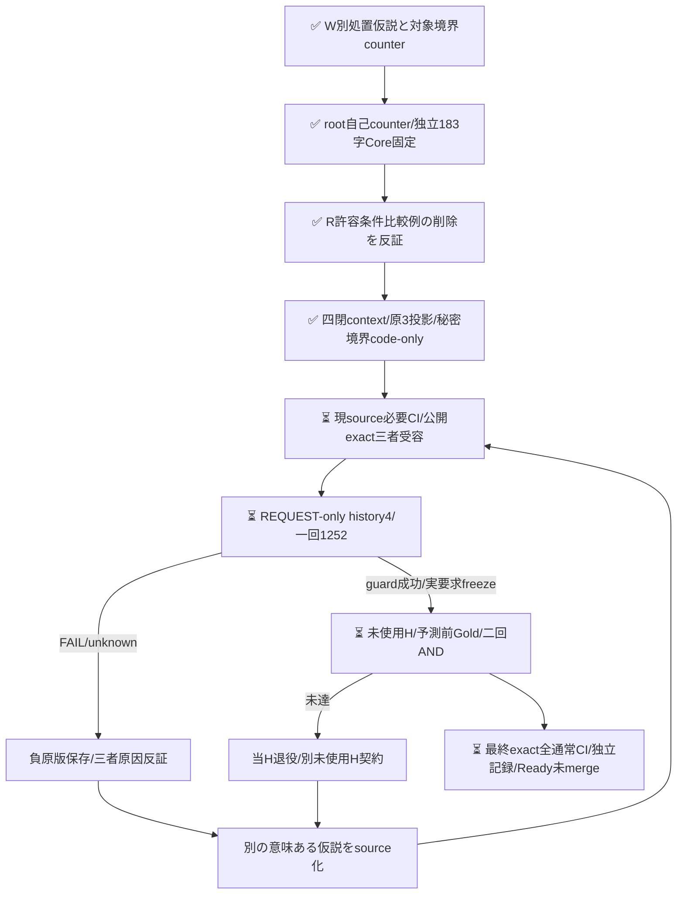

以下は受容済みのD3負結果と各旧sourceの固定記録。新source/必要CI/実D4/新H/最終current全CIは未完である。

## D3 scope・合成例候補：正差23でもfresh退行1・歴史破壊3で不受容

[development3の一回の実run](https://github.com/roccho-org/ops/actions/runs/39523800207)はsource3610f16 / REQUEST-only activation ff235faf / phase development3・履歴3で実行した。全1252要求が資格とexpected modelを満たし、unknown0。fresh complete476→499（修復24/退行1）、E583→607（修復25/退行1）だった。しかしfreshE退行census-090、原607保護内の破壊held-086/census-023/census-090によりDEVELOPMENT_GUARD_FAIL。3件ともGoldE=yesをnoへ落としたもので、正差23で相殺しない。機械first477/E585は別診断、O-null17も全626分母に残す。

root/Rは各自provider ZIPとnative実Git親/REQUEST phase3を取得し、独立readerで全1252 Core/flags/資格/全guard/usageを再生した。Wの原5全27,224,473Bと製品再生も一致し、results/expectation-example-development3-20261021/へ原bytesを保持する。実job鍵前688/688と全step成功は意味受容ではない。selection/成功要求freezeを発行せず、新Hの件数/本文/Goldは未開封。D1原604・D2/D3原607やGoldを遡及変更せず、旧2候補も全field固定で再生する。

当回物理1252/input2,905,878/output38,812、total_tokens全1252欠測。PR624のD1+D2+D3実消費は3756/input8,399,626/output116,436、total_tokens3756欠測。5556はD3 source時点の最大割当であって実消費ではない。歴史5753 E/O aliasや未実施Hを新費用へ数えず、料金/内部計算量は不明。旧Best維持・未採用。現headの全通常CI/記録/Readyは別に閉じる。

次処置を設計する際の歴史保護は、当回1252の新正答も加えた原7005 Eから610へ拡張する（追加expectation-017/043/044）。これは次sourceの出力前契約であり、D3の607へ遡及しない。ever-correct保護は工学的採択条件で、不偏性能推定や達成可能性を保証しない。次仮説は候補instructionsのO向け対比blockを許容条件の対比例ごと一連続削除する案で、body全体/非推測・E前半/ANY・原suffix・286字例・criteria・Best/Oを保持する。干渉原因は未証明で、英語例追加等を混ぜず、exact source/必要CI/三者受容前の実作用はしない。

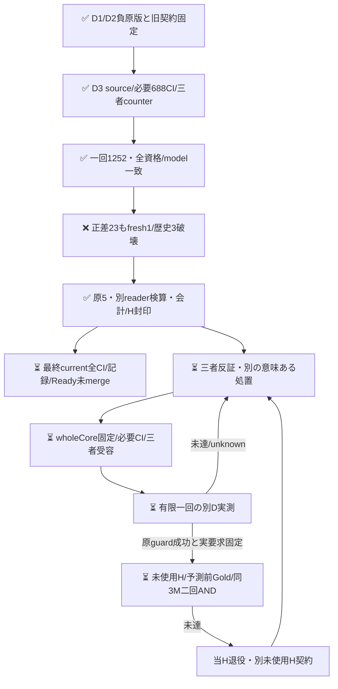

以下はD3 source時点と旧候補の固定記録であり、当時の未完表示を現在と混同しない。

## D3 source時点の記録

## D2境界候補：正差17だがfresh退行1・歴史破壊7で不受容

[development2の一回の実run](https://github.com/roccho-org/ops/actions/runs/39520431305)はsource f3618bb9 / REQUEST-only activation d2eeec62 / phase development2・履歴2で実行した。全1252要求が資格/expected modelを満たし、unknown0だった。fresh complete475→492（修復18/退行1）、E582→600（修復19/退行1）。しかしfreshE退行census-093と、原607保護内の破壊7（census-003/012/053/093、expectation-020/045/070）によりDEVELOPMENT_GUARD_FAIL。正差17でどちらも相殺しない。機械first477/E585は別診断、O-null17を全626分母に残す。

root/Rは各自provider ZIP/native実Git親/REQUEST phase2と原5を取得し、別readerで全1252 Core/flags/資格/全guard/usageが一致した。原5全25,683,706Bをresults/expectation-boundary-development2-20261021/へ保持する。実jobの鍵前680/680と全step成功は意味改善の受容ではない。selection/成功要求freezeは発行せず、新Hの件数/本文/Goldを開かなかった。旧D1の原604・schema・Core・原5・FAILは全field不変で再生する。607を弱めたり原Goldを変更したりしない。

当回物理1252/input2,734,980/output38,812、total_tokens全1252欠測。PR624のD1+D2実消費は2504/input5,493,748/output77,624、total_tokens2504欠測。4304は事前最大割当であり消費ではない。歴史4501原E/O aliasや未実施Hを新費用へ数えず、料金/内部計算量は不明。旧Best維持・未採用、現headの全通常CI/記録/Readyは別に閉じる。

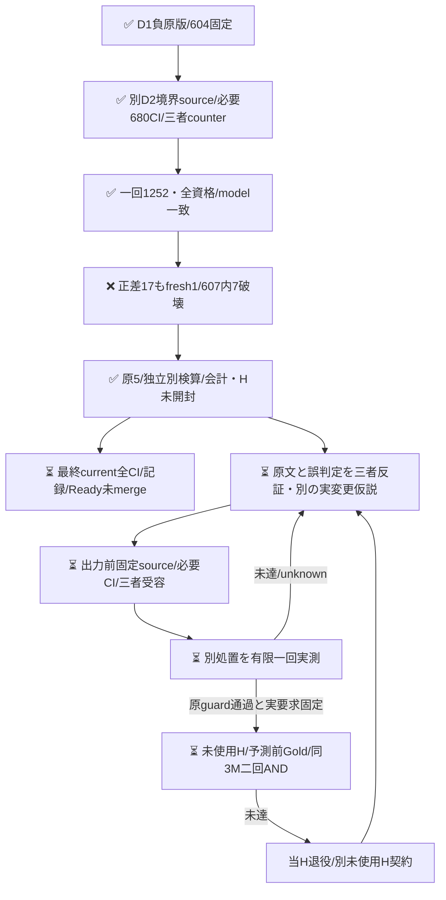

以下はD1結果とD2 source時点の固定契約であり、当時の未完表示を現状と混同しない。次候補のsource/作用はまだなく、同候補盲再送/Gold変更/同H再試験で救済しない。

## D1役割候補と旧sourceの記録

## 実D結果：正差6、fresh退行15・歴史破壊18で不受容

[一回の実run](https://github.com/roccho-org/ops/actions/runs/39515942918)は全1252要求が資格/expected modelを満たした。complete正答475→481（修復21/退行15）、E正答583→589（同21/15）だったが、freshE退行15と原604保護内の破壊18によりDEVELOPMENT_GUARD_FAIL。正差6でどちらも相殺しない。機械first477/E585は診断だけ、不確定O17は全626分母に維持する。

root/Rは各自provider ZIP・native parent/REQUEST/source/attemptを取得し、別readerで全1252 Core/flags/資格/全guard/会計が一致した。原5はresults/expectation-role-development1-20261021/へ原bytesで保持、Wも原版と全製品投影の一致を確認した。実jobの鍵前672/672成功とworkflow全step成功は意味判定PASSではない。selection/成功要求freezeを発行せず、新H件数/本文/Goldを開かなかった。旧622 ORの不受容も維持する。

当回物理1252 E/input2,758,768/output38,812。total_tokensは全1252欠測、金額/内部計算量不明。歴史aliasを新物理費用に加算しない。H作用0。保存後current全通常CI/記録/Readyは別に閉じる。

18歴史破壊には真正な対応指示/必要性、責務、提出依頼の過小包含と、観測のみの過大包含が混在した。原本文/Goldは変更せず、このclusterを見出し/語句/ID例外にしない。次は元620のE末尾へ戻した上で、criteria側へ短い宣言/観測境界を置く別一候補bundleを三者反証する。配置/短文化の単独原因は断定せず、同役割手順の盲再送で救済しない。今回の新正答も忘れず全4501原E→607保護を次prospective sourceへ導く（現604 guardへ遡及適用しない）。

## 事前sourceと反証（926eff時点）

PR622のORはcomplete正答476→494だったが、fresh census-093退行と歴史601内census-023破壊により不受容だった。旧OR/Gold/原版は変更しない。今回正答も忘れず、全3249物理E原応答から604保護を導く。

Wは機能・入出力宣言と実施/観測の発話役割をinstructionsの先行手順に置く案を提示。rootは再現手順内の宣言まで捨てる再発を反証し、Rは「独立」を別の文/箇所という必要条件にしないこと、単なる観測IOから仕様を補わないことを指摘した。最終案は元common instructionsとcurrent yes/no全文を保持し、E専用末尾だけを固定置換する一候補bundleである。配置と文面内容の個別原因を証明しない。本文の特定ID/語句例外やGold変更はない。

新Dも当回freshBestE/candidateE各626を同じ固定歴史Oと比較する。機械firstは診断のみで、604歴史E保護とfreshE退行0を正差とは別ANDにする。singlecandidateをそのまま採点し、ORで救済しない。baseline欠測を既知修復に数えず、候補の既知歴史破壊は欠測と併存して残す。原資格は後段の標準recorder/raw/native入口で実検証する責務であり、pure引数は証明ではない。

原3249→604/626の再生とfresh1252whole-body/Goldfree要求の鍵なし準備だけを実装した。元BestE/共有OのwholeCore、criteria、共通instructionsは不変で、候補instructionsだけが違う。今回の局所synthetic検査はモデルの改善証拠ではない。固定native入口はcode-onlyで追加したが、必要CI/三者受容/実D/成功要求固定/新Hは未完。

次Hは既固定Oct18同3repo/旧8bc観測metadata、prefix300/補充0を継承し、新countは未抽出。元862typed/2033body/2371参照の私的native由来と保守参照除外規則を維持する。metadata-only全IDをtask既使用へ混ぜない。本文取得/Goldは実D受容後、初稿相互未読・予測盲検でnative固定する。同系列モデル/候補既知の評定者は独立human Goldではなく、未確定nullと有限固定Goldに対する近似という射程を保つ。無作為/意味や学習未見/Apps E2E/一般母集団品質は保証しない。

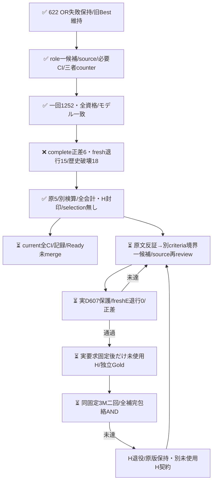

同GOで別仮説をsource/必要CI/三者受容後だけ実施する。新User予算/認証/merge承認を追加せず、負結果/実費用を全て残す。

## D2 source f361時点の事前契約（当時code-only、実結果は冒頭）

[三者の出力前counter](https://github.com/roccho-org/ops/pull/624#pullrequestreview-5593193516)に従い、原620のE専用suffixへ戻し、yes/no基準へ短い境界対を半角space一つで追加する。本文の機能/IO宣言を説明・表示・再現記録という置き場所で捨てず、観測記録から未記載の仕様を補わない。元ANYの責務/対応指示/提出依頼/引用/回復要求は削らず、「本来」「不満」を独立predicateにしない。復帰＋短criteria対の一候補bundleで、配置/短文化の単独因果は主張しない。case/見出し/語句lookupもない。

既measurement内部の二固定contextとnamed wrapperで標準2E loop/資格だけを共有する。旧role D1のschema、template、historyScope、604 guard、全projection/usageScopeは全値再生した。新境界は別input/predictions/projection schema・constructorで正直に識別し、任意schema/max/profile/constructor overrideを公開しない。全4501物理E原版から607全IDを再生し、fresh2Eの同歴史O primary・freshE退行0・607保護・joint正差・全資格を別ANDにする。

同branch/workflowを再用し、sourcebatchでは元D1 REQUESTを一切変更しない。新sourceの必要CI/三者受容後だけrequest-only childへdevelopment2を書き、native historyは元D1/currentD2ちょうど二つ、各実Git親/phase/source/actorを拘束する。D1意味FAILは新D2の取消理由にはしないが、原資格/モデル/来歴の不成立は拒否する。新9nativeと原attempt1252を鍵前/投影で結合し、秘密下は新8field/全body/全Coreを固定sourceと比較する。

4304は消費済D1 1252＋新D2最大1252＋prospective H最大1800で、実消費とは別。D各350分/H各250分は完了保証でなく、追加User予算/認証待ちを設けない。旧prospective-plan.jsonは原文不変、prospective-plan2.jsonへ前向きに記録した。新H窓/prior/無補充/両回AND/Gold射程は同じで、現時点の新count/body/Gold/modelは0。必要sourceCI・実D2・H・最終全CI/Readyは未完。

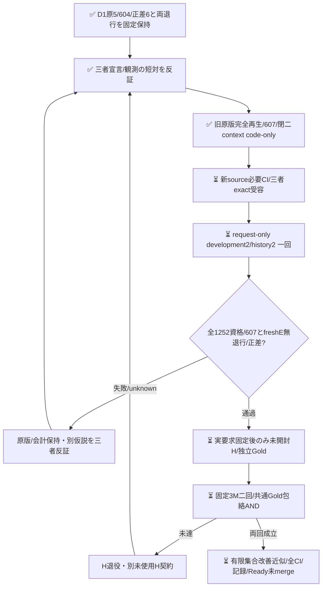

歴史ever-correct保護は工学的な採用条件であり、偏りのない性能推定量ではない。D626はwholebody620/同全文GoldE矛盾0という診断を得たが、意味同値やGold無誤謬を証明しない。新Hは便宜的な未使用有限targetでありSRS/相互独立標本とは称さず、実取得後はM Issue ID数とdistinct wholebody数/固定参照の不整合も記述診断として報告する。重複を事後除外/補充/再重み付けする新条件は追加しない。

## D3 scopeと合成例の一候補（code-only）

[三者の次処置counter](https://github.com/roccho-org/ops/pull/624#pullrequestreview-5593479772)でliteral全文を出力前固定した。D2 yes/no全criteria/common/元620 E専用suffix/BestE/sharedOをそのまま保ち、candidate instructions末尾へ半角space＋286文字のEXAMPLE_SUPPLEMENTだけを追加する。提出条件と実施記録、IO仕様と観測記録の対、回復依頼の5合成例で、要求を製品変更だけに狭めない。例は本文での役割を示し、語句/丁寧さ/時制/疑問形の規則ではなく、本文中の他の宣言をno例で無効化しない。引用の要求/仕様/責務を残し、要求として使わない語句/架空展示だけを区別する。実caseへラベル/役割hintを付けず、IDや実本文の例外lookupもない。

これはscope＋例＋配置の一bundleで、何が原因かの独立因果や内部理由を証明しない。fewshotの表面cue過適合と長文化のリスクは残り、D上の修正だけで性能を受容せず、成功D原版/実要求固定後の未使用H二回で判断する。長D1役割手順への復帰やケースに応じたruntime分岐はない。標準recorder/資格は非export固定ROLE/BOUNDARY/EXAMPLE三context＋namedwrappersに閉じ、任意schema/max/profile/constructor overrideは受けない。旧二runの全原投影を固定再生し、新dataは全5753物理Eから同607保護を作る。古い604/607/outcomeへ遡及変更しない。

同workflow/branchのdevelopment3/history3一回として、元D1/D2/currentちょうど三つを結合し、全10native実Git親/requestphase/sourceを鍵前に確認する。sourcebatchでは現在phase2/f361 REQUESTを変更しない。新source/必要CI/三者exact受容後だけactivation3 REQUEST-only childへ進む。D3もfresh2E1252、同歴史Oで完全joint正差・607無破壊・freshE退行0・全資格/expectedmodelを別ANDにする。不確定17は全626分母維持、旧firstは診断、aliasを新資格や費用へ数えない。

5556は消費済D1+D2の2504＋新D最大1252＋将来H最大1800という事前最大割当であり実消費ではない。各D350分/H250分は完走保証でなく、追加User予算/認証待ちを作らない。元plan/plan2は原bytes保持、prospective-plan3.jsonへ前向きに記録した。539の中間Ready/全CI完了を新source作成の二重gateにせず、新効果には新source必要CIを確認し、最終current全通常CI/記録/Readyは必ず閉じる。新H窓/priorは事前固定のままで、新H count/body/Goldは引き続き未開封。

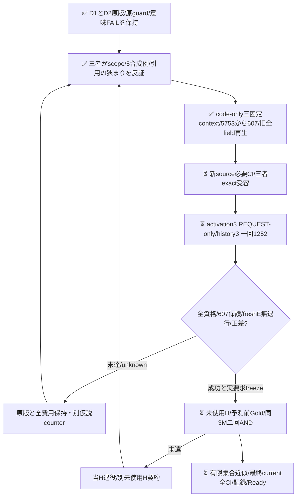
