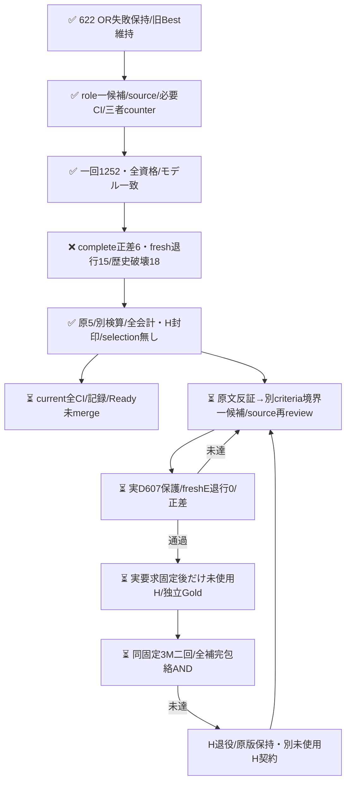

# E専用の役割判定手順を別の一候補として検証する

## 実D結果：正差6、fresh退行15・歴史破壊18で不受容

[一回の実run](https://github.com/roccho-org/ops/actions/runs/39515942918)は全1252要求が資格/expected modelを満たした。complete正答475→481（修復21/退行15）、E正答583→589（同21/15）だったが、freshE退行15と原604保護内の破壊18によりDEVELOPMENT_GUARD_FAIL。正差6でどちらも相殺しない。機械first477/E585は診断だけ、不確定O17は全626分母に維持する。

root/Rは各自provider ZIP・native parent/REQUEST/source/attemptを取得し、別readerで全1252 Core/flags/資格/全guard/会計が一致した。原5はresults/expectation-role-development1-20261021/へ原bytesで保持、Wも原版と全製品投影の一致を確認した。実jobの鍵前672/672成功とworkflow全step成功は意味判定PASSではない。selection/成功要求freezeを発行せず、新H件数/本文/Goldを開かなかった。旧622 ORの不受容も維持する。

当回物理1252 E/input2,758,768/output38,812。total_tokensは全1252欠測、金額/内部計算量不明。歴史aliasを新物理費用に加算しない。H作用0。保存後current全通常CI/記録/Readyは別に閉じる。

18歴史破壊には真正な対応指示/必要性、責務、提出依頼の過小包含と、観測のみの過大包含が混在した。原本文/Goldは変更せず、このclusterを見出し/語句/ID例外にしない。次は元620のE末尾へ戻した上で、criteria側へ短い宣言/観測境界を置く別一候補bundleを三者反証する。配置/短文化の単独原因は断定せず、同役割手順の盲再送で救済しない。今回の新正答も忘れず全4501原E→607保護を次prospective sourceへ導く（現604 guardへ遡及適用しない）。

## 事前sourceと反証（926eff時点）

PR622のORはcomplete正答476→494だったが、fresh census-093退行と歴史601内census-023破壊により不受容だった。旧OR/Gold/原版は変更しない。今回正答も忘れず、全3249物理E原応答から604保護を導く。

Wは機能・入出力宣言と実施/観測の発話役割をinstructionsの先行手順に置く案を提示。rootは再現手順内の宣言まで捨てる再発を反証し、Rは「独立」を別の文/箇所という必要条件にしないこと、単なる観測IOから仕様を補わないことを指摘した。最終案は元common instructionsとcurrent yes/no全文を保持し、E専用末尾だけを固定置換する一候補bundleである。配置と文面内容の個別原因を証明しない。本文の特定ID/語句例外やGold変更はない。

新Dも当回freshBestE/candidateE各626を同じ固定歴史Oと比較する。機械firstは診断のみで、604歴史E保護とfreshE退行0を正差とは別ANDにする。singlecandidateをそのまま採点し、ORで救済しない。baseline欠測を既知修復に数えず、候補の既知歴史破壊は欠測と併存して残す。原資格は後段の標準recorder/raw/native入口で実検証する責務であり、pure引数は証明ではない。

原3249→604/626の再生とfresh1252whole-body/Goldfree要求の鍵なし準備だけを実装した。元BestE/共有OのwholeCore、criteria、共通instructionsは不変で、候補instructionsだけが違う。今回の局所synthetic検査はモデルの改善証拠ではない。固定native入口はcode-onlyで追加したが、必要CI/三者受容/実D/成功要求固定/新Hは未完。

次Hは既固定Oct18同3repo/旧8bc観測metadata、prefix300/補充0を継承し、新countは未抽出。元862typed/2033body/2371参照の私的native由来と保守参照除外規則を維持する。metadata-only全IDをtask既使用へ混ぜない。本文取得/Goldは実D受容後、初稿相互未読・予測盲検でnative固定する。同系列モデル/候補既知の評定者は独立human Goldではなく、未確定nullと有限固定Goldに対する近似という射程を保つ。無作為/意味や学習未見/Apps E2E/一般母集団品質は保証しない。

同GOで別仮説をsource/必要CI/三者受容後だけ実施する。新User予算/認証/merge承認を追加せず、負結果/実費用を全て残す。
