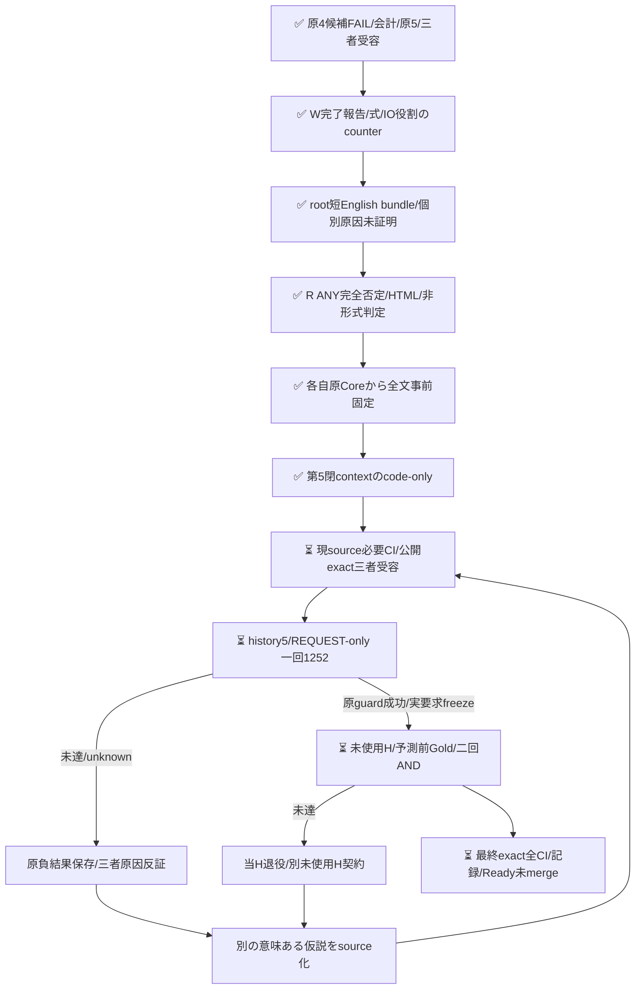
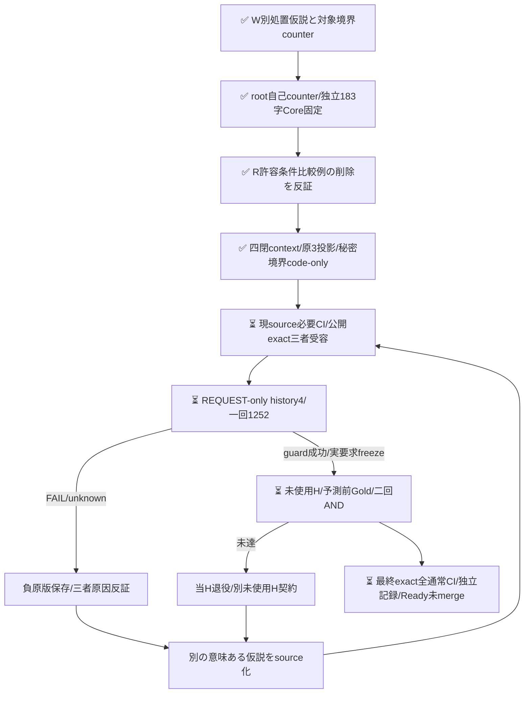
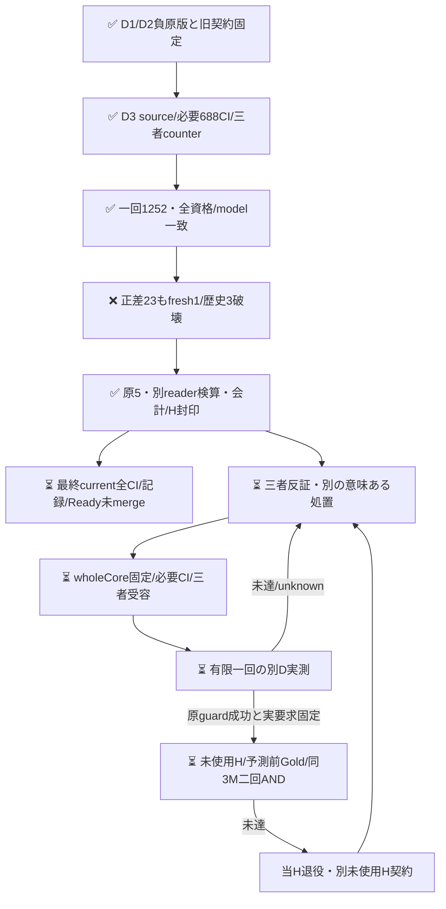
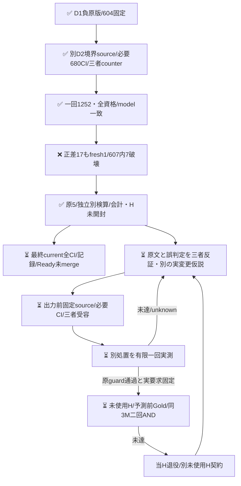
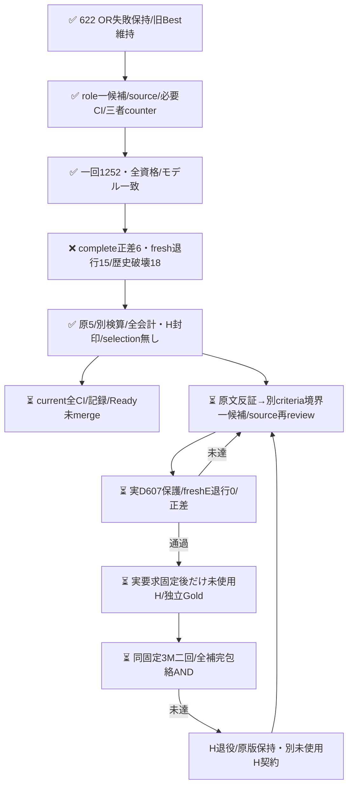
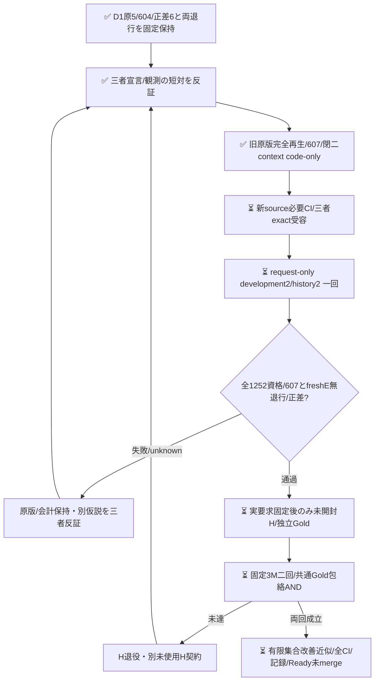
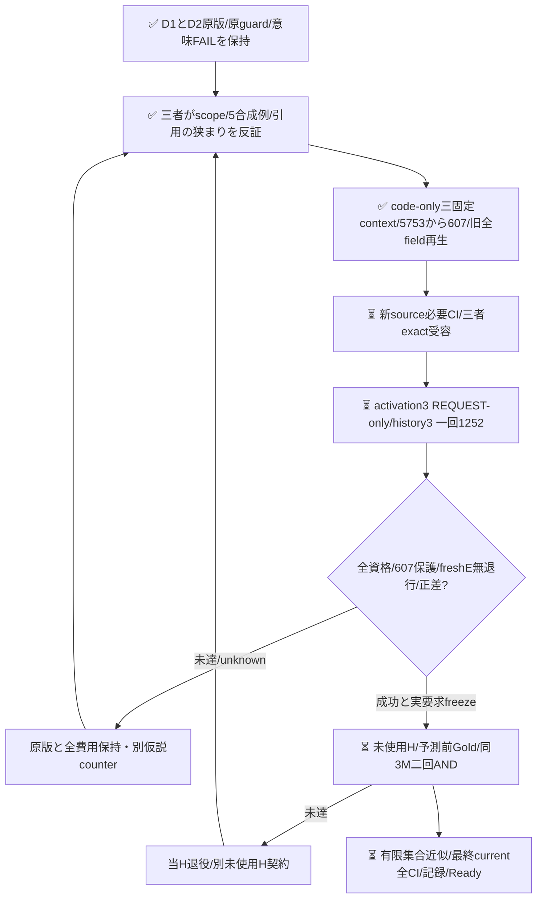

# 四候補の負結果を保持し、英語のE存在判定を別処置で検証

## D5固定DECLARATION context（code-only）

候補instructionsとyes/no criteriaだけを1118字の英語説明＋114字のyes/noへ一体で全置換する。旧日本語suffix/5例をappendせず、question/key/二択の形・BestE/sharedO・model/client・全本文/Goldは全値保持する。言語/文言/圧縮/役割構成のbundleであり、英語や短文化単独の原因を主張しない。本文へ役割hintやID/語句例外を追加しない。

Wは例の継ぎ足しより全体整合を反証する別案として選択し、完了状態という表現が実施報告をEへ昇格させる穴を指摘した。rootは因果的な観測をIO仕様へ昇格させる穴を反証し、Rはnoが列挙された観測等だけの否定になる穴をANYの完全否定へ是正した。HTML commentsの入力境界、formulas、IOが本文でspecificationとして提示される役割をW/root/Rで精密化し、元の真正な提出/回答/回復/婉曲依頼・現責務を狭めない全文を各自の原Coreから出力前固定した。specificationは公式文書/採用済み/future/must必須という意味ではない。観測結果や回避だけから未記載要求を補わず、引用/例も形式でなく本文の用途で判断する。[root原負保持と次仮説](https://github.com/roccho-org/ops/pull/624#pullrequestreview-5593939574)・[R独立反証](https://github.com/roccho-org/ops/pull/624#pullrequestreview-5593941852)。

原8257 Eの全626 case/611正答を保護し、freshBestEと候補E各626=1252を同じfixed historicalOで比較する非同時D診断。全資格/expectedmodel・完全joint正差・歴史611破壊0・freshE退行0を別AND、機械firstは別診断、O-null17を全分母に残す。旧4contextの604/607/607/610・Core/schema/historyScope/guard/outcome/usageScopeは全field再生して不変、611へ遡及しない。ever-correct保護は不偏性能推定/到達可能性保証ではない。

既workflow/350分/sixstep/secret/clientへ閉development5のみ追加、原4run＋currentのhistory exact5・全12native API/実Git親/source/REQUESTphaseと原8257資格を鍵前結合する。secret下はexact8field/fullbody/Core/template/execution、投影で原attempt digest/max1252を再照合。任意profile/schema/max/endpoint/constructorは公開しない。source-onlyは旧phase4/dd98 REQUESTを一字も変更せず、新source必要CI/公開exact三者受容後のactivation5だけがrequestを変更し一回起動する。意味FAILは原来歴を保った別処置を取消さず、原技術不成立は拒否する。

prospective-plan5の最大8060=消費済5008+新最大1252+将来H最大1800と実会計は別で、追加User予算/認証待ちのgateを設けない。旧4plans/旧raw/Goldは原文保持。未使用Hは既Oct18窓/prior/noRefill/同3M二回ANDを変えず、実D5guard成功/原版/実要求freeze受容前のcount/body/Goldは0。Hcap250→350は別held sourceで開封前改訂して受容し、旧plan通り成功したとは言わない。

以下はD4負保持と旧sourceの固定記録。新D5 source/必要CI/実gain/新H/最終current全CIは未完。

## D4 O向け対比削除：正差22でもfresh退行2・歴史破壊5で不受容

[development4の一回の実run](https://github.com/roccho-org/ops/actions/runs/39527554272)はsource dd98d10 / REQUEST-only activation a5d8631 / phase development4・履歴4で実行した。全1252要求が資格とexpected modelを満たしunknown0。fresh complete476→498（修復24/退行2）、E583→606（修復25/退行2）。freshE退行census-034/090と、原610保護内の破壊5（census-023/034/090/093、expectation-020）によりDEVELOPMENT_GUARD_FAIL。正差22で相殺せず、機械first477/E585は別診断、O-null17を全626分母に残す。

root/Rは各自provider ZIP/native実Git親/REQUEST phase4を取得し、別readerで全1252 Core/flags/資格/610guard/usageを検証した。W原bytes/製品再生も一致。原5全26,229,134Bをresults/expectation-focus-development4-20261021/へ保持。実job全stepsSUCCESSと鍵前696/696は意味受容ではない。selection/成功要求freezeを発行せず、新Hの件数/本文/Goldを開かなかった。旧D1/D2/D3の原604/607/607と今回610を固定したまま全projectionを再生し、後の保護やGoldへ遡及変更しない。

当回物理1252/input2,793,198/output38,812、total_tokens全1252欠測。PR624のD1+D2+D3+D4実消費は5008/input11,192,824/output155,248、total_tokens5008欠測。6808はD4 source時点の最大割当で実費用ではない。歴史7005 E/O aliasや未実施Hを新費用へ数えず、料金/内部計算量は不明。原qualified Coreを標準clientから再構成したpayload照合であって、実HTTP body全bytes捕捉とは言わない。旧Best維持・未採用、現head最終全通常CI/記録/Readyは別に閉じる。

全5失敗本文を再読した。UIの入力目的宣言、next stepsの真正対応指示、婉曲な表示改善提案、HTMLコメントの提出条件を落とす一方、操作と観測/回避だけの報告を要求と数える誤りが残る。元Gold/本文は変更しない。O対比削除によるheld-086修復も保持するが、混合軸干渉の単独原因は証明しない。次の工学的保護は原8257 Eから611へ（追加expectation-014）、これは次sourceだけの出力前契約で今回610へ遡及しない。

次仮説は候補Eのinstructionsとyes/noを短い英語の役割/存在判定へ一体再定式化する案。英語/圧縮/文言/構成のbundleで因果分離はなく、4choice資格変更や日本語例の追加継ぎ足しは混ぜない。元ANYの責務/IO/条件付き提出/真正依頼を狭めず、観測だけから未記載仕様を補わない。exact全文は三者反証して出力前に固定し、必要CI/三者受容前の新作用はない。

H未使用とは862typed/2033exactbody/2371canonical参照規則で確認可能な観測範囲で、意味・全引用・学習の未見を保証しない。同系統かつ候補既知評定者の盲検Goldは共通偏りを消さず、固定有限集合/Gold条件での近似だけ。joint b/cとany-axis退行Rは別定義である。以下はD4 source時点と旧候補の固定記録であり、当時の未完表示を現状と混同しない。

## D4 source時点の記録

## D4固定FOCUS context（code-only、実作用前）

元D3の候補instructionsからO判定向け183字の連続対比blockを一回だけ削る。末尾のbody全体/非推測は残し、前E/ANY・元620suffix・286字5例・全criteria・BestE/sharedOは全値保持する。削るblockには許容条件Eの比較例も含むため「純Oだけ」「全E例不変」とは言わない。英語例追加や4choice分類は混ぜない。混合軸干渉は仮説であり、内部原因や削除単独の一般効果は未証明。

Wは後body-only句まで削る案へcounterし、rootも自己counterで対象境界保持へ精密化した。Rは許容条件E例も削ることを指摘し、3者が原D3 Coreから183字を独立抽出して削除後全instructionsを出力前一致確認した。[root負保持と三者反証](https://github.com/roccho-org/ops/pull/624#pullrequestreview-5593723442)・[R負保持とexact残文確認](https://github.com/roccho-org/ops/pull/624#pullrequestreview-5593727115)。root/Rは別々の原取得Coreから期待値を固定し、今回もnetwork HTTPbody捕捉ではなく標準client再構成で全1252 payloadを照合する。実case本文への役割hint/ID例外はない。

元7005物理Eから全626 case/610正答を保護し、fresh BestE/candidateEを各626=1252新規測定する。同一の固定historicalOを両armへ用いる非同時D診断で、fresh E退行0と歴史610破壊0・完全joint正差・全1252資格/expected modelを独立ANDにする。機械firstは診断だけ、O-null17を全分母に残す。610は独立情報数/不偏推定/到達保証ではない。旧D1/604・D2/607・D3/607の全projection/Core/raw/FAILは固定contextで再生し、610へ遡及採点しない。

同じworkflow/350分/sixstep/secret/clientの固定development4のみを追加し、history exact4（原D1,D2,D3,current）と全11 native API/実Git親/REQUEST-only sourcephaseを鍵前に結合する。新schema/namedwrappersで処置を区別し、任意profile/schema/max/endpoint/constructor overrideは受けない。source-onlyは旧phase3/3610 REQUESTを一字も変更せず、必要CIと三者exact受容後のactivation4だけがREQUESTを変更して一回起動する。以前の意味FAILは新D取消条件にせず、原技術資格/来歴は必須。

prospective-plan4.jsonはseries最大6808=実消費3756+新D最大1252+将来H最大1800を明示する。旧plansは原文保持し、最大割当と実会計を分離する。同GO内で追加User予算/認証を求めるgateではない。新Hの固定Oct18窓/prior862・2033・2371/noRefillは変えず、実D4guard成功と要求freeze受容前のcount/body/Goldは0。H250→350技術cap改訂は別held sourceで出力前に明示し、ここでは旧250契約の成功を主張しない。

以下は受容済みのD3負結果と各旧sourceの固定記録。新source/必要CI/実D4/新H/最終current全CIは未完である。

## D3 scope・合成例候補：正差23でもfresh退行1・歴史破壊3で不受容

[development3の一回の実run](https://github.com/roccho-org/ops/actions/runs/39523800207)はsource3610f16 / REQUEST-only activation ff235faf / phase development3・履歴3で実行した。全1252要求が資格とexpected modelを満たし、unknown0。fresh complete476→499（修復24/退行1）、E583→607（修復25/退行1）だった。しかしfreshE退行census-090、原607保護内の破壊held-086/census-023/census-090によりDEVELOPMENT_GUARD_FAIL。3件ともGoldE=yesをnoへ落としたもので、正差23で相殺しない。機械first477/E585は別診断、O-null17も全626分母に残す。

root/Rは各自provider ZIPとnative実Git親/REQUEST phase3を取得し、独立readerで全1252 Core/flags/資格/全guard/usageを再生した。Wの原5全27,224,473Bと製品再生も一致し、results/expectation-example-development3-20261021/へ原bytesを保持する。実job鍵前688/688と全step成功は意味受容ではない。selection/成功要求freezeを発行せず、新Hの件数/本文/Goldは未開封。D1原604・D2/D3原607やGoldを遡及変更せず、旧2候補も全field固定で再生する。

当回物理1252/input2,905,878/output38,812、total_tokens全1252欠測。PR624のD1+D2+D3実消費は3756/input8,399,626/output116,436、total_tokens3756欠測。5556はD3 source時点の最大割当であって実消費ではない。歴史5753 E/O aliasや未実施Hを新費用へ数えず、料金/内部計算量は不明。旧Best維持・未採用。現headの全通常CI/記録/Readyは別に閉じる。

次処置を設計する際の歴史保護は、当回1252の新正答も加えた原7005 Eから610へ拡張する（追加expectation-017/043/044）。これは次sourceの出力前契約であり、D3の607へ遡及しない。ever-correct保護は工学的採択条件で、不偏性能推定や達成可能性を保証しない。次仮説は候補instructionsのO向け対比blockを許容条件の対比例ごと一連続削除する案で、body全体/非推測・E前半/ANY・原suffix・286字例・criteria・Best/Oを保持する。干渉原因は未証明で、英語例追加等を混ぜず、exact source/必要CI/三者受容前の実作用はしない。

以下はD3 source時点と旧候補の固定記録であり、当時の未完表示を現在と混同しない。

## D3 source時点の記録

## D2境界候補：正差17だがfresh退行1・歴史破壊7で不受容

[development2の一回の実run](https://github.com/roccho-org/ops/actions/runs/39520431305)はsource f3618bb9 / REQUEST-only activation d2eeec62 / phase development2・履歴2で実行した。全1252要求が資格/expected modelを満たし、unknown0だった。fresh complete475→492（修復18/退行1）、E582→600（修復19/退行1）。しかしfreshE退行census-093と、原607保護内の破壊7（census-003/012/053/093、expectation-020/045/070）によりDEVELOPMENT_GUARD_FAIL。正差17でどちらも相殺しない。機械first477/E585は別診断、O-null17を全626分母に残す。

root/Rは各自provider ZIP/native実Git親/REQUEST phase2と原5を取得し、別readerで全1252 Core/flags/資格/全guard/usageが一致した。原5全25,683,706Bをresults/expectation-boundary-development2-20261021/へ保持する。実jobの鍵前680/680と全step成功は意味改善の受容ではない。selection/成功要求freezeは発行せず、新Hの件数/本文/Goldを開かなかった。旧D1の原604・schema・Core・原5・FAILは全field不変で再生する。607を弱めたり原Goldを変更したりしない。

当回物理1252/input2,734,980/output38,812、total_tokens全1252欠測。PR624のD1+D2実消費は2504/input5,493,748/output77,624、total_tokens2504欠測。4304は事前最大割当であり消費ではない。歴史4501原E/O aliasや未実施Hを新費用へ数えず、料金/内部計算量は不明。旧Best維持・未採用、現headの全通常CI/記録/Readyは別に閉じる。

以下はD1結果とD2 source時点の固定契約であり、当時の未完表示を現状と混同しない。次候補のsource/作用はまだなく、同候補盲再送/Gold変更/同H再試験で救済しない。

## D1役割候補と旧sourceの記録

## 実D結果：正差6、fresh退行15・歴史破壊18で不受容

[一回の実run](https://github.com/roccho-org/ops/actions/runs/39515942918)は全1252要求が資格/expected modelを満たした。complete正答475→481（修復21/退行15）、E正答583→589（同21/15）だったが、freshE退行15と原604保護内の破壊18によりDEVELOPMENT_GUARD_FAIL。正差6でどちらも相殺しない。機械first477/E585は診断だけ、不確定O17は全626分母に維持する。

root/Rは各自provider ZIP・native parent/REQUEST/source/attemptを取得し、別readerで全1252 Core/flags/資格/全guard/会計が一致した。原5はresults/expectation-role-development1-20261021/へ原bytesで保持、Wも原版と全製品投影の一致を確認した。実jobの鍵前672/672成功とworkflow全step成功は意味判定PASSではない。selection/成功要求freezeを発行せず、新H件数/本文/Goldを開かなかった。旧622 ORの不受容も維持する。

当回物理1252 E/input2,758,768/output38,812。total_tokensは全1252欠測、金額/内部計算量不明。歴史aliasを新物理費用に加算しない。H作用0。保存後current全通常CI/記録/Readyは別に閉じる。

18歴史破壊には真正な対応指示/必要性、責務、提出依頼の過小包含と、観測のみの過大包含が混在した。原本文/Goldは変更せず、このclusterを見出し/語句/ID例外にしない。次は元620のE末尾へ戻した上で、criteria側へ短い宣言/観測境界を置く別一候補bundleを三者反証する。配置/短文化の単独原因は断定せず、同役割手順の盲再送で救済しない。今回の新正答も忘れず全4501原E→607保護を次prospective sourceへ導く（現604 guardへ遡及適用しない）。

## 事前sourceと反証（926eff時点）

PR622のORはcomplete正答476→494だったが、fresh census-093退行と歴史601内census-023破壊により不受容だった。旧OR/Gold/原版は変更しない。今回正答も忘れず、全3249物理E原応答から604保護を導く。

Wは機能・入出力宣言と実施/観測の発話役割をinstructionsの先行手順に置く案を提示。rootは再現手順内の宣言まで捨てる再発を反証し、Rは「独立」を別の文/箇所という必要条件にしないこと、単なる観測IOから仕様を補わないことを指摘した。最終案は元common instructionsとcurrent yes/no全文を保持し、E専用末尾だけを固定置換する一候補bundleである。配置と文面内容の個別原因を証明しない。本文の特定ID/語句例外やGold変更はない。

新Dも当回freshBestE/candidateE各626を同じ固定歴史Oと比較する。機械firstは診断のみで、604歴史E保護とfreshE退行0を正差とは別ANDにする。singlecandidateをそのまま採点し、ORで救済しない。baseline欠測を既知修復に数えず、候補の既知歴史破壊は欠測と併存して残す。原資格は後段の標準recorder/raw/native入口で実検証する責務であり、pure引数は証明ではない。

原3249→604/626の再生とfresh1252whole-body/Goldfree要求の鍵なし準備だけを実装した。元BestE/共有OのwholeCore、criteria、共通instructionsは不変で、候補instructionsだけが違う。今回の局所synthetic検査はモデルの改善証拠ではない。固定native入口はcode-onlyで追加したが、必要CI/三者受容/実D/成功要求固定/新Hは未完。

次Hは既固定Oct18同3repo/旧8bc観測metadata、prefix300/補充0を継承し、新countは未抽出。元862typed/2033body/2371参照の私的native由来と保守参照除外規則を維持する。metadata-only全IDをtask既使用へ混ぜない。本文取得/Goldは実D受容後、初稿相互未読・予測盲検でnative固定する。同系列モデル/候補既知の評定者は独立human Goldではなく、未確定nullと有限固定Goldに対する近似という射程を保つ。無作為/意味や学習未見/Apps E2E/一般母集団品質は保証しない。

同GOで別仮説をsource/必要CI/三者受容後だけ実施する。新User予算/認証/merge承認を追加せず、負結果/実費用を全て残す。

## D2 source f361時点の事前契約（当時code-only、実結果は冒頭）

[三者の出力前counter](https://github.com/roccho-org/ops/pull/624#pullrequestreview-5593193516)に従い、原620のE専用suffixへ戻し、yes/no基準へ短い境界対を半角space一つで追加する。本文の機能/IO宣言を説明・表示・再現記録という置き場所で捨てず、観測記録から未記載の仕様を補わない。元ANYの責務/対応指示/提出依頼/引用/回復要求は削らず、「本来」「不満」を独立predicateにしない。復帰＋短criteria対の一候補bundleで、配置/短文化の単独因果は主張しない。case/見出し/語句lookupもない。

既measurement内部の二固定contextとnamed wrapperで標準2E loop/資格だけを共有する。旧role D1のschema、template、historyScope、604 guard、全projection/usageScopeは全値再生した。新境界は別input/predictions/projection schema・constructorで正直に識別し、任意schema/max/profile/constructor overrideを公開しない。全4501物理E原版から607全IDを再生し、fresh2Eの同歴史O primary・freshE退行0・607保護・joint正差・全資格を別ANDにする。

同branch/workflowを再用し、sourcebatchでは元D1 REQUESTを一切変更しない。新sourceの必要CI/三者受容後だけrequest-only childへdevelopment2を書き、native historyは元D1/currentD2ちょうど二つ、各実Git親/phase/source/actorを拘束する。D1意味FAILは新D2の取消理由にはしないが、原資格/モデル/来歴の不成立は拒否する。新9nativeと原attempt1252を鍵前/投影で結合し、秘密下は新8field/全body/全Coreを固定sourceと比較する。

4304は消費済D1 1252＋新D2最大1252＋prospective H最大1800で、実消費とは別。D各350分/H各250分は完了保証でなく、追加User予算/認証待ちを設けない。旧prospective-plan.jsonは原文不変、prospective-plan2.jsonへ前向きに記録した。新H窓/prior/無補充/両回AND/Gold射程は同じで、現時点の新count/body/Gold/modelは0。必要sourceCI・実D2・H・最終全CI/Readyは未完。

歴史ever-correct保護は工学的な採用条件であり、偏りのない性能推定量ではない。D626はwholebody620/同全文GoldE矛盾0という診断を得たが、意味同値やGold無誤謬を証明しない。新Hは便宜的な未使用有限targetでありSRS/相互独立標本とは称さず、実取得後はM Issue ID数とdistinct wholebody数/固定参照の不整合も記述診断として報告する。重複を事後除外/補充/再重み付けする新条件は追加しない。

## D3 scopeと合成例の一候補（code-only）

[三者の次処置counter](https://github.com/roccho-org/ops/pull/624#pullrequestreview-5593479772)でliteral全文を出力前固定した。D2 yes/no全criteria/common/元620 E専用suffix/BestE/sharedOをそのまま保ち、candidate instructions末尾へ半角space＋286文字のEXAMPLE_SUPPLEMENTだけを追加する。提出条件と実施記録、IO仕様と観測記録の対、回復依頼の5合成例で、要求を製品変更だけに狭めない。例は本文での役割を示し、語句/丁寧さ/時制/疑問形の規則ではなく、本文中の他の宣言をno例で無効化しない。引用の要求/仕様/責務を残し、要求として使わない語句/架空展示だけを区別する。実caseへラベル/役割hintを付けず、IDや実本文の例外lookupもない。

これはscope＋例＋配置の一bundleで、何が原因かの独立因果や内部理由を証明しない。fewshotの表面cue過適合と長文化のリスクは残り、D上の修正だけで性能を受容せず、成功D原版/実要求固定後の未使用H二回で判断する。長D1役割手順への復帰やケースに応じたruntime分岐はない。標準recorder/資格は非export固定ROLE/BOUNDARY/EXAMPLE三context＋namedwrappersに閉じ、任意schema/max/profile/constructor overrideは受けない。旧二runの全原投影を固定再生し、新dataは全5753物理Eから同607保護を作る。古い604/607/outcomeへ遡及変更しない。

同workflow/branchのdevelopment3/history3一回として、元D1/D2/currentちょうど三つを結合し、全10native実Git親/requestphase/sourceを鍵前に確認する。sourcebatchでは現在phase2/f361 REQUESTを変更しない。新source/必要CI/三者exact受容後だけactivation3 REQUEST-only childへ進む。D3もfresh2E1252、同歴史Oで完全joint正差・607無破壊・freshE退行0・全資格/expectedmodelを別ANDにする。不確定17は全626分母維持、旧firstは診断、aliasを新資格や費用へ数えない。

5556は消費済D1+D2の2504＋新D最大1252＋将来H最大1800という事前最大割当であり実消費ではない。各D350分/H250分は完走保証でなく、追加User予算/認証待ちを作らない。元plan/plan2は原bytes保持、prospective-plan3.jsonへ前向きに記録した。539の中間Ready/全CI完了を新source作成の二重gateにせず、新効果には新source必要CIを確認し、最終current全通常CI/記録/Readyは必ず閉じる。新H窓/priorは事前固定のままで、新H count/body/Goldは引き続き未開封。

