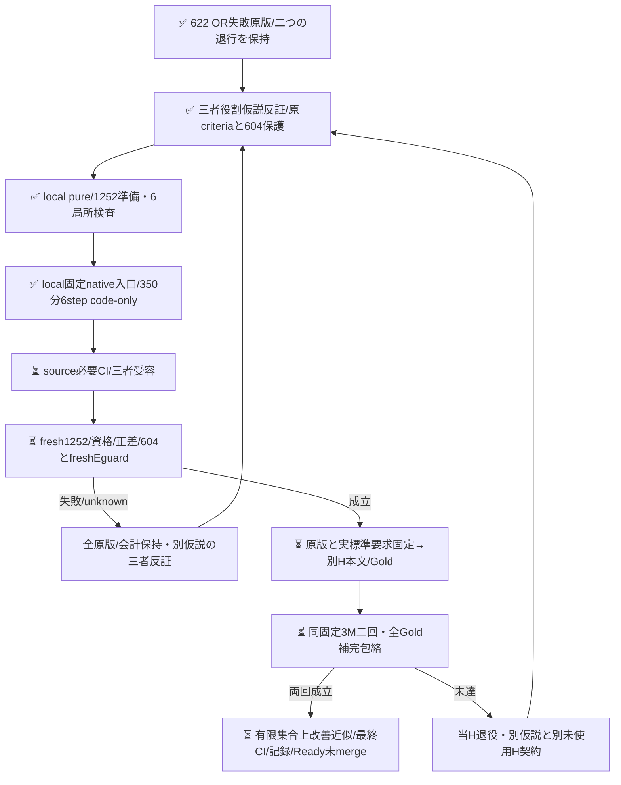

# E専用の役割判定手順を別の一候補として検証する

PR622のORはcomplete正答476→494だったが、fresh census-093退行と歴史601内census-023破壊により不受容だった。旧OR/Gold/原版は変更しない。今回正答も忘れず、全3249物理E原応答から604保護を導く。

Wは機能・入出力宣言と実施/観測の発話役割をinstructionsの先行手順に置く案を提示。rootは再現手順内の宣言まで捨てる再発を反証し、Rは「独立」を別の文/箇所という必要条件にしないこと、単なる観測IOから仕様を補わないことを指摘した。最終案は元common instructionsとcurrent yes/no全文を保持し、E専用末尾だけを固定置換する一候補bundleである。配置と文面内容の個別原因を証明しない。本文の特定ID/語句例外やGold変更はない。

新Dも当回freshBestE/candidateE各626を同じ固定歴史Oと比較する。機械firstは診断のみで、604歴史E保護とfreshE退行0を正差とは別ANDにする。singlecandidateをそのまま採点し、ORで救済しない。baseline欠測を既知修復に数えず、候補の既知歴史破壊は欠測と併存して残す。原資格は後段の標準recorder/raw/native入口で実検証する責務であり、pure引数は証明ではない。

原3249→604/626の再生とfresh1252whole-body/Goldfree要求の鍵なし準備だけを実装した。元BestE/共有OのwholeCore、criteria、共通instructionsは不変で、候補instructionsだけが違う。今回の局所synthetic検査はモデルの改善証拠ではない。固定native入口はcode-onlyで追加したが、必要CI/三者受容/実D/成功要求固定/新Hは未完。

次Hは既固定Oct18同3repo/旧8bc観測metadata、prefix300/補充0を継承し、新countは未抽出。元862typed/2033body/2371参照の私的native由来と保守参照除外規則を維持する。metadata-only全IDをtask既使用へ混ぜない。本文取得/Goldは実D受容後、初稿相互未読・予測盲検でnative固定する。同系列モデル/候補既知の評定者は独立human Goldではなく、未確定nullと有限固定Goldに対する近似という射程を保つ。無作為/意味や学習未見/Apps E2E/一般母集団品質は保証しない。

3052は一候補の有限最大割当で実消費ではない。D350分/H各250分は完了保証ではない。追加User予算/本人確認待ちを作らず、既GO内の通常技術是正/反証loopを継続する。

固定D入口は原8runの実provider API/Git親/phaseと全3249 rawをprepareで再生し、secret stepではexact8field/全body/全Core templateを固定sourceへ比較する。原attempt digest/max1252をkeyless投影で再読する。最初のactivation-only childでREQUESTを追加し、source batchでidle REQUESTを作らない。意味FAIL/unknownを保存し、同候補の再送は許可しない。旧OR/native helperは変更せず再用する。
