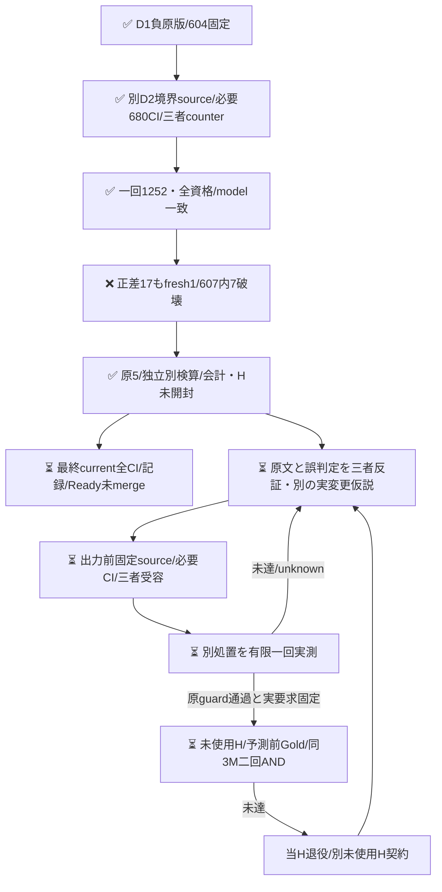
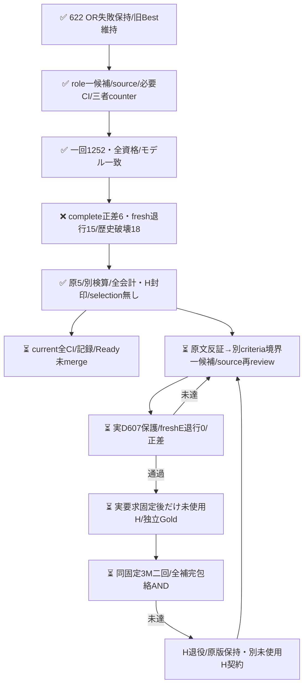
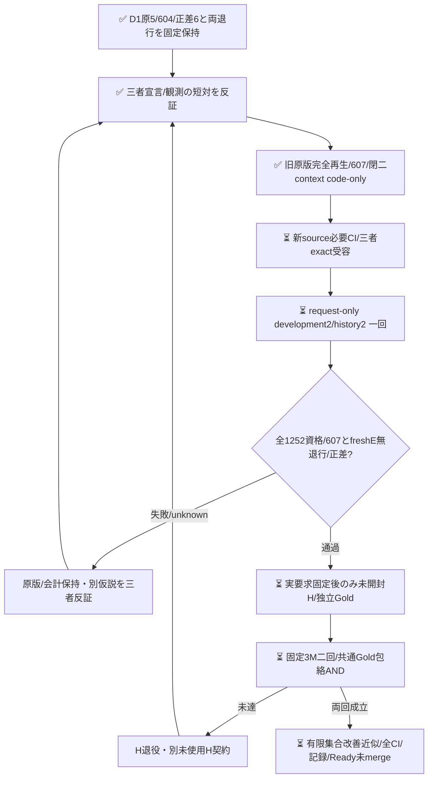

# E判定の二候補の負結果を保持する

## D2境界候補：正差17だがfresh退行1・歴史破壊7で不受容

[development2の一回の実run](https://github.com/roccho-org/ops/actions/runs/39520431305)はsource f3618bb9 / REQUEST-only activation d2eeec62 / phase development2・履歴2で実行した。全1252要求が資格/expected modelを満たし、unknown0だった。fresh complete475→492（修復18/退行1）、E582→600（修復19/退行1）。しかしfreshE退行census-093と、原607保護内の破壊7（census-003/012/053/093、expectation-020/045/070）によりDEVELOPMENT_GUARD_FAIL。正差17でどちらも相殺しない。機械first477/E585は別診断、O-null17を全626分母に残す。

root/Rは各自provider ZIP/native実Git親/REQUEST phase2と原5を取得し、別readerで全1252 Core/flags/資格/全guard/usageが一致した。原5全25,683,706Bをresults/expectation-boundary-development2-20261021/へ保持する。実jobの鍵前680/680と全step成功は意味改善の受容ではない。selection/成功要求freezeは発行せず、新Hの件数/本文/Goldを開かなかった。旧D1の原604・schema・Core・原5・FAILは全field不変で再生する。607を弱めたり原Goldを変更したりしない。

当回物理1252/input2,734,980/output38,812、total_tokens全1252欠測。PR624のD1+D2実消費は2504/input5,493,748/output77,624、total_tokens2504欠測。4304は事前最大割当であり消費ではない。歴史4501原E/O aliasや未実施Hを新費用へ数えず、料金/内部計算量は不明。旧Best維持・未採用、現headの全通常CI/記録/Readyは別に閉じる。

以下はD1結果とD2 source時点の固定契約であり、当時の未完表示を現状と混同しない。次候補のsource/作用はまだなく、同候補盲再送/Gold変更/同H再試験で救済しない。

## D1役割候補と旧sourceの記録

## 実D結果：正差6、fresh退行15・歴史破壊18で不受容

[一回の実run](https://github.com/roccho-org/ops/actions/runs/39515942918)は全1252要求が資格/expected modelを満たした。complete正答475→481（修復21/退行15）、E正答583→589（同21/15）だったが、freshE退行15と原604保護内の破壊18によりDEVELOPMENT_GUARD_FAIL。正差6でどちらも相殺しない。機械first477/E585は診断だけ、不確定O17は全626分母に維持する。

root/Rは各自provider ZIP・native parent/REQUEST/source/attemptを取得し、別readerで全1252 Core/flags/資格/全guard/会計が一致した。原5はresults/expectation-role-development1-20261021/へ原bytesで保持、Wも原版と全製品投影の一致を確認した。実jobの鍵前672/672成功とworkflow全step成功は意味判定PASSではない。selection/成功要求freezeを発行せず、新H件数/本文/Goldを開かなかった。旧622 ORの不受容も維持する。

当回物理1252 E/input2,758,768/output38,812。total_tokensは全1252欠測、金額/内部計算量不明。歴史aliasを新物理費用に加算しない。H作用0。保存後current全通常CI/記録/Readyは別に閉じる。

18歴史破壊には真正な対応指示/必要性、責務、提出依頼の過小包含と、観測のみの過大包含が混在した。原本文/Goldは変更せず、このclusterを見出し/語句/ID例外にしない。次は元620のE末尾へ戻した上で、criteria側へ短い宣言/観測境界を置く別一候補bundleを三者反証する。配置/短文化の単独原因は断定せず、同役割手順の盲再送で救済しない。今回の新正答も忘れず全4501原E→607保護を次prospective sourceへ導く（現604 guardへ遡及適用しない）。

## 事前sourceと反証（926eff時点）

PR622のORはcomplete正答476→494だったが、fresh census-093退行と歴史601内census-023破壊により不受容だった。旧OR/Gold/原版は変更しない。今回正答も忘れず、全3249物理E原応答から604保護を導く。

Wは機能・入出力宣言と実施/観測の発話役割をinstructionsの先行手順に置く案を提示。rootは再現手順内の宣言まで捨てる再発を反証し、Rは「独立」を別の文/箇所という必要条件にしないこと、単なる観測IOから仕様を補わないことを指摘した。最終案は元common instructionsとcurrent yes/no全文を保持し、E専用末尾だけを固定置換する一候補bundleである。配置と文面内容の個別原因を証明しない。本文の特定ID/語句例外やGold変更はない。

新Dも当回freshBestE/candidateE各626を同じ固定歴史Oと比較する。機械firstは診断のみで、604歴史E保護とfreshE退行0を正差とは別ANDにする。singlecandidateをそのまま採点し、ORで救済しない。baseline欠測を既知修復に数えず、候補の既知歴史破壊は欠測と併存して残す。原資格は後段の標準recorder/raw/native入口で実検証する責務であり、pure引数は証明ではない。

原3249→604/626の再生とfresh1252whole-body/Goldfree要求の鍵なし準備だけを実装した。元BestE/共有OのwholeCore、criteria、共通instructionsは不変で、候補instructionsだけが違う。今回の局所synthetic検査はモデルの改善証拠ではない。固定native入口はcode-onlyで追加したが、必要CI/三者受容/実D/成功要求固定/新Hは未完。

次Hは既固定Oct18同3repo/旧8bc観測metadata、prefix300/補充0を継承し、新countは未抽出。元862typed/2033body/2371参照の私的native由来と保守参照除外規則を維持する。metadata-only全IDをtask既使用へ混ぜない。本文取得/Goldは実D受容後、初稿相互未読・予測盲検でnative固定する。同系列モデル/候補既知の評定者は独立human Goldではなく、未確定nullと有限固定Goldに対する近似という射程を保つ。無作為/意味や学習未見/Apps E2E/一般母集団品質は保証しない。

同GOで別仮説をsource/必要CI/三者受容後だけ実施する。新User予算/認証/merge承認を追加せず、負結果/実費用を全て残す。

## D2 source f361時点の事前契約（当時code-only、実結果は冒頭）

[三者の出力前counter](https://github.com/roccho-org/ops/pull/624#pullrequestreview-5593193516)に従い、原620のE専用suffixへ戻し、yes/no基準へ短い境界対を半角space一つで追加する。本文の機能/IO宣言を説明・表示・再現記録という置き場所で捨てず、観測記録から未記載の仕様を補わない。元ANYの責務/対応指示/提出依頼/引用/回復要求は削らず、「本来」「不満」を独立predicateにしない。復帰＋短criteria対の一候補bundleで、配置/短文化の単独因果は主張しない。case/見出し/語句lookupもない。

既measurement内部の二固定contextとnamed wrapperで標準2E loop/資格だけを共有する。旧role D1のschema、template、historyScope、604 guard、全projection/usageScopeは全値再生した。新境界は別input/predictions/projection schema・constructorで正直に識別し、任意schema/max/profile/constructor overrideを公開しない。全4501物理E原版から607全IDを再生し、fresh2Eの同歴史O primary・freshE退行0・607保護・joint正差・全資格を別ANDにする。

同branch/workflowを再用し、sourcebatchでは元D1 REQUESTを一切変更しない。新sourceの必要CI/三者受容後だけrequest-only childへdevelopment2を書き、native historyは元D1/currentD2ちょうど二つ、各実Git親/phase/source/actorを拘束する。D1意味FAILは新D2の取消理由にはしないが、原資格/モデル/来歴の不成立は拒否する。新9nativeと原attempt1252を鍵前/投影で結合し、秘密下は新8field/全body/全Coreを固定sourceと比較する。

4304は消費済D1 1252＋新D2最大1252＋prospective H最大1800で、実消費とは別。D各350分/H各250分は完了保証でなく、追加User予算/認証待ちを設けない。旧prospective-plan.jsonは原文不変、prospective-plan2.jsonへ前向きに記録した。新H窓/prior/無補充/両回AND/Gold射程は同じで、現時点の新count/body/Gold/modelは0。必要sourceCI・実D2・H・最終全CI/Readyは未完。

歴史ever-correct保護は工学的な採用条件であり、偏りのない性能推定量ではない。D626はwholebody620/同全文GoldE矛盾0という診断を得たが、意味同値やGold無誤謬を証明しない。新Hは便宜的な未使用有限targetでありSRS/相互独立標本とは称さず、実取得後はM Issue ID数とdistinct wholebody数/固定参照の不整合も記述診断として報告する。重複を事後除外/補充/再重み付けする新条件は追加しない。
