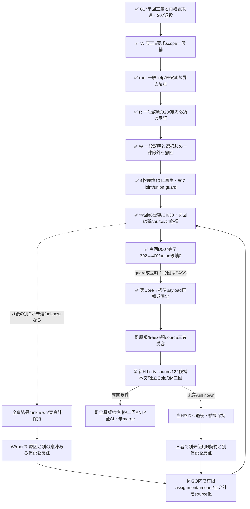

# 元rubricのE scope一候補と退役507件の開発guard

[PR617](https://github.com/roccho-org/ops/pull/617) のH1差0/H2単回差4/207・退行0、事前二回AND NOT_RECONFIRMED/未採用/207退役を変更しない。H2正差を消さず、O追加が常に無効ともE優先の原因が証明されたとも言わない。今回D507は全資格でguard PASS、次Hは旧観測metadataから事前窓の122候補を固定済みで、本文/Gold/予測は未取得である。

このsliceは元Best/元E yes/no/元instructions/全bodyを保ち、E criteriaだけへ一つのlabel別補足を加える。既611の「対象について」狭義化を再送せず、本文中の真正な条件付き提出指示・実依頼引用・IO宣言もANY本文として数える仮説である。語句や作文/架空例として展示するだけなら要求にしない。テンプレ/引用/チェック欄/Please/命令形だけで一律yesにせず、未実施/未採用と要求として使われない見本を混同しない。候補の文章があることは実モデル準拠の証明ではない。

三者反証で初案noの「一般説明だけ」を撤回した。説明文でも公開023のcmd+n→new fileのようにIO対応を宣言すれば元Eに該当する。逆に公開093のrepro実施記録を要求へ昇格させない。宛先への命令を必須にせず、宣言的責務/完成状態を保つ。「主たる不具合と同じ対象は不要」も、本文で要求や仕様として提示するという条件の内側だけで使う。真のenum/許容仕様を誤除外しないよう、選択肢の独立除外も撤回した。原Goldや閾値は変更しない。

`development.mjs` は旧300と退役207の全body/source/Goldを保持し、旧H1/H2と今回H1/H2の原raw資格/全request/projectionを再生する。物理Eは4群・全1014件。旧D1..5のEは旧H1の同一receipt aliasとして全値を照合し、別の物理資格/費用/成功機会に数えない。complete joint anchorは各cohortの機械first、全snapshot E既正答unionは486/507、first joint正答392・O未確定16。この候補前固定値は都合よいrun選択ではなく全原版から導く。

`guard.mjs` は全507の新E資格、first-snapshot complete E/O gain>0、全4物理snapshotの既正答E union破壊0を別に判定する。Eだけの修復がhistorical O誤答と組になる場合はjoint gainへ数えない。欠測を既知退行にせず、既知退行と欠測が併存すれば両方を残す。未確定Goldも全分母へ保持する。DのE/Oは非同時の歴史比較なので、新Hの同時測定・未来期待性能を証明しない。

`prospective-plan.json` は新count/本文/予測前の窓・prefix300・補充0と最大資源を記す。次target案は既取得native8bcの観測metadata内だけのUTC `[2026-10-20T00:00Z,18:00Z)`。全履歴APIの再取得はせず、新snapshot/全日網羅を称さない。元407に実210bodyを加えるpriorは除外empty/oversize3も含み、metadata-only322718 IDsをtask本文既使用へ混ぜて自己除外しない。候補actual fullwireと開発guardを閉じるまで新H本文/Goldを候補作者へ渡さない。M0も保存し、件数/成績を見た窓拡大をしない。

新D507・新H3M×2最大1800の新scope上限は2307。元Best Oは変えず新Hの当回sharedOを一物理receiptだけ共有する。両armのO呼出し数が同じでも、E補足のtoken/時間/費用が同じとは言わない。既存標準client/recorder/資格と共通Gold補完の再用を優先し、任意profile/endpoint/constructor override、新executor/auth/ledgerを加えない。今回実物理はD507、追加metadata API/新H本文/Gold/計測0。

固定D入口はrequest-only pushの最初の一回だけを認め、request.jsonは作用開始まで存在しない。鍵前に全507/1014原資格・request・projectionを再生し、四原providerの実API run/actor/branch/workflowと実Git親/固定request path/phase/repを照合する。鍵下は固定sourceからbody/best/原templateを読み直すsecret-safe比較だけを行い、wireTemplateやGold採点を呼ばない。既存standardRecorderの507上限・15秒・redirect拒否・flags/failureを用い、鍵なしprojectionで原rawから資格/guardを再生する。意味FAILでも原結果を保存し、欠測と既知退行を別に保持する。workflow150分は507×15秒=126.75分＋検証/保存余裕の技術capで、完了保証ではない。現sourceの独立受容/必要CI前には作用せず、新H入口/本文/Goldは後続source受容である。

`prefix.mjs` は既受容8bcの全原metadataを旧窓で再生して保存prefix全値と一致させた後だけ、新事前窓へ投影するpure readerである。三者入口受容後、root/Rが全11blob/5原CLI command stdout/cursor/pageInfo/visibilityを別readerで再生し、旧322718観測Issueから新窓122/prefix122の全値順序が一致した。native77477の原prefix/receipt2file34,737Bをここへ原bytesで保持し、Wもnative原版保存/bytesを確認した。関数への任意capturesや自己申告native文字列だけで実取得真性を証明せず、保存pageInfoと受容済標準CLIの終端意味を再用する。追加API/新snapshot/当日全Issue網羅を称さない。122はmetadata候補数でeligibleMではない。

実Dは[run39497868527](https://github.com/roccho-org/ops/actions/runs/39497868527)、activation59ceのrequest-only child/source e6、全507 qualified/model stable。機械first complete392→400、修復8/破壊0、E486→494、全snapshot E union破壊0、O未確定16を全507に残してguard PASS。原5file11,457,514B、provider digest/size/実actor/branch/run/実Git親/requestと全request/資格/投影をWが再生し、root/Rが各自己ZIPと別算術で全値一致。現物理input1,114,056/output15,717、total_tokensは全507で未提供のまま、金額/内部computeは不明。これは非同時の開発診断であり新Hの改善・採用を証明しない。

原first E入力975,645と原first O入力985,278からの論理運用相当はBest1,960,923→新E＋同O2,099,334（+138,411/+7.05846%）。これは非同時の歴史alias比較で、現507物理usageへ歴史Oを加算したり、両armの和を実usageへ再集計したりしない。同じ呼出し数でも入力資源は増えており、金額改善を主張しない。

`selection.mjs` は原5を再生してguard成立を確認し、実保存された全507 qualified Core requestから既存標準clientでpayloadを再構成し、body stateだけを固定placeholderへ替えた全値とinput templateProofを照合する。原BestE/sharedOは受容済歴史receipt由来の別来歴として保持する。rootは製品constructor/wireTemplateを使わず、自己原D507と原BestE/O507ずつから全1521 payloadを直接標準clientで再構成し、3templates全値一致を確認した。post eventはIDのみであり、network上のHTTP body全bytesを捕捉したという証拠ではない。候補は固定済み・adopted=false。今後の本文/H sourceはこの原結果とselection全値を再生し、eligibleフラグの自己申告だけでは受容しない。

三者の意味反証は公開D507/元split rubricだけを根拠とする。boilerplate条件を拾うE proxy改善は実製品missing-expectation検知/E2EやApps全体改善へ昇格しない。旧616/617の全失敗・追加compute・不確実性を保持した別処置であり、過去holdoutを再Hにしない。

継続辺は同GO内の手動設計・開発運用であり、自動無限retryや追加User予算承認を作らない。同候補の盲再送、良い回選択/平均、Gold変更、同H再試験による救済は禁止する。2307は現在の一候補系列の有限最大割当である。

`fixed-e-prospective-census-closure` は元617の原結果/全CI/Ready/記録、現source/treeとactual候補wire、4原E履歴/507/機械first/union、D507原rawと資格/guard、固定新prefix/body/除外/独立Gold、同時新H両原raw/共通Gold包絡/会計、最終全CI/独立review/Ready未mergeという証拠のANDを表す。原判定/Gold変更、source/wire/分母/資格不一致、原版不足、D不成立、H片回未達/unknown/drift又はCI/記録未閉包では成立としない。別runtime gate/executor/ledgerは追加しない。

次priorは受容済407原版と実210本文から740 typed Issue IDs/1916 exact bodyを固定する。追加29件は210の本文文字列内Issue/pull参照の旧集合との差分であり未型解決残余として私的保持する。自Issueの出典URL210はtyped IDと結合済みである。旧38d5の35repo/2211参照解決を新29へ拡張済みとは称さず、typed実観測ID/exactbody非重複が主境界で、URL露出や意味/作者/学習への独立性は保証しない。

本文前の追加eligibility補強を[事前記録6301559042](https://github.com/roccho-org/ops/pull/620#issuecomment-6301559042)で固定した。旧2211＋追加29の全2240正規化参照へ一律に、固定scope canonical名のcase-insensitive一致と正整数numberがprefix Issue metadataへ一致したら別集合referenceExcludedCandidateIdsへ保守除外する。原issues/pull型と実metadata Issue型を保持し、型差があっても参照のsafe側除外と記録するだけで、PRをIssueへ変換したり参照を本文既読へ昇格させない。740実観測ID/1916本文集合と原122prefix/順序/補充0は不変。root/Rの別parser実適用で参照match/追加除外/既typed overlapはすべて0。0でも規則は保持し、本文/Gold/成績後に緩和しない。旧e6契約は履歴に保持し、この補強は次H sourceへ明示して結合する。alias/改名/外scope移管/意味未使用の保証は増やさず、新APIも0。
