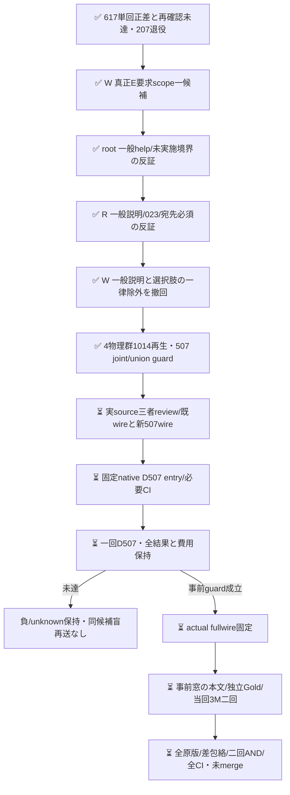

# 元rubricのE scope一候補と退役507件の開発guard

[PR617](https://github.com/roccho-org/ops/pull/617) のH1差0/H2単回差4/207・退行0、事前二回AND NOT_RECONFIRMED/未採用/207退役を変更しない。H2正差を消さず、O追加が常に無効ともE優先の原因が証明されたとも言わない。次cohortの件数/本文/Gold/予測はまだ調べていない。

このsliceは元Best/元E yes/no/元instructions/全bodyを保ち、E criteriaだけへ一つのlabel別補足を加える。既611の「対象について」狭義化を再送せず、本文中の真正な条件付き提出指示・実依頼引用・IO宣言もANY本文として数える仮説である。語句や作文/架空例として展示するだけなら要求にしない。テンプレ/引用/チェック欄/Please/命令形だけで一律yesにせず、未実施/未採用と要求として使われない見本を混同しない。候補の文章があることは実モデル準拠の証明ではない。

三者反証で初案noの「一般説明だけ」を撤回した。説明文でも公開023のcmd+n→new fileのようにIO対応を宣言すれば元Eに該当する。逆に公開093のrepro実施記録を要求へ昇格させない。宛先への命令を必須にせず、宣言的責務/完成状態を保つ。「主たる不具合と同じ対象は不要」も、本文で要求や仕様として提示するという条件の内側だけで使う。真のenum/許容仕様を誤除外しないよう、選択肢の独立除外も撤回した。原Goldや閾値は変更しない。

`development.mjs` は旧300と退役207の全body/source/Goldを保持し、旧H1/H2と今回H1/H2の原raw資格/全request/projectionを再生する。物理Eは4群・全1014件。旧D1..5のEは旧H1の同一receipt aliasとして全値を照合し、別の物理資格/費用/成功機会に数えない。complete joint anchorは各cohortの機械first、全snapshot E既正答unionは486/507、first joint正答392・O未確定16。この候補前固定値は都合よいrun選択ではなく全原版から導く。

`guard.mjs` は全507の新E資格、first-snapshot complete E/O gain>0、全4物理snapshotの既正答E union破壊0を別に判定する。Eだけの修復がhistorical O誤答と組になる場合はjoint gainへ数えない。欠測を既知退行にせず、既知退行と欠測が併存すれば両方を残す。未確定Goldも全分母へ保持する。DのE/Oは非同時の歴史比較なので、新Hの同時測定・未来期待性能を証明しない。

`prospective-plan.json` は新count/本文/予測前の窓・prefix300・補充0と最大資源を記す。次target案は既取得native8bcの観測metadata内だけのUTC `[2026-10-20T00:00Z,18:00Z)`。全履歴APIの再取得はせず、新snapshot/全日網羅を称さない。元407に実210bodyを加えるpriorは除外empty/oversize3も含み、metadata-only322718 IDsをtask本文既使用へ混ぜて自己除外しない。候補actual fullwireと開発guardを閉じるまで新H本文/Goldを候補作者へ渡さない。M0も保存し、件数/成績を見た窓拡大をしない。

新D507・新H3M×2最大1800の新scope上限は2307。元Best Oは変えず新Hの当回sharedOを一物理receiptだけ共有する。両armのO呼出し数が同じでも、E補足のtoken/時間/費用が同じとは言わない。既存標準client/recorder/資格と共通Gold補完の再用を優先し、任意profile/endpoint/constructor override、新executor/auth/ledgerを加えない。現sliceはnative entry/実source CI/作用の受容ではなく、次独立source反証が必要である。新API/body/model0。

三者の意味反証は公開D507/元split rubricだけを根拠とする。boilerplate条件を拾うE proxy改善は実製品missing-expectation検知/E2EやApps全体改善へ昇格しない。旧616/617の全失敗・追加compute・不確実性を保持した別処置であり、過去holdoutを再Hにしない。
