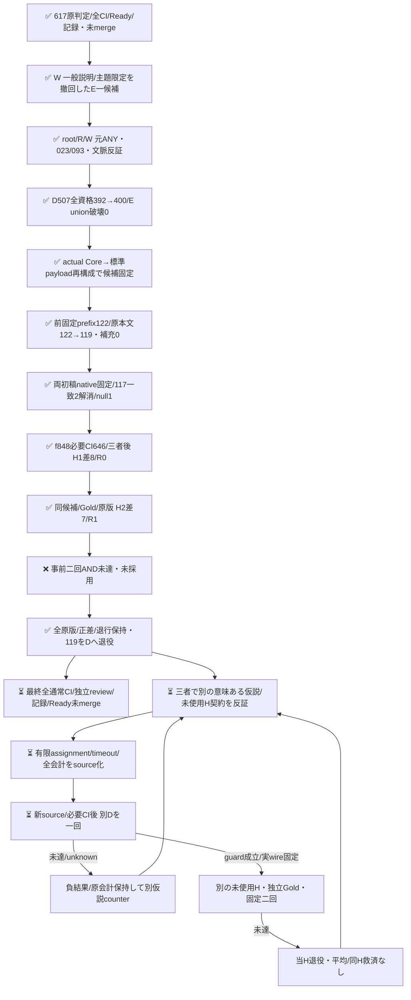

# 未使用119件で両回正差、H2のE退行1により再確認未達

事前固定した新E一候補を未使用の有限実案件119件で二回測定した。H1はcomplete正答85→93・差8/119・退行0、H2は85→92・差7/119だがE退行1を観測した。両回の正差を保持する一方、事前の「両回とも全資格/expected model/差下限正/退行上限0」は満たさず、二回ANDは **NOT_RECONFIRMED**。候補は未採用で元Bestを維持し、119件を開発用へ退役する。同Hの再試験/平均/良い回選択/Gold改訂で救済しない。

| 段階 | 全case / Gold未確定 | complete既知正答 | 修復 / 破壊 | 共通Gold差包絡 | 軸退行包絡 | 判定 |
| --- | --- | --- | --- | --- | --- | --- |
| D507・非同時の歴史比較 | 507 / 16 | 392→400 | 8 / 0 | 開発known guard | E union486破壊0 | guard PASS |
| 新H1 | 119 / 1 | 85→93 | 8 / 0 | [8,8]/119 | [0,0]/119 | 単回positive |
| 新H2 | 119 / 1 | 85→92 | 8 / 1 | [7,7]/119 | [1,1]/119 | OBSERVED_REGRESSION |

H1約6.72pp/H2約5.88ppはこの固定119件上の差であり、確率CI・無作為母集団・将来backend期待値・Apps/E2E改善ではない。同じ119件を二回使い、独立238標本にはしない。Goldはcandidate-known same-family採点者によるため外部人間正本と同一視しない。metadataは既観測、意味/作者/テンプレ/学習への未見は保証しない。便宜的な3repo/時間窓という主張限界を保持する。

## 元rubricと一候補

元split.mjsのhasExpectation/hasObservation/question、元Best/instructions、binary yes/no、全bodyとGoldは不変。E criteriaだけに、真正な条件付き提出指示・引用された実依頼・IO対応も本文ANYの要求として数えるlabel別補足を加えた。未実施/未採用や主たる不具合との主題不一致は除外理由にせず、語句/作文/架空例の展示は要求へ昇格しない。

三者counterではW初案の「一般説明だけならno」をRが023のcmd+n→new file IO宣言で反証して撤回した。rootは一般help/未適用見本と真正要件の文脈境界を要求し、W/Rも受容。真のenum/許容仕様を落とす選択肢の一律除外も撤回した。宛先への命令を必須にせず、宣言的責務/完成状態を保ち、093の単なるrepro実施記録という反例も保持した。611のsubject狭義化の盲再送、特定ID lookup、Gold再定義ではない。元Best Oは変更しない。

## D507と要求の固定

旧300と退役207の全原body/source/GoldをDへ使用した。物理Eは旧300のH1/H2と207のH1/H2の4群1014。旧D1..5のEは原H1と全値同一のaliasで、新しい資格/呼出し/費用に数えない。complete anchorは各cohortの機械first、E既正答union486・first joint392・O未確定16を候補出力前に固定した。Eだけの修復をjoint gainへ置換せず、欠測と既知退行は別に保持する。

[D run39497868527](https://github.com/roccho-org/ops/actions/runs/39497868527) はsource e6、activation59ceのrequest-only child、全507qualified/model stable、392→400/b8c0、E486→494/union破壊0。原5file11,457,514Bとprovider/readback/root独立reportを保存した。root/Rは各自己ZIP/native API/Git親/request/全flagsと別算術で全値一致。これは非同時開発診断であり新Hの効果ではない。

selectionは全507の実保存qualified Core requestを既存標準clientでpayload再構成し、bodyだけplaceholderへ替えた全値を固定する。元BestE/sharedOは別の受容済歴史receipt由来。root/Rは自己D507と元BestE/O各507の計1521 Coreから、製品request constructor/wireTemplateを使わず直接標準clientを通し全3templateを一致確認した。**post eventはIDだけで、network上のHTTP body全bytesの実捕捉とは称さない。** stored eligibleだけで受容せず、原5/attempt/全資格/guard/selectionを再生する。

## 取得・未使用境界・独立Gold

受容済private native8bcの全11blob/5標準gh commands/3228Issuepages/322718観測Issueを再取得せず再用した。固定3public repo IDsはcli/cli、NixOS/nixpkgs、microsoft/vscode。新count/本文/Gold/予測前にUTC [2026-10-20T00:00Z,18:00Z)とcreatedAt＋ordinal immutableID順の先頭最大300を固定し、root/R別readerの全原query/pageInfo/cursor/global typed-ID/公開前後再生で122/prefix122が一致。新snapshot/全日網羅とは称さない。原prefix/receiptはnative77477から原bytesを保持する。Wはnative全bytes/契約確認を担当し、全3228pages独立再生を自身の実績へ誤帰属しない。

priorは元407原版と旧94b7の全実210 body（empty/oversizeを含む）からtyped740/exactbody1916。metadata-only322718をtask本文使用へ混ぜて自己除外しない。旧2211＋追加29の全2240 literal参照へ事前の同一保守ルールを適用し、canonical repo casefold＋正整数numberがprefix Issueへ一致すれば別referenceExcludedCandidateIdsへ除外する。issues/pull原型を保持し、型差でも参照のsafe側除外とするだけでPRをIssueへ変換しない。match/追加除外/typed overlapは0だったが規則を撤回せず、補充0を維持した。旧38d5の35repo解決は追加29を覆わず、外scope/移管/alias/意味未使用の保証を増やさない。参照URL露出と実本文閲読は区別し、私的全ID/URL集合はpublicへ複写しない。

3972 source/具体hostを三者受容してから、標準ghで122body＋public前後2の124commandsを一回取得。immutable Issue/query/variables、同ID/name/issue-enabled/public前後、1h、原stdout/stderr/status、source前後と最終completion保存後のcap/source検査を拘束した。内部HTTP試行数はUNKNOWN、手動retry/resume/部分救済なし。priorExact1/oversize2/empty0/eligible119、既typed/reference0。全3標準payload<24000Bを要求し、全文切詰め/除外後補充をしなかった。

原body129file＋body-only viewをnative322399に130file/1,641,986Bで固定した。その取得・Gold固定時点では予測0だった。root/Rは全119 literal bodyを互いの稿と予測を見ず採点し、両原稿をnative fdc9へ凍結後だけ比較した。117一致/2不一致はWが元split/body-onlyで第三反証。024は一般IO/条件の現在形を観測報告にしないO=no、070は回復要求に対象完全同定/具体性を新必須条件にしないE=yesへ理由付き解消し、Rは双方の反対根拠を撤回した。多数決ではなく原基準の反証解消で、初稿2本は不変。元から一致した未確定1も残した。

最終native1d9 corpus/裁定、322399 frame/view/completion/visibility、fdc9両初稿の8原file1,609,454BをGit全blobまで原bytesで保持。root/Rが119全body/source12属性/sourceId/原gap順/全Gold/両初稿不変を別確認し、Wは原bytesと既DATA validatorを照合した。E103yes16no、O108yes10no1null。body-only provider stateへGold/source属性を渡さない。

## 固定二回の実行と独立再生

H1 activation031db親f848、H2 activation4f870親49745はともにREQUEST一fileのみ。履歴は同branch/workflowのD→H1→H2だけで、rerun/resend0。H1/H2 actual jobは鍵前に実646/647の全keyless検査とnative prepareを通り、既存standardRecorder/clientの15秒/redirect拒否/厳格flags/failureを経由した。各回bestE/scopedE/sharedOをcase-index循環で全3M実行し、Oはその回の一receiptだけを両armへ共有。歴史Oやcross-pass再用はしない。

| 原結果 | run / job | artifact | ZIP bytes | 原5 bytes |
| --- | --- | --- | --- | --- |
| H1 | 39505411380 / 118912973990 | 12302833849 | 613922 | 7375226 |
| H2 | 39506465446 / 118916511783 | 12302259823 | 614251 | 7375486 |

各自己providerZIPのdigest/size/実actor/attempt/branch/path/Git親/request/executionと原5をW/root/Rが照合。root/Rの別readerは製品constructor/qualifier/scorerをimportせず、自己取得原Coreから全357要求/flags/order/物理資格/Gold全補完/全投影/usageを独立再計算した。各357qualified/stable、全714qualified、未知/未試行0。新closed2は両原5/attempt/同7DATA/全包絡と二回AND/全会計を再生し、原結果を上書きしない。

両回の全357 Core requestと同7DATAは全値同一だが、native choiceはbestEの096、scopedEの052で各1件変化しsharedO差0。052は本文の実エラーを指す「how to solve these on my vscode」という真正解消依頼で、元Gold E=yesは不変。H1yes/H2noなので内部原因の断定や一律how規則を作らず、観測した揺れとH2既知E退行を記録する。request alias/応答model IDが同じことは決定性・backend独立性を証明せず、固有HTTP response IDの同一性は未保持である。

## 全物理会計とCI

| 今回物理 | 呼出し | input_tokens | output_tokens | total_tokens未提供 |
| --- | --- | --- | --- | --- |
| D507 | 507 | 1114056 | 15717 | 507 |
| H1 | 357 | 860975 | 11067 | 357 |
| H2 | 357 | 860975 | 11067 | 357 |
| 今回系列合計 | 1221 | 2836006 | 37851 | 1221 |

元最大割当2307は拡大していない。total_tokensをinput+outputで埋めず、金額/内部computeは不明。Dの非同時論理運用相当はBest1960923→新E+同historicalO2099334（+7.05846% input）。各新Hの論理Best=275409+当回O277670=553079、新E=307896+同O277670=585566（約+5.87%）。両armへ帰属するOを二重に足した和は物理usageでない。呼出数が同じでも同原価改善とは称さない。旧616/617等の失敗・費用・判定は別原版に保持する。

実source f848のcanonical39503574278/flake118906812776は646/646fail0、consumer118911982344は同sourceのprovided/imported closure・clean env/unshare・実3controls true、health39503574160成功を三者が原API/logで独立読戻しした。H1保持49745ではeffect/client/workflow/同7DATAが全bytes不変である範囲だけこのCIとH1 actual Ubuntu646を再用し、H2自身の鍵前647を必須にした。headの異なる成功をcurrent全CI成功へ読み替えない。最終exactheadの全通常CI/独立review/記録/Ready open未mergeは現在終端待ちであり、性能条件不成立を技術Readyへ昇格しない。

WのH1 REQUEST末尾CRLFは正規H2のphase/source更新時にLFへ同時是正し、空cleanup pushでH1を重複させなかった。現在は全PR diffcheckもPASS。旧READMEの「予測0」は上記取得・Gold固定時点の事実へ過去形で限定し、原raw/Gold/意味は変えていない。

## 三者記録と次loop

[source/data root5592235425](https://github.com/roccho-org/ops/pull/620#pullrequestreview-5592235425) / [R5592281338](https://github.com/roccho-org/ops/pull/620#pullrequestreview-5592281338)、[H1保持 root5592438080](https://github.com/roccho-org/ops/pull/620#pullrequestreview-5592438080) / [R5592444053](https://github.com/roccho-org/ops/pull/620#pullrequestreview-5592444053)は各provider全文/対象commitをWが自読した。原body/source3972、旧210全frame/backcompat、a0 private二context/feasible/data固定wrapperはこれらの先行正式レビューに原履歴を残す。schema/max/endpoint/任意callbackを公開する新executor、auth、ledgerは追加しない。

次は退役119＋旧507のD626を使うprospective別仮説であり、現620の救済ではない。三者反証の結果、次は元BestE/currentEの判定文を変えないOR一構成を優先支持した。help-request文言変更を同時に走らせて良い方を選ばない。fresh Dは当回BestE＋固定historicalOと、両qualified EのOR＋同Oを比較し、機械firstは別診断とする。全1997物理E receipt由来の既正答601を別ANDで保護し、既成功Dの修復8も忘れない。ORの旧raw診断はpost hoc Dに限定し、単一Jev/同原価改善や実guard/H受容とは称さない。次H案は既観測8bc内のOct18全日/同3repo/prefix300をcount前固定し、新source受容前のcount/body/Gold/新モデル0を維持する。priorには元740/1916に原322399の全実122 body（priorExact/oversizeも）を追加し、全metadata-only IDsを自己除外へ混ぜず、全保持URLへ同じ保守参照ルール/補充0を適用する。

fixed-e-prospective-census-closureは、上流原結果/CI/記録、current native source/fixed要求、全原history/D guard、未使用frame/独立Gold、両H原raw/共通Gold/全会計、最終全CI/review/Ready未mergeという証拠ANDの条件名であり新runtime gateではない。今回はH2 R1のため成立しない。同GO内の通常loopは継続し、別仮説/有限resource/timeout/source三者受容で進める。追加User予算/再認証を待つgate、自動無限retry、同候補盲再送、閾値変更、同H再試験は作らない。
