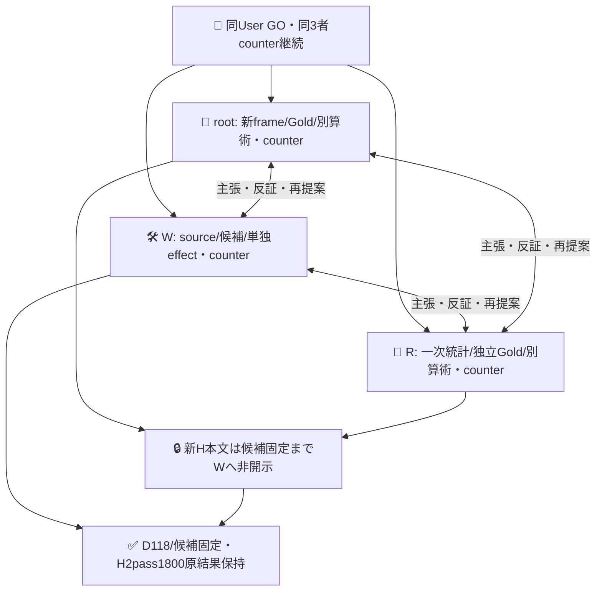
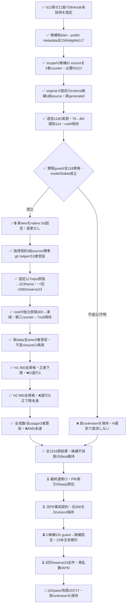

# O判定の実案件改善：事前scopeと次ループ設計

PR613の実118件/2passは**E改善差0**で閉じた（[PR613](https://github.com/roccho-org/ops/pull/613)、exactbase ce906a1d7a656cf5abd31d2462523b9f1abc4285）。Eは両118/118、既知114の完全正答は両79、O FP13/FN22、Goldnull4。旧結果/全708呼出し/未採用を保全する。本PRは次の**O request configuration改善**を主目的とし、旧E改善や元Ops+Apps母集団の成功へすり替えない。

現在は**未使用実案件300件を固定して2pass実測完了、候補不受容・元Best維持**。完全正答はH1で220→233、H2で220→231（既知293/全300・7null）。H1の正gain下限は成立したがH2では成立せず、両方に既正答Oの破壊3件があり、事前の複合条件/二回再確認はNOT_RECONFIRMED。候補/Gold/primaryを結果後に変更せず、全原結果を固定した。標準client/既存organization JEV_API_KEYを、既存6step境界の限定profileで再利用する。同root/W/RのUser GOを継承し、全員が主張・反証・再提案する。policy ADRS exact0dd39ca41718fafe40e58c6927a2ebb0ea297eee、bare/.worktrees、W solewriter。採用/mergeなし。

## 候補修正前に固定したmetadata scope

rootはprospective-plan.jsonをnative ecc40ebf59230fa36e6a4bbf8170b4724abc9841へ、APIより前の11:12:59Zに凍結。roccho-dev/roccho-orgの全public owner repoを標準ghで一回全pagination取得（11:14:03.160Z～08.235Z）。public/private=false・has_issues=trueを含め、旧Ops/Appsだけをimmutable repo IDで除外。fork/archived/内容による追加除外はしない。

原dev [100,53]/org [3]は156 entries/156 unique repo、eligible117/除外39（issues disabled＋旧2）。これは**117件のissue本文ではなくrepo metadata scope**。候補やGold/成績を見て勝ちそうなUI等のrepoを選び直さない。非原子的API取得windowの観測metadataを固定し、owner/alias/移管はimmutable node/numeric IDsでexact once、同IDのconflicting metadataはINVALID。fork/系列/同文によるclusterと別母集団である限界を残す。

原6fileをnative8b40f8980e3b4321b60fa8aab6236a5a6970d1dbから原bytesで取込み（metadata folder pathだけ改名）。Rが全原API/属性/除外/ID/取得前planを別再生して一致。本sliceのmetadata.mjsも全156から同scopeを純再生し、capture owner欠落/ID conflict/private/範囲外owner/後出しrecord省略/短い中間pageを拒否する。全paginationの根拠は当該標準gh --paginateの正常終端記録であり、page形状だけで未取得page不存在を一般証明しない。ここに新しいAPI実行器は置かない。

## 固定する処置と開発経路

元の広義E/Oは[split.mjs](../split.mjs)と既存targetRequestが正本。E/instructionsをoriginal Bestのexact bytesへ固定し、[request.mjs](request.mjs)がO yes/no criteriaへ**対称な一般scope補足を1候補だけ**追加する。新しいモデル重み/自由文API/認証/bridge/独自executorは追加しない。実験用standard generate呼出し0。

Oは報告の存在/種類を判定し、未達/未確認/失敗/権限の現在状態も現状報告なら含む。外部真偽検証や証拠リンクの存在を勝手な必要条件へ足さず、Refsだけ・語彙/作文例を報告へ過包含しない。Goldやtask意味を狭めて成功させない。

旧118はO改善Dへ明示退役。比較アンカーは**機械的に第1pass**のBestE/sharedO原receiptを使い、第2passや良い方を選ばない。新候補O118だけを実測し、元BestO/sharedEとはfull standard-wire一致を検証した歴史alias。非同時比較でfresh E性能/無退行の証明ではない。Goldnull4も編集せず保持する。

D進行guardは全新O118 qualified/modelStable、既知Oの正答を壊さず既知paired gain>0。null4は全118のunknownとして記録し、既知subsetの開発guardを新Hの効果証明と呼ばない。D不成立なら候補を不採用/全失敗保持、新Hを都合よく開いて選ばない。

`runtime.mjs`は原pass1 rawからinput/alias/fullwireを鍵なしprepare/projectで再構築する。credential下のevaluateはkeyless wire captureを呼ばず、body/Best/歴史aliasと実行identityを原保持物と直接比較し、固定sourceだけで実requestを作る。source受容後のrequest.jsonだけを追加するchild commitが入口で、同branch/actor/run attempt1/同workflow履歴1件だけを受容した。起動前にrequest.jsonは存在せず、今は閉じた一回の起動記録として保持し、通常source変更でモデルを起動しない。各attempt/post/answer/qualification-unknownは完全分割を検証し、model driftでは残りを未試行unknownにする。成功済み/不明requestは再送しない。15秒×118=29.5分＋検証/保持余裕の40分job、prepareにGH_TOKEN、evaluateだけにJEV_API_KEY、project/uploadは失敗後も保持する。意味FAILを技術失敗やunknownへ塗り替えず、gainが正でも既知軸を1件壊せば不採用。

### 実D結果・固定した候補

[実run39418385532](https://github.com/roccho-org/ops/actions/runs/39418385532)はsource3c7d479dのrequest-only child dad69beb、attempt1でsuccess。artifact12262716166（551919B、provider SHA256と実ZIP一致）の原5fileと[selection](../results/observation-development-20261020/selection.json)を保持した。root/Rも各自原artifactを取得し、独立算術で一致。新118POSTは全qualified/modelStable、輸送/資格unknown0、Goldnull4は不変。

| 開発用の既知114件（全118割当） | 歴史Best | O候補 |
|---|---:|---:|
| E/O完全正答 | 79 | 80 |
| O TP/TN/FP/FN | 44/35/13/22 | 45/35/13/21 |
| 修復/既知軸退行 | — | 1（real-056）/0 |

`DEVELOPMENT_GUARD_PASS`だが、1件差とGold未知4を含む保守sample差範囲は[-3,+5]/118で、新cohortの改善近似は未証明。新Oのusageはinput322900/output3658、provider total_tokens118件とも未提供。歴史sharedEを加えた運用相当入力は485910→564734（+16.22%）で、非同時比較・金額未知。費用対効果改善とは言わない。selectionは実inputの完全standard-wire proofを固定し、新Hへ向けた候補変更を禁止する。採用ではない。

## 新cohortの全文取得・独立Gold

metadata scopeを基にopen/closed非PR issueの作成cutoff2026-10-20T00:00:00Z、1取得版全文bodyを1unitとする。タイトル/コメント/リンク先を補わない。原API/日時/元URL/不変repo+issue IDを保持し、非空かつoldO/newO/sharedEのactual serialized wireすべて24000B未満。truncate/語彙/難易度/Gold/予測による選別/後出し補充なし。

既使用identityは従前の全保存source references＋613全118。完全同本文も旧保持全body集合と照合して事前除外。旧metadata100を本文100と偽らない。新public対象repo IDsを先に確定し、その範囲だけissue identityを解決する。private/out-of-scope参照の存在情報を公開receiptへ混ぜず、外部未解決だけでframeをINVALIDにしない。対象内の未解決/不完全取得はfail closed。新frame内同文は1issue1weightのまま記述する。

[capture-plan.json](capture-plan.json)が次の取得契約。[prior.mjs](prior.mjs)は旧4alias制限を外し、ce906の実191JSONから791references/401exact bodiesを抽出する（root独立全集合と一致）。さらにnative256443の旧known-used-identities原版を再利用し、明示Issue型・issueNodeId・既定corpus sourceIdだけからglobal既使用IDsを抽出する。旧57Issue参照/56uniqueと613118のunion174に、旧取得でoversize除外されたIssue2件のmetadataを加え176 IDsを保守的除外する。現在repoや本文が変わっても保持する。旧frameはPR除外記録にもissueNodeId欄を使うが、明示pullRequests/PR型はIssueに数えない。任意id文字列からIssueと推測せず、metadata-only参照を本文閲読実績へ読み替えない。nested JSONも構文エラーだけを無視し、解析できたtyped identityの不正はfail closedとする。

rootは原APIを私的に取得・保持、Wの[frame.mjs](frame.mjs)は固定scope全件/公開前後確認/全page/除外/actual3wireを純再生する。本文前後に全固定repo nodeIDのcurrent name/isPrivateを確認し、取得中の変更/不明ならframe全体INVALIDで補充しない。metadata固定後から取得開始前までのrename/移管は、同じ固定nodeIDで同定できれば許し、metadata時のnameをscopeRepository、取得時current nameをrepositoryへ分ける。認証APIは非原子的なので途中のprivate化を絶対取得しない保証にはせず、不整合原応答は私的保持し公開/抽出へ渡さない。追加auth/proxyは置かない。

全117repoの原取得後、created昇順を要求した標準APIに3件の37～39秒逆転があり、最初のpure materializeはINVALIDとなった。原API/元invalidを保持し再取得せず、日付finite・cutoff・全ID一意・全ページ/公開確認を維持して同じ原版を再生する。provider列順はFisher–Yates前の任意順であり全件性の証明ではないため、逆転はorderingAnomaliesへ記録し、並替/除外/補充せず受け入れる。実モデルやGoldを見てデータを選別した変更ではない。

whole-body frameの原bytesをnative保持後、一回の標準crypto Fisher–Yates。n=min(300,M)、残ればreserve封印、小Mならcensus。空frameはNO_ELIGIBLE_FRAMEで成功ではない。300は最小必要精度の保証でなく、情報/Gold600判定/効果資源の**事前上限**。M/結果を見て標本数を下げて選別しない。

同原版の再生結果は1376 rawからPR1022・既使用18・empty2・oversize11を事前規則で除いた**M323**（priorExact0、新frame同文重複0）。rootが原117raw/元INVALID/新frameをnative034a16b70a71127bbb09175229048875db649980へ保持し、Rが別再生で一致した。既存sample.mjsを一回だけ実行し、**n300/reserve23**のreceipt/selected-only Goldviewをnative1959840a9b42378f5b9c08418d91610fb05dd45bへ保持。全frame原文/reserveはWへ渡さない。

root/R各独立Goldは元split.mjsのhasExpectation/hasObservation/questionが意味正本で、新候補の補足をGoldoracleにしない。body-only/arm出力盲検だが候補設計は既知であり、完全盲検とは言わない。原初稿を互いに見る前に凍結、不一致を出力前合議、未解決nullを全assignedへ残す。Wは新H本文/Goldを候補選定へ使わず、候補固定後にselectedだけ初開示。全frame原文とreserveはroot私的native保持、Rの機械再生は集計/ID/サイズだけ表示し、ratersはselected Goldviewだけ読む。same UID秘匿/Gold無謬/全actor生涯未見は主張しない。

原初稿はroot nativefc68a35669eacb90d908c39a5f9572a1537683e1、R nativea17481973397888599ebec4fb24b9ba06e4af41cへ独立凍結。300件中290件は両軸一致、10件はO不一致でEは全件一致した。Wも原稿値を見ず元rubric/bodyだけで10件の主張と反証を保存。131=yes/118=no/288=yesを解消し、残7件の現実報告/規範入力の二読は多数決で潰さずO=null。初稿を編集せず、裁定/corpus/第三counterをnativeb00ca2c012b983a8eff9ae9cb072bd9406bbf51eへ保持、Rが全300原body/source/order/Goldを別照合した。製品の[corpus.json](corpus.json)・[sampling.json](sampling.json)・二初稿・裁定・第三counterは各native原版と同bytes。

自然GoldはE yes295/no5、O yes140/no153/null7。Eの負例が少ない構成を選別で補わず、7未確定を脱落させない。Goldは条件付き正本であって独立人間の無謬oracleではない。

## 新Hの測定・採否と有限条件

各case oldO/newO/sharedEの3physical requestsを循環順、共有Eは各pass内だけ。2passを出力前固定し、初回意味FAILによる取消/再抽選/平均救済なし。model drift等技術停止は維持、未試行も全割当unknown。各pass最大900、2pass最大1800＋D118。各job250分は900×15秒=225分＋保持余裕25分で、実待ち予測ではない。Userの予算不要を勝手な通算1000停止gateへ変えない。

[measurement.mjs](measurement.mjs)/[data.mjs](data.mjs)/[runtime.mjs](runtime.mjs)は同じ標準client/実workflowへ測定phaseを追加する。native履歴は閉D=1、pass1=2、pass2=3と固定し、先行D原rawのguard/候補actual wire、pass2前にはpass1原rawとnative終端identityを鍵なしで再生する。先行runのconclusionは保存実値との一致を求め、意味上の成功だけを選別しない。repIDは全eventに残し、qualification/transport unknownはその要求を再送せず次の独立要求へ進む。model driftは技術停止し、未試行全割当を保持する。Goldはprepareで形式検証、projectでだけ採点に使用し、providerへ渡すstateはbodyだけでID/出典/Goldは送らない。

測定資格が一つでも不足すれば、数値上の保守boundが正でも受容dispositionをUNKNOWN_INCOMPLETE_MEASUREMENTとする。既観測退行は別に保持し、unknownで隠さない。各answerに一意のraw response-flagsを要求し、モデル・確率sum/max等とevent順序を再検査、failure/unknown/attemptおよびmodel drift/停止末尾も対応させる。これは新protocolの資格gateとの整合であり、旧613の数学的bound/結果を不正扱いして変更するものではない。

primaryは従前と同じE/O完全正答paired差＋case内既正答軸退行。O副次だけを選んでjoint失敗を救済しない。全assignedのnot fully resolved cases（一軸unknown含む）を保守的B/C/R範囲へ残す。次j=2、alphaRound=1/80、2pass×5 inclusive HG tails各1/800、resetなし。各passでlower gain>0・観測既知軸退行0・全n worst-case正を要求、両pass ANDで有限近似/再確認を判定。既知FAILとunknownを共に残す。

n300でも弱い差/未知/有限population HGの保守性からNOT_ESTABLISHEDになり得る。censusの点区間はsampling誤差だけ、モデル/Gold/backend/future期待性能/人口ゼロ退行の保証でない。別cohortでの改善を元Ops+Apps改善やApps完成性能/Jev評価役の因果価値へ読み替えない。usageはunique physical templatesだけ、実額/人手費未知を区別する。

予測前のW反証として、Gold nullの全yes/no補完からB/C/R範囲を狭めるsharp boundを提案した。共有Eと同じO回答ならGold不明でもpaired効果0など、数学的な保守性はRが確認した。一方、旧D小差だけで別cohortの不足は断定できず、元primaryもvalidなのでrootは今回は比較条件維持を採用した。今roundの保守primaryは変更せず、sharp案を示すとしても非primary感度のみで採否を救済しない。予測欠損を別physical間の同一回答とみなさない。旧613負結果も変更しない。

## H pass1：正gainの条件部分と退行を分ける

同data/source3者受容後、[run39426848156](https://github.com/roccho-org/ops/actions/runs/39426848156)をsource3df4d9cb935de2961ecd5242d963a1050e8dd06aのrequest-only child f78fba1d3ce43dae37122f833e09f6d8afa53d28で一回起動。実Ubuntuで鍵前526/526とprepareが成功し、900POST/900qualified/modelStable、attempt1 SUCCESS。artifact12266297383のZIP1659357B/provider SHA256 ea25466d3e259ce02ddd39a5e6fc0fbecd8576acf26d2f62d4597148ac2c9de0を実取得し、5rawと投影の全値再生一致。rootも別ZIP取得・別BigInt/raw算術で一致した。原版は[results/observation-pass1-20261020](../results/observation-pass1-20261020/)へ保持。job成功は性能受容ではない。

| 指標 | original Best | O候補 |
|---|---:|---:|
| 完全正答/既知293（全割当300） | 220 | 233 |
| E正答/300 | 297 | 297 |
| O正答/既知293 | 223 | 236 |
| O FP/FN | 9/61 | 12/45 |

修復16、完全正答の破壊3（held-155/196/289のO）、7nullを含むsample最悪差[6,20]/300。inclusive HG差区間[1,27]/323、退行率上限15/323（約4.64%）。正の差下限は成立するが、既知軸退行0という事前条件は満たさずdispositionは**OBSERVED_REGRESSION**。一回の差を将来期待性能/2pass再確認/採用/評価役の因果価値へ読み替えない。

物理usageはbestO/scopedO/sharedEのinput593192/793592/587492、output各9300、total_tokensは900件すべて未提供。運用相当E+O inputは1180684→1381084（+16.97%）であり、実験内E共有による測定回数削減を製品原価改善とは称しない。ここまでの実作用はD118+H1 900=1018、既知input2297176/output31558、total_tokens1018件未知、金額不明。予定pass2は同じ300/900割当で、同じwireが再登場しても独立予定観測であり、failed runの再実行や各phase内の自動再送ではない。

## H pass2・最終閉包

H1の意味FAILでも予定を取り消さず、[run39427992227](https://github.com/roccho-org/ops/actions/runs/39427992227)をsourcead4b0e618ef36d157716f0a544cbe4a72588c368のrequest-only child 0cb17efdb809513b589f9ab31f4b7c2afe0a1029で一回起動。実Ubuntu鍵前528/528とprior prepare成功、900全qualified/modelStable、attempt1 SUCCESS。artifact12267385263/1659410B/SHA256 4ad3b7eb61f266710050eea7aed6791c9f21c489dfcdde90af899d2af291cd1eを別取得し、原5rawと全値再生一致。root/Rも別ZIP/別算術で全個別役値・会計・HGを一致確認した。原版は[pass2 results](../results/observation-pass2-20261020/)、合成は[reconfirmation](../results/observation-reconfirmation-20261020.json)に保持。

| 指標 | H1 | H2 |
|---|---:|---:|
| 完全正答 Best→候補/既知293 | 220→233 | 220→231 |
| E正答/300（両role共通） | 297 | 297 |
| O正答 Best→候補/既知293 | 223→236 | 223→234 |
| O FP Best→候補 | 9→12 | 8→11 |
| O FN Best→候補 | 61→45 | 62→48 |
| 修復/破壊 | 16/3 | 14/3 |
| 保守HG差区間（分母323） | [1,27] | [-1,25] |
| 退行率上限 | 15/323 | 15/323 |
| disposition | OBSERVED_REGRESSION | OBSERVED_REGRESSION |

H2退行はheld-101/155/289のOで、H1とunionした失敗課題は**101/155/196/289の4件**。両passの900provider requestは完全同一だが、choiceがbestOで2件、scopedOで6件変化し、sharedEは同値だった。model alias/応答IDが同じでも決定性・将来の安定gainを証明しない。300件を600独立例と数えず、良いH1だけを選ばず、平均でH2の区間/退行を救済しない。H1の正gain近似条件部分という成果と、無退行改善/二回正gain再確認が未達という結論を分ける。

実作用は3native run各attempt1、**D118+H1 900+H2 900=1918POST、全qualified**。既知input4271452/output59458、total_tokensは1918件未提供、金額/人手費/利益効果不明。H2の各template token数と運用相当input増16.97%はH1と同値。全割当/7nullを残してANDは**NOT_RECONFIRMED**、候補不採用・元Best維持。通常最終head CI/Ready/索引の閉包はこのsource作成時点では未完。

## 次周の合意境界（未実行）

615を不変閉記録にした後、旧selected300を次Dへ明示退役し、original Bestを比較baseline、E/instructionsと元E/O意味を維持してgeneric O criteria候補1本だけを作る。paired gainの主Dアンカーは機械的にH1原BestO/sharedEを固定する。H2で正しかった既知軸も壊さないunion補助guardは保守的な開発条件として別記し、良い過去runをcaseごとprimaryへ選び直さない。全300と上記union4の失敗を使い、H1の3件だけへ過適合しない。

候補固定までWへreserve本文は非開示。元一回抽出で封印した**reserve23全件**を再乱数/API0の一回censusとして使う案を3者で受容した。次j3/tail1/1600・2×69=138予定POST・両pass AND・全unknown・既知退行0を事前固定し、23を見て修正後に同23を再Hへ使わない。これは300を開発した後の条件付き有限23の差に限られ、元323全体/Apps/将来へ一般化しない。census点区間はsampling誤差だけで、2回でもn23、未達を受容し成功を保証しない。次source/候補/Gold/実作用は現PRの閉包後、新事前契約の3者受容から始める。

## 3者counterと実証運用

現sliceはH2原結果・合成NOT_RECONFIRMEDと全1918会計まで固定した。effect/runtime/client/workflow/候補/Gold/primaryは直前受容sourceから不変。通常最終head CI/二者最終受容・記録/Readyが残る。旧613負結果とその通常CI/Ready/未mergeを保持する。
