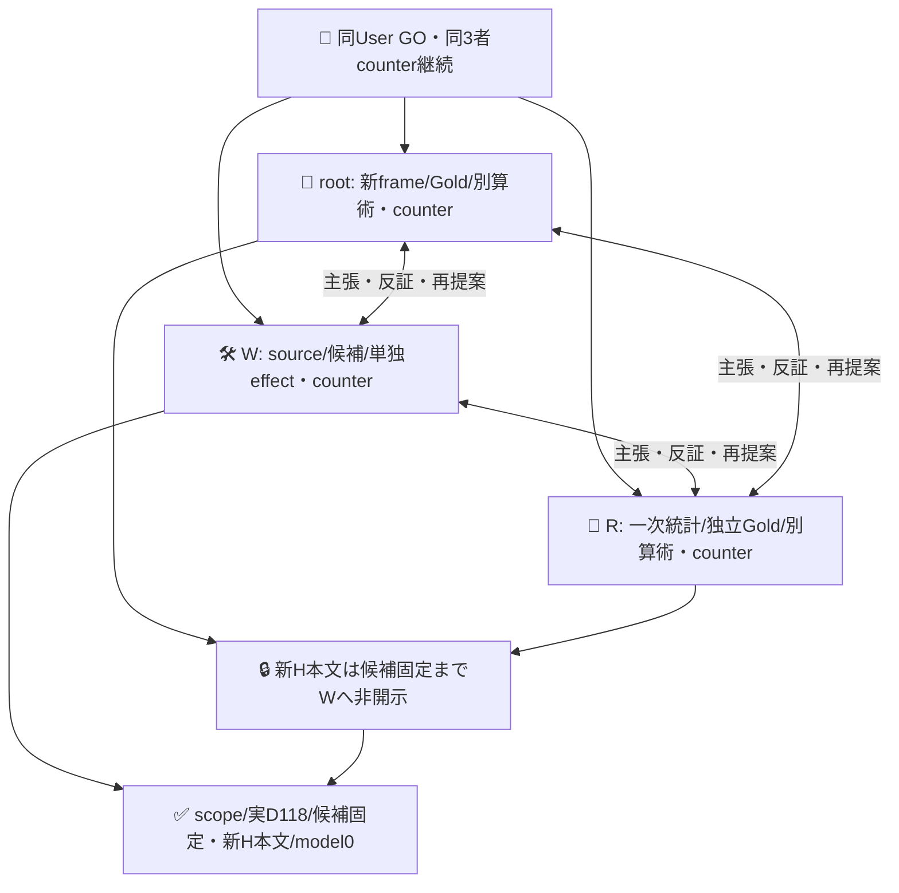
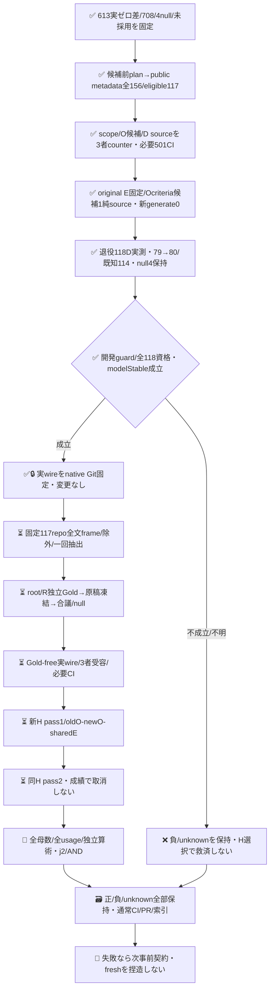

# O判定の実案件改善：事前scopeと次ループ設計

PR613の実118件/2passは**E改善差0**で閉じた（[PR613](https://github.com/roccho-org/ops/pull/613)、exactbase ce906a1d7a656cf5abd31d2462523b9f1abc4285）。Eは両118/118、既知114の完全正答は両79、O FP13/FN22、Goldnull4。旧結果/全708呼出し/未採用を保全する。本PRは次の**O request configuration改善**を主目的とし、旧E改善や元Ops+Apps母集団の成功へすり替えない。

現在は**D118を実測して開発guard通過・候補wire固定、新issue本文0・新H model呼出し0**。標準client/既存organization JEV_API_KEYを、既存6step境界の限定profileで再利用する。同root/W/RのUser GOを継承し、全員が主張・反証・再提案する。policy ADRS exact0dd39ca41718fafe40e58c6927a2ebb0ea297eee、bare/.worktrees、W solewriter。merge/adoptionは別。

## 候補修正前に固定したmetadata scope

rootはprospective-plan.jsonをnative ecc40ebf59230fa36e6a4bbf8170b4724abc9841へ、APIより前の11:12:59Zに凍結。roccho-dev/roccho-orgの全public owner repoを標準ghで一回全pagination取得（11:14:03.160Z～08.235Z）。public/private=false・has_issues=trueを含め、旧Ops/Appsだけをimmutable repo IDで除外。fork/archived/内容による追加除外はしない。

原dev [100,53]/org [3]は156 entries/156 unique repo、eligible117/除外39（issues disabled＋旧2）。これは**117件のissue本文ではなくrepo metadata scope**。候補やGold/成績を見て勝ちそうなUI等のrepoを選び直さない。非原子的API取得windowの観測metadataを固定し、owner/alias/移管はimmutable node/numeric IDsでexact once、同IDのconflicting metadataはINVALID。fork/系列/同文によるclusterと別母集団である限界を残す。

原6fileをnative8b40f8980e3b4321b60fa8aab6236a5a6970d1dbから原bytesで取込み（metadata folder pathだけ改名）。Rが全原API/属性/除外/ID/取得前planを別再生して一致。本sliceのmetadata.mjsも全156から同scopeを純再生し、capture owner欠落/ID conflict/private/範囲外owner/後出しrecord省略/短い中間pageを拒否する。全paginationの根拠は当該標準gh --paginateの正常終端記録であり、page形状だけで未取得page不存在を一般証明しない。ここに新しいAPI実行器は置かない。

## 固定する処置と開発経路

元の広義E/Oは[split.mjs](../split.mjs)と既存targetRequestが正本。E/instructionsをoriginal Bestのexact bytesへ固定し、[request.mjs](request.mjs)がO yes/no criteriaへ**対称な一般scope補足を1候補だけ**追加する。新しいモデル重み/自由文API/認証/bridge/独自executorは追加しない。実験用standard generate呼出し0。

Oは報告の存在/種類を判定し、未達/未確認/失敗/権限の現在状態も現状報告なら含む。外部真偽検証や証拠リンクの存在を勝手な必要条件へ足さず、Refsだけ・語彙/作文例を報告へ過包含しない。Goldやtask意味を狭めて成功させない。

旧118はO改善Dへ明示退役。比較アンカーは**機械的に第1pass**のBestE/sharedO原receiptを使い、第2passや良い方を選ばない。新候補O118だけを実測し、元BestO/sharedEとはfull standard-wire一致を検証した歴史alias。非同時比較でfresh E性能/無退行の証明ではない。Goldnull4も編集せず保持する。

D進行guardは全新O118 qualified/modelStable、既知Oの正答を壊さず既知paired gain>0。null4は全118のunknownとして記録し、既知subsetの開発guardを新Hの効果証明と呼ばない。D不成立なら候補を不採用/全失敗保持、新Hを都合よく開いて選ばない。

`runtime.mjs`は原pass1 rawからinput/alias/fullwireを鍵なしprepare/projectで再構築する。credential下のevaluateはkeyless wire captureを呼ばず、body/Best/歴史aliasと実行identityを原保持物と直接比較し、固定sourceだけで実requestを作る。source受容後のrequest.jsonだけを追加するchild commitが入口で、同branch/actor/run attempt1/同workflow履歴1件だけを受容した。起動前にrequest.jsonは存在せず、今は閉じた一回の起動記録として保持し、通常source変更でモデルを起動しない。各attempt/post/answer/qualification-unknownは完全分割を検証し、model driftでは残りを未試行unknownにする。成功済み/不明requestは再送しない。15秒×118=29.5分＋検証/保持余裕の40分job、prepareにGH_TOKEN、evaluateだけにJEV_API_KEY、project/uploadは失敗後も保持する。意味FAILを技術失敗やunknownへ塗り替えず、gainが正でも既知軸を1件壊せば不採用。

### 実D結果・固定した候補

[実run39418385532](https://github.com/roccho-org/ops/actions/runs/39418385532)はsource3c7d479dのrequest-only child dad69beb、attempt1でsuccess。artifact12262716166（551919B、provider SHA256と実ZIP一致）の原5fileと[selection](../results/observation-development-20261020/selection.json)を保持した。root/Rも各自原artifactを取得し、独立算術で一致。新118POSTは全qualified/modelStable、輸送/資格unknown0、Goldnull4は不変。

| 開発用の既知114件（全118割当） | 歴史Best | O候補 |
|---|---:|---:|
| E/O完全正答 | 79 | 80 |
| O TP/TN/FP/FN | 44/35/13/22 | 45/35/13/21 |
| 修復/既知軸退行 | — | 1（real-056）/0 |

`DEVELOPMENT_GUARD_PASS`だが、1件差とGold未知4を含む保守sample差範囲は[-3,+5]/118で、新cohortの改善近似は未証明。新Oのusageはinput322900/output3658、provider total_tokens118件とも未提供。歴史sharedEを加えた運用相当入力は485910→564734（+16.22%）で、非同時比較・金額未知。費用対効果改善とは言わない。selectionは実inputの完全standard-wire proofを固定し、新Hへ向けた候補変更を禁止する。採用ではない。

## 新cohortの全文取得・独立Gold

metadata scopeを基にopen/closed非PR issueの作成cutoff2026-10-20T00:00:00Z、1取得版全文bodyを1unitとする。タイトル/コメント/リンク先を補わない。原API/日時/元URL/不変repo+issue IDを保持し、非空かつoldO/newO/sharedEのactual serialized wireすべて24000B未満。truncate/語彙/難易度/Gold/予測による選別/後出し補充なし。

既使用identityは従前の全保存source references＋613全118。完全同本文も旧保持全body集合と照合して事前除外。旧metadata100を本文100と偽らない。新public対象repo IDsを先に確定し、その範囲だけissue identityを解決する。private/out-of-scope参照の存在情報を公開receiptへ混ぜず、外部未解決だけでframeをINVALIDにしない。対象内の未解決/不完全取得はfail closed。新frame内同文は1issue1weightのまま記述する。

[capture-plan.json](capture-plan.json)が次の取得契約。[prior.mjs](prior.mjs)は旧4alias制限を外し、ce906の実191JSONから791references/401exact bodiesを抽出する（root独立全集合と一致）。さらにnative256443の旧known-used-identities原版を再利用し、明示Issue型・issueNodeId・既定corpus sourceIdだけからglobal既使用IDsを抽出する。旧57Issue参照/56uniqueと613118のunion174は、現在repoや本文が変わっても保守的除外対象。任意id文字列からIssueと推測しない。metadata-only参照を本文閲読実績へ読み替えない。

rootは原APIを私的に取得・保持、Wの[frame.mjs](frame.mjs)は固定scope全件/公開前後確認/全page/除外/actual3wireを純再生する。本文前後に全固定repo nodeIDのcurrent name/isPrivateを確認し、変更/不明ならframe全体INVALIDで補充しない。metadata時のnameと取得時current nameを分ける。認証APIは非原子的なので途中のprivate化を絶対取得しない保証にはせず、不整合原応答は私的保持し公開/抽出へ渡さない。追加auth/proxyは置かない。

whole-body frameの原bytesをnative保持後、一回の標準crypto Fisher–Yates。n=min(300,M)、残ればreserve封印、小Mならcensus。空frameはNO_ELIGIBLE_FRAMEで成功ではない。300は最小必要精度の保証でなく、情報/Gold600判定/効果資源の**事前上限**。M/結果を見て標本数を下げて選別しない。

root/R各独立Goldは元split.mjsのhasExpectation/hasObservation/questionが意味正本で、新候補の補足をGoldoracleにしない。body-only/arm出力盲検だが候補設計は既知であり、完全盲検とは言わない。原初稿を互いに見る前に凍結、不一致を出力前合議、未解決nullを全assignedへ残す。Wは新H本文/Goldを候補選定へ使わず、候補固定後にselectedだけ初開示。全frame原文とreserveはroot私的native保持、Rの機械再生は集計/ID/サイズだけ表示し、ratersはselected Goldviewだけ読む。same UID秘匿/Gold無謬/全actor生涯未見は主張しない。

## 新Hの測定・採否と有限条件

各case oldO/newO/sharedEの3physical requestsを循環順、共有Eは各pass内だけ。2passを出力前固定し、初回意味FAILによる取消/再抽選/平均救済なし。model drift等技術停止は維持、未試行も全割当unknown。各pass最大900、2pass最大1800＋D118。各job250分は900×15秒=225分＋保持余裕25分で、実待ち予測ではない。Userの予算不要を勝手な通算1000停止gateへ変えない。

primaryは従前と同じE/O完全正答paired差＋case内既正答軸退行。O副次だけを選んでjoint失敗を救済しない。全assignedのnot fully resolved cases（一軸unknown含む）を保守的B/C/R範囲へ残す。次j=2、alphaRound=1/80、2pass×5 inclusive HG tails各1/800、resetなし。各passでlower gain>0・観測既知軸退行0・全n worst-case正を要求、両pass ANDで有限近似/再確認を判定。既知FAILとunknownを共に残す。

n300でも弱い差/未知/有限population HGの保守性からNOT_ESTABLISHEDになり得る。censusの点区間はsampling誤差だけ、モデル/Gold/backend/future期待性能/人口ゼロ退行の保証でない。別cohortでの改善を元Ops+Apps改善やApps完成性能/Jev評価役の因果価値へ読み替えない。usageはunique physical templatesだけ、実額/人手費未知を区別する。

予測前のW反証として、Gold nullの全yes/no補完からB/C/R範囲を狭めるsharp boundを提案した。共有Eと同じO回答ならGold不明でもpaired効果0など、数学的な保守性はRが確認した。一方、旧D小差だけで別cohortの不足は断定できず、元primaryもvalidなのでrootは今回は比較条件維持を採用した。今roundの保守primaryは変更せず、sharp案を示すとしても非primary感度のみで採否を救済しない。予測欠損を別physical間の同一回答とみなさない。旧613負結果も変更しない。

## 3者counterと実証運用

現sliceは実D原結果/候補固定、次の全文frame純再生と取得契約。新issue本文API/新H model作用は未着手で、取得sourceの3者受容後にrootが標準API取得へ進む。旧613は同headの通常CI（484/484・consumerを含む9成功/7既存skip）とReadyを3者が読戻して閉じており、未merge・正改善未達を保持する。
