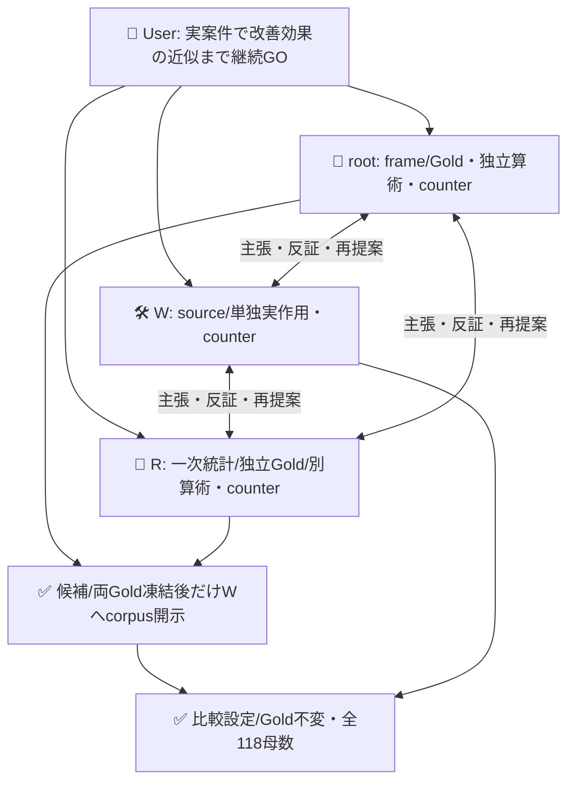
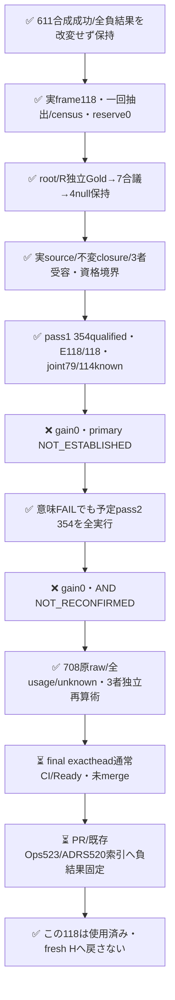
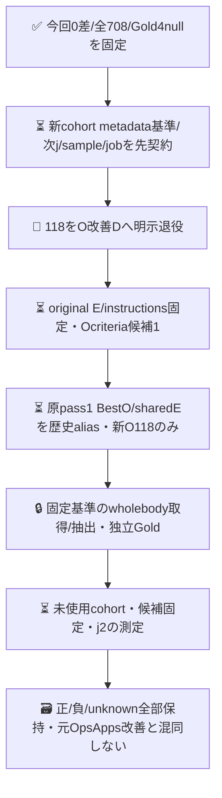

# 固定した実案件118件でのJev改善再確認

**改善効果は再確認できなかった。** PR611のscoped E criteriaをoriginal Bestと比較したが、実案件118件の2passとも全E判定が両設定で正答し、gain0だった。35件の既知誤答は今回変更していないO判定。708/708の実呼出しを完了して原証拠を保存した。既存Best/候補の採用・mergeなし。次のO改善は別の事前契約と未使用cohortが必要で、今回の未達を全体完了へ読み替えない。

| 実結果 | pass1 | pass2 |
|---|---:|---:|
| native run（attempt1、SUCCESS） | [39410714744](https://github.com/roccho-org/ops/actions/runs/39410714744) | [39411617358](https://github.com/roccho-org/ops/actions/runs/39411617358) |
| physical/qualified/model stable | 354/354/true | 354/354/true |
| 全割当/Gold既知/Gold不明 | 118/114/4 | 118/114/4 |
| 完全正答 Best/scoped（既知分） | 79/79 | 79/79 |
| 修復b/悪化c/観測軸退行 | 0/0/0 | 0/0/0 |
| E正答 Best/scoped | 118/118 | 118/118 |
| O TP/TN/FP/FN（両同じ） | 44/35/13/22 | 44/35/13/22 |
| 保守的primary差範囲 | [-4,+4]/118 | [-4,+4]/118 |
| primary判定 | NOT_ESTABLISHED | NOT_ESTABLISHED |

2pass結合は **NOT_RECONFIRMED**、knownFailurePasses=[1,2]。114既知だけで母数を膨らませず、Goldnull4を全118に残す。各設定の全件正答率は79/118から83/118の範囲で、79/114を全割当の精度とは呼ばない。両passの全354 choiceは同一だったが、118件を236独立案件へ水増しせず、未来の安定性能を保証しない。

## 事前frame・独立Goldと開示順序

公開roccho-org/opsとroccho-dev/appsのunionで、作成cutoff2026-10-20T00:00:00Z以前の全open/closed非PR issueを対象にした。1issueの実取得版**全文body**が1unit。タイトル/コメント/リンク先を追加しない。APIは原子的as-of snapshotではなく、取得window2026-10-20T10:10:44.998Z～10:11:11.044Z（26.046秒）中に取得した各recordの最新版bodyを固定した。created_at/updated_at/retrievedAt・元URL/不変ID・原bytesを保持する。

標準gh全paginationは正常終端。原718itemsからPR542・既使用issue56・oversize2を事前規則で除きeligible118（Ops91/Apps27）。旧605は100metadata＋本文8という差を保持し、全100 source identityを保守除外。他の保持済みprior sourceと明示ops482、別issueのexact prior bodyも事前除外した。意味/Gold/モデル結果で選別しない。新frame内同本文3群/extra8件は除外せず1issue1weight。近重複の意味選別はしない。

rootがframeをnative6536da40c5ea57c1e7171b78cdae9d9089ce13f9へ保存後、乱数前wx出力確保・標準crypto.randomInt Fisher–Yatesを一回だけ実行。draw indices/permutationを純再生でき、n=min(300,M)=118のcensus、reserve0。sampling/opaque viewはnative9311bb9d31a224e36e32f199eb95f85cd7e88de7。未使用は既知の旧入力/取得snapshot/候補開発への投入を除いた範囲で、全actor生涯未読・model pretraining未使用を保証しない。

root/Rは互いの初稿もモデル出力も見ずbody-onlyで各118採点。root初稿をnative839c8520a9cc1ded090b04c5974b0aa331d2f9b6へ凍結後に初比較した。111一致/7不一致を保持し、出力前合議で3件解消・4件null。両初稿/合議/corpusをnative256443b3ba67cd85feab848fbad043759f133fbbへ保持し、root/Rが全body/source/order/Goldを別確認後、5fileを原bytesで製品へ取込んだ（sampling path改名のみ）。Wは候補・Gold固定後に初めて全corpusを受領。Goldは出力後に変えない。

自然Gold分布はOps91: Eyes66/no25、Oyes41/no46/null4。Apps27: Eyes27/no0、Oyes25/no2。Apps E負例0・wholeissueでE優位・repo不均衡を限界として保持し、再重み付けしない。E/repo/Gold分布は記述副次で、別endpointの成功へ変えない。

## 固定処置・unknown・事前近似条件

比較はPR611 final641fedのoriginal Best対**E yes/no criteriaへ同じscope補足だけ**。Best instructions/O/axis/protocol/full-wireは不変。各caseのBestE/scopedE/sharedOを事前の循環順で実測し、共有Oは各pass内で同receipt/unknownを両roleへ投影。pass間は別物理観測。同wireが再び現れるpass2は事前宣言した新assignmentで、pass内retryやfailed-run rerunではない。初回の意味FAILで予定pass2を取消/再抽選しない。model drift等の技術停止は維持し未試行をunknownへ残す。

完全正答の修復b/悪化cとcase内既正答E/Oの破壊rを分ける。not fully resolved cases=u（一軸でもGold/どちらかarmがunknownで完全既知にならないcase）、rは完全既知内、partial既知退行は別観測して受入へ含める。全n worst-case差[(b-c-u)/n,(b-c+u)/n]、R上側(r+u)/n。既知subsetだけで成立を作らない。

real-case family j>=1、alpha_j=.05/2^jをPR/失敗でresetしない。2pass×5 finite-population hypergeometric tailsに各alpha_j/10（今回1/400）、tail>=alphaをinclusiveにretainするBigInt exact反転。B/C/Rは未知の最悪向き範囲、差[(B_L-C_U)/M,(B_U-C_L)/M]、退行上側R_U/Mを報告。事前受入は両passの差lower>0・全n worst-case正・観測既知軸退行0。既知不成立とunknownを両配列で残し、平均で救済しない。Rupper<=1%はUser由来でないためgateにしていない。

censusのHG点区間は**sampling誤差だけ**の話で、モデル/Gold/backend/future uncertaintyが消えるわけではない。今回4nullのため保守区間[-4,+4]/118、R上側4/118。共有O/同Eなら未知Goldでもpaired差0になるsharp-boundの予測前counterは3者で確認したが、今回primary全u±1は変更せず、未達救済に使わなかった。将来期待gain/人口無退行/Gold無謬/Apps完成性能/Jev評価役の因果価値は未証明。

## 実入口・証拠と費用

専用branch/request-only source直接親・actor/attempt1/native historyをcredential前に検証し、既存標準Jev clientとstrict model/probability/typed qualificationを使った。Gold採点はprojectだけ、prepareはGold形式検証だけ。全708 serialized wireをkeyless捕捉しstate={body}のみ、最大19933B<24000を独立確認した。出典/Gold/id/repはprovider判定入力へ入れない。各110分jobは354×15秒=88.5分と保存余裕を満たす。JEV秘密はevaluate1stepだけ、always projection/upload、原rawは保持。

sourcef76はcanonical39409251752実482/482、freshconsumer118586745329、health39409251857成功後にpass1を起動。696は閉raw/test/docだけでeffect closure全bytes不変を3者確認し、f76証拠を不変componentにだけ再用、696全head成功と呼ばなかった。current reviewと実Ubuntu credential前全keylessを必須にしてpass2を起動した。通常CIは省略せず最終exactheadで閉じる（本source snapshotでは⏳）。旧runがnative concurrencyでobsolete/cancelledなら独自再実行gateを足さない。

pass1 artifact12258978528は665863B、pass2 artifact12260200219は665771B。各provider SHA256/size/run/head/source/attemptをW/root/Rが各自取得し、原5fileとGitbytes、製品projection全再生、製品採点をimportしない別算術を照合した。root/Rレビューは同PRのexactsourceに残す。old611/606/605等のrawは一切書換えていない。

| 物理template（各pass） | input tokens | output tokens |
|---|---:|---:|
| BestE | 241834 | 3658 |
| scopedE | 284550 | 3658 |
| sharedO | 244076 | 3658 |
| 物理合計 | 770460 | 10974 |

今回2pass総708qualified、input1540920/output21948、provider total_tokens708件欠損。金額/修正者・採点者の総費用は未知。独立判定236件＋7合議を要した。運用相当inputは各pass485910→528626（+42716、約8.79%）でgain0。実験内O共有を配備後節約/効率改善とは呼ばない。PR613新規standard generate呼出し0。過去606296/611496などは別の閉記録で、今回708へ紛れ込ませない。

## 3者counterと今回の閉包

同じroot/W/R全員が主張・反証・再提案。policyはADRS exact0dd39ca41718fafe40e58c6927a2ebb0ea297eee、専用bare/.worktrees、W solewriter/effect owner。User GOは実測まで、merge/adoptionは別。

## 次O改善の経路（未実行・別事前契約）

E天井に対してE候補を重ねず、残るO誤答へ対象を切り分ける。旧E補足は未採用のまま保持し自動継承しない。Oは報告の存在/種類で、外部真偽検証・証拠リンク存在を勝手な必要条件へ足さず、未達/未確認の現状報告を含め、Refsだけ/作文例は報告へ過包含しない。元の広義E/Oを狭めない。Dのhistorical aliasは非同時の閉receipt比較で、新しいE性能やfresh E無退行を証明しない。Goldnull4を編集せず残し、fresh比較は別cohortの同時測定だけで行う。

**訂正注記（sys1 v1 後始末 C、2026-10-22、adrs#664）**：`results/real-case-reconfirmation-20261020.json:504` の claim 文「both prospectively fixed passes positive without observed axis regression」は誤り。同じ file の数値は両 pass とも b=0・c=0（148〜149 行、394〜395 行）で、各 pass は NOT_ESTABLISHED（251 行、497 行）、全体は NOT_RECONFIRMED（2 行）。正しくは「両 pass とも差 0、観測軸の退行 0、再確認未達」。原 file は変更しない。

次cohortを勝ちそうなUI等の内容で選び直さず、本文/Gold/予測を見る前にmetadata基準で固定した同owner public issue-enabled repo集合のunion等を検討する。元母集団変更を隠さず、候補/新frame/追加effectは今roundの閉包後に別設計。fresh供給がなければ捏造/同本文再使用で成功を作らない。次sample数/有限job条件は精度・Gold負担・効果資源からM前に合意し、Userの「予算不要」を勝手な通算1000停止gateへ変えない。
