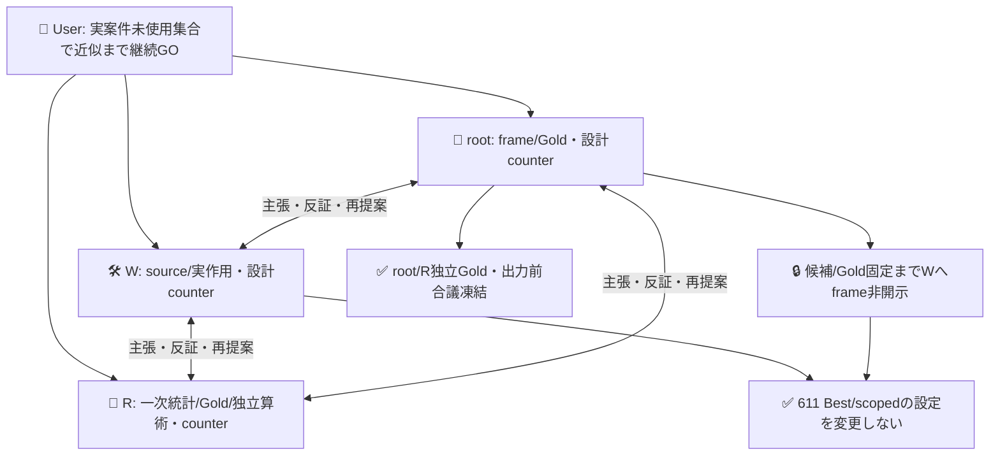
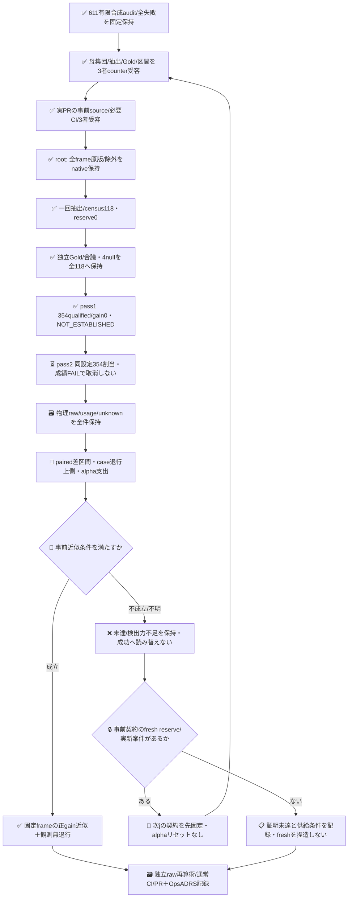

# 実案件から独立採取するJev改善効果の近似評価

目的は、PR611で固定したBest対scoped設定を変えず、実GitHub案件の事前定義frameから無作為に採取した未使用集合で正のgainを近似できるか測ること。611の合成audit54→62/64・全負結果・Bestは不変。root/Rが受容したcollectorでframeを一回取得・native Git保持済み。候補・Gold固定後にWへ全118 corpusを開示・一回sampling保持済み・モデル作用354（pass1）、pass2は未実行。成立を先に約束しない。

## frameと何を一般化するか

提案frameは公開roccho-org/opsとroccho-dev/appsのunion。作成日時が2026-10-20T00:00:00Zより前の、open/closedを問わない非PR issueを対象とする。repo immutable IDを採取前に解決し、元URL/provider issue IDとともに固定する。1issueの実取得版**全文body**が1unitで、タイトル/コメント/リンク先を判定入力へ足さない。

GitHub APIは原子的as-of snapshotではない。作成cutoff以前の案件について、後で宣言する有界取得window中に実取得した最新版body集合を固定する。created_at/updated_at/retrievedAtと原bytesを別保持し、元URLとnative Gitから取得版へ辿れるようにする。

eligible条件は出力前に固定する。全文が非空で、611固定の3つのactual serialized requestがすべて24000 UTF8 bytes未満。長文を切り詰めず、制約外件数とcoverageを母集団記述に残す。旧605 snapshot取得100件全source URL、他の保持済みprior source URL、明示既使用ops482等をissue identity単位で事前除外する。選んだ8件だけを除外して100件を未見に戻さない。意味/ラベル/今回の出力を見た除外・補充は禁止。

このeligible固定frameへの近似であり、将来GitHub、全ops、Appsの完成性能への一般化ではない。「未使用」は旧入力/取得snapshot/候補開発に未投入という境界で、model pretrainingや全actorの生涯未読を保証しない。updated_atだけ変わった同本文や同issue改版をprimaryのfresh案件へ戻さない。

## 収斂した取得routeと失敗境界

capture.mjsはrootの私的data worktreeでだけ使う標準gh API capture。開始から最大3600000ms（1h）、既存認証でmetadata-only GraphQLによりpublic repo IDと既source issue/pullの不変node IDを解決し、RESTのgh api --paginate --slurpを各repo一回正常終端まで実行する。自前cursor/HTTP broker/新authは置かない。全raw pageとAPI invocation結果を私的ファイルへ保持する。API/identity/pagination/timeout/順序/duplicate不成立はFRAME_INVALID、部分原文を残してsampling/model作用0。空eligibleはNO_ELIGIBLE_FRAMEで近似成功ではない。

priorは611base refをnative Gitで一度commitへ解決し、そのexperiments/**/*.jsonからURLとbody値（旧provider text内のJSON bodyも含む）を機械抽出する。旧605はmetadata100＋本文8という実在差を保持し、100URLを保守的identity除外する。GraphQLはbodyを要求せず、不変repo/issue node IDへ解決。未解決をURL fallbackで通さない。別issueのprior完全同本文も除外する。文字列の意味/nearcloneによる恣意除外なし。新frame内の同本文複数issueは排除せず群数/重複数を記述する。

whole-body原版、repo/issue不変ID、取得window、除外理由とcoverageをpure materializeFrameで検証する。完了直後はOBSERVED_FRAME_AWAITING_NATIVE_RETAINで、rootが原raw/frameをnative Git保持・独立readbackするまでcold Capturedやsampling可とはしない。Wは候補・Gold固定まで未抽出frame本文/Goldを読まない。

## 一回の抽出とGold

取得はroot保持commit6536da40c5ea57c1e7171b78cdae9d9089ce13f9、26.046秒のwindowで718 itemsからPR542・既使用56・oversize2を事前規則で除きeligible118（Ops91/Apps27）。Rが原APIとframeを別再生して一致。n118のcensusでreserve0。同本文3群/extra8件はissue weightのまま保持した。本文はW未開示。

sample.mjsはnative Git保持bytesを検証し、乱数前に一つの出力をcreate-newで確保してから標準crypto.randomIntで一回だけ抽出する。途中書込みが不明なら再抽選せず、partial原記録を保持する。

frame原bytesをnative Git保持した後、一回だけ標準crypto.randomIntのFisher–Yatesでuniform permutationを作る。n=min(300,M)、Mはeligible frame件数。draw indicesとpermutationを一つのsampling receiptへ保持し純粋再生する。独自PRNG/beacon/手転記SHA gateは不要。残れば非開示suffixをreserve、M<=300ならcensus。reserve維持のため恣意的に標本を半減しない。欠測・曖昧例の後付け再抽選/穴埋めはしない。

rootとcounterreviewがモデル出力を見る前に、bodyとopaque IDだけからE/Oを各独立採点する。各原annotationと不一致を保持し、出力前に合議、未解決軸はnull。盲検はarm出力に対するもので、両者が候補方式自体を知らないという主張ではない。旧正本の広義E/Oを使い、コメント先で意味を補わず、出力後Gold編集はしない。

未解決Gold/応答は全抽出nへ残す。候補とGoldの固定前にはWや修正器へframe本文を開示せず、固定後の測定source取込みで初めて開示する。両設定は611の実S/A full-wire proofと同値のまま、採取結果に応じた添削をしない。

## paired測定と近似判定

1caseにつきBestE/scopedE/sharedOの3physical request、固定循環順、各pass上限3n<=900とし、出力前に2passを固定する。今回のM=n118では各354、計708 POST。初回の意味結果が不成立でも2回目を取消・再抽選しない。model drift等の技術停止guardは維持し、未試行は割当分母のunknownへ残す。両passそれぞれprimary条件を満たすことを要求し、平均による退行救済はしない。repIDをattempt/post/usageへ保持し、共有Oはpass内だけ、pass間は別物理観測。各jobは15秒deadline×354=88.5分と保存余裕を満たす110分を予定する。共有Oは同じreceipt/unknownを両roleへ投影し、独立二証拠・追加callにしない。既存標準Jev client/CI/認証境界を使う予定で、runtime.mjsと限定workflowは実装したが、実corpus/二者Goldをnative256443b3から原bytesで取込み、pass1のみ実測・pass2は未実行。source/必要CI/3者受容とGold固定後だけrequest-onlyで各pass一回起動する。model drift/資格拒否/輸送不明はunknown、盲再送をしない。

完全正答の改善b=Best誤→候補正、改悪c=Best正→候補誤をcase単位に数える。case内E/Oのどちらか一つでも既正答を壊せばcase退行event。両完全誤答間のE修復/O破壊も退行なので、cとcase退行rを混同しない。

fully unresolved casesをuとし、rはfully resolved内だけで数える。partialでも判明した軸退行は別に観測し、観測退行0の判定に含める。全nで差のworst-case境界[(b−c−u)/n,(b−c+u)/n]、退行上側(r+u)/nを残し、既知subsetだけで成績を上げない。

反復familyのround j>=1でalpha_j=.05/2^j。初回.025、全roundを足して.05以下。新PR/失敗/候補変更でjをリセットしない。E軸はpaired件数/率/FPFN、repo別/自然Gold分布/unknown率は記述副次だけで、別CI/p値/成功判定を追加しない。Eだけ良くてもjoint未成立を全体successへ変えず、unionの1issue1weightをrepo等重みに後変更しない。

有限population hypergeometric反転でB_L/B_U/C_L/C_U/R_Uの5tailsへ2pass計10tailsへ各alpha_j/10（初回1/400）を割り当てる。tail==alphaを除外せず、tail>=alphaを保守的にretainする。inference.mjsはnative BigIntの整数HG tail/二分反転を実装。等号境界・census・小M全K coverage・unknown・2pass ANDを鍵なし検証し、独立R oracle5320条件とcoverage検算に一致、root/R review5583912889/5583941518受容済み。uはB観測[b,b+u]、C[c,c+u]、R[r,r+u]として最悪向きへ入れる。差区間は[(B_L−C_U)/M,(B_U−C_L)/M]、退行上側R_U/Mを報告する。

事前受入案は差lower>0、観測既知case軸退行0（partial含む）、全n worst-caseでも正の差、sampling/provenance/modelに未解決無効化なし。退行upper<=1%はUser要求でなく設計上届かない場合があるためgateにしない。必ず上限を数値報告し、人口ゼロ/1%保証とは呼ばない。

hypergeometricのdesign exactnessは固定finite binary outcomesとSRS仮定下。モデル確率性/alias backend/時間順序/Gold誤りまで95%保証とせず、当該固定frameと標準測定protocolでの近似とする。summary.mjsはpaired件数/全母数unknown/部分退行/各arm軸FPFNを算出する。inference.mjsは各passの事前条件と2pass ANDを別に判定し、同じcase IDs/件数/roundであることを検証する。

censusのHG点区間は抽出誤差0だけを表す。2passは同118件での経験的な再確認であり、n236への水増し・backend独立・未来期待gainの95%保証にしない。モデル確率性とGold不確実性はHGで消えない。

## 3者と知識境界

適用policyはADRS0dd39ca41718fafe40e58c6927a2ebb0ea297eee。同じroot＋W＋counterreviewが全員主張/反証/再提案。rootはframe/Gold、Wはsource/実作用、Rは一次統計資料/独立Gold/別算術を担当する。User GOは実測までを含むが、設計収斂前の採取・モデル作用やmerge/採用を意味しない。

## 実証から閉包まで

現状はframe/一回sampling/両独立Gold/出力前合議を保持済み。data取込みsourceの3者受容と必要CIを閉じてpass1を測定した。次にpass1原rawを保持・独立読戻しして、事前固定pass2を各一回測る。モデル作用は実source/資格境界/必要CI/3者受容後。費用は物理usage/人手と不明額を分離し、共有callの節約を配備後効率へ読み替えない。false positiveを避けるため不成立/unknownの枝も閉包として残し、改善成功そのものを保証しない。

## 実行入口の現在境界

real-case runtimeは2つのrepを同じ標準clientで各一回測る。新workflowは専用branchのrequest.json変更だけを入口とし、pass1のrequest-only activationは保持済みで、pass2も新しいrequest-only childを一回作る。preflightはnative parent・request-only diff・actor/run_attempt1・履歴件数・保持済み前rep原rawを照合する。rep2はrep1の正gainを条件にしないが、model drift等技術無効化では起動を止め未試行をunknownとして残す。Gold採点はprojectのみ、prepareは形式検証のみ使用、provider requestはbodyと611固定設定だけ。

専用workflowは既存regression profileへ限定差分を変換して既存6step/credential位置/permissions/checkout/artifact境界の全検査を再用。各110分は354×15秒=88.5分に保持余裕を加える。実Gold/corpus・source3者受容・必要CI482/482とfresh consumerを閉じ、pass1の354 POSTを実測済み。pass2の保持source受容/必要検証後だけ次assignmentを開始する。

## 出力前に固定した実data

root/R各118初稿は互いの値を読む前に保存し、111一致/7不一致を保持した。出力前合議で3件解消、4件はnullのまま全118分母へ残した。root/Rが全body/source/order/原annotation/合議を独立照合後、native256443b3ba67cd85feab848fbad043759f133fbbからcorpus/sampling/両初稿/合議の5fileを原bytesで取込んだ。候補・Best・Goldを結果に応じて変更しない。

「再送なし」はpass内retry/失敗run rerun無しの意味。事前宣言pass2は同wireを再観測する新assignmentなので、pass1の成功済み/unknownと同じpayloadが再び現れる。両回を独立issue236件へ数えず、全2回の差と不成立/unknownを保持する。

## pass1実測（負結果を固定）

[run39410714744](https://github.com/roccho-org/ops/actions/runs/39410714744) はsourcef76→request-only90e5、attempt1/SUCCESS。artifact12258978528は665863bytes/providerSHA256一致、原5fileを再生して全値一致、root/Rがそれぞれ自取得・別算術で一致した。354/354 qualified、model stable、未実行/資格unknown0。Gold null4はunknownのまま。

既知114件ではBest/scopedとも79正答、修復b0/悪化c0/観測軸退行0。primary worst差[-4,+4]/118でNOT_ESTABLISHED。Eは両118/118・全choice同一、残るOは既知114でTP44/TN35/FP13/FN22（Goldnull4）。E処置のgainはこの自然frameでは観測されず、Oの35誤答をE改善として扱わない。pass1の不成立で予定pass2を取消/再生成せず、同設定/同Goldで2回目を測る。

入力tokensはBestE241834/scopedE284550/sharedO244076、各output3658。physical合計input770460/output10974、provider total_tokens354件欠損。運用相当のinputは485910→528626（+42716、約8.79%）でgain0。金額/効率改善は未証明。

Gold自然分布はOps91(Eyes66/no25、Oyes41/no46/null4)、Apps27(Eyes27/no0、Oyes25/no2)。Apps E負例0、wholeissueのE優位とrepo構成を限界とし、結果を見て再均衡化しない。共有O/同Eなら未知Goldでもpaired差0になるsharp-boundの予測前counterは3者で確認したが、今回primaryは全u±1の保守的事前境界のまま、未達救済へ使わない。
