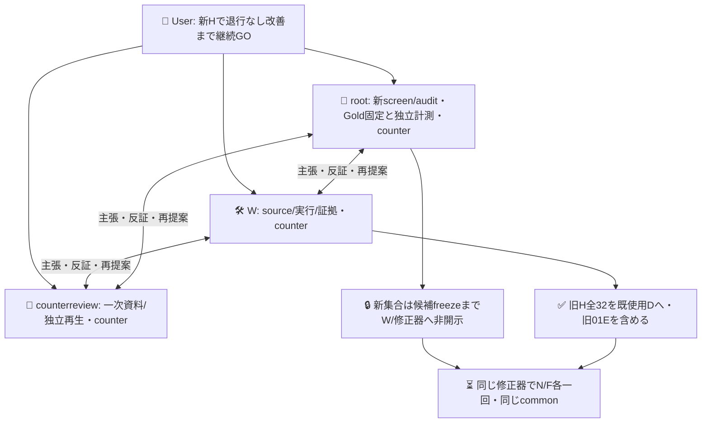
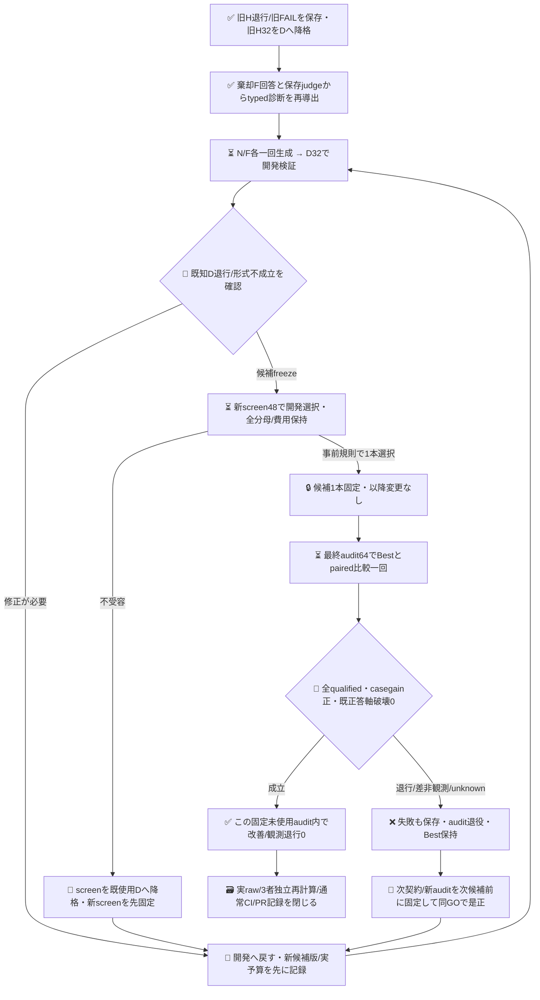

# 既知退行を開発へ戻す次周

PR606の閉じた記録（base `43b4b4fbbeaad6c74aec3292894f42ea73056b64`）を変更せず、旧H01Eの退行を開発課題へ移す。目標は、新しい未使用集合でBestより完全正答が増え、Bestの既正答E/O軸を壊さない設定を確認すること。普遍的な偽陽性/偽陰性ゼロや人口への統計的保証は主張しない。Bestは未変更、merge/採用/新認証は対象外。

現在は、旧H32の開発Dへの明示降格、固定修正入力、strict候補受入、D退行guard/S選定の純粋機能、別directoryの標準生成captureを実装した。新モデル作用0、新screen/audit本文・GoldはW未読。D/S/Aの新モデル実行workflowは次sliceであり、旧Hを未見評価と呼ばず、旧Jev呼出しを再送しない。

標準生成用`native-repair.mjs`は606で実使用した同じ小さいCLI captureを、別private directory `.../jev-regression-repair-20261020/round-1`で一度だけ使う。606 source/原ファイルを変更・上書きせず、同一common/明示model・32body・前後version/catalog/config-stat、N→F各一回、原response/receiptを保存する。配置/構文のread-only確認は生成と別。source/必要check/3者受容までは本体未実行。provider内部試行/usage/hardmaxは非露出のunknown、6000Bは候補受入上限で推論hardmaxでない。stdout/stderrは私的保持し、秘密値やauthfileを読まない。

各armのAPI失敗・timeout・応答欠損は原stdout/stderrとreceiptを残してunknownとし、有効な他armまで失わせない。文字列応答の形式違反はinvalid、どちらもcandidate=nullでBestへ代入しない。collectorはarmごとに分類し、再送/文面救済/再抽選を行わない。前後metadata一致は観測したversion/catalog/config-statだけの一致で、provider内部weightsや完全な設定同一性を証明しない。

## 実装済みの最小経路

`development.mjs` は606の保持済みinput/report/projectionを同じcanonical採点で再生して一致を確認する。棄却Fの実回答を対象に、保存body-only judge分類との差を機械的に診断する。01Eは`requirement_scope`、06の資格拒否は`unknown`のまま。これは実行済み呼出しの再利用で、新D probeや自由文rationaleではない。

両修正armのcommonは同一のBest全文参照、棄却F出発点、既存E/O正本から直接参照したtaskContract、旧H32の全bodyと棄却F実回答、同じprompt/診断定義。Fだけtyped助言を添付し、Nは助言なし。Gold/basis/正誤ラベルはどちらへも渡さない。今回は全instructionsの簡潔な書換をN/F双方へ許し、606だけのBest prefix条件を自動継承しない。固定targetRequest質問・criteriaとbaselineBestは変更しない。新parserは最大6000UTF8bytes/非空/JSON sole instructions/救済・再抽選なしを検査する。意味の狭義化・case lookupは3者意味レビューで拒否し、D/S/Aの独立Goldでも検証する。修正器は同じ既存native標準stateless経路を使う予定で、履歴やsub著者をarm間で変えない。

## 3者counterと知識境界

適用policyはADRS `0dd39ca41718fafe40e58c6927a2ebb0ea297eee`。Userが指定した同じroot＋sub2名を継続使用する。Wは専用worktree `jev-regression-repair-20261020` と同名codex branchだけを書き、rootは別data worktreeで新集合/Goldを候補前に固定する。全員が主張・反証・再提案を担い、rootは候補を共同著作しない。

同UIDのOS秘匿や独立第三者著作を主張せず、役割間の知識分離に限る。旧HのGoldは開発担当へ既知だが、片armへのGold助言やWの後付け自由文を加えない。Gold閲覧者の候補意味レビューは公開済みtask契約への適合だけを判定し、新screen/auditの内容に照らした最適化ヒントや添削を返さない。不適合候補はそのままinvalidとして保存し、文面救済や再抽選をしない。

## 次段の有限実行契約（source/CI/3者受容前は未起動）

第一周の技術上限は標準generate2要求＋Jev672POST。D32の2候補E/O=最大128、screen48のBest/F/N E/O=最大288、選択後audit64のBest/候補1本E/O=256。screen judgeは候補生成・選択・監査のどれにも不要なため省く。新screen/audit合計112bodyはrootが出力前に固定し、互いと旧D/Hの完全一致を除く。人工機構集合のため、この数へ人口p値やglobal95%保証を付けない。各phaseは有限で、最大288×15秒=72分に検証/保存余裕を加え90分のjob枠を予定する。

開発Dは既知退行を直すguardで、D成績を未見成功と呼ばない。全32target qualified＋Best既正答E/O軸破壊0（01E修復を含む）だけscreenへ進む。両不合格ならscreen/auditを開封せず開発へ戻す。一候補だけならscreenのunique設定をBest＋その1本へ減らす。無効候補やBestと同一設定は新たな改善候補にしない。同一configの重複測定やaliasによる二重原価計上はしない。

screenでBest比casegain正・既正答軸破壊0・全qualifiedの候補から、S正答最大→D正答最大→instructions UTF8bytes最小→固定arm順で1本選ぶ。固定arm順はfeedback、no-feedbackとし、最後のtie規則に品質/助言因果/効率の意味を持たせない。screenは開発選択に消費し、選んだ候補1本を固定してからauditを一度だけ開く。Nが勝てば対象改善の成果で、Jev助言の成果へ加算しない。S/Aの事前Gold反証は候補authorでないroot/counterreviewだけが行い、W/修正器へ内容やGold由来助言を渡さない。

輸送不明・資格拒否はunknownで全分母へ残し、成功済み/失敗済みqueryを盲再送しない。role/model別の実数と費用unknownを分け、標準generateの内部provider試行/usageを2HTTPと推測しない。新auth/secretコピー/権限拡大/独自executorは追加しない。Userの継続GOに通算周数の本人確認待ちを追加せず、次roundは次候補/新H/有限phase契約を先に3者で固定し、累計はnative receiptから全開示する。

採用可能性の有限根拠は、固定未使用auditでの完全case改善と観測軸退行0、実行qualified、必要既存check、独立再計算の組。人工集合・Gold著者依存・一組の確率的修正生成から安定性能を証明せず、繰り返した最後の成功だけにp値を付けない。全失敗/screen消費/監査消費を同系列に残す。

改善の近似は不可能ではない。この固定未使用auditで改善/観測退行0を再確認できる。より強い統計近似には対象分布、無作為で独立したsampling単位、Goldと事前受容基準が必要で、この人工cluster集合へ人口p値や95%保証を流用しない。例えばその別設計の仮定を満たす独立300件で退行event0なら片側95%上限は約0.994%だが、本112件の保証ではない。根拠はcounterreview担当が調査した[adaptive holdout](https://arxiv.org/abs/1506.02629)と[NIST exact binomial](https://www.itl.nist.gov/div898/handbook/prc/section2/prc241.htm)。rootは主張/反証、counterreviewは一次調査、Wは実装/記録を担う。
