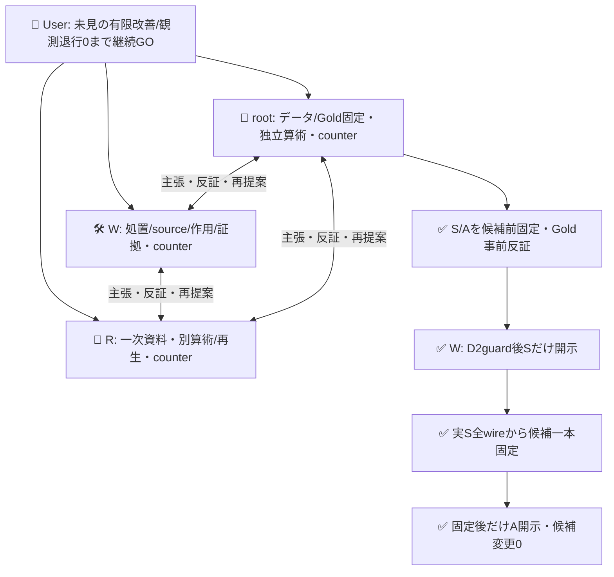
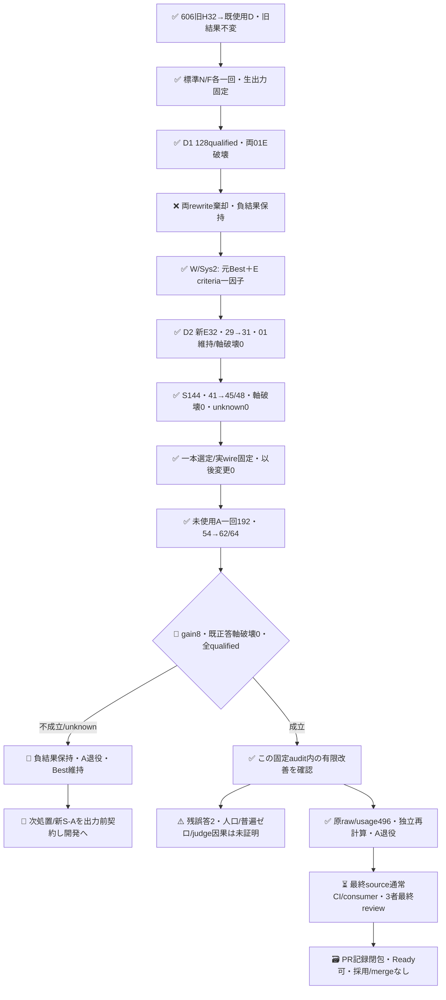

# 適用scopeを直した対象configurationの有限改善

未使用の固定audit64件で、元Best **54→62件**の完全正答、**8件修復・既正答E/O軸の破壊0**を観測した。全192物理requestはqualified、unknown0、応答modelは固定期待値と一致した。事前受入条件を満たす有限の対象設定改善であり、普遍的な無退行、人口精度、Jev評価役の因果価値、Apps性能、配備後効率の証明ではない。Bestの自動採用/mergeはしない。追加モデル作用は不要。

## 実測と残る誤答

| 段階 | 完全正答 | Best既正答軸破壊 | 実作用 | 判定 |
|---|---:|---|---:|---|
| D1: N/F instructions rewrite | 歴史Best29→F30/N30 /32 | 両01E | 128 | 両棄却・負結果保存 |
| D2: 元Best＋E criteriaだけ | 歴史Best29→scoped31 /32 | 0、01E保持 | 新E32 | 開発guard成立 |
| S: 同一固定candidate | 同時Best41→scoped45 /48 | 0 | 144 | 開発screen成立 |
| A: 選定後一回の未使用audit | 同時Best54→scoped62 /64 | 0 | 192 | 有限改善成立 |

D2/S/Aでcandidateのinstructions/criteria/protocolを変更していない。A修復は005/013/017/021/037/049/061/063のE。audit-025のE偽陽性、audit-053の共有O偽陽性は残る。満点や偽陽性ゼロとは呼ばず、結果を見てGold/候補/主判定を変更しない。Aは消費済みとして退役する。

| A64の軸 | Best TP/TN/FP/FN | scoped TP/TN/FP/FN | unknown |
|---|---|---|---:|
| E | 32/23/9/0 | 32/31/1/0 | 0 |
| O | 32/31/1/0 | 32/31/1/0 | 0 |

Oは同一の実request一回/件を両roleへ投影したもので、独立二観測でも候補のO改善でもない。完全正答数と各軸誤りを分け、総正答の増加で軸退行を隠さない。

## 小さい一因子処置

標準stateless generate N→F各一回の生候補N3300B/F3446Bは固定したが、D1で両方01Eを壊した。再抽選や失敗の救済をせず保持した。次の処置はW/Sys2由来の一本だけで、**元Bestの生instructions＋E yes/no criteriaへの対称scope追記**とした。元criteria全文を残し、語彙/文型見本内の要求形と、対象について提示された要求宣言を区別する。引用・条件・表形式を一律除外せず、必要責務/目標/未採用仕様を狭めず、採用済み/実施済みを必要条件にしない。

元Best全request、O、axis固定文、標準protocolは不変。identityは文字列instructionsや版名でなく、既存標準clientのnetworkなしpost注入で取得した全serialized E/O wire templateで比較した。model/state/live choice/criteria/instructionsを含み、実provider入力はbodyと固定判定設定だけ。traceのID/familyやGold/basisをproviderへ渡さない。

D2は新E32のみ。Oはexact wire一致を検査した旧606 BestO実receiptへ歴史aliasした。D2のcached Bestは同時対照ではなく既使用の開発資料である。S/AはcaseごとBestE/scopedE/sharedOの3物理requestを事前の循環順で実行した。sharedOのunknownは両roleへ同じく伝播し、alias行を追加callや独立した証拠へ数えない。資格基準/modelチェックは緩めず、輸送/資格不明は全割当のunknownとして保持する。

この成功はrequest-configuration処置の有限観測。Jev助言の純因果効果やinstructions rewriteだけの効果とは称しない。旧606/605等の閉じた実証とBestを改変しない。

## 証拠と事前固定

| 段階 | native run（すべてattempt1） | artifact / bytes / provider SHA256 |
|---|---|---|
| D1 | [39387282415](https://github.com/roccho-org/ops/actions/runs/39387282415) | 12248102054 /40853 /203123ad0a2ed3a50bc2a58ab04e83c925c95b95a4a0a72f0db0e6d9352efba3 |
| D2 | [39392227245](https://github.com/roccho-org/ops/actions/runs/39392227245) | 12250211988 /17759 /7e862a02a7d123cd330f5a791f6dbefa81f939b11c23435660b39bf88ca6a8a6 |
| S | [39394190268](https://github.com/roccho-org/ops/actions/runs/39394190268) | 12250891662 /35916 /af9ecfff24193412a439e9f351765807177b0e03251b601a48d345d5833be1e5 |
| A | [39396123715](https://github.com/roccho-org/ops/actions/runs/39396123715) | 12252041253 /45383 /29f11ceec42c01be0cb4b9542d39e31af215afa74170f996d13b35564d93c7cb |

各ZIPを実取得してprovider size/digestを照合し、原input/predictions/events/attempt/projectionの全bytesをresults配下へ保持した。canonical全値再生、root/Rの別算術、native metadataの独立読戻しで照合する。D1 executionのSUCCESSは意味上の両棄却を消さない。

rootは候補生成前にS48/A64を別data worktreeのnative Git718bへ固定し、root/RがGoldを事前反証した。モデル作用0の時点に曖昧だったA001を明確化した履歴もそのcommit以前に残る。SはD2guard後だけWへ開き、S通過後の実input全wireと一本選択をnative Git f966a47eのselection.jsonへ固定した。その後だけAを初開示した。S/Aの原bytesとsourceCommit/sourcePath/段階開示条件を各origin.jsonへ保持する。同UIDのOS秘匿や独立第三者著作は主張しない。

最終Aは事前固定のcasegain正/既正答軸破壊0/全targetqualifiedを満たした。結果を見た後の候補選択/再試行は0。audit-only admissionはcredential前にnative履歴4件、request-only親source、actor/attempt1、D1負結果/D2guard/Spositiveguard/選定実wireと各原run identityを再検査した。新認証/secretコピー/権限追加/独自executorなし、標準client/既存CI/6step隔離を再利用している。

## 作用と費用の全量

| 物理作用 | POST | 既知input tokens | 既知output tokens |
|---|---:|---:|---:|
| D1 | 128 | 222716 | 3968 |
| D2 新E | 32 | 43727 | 992 |
| S BestE / scopedE / sharedO | 48 /48 /48 | 48096 /65472 /49008 | 1488 /1488 /1488 |
| A BestE / scopedE / sharedO | 64 /64 /64 | 64258 /87426 /65474 | 1984 /1984 /1984 |
| Jev合計 | **496** | **646177** | **15376** |

496POSTは全qualified、provider total_tokensは全496で未提供。既知input/outputをprovider totalや金額の代わりにしない。別単位の標準generateは実API要求2で、内部provider試行/usage/hardmaxはunknown、6000Bは候補受入境界だった。観測metadata前後一致はbackend weights完全不変の証明ではない。金額/成功一件原価/収益効果は未取得。

A運用相当E+O入力はBest129732→scoped152900、**約17.86%増**。outputは両3968。同じ共有Oを二重計数した実験費用ではなくroleごとの運用相当投影であり、独立二測定ではない。入力増と8件修復のtradeoffを残し、配備後の効率改善や有意な速度向上と称しない。sharedOによる測定call節約は実験の節約だけである。

## 3者組織と知識境界

適用policyはADRS 0dd39ca41718fafe40e58c6927a2ebb0ea297eee。同じroot/W/counterreview全員が主張/反証/再提案を担った。root/Rは封印Goldを知るため、候補意味レビューは公開task契約適合だけに限り、隠し集合から候補への添削/最適化ヒントを返していない。

## 完成状態と閉包

D2/S/Aの実推論は完了し追加呼出しはしない。最終記録commitの通常CI/consumerと3者reviewを閉じ、Ops523/ADRS520へrootが索引する。将来残誤答を直す場合、このAを未見に再利用せず、全失敗を残した別の事前契約とfresh確認集合を用意する。

## 証明/近似の範囲

固定未使用auditでの有限gainと観測退行0の再確認は可能で、今回それを満たした。一方、この集合はrootが手作りした機構stressで四変種ずつclustered、非無作為・非iid・Gold author依存/文面hint偏りがある。人口p値/95%保証や「勝つまで繰り返して最後だけ有意」とはしない。

より強い統計近似には対象分布、無作為独立sampling、Goldと事前受入基準が必要。仮に独立300件で退行event0なら片側95%上限は約0.994%だが、これは仮定を満たす別設計の例で、本112件へ流用しない。Rの一次調査: [adaptive holdout](https://arxiv.org/abs/1506.02629)、[NIST exact binomial](https://www.itl.nist.gov/div898/handbook/prc/section2/prc241.htm)。同caseのE/Oや四変種を独立nへ水増ししない。
