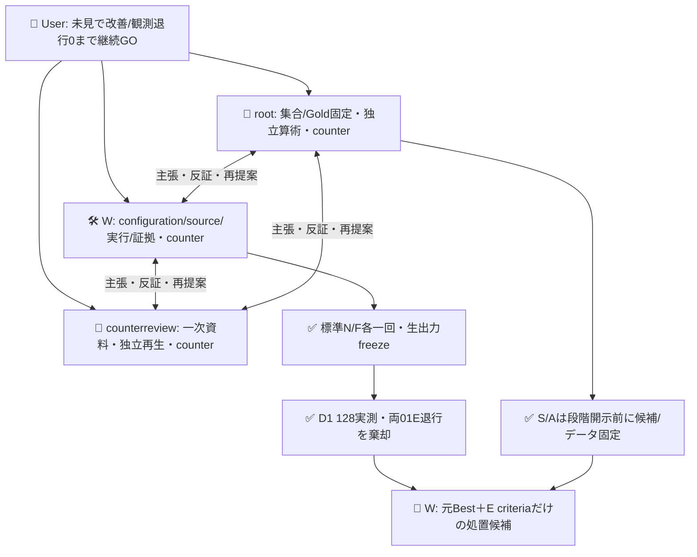
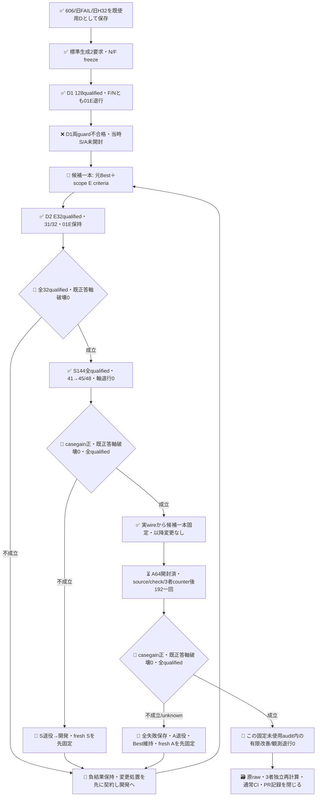

# 適用scopeをrequest configurationで直す改善ループ

目的は、未使用の固定評価でBestより完全正答を増やし、Bestの既正答E/O軸を壊さない設定を確認すること。Bestと旧606の閉じた記録は変更せず、merge/採用/新認証は行わない。普遍的な偽陽性/偽陰性ゼロや人口精度の保証ではない。

## 実測した現在地

旧606 H32は既使用D32へ降格済み。固定入力で標準stateless generate N→F各一回を行い、N3300B/F3446B strict validを生request/response/receiptとともに固定した。再抽選0、観測metadata前後一致。provider内部試行/usage/hardmaxはunknownで、6000Bは候補受入上限だった。

D1は[source6556](https://github.com/roccho-org/ops/tree/6556fe0e95943656b249ffc45697bd69e857cb39)、[run39387282415](https://github.com/roccho-org/ops/actions/runs/39387282415)、artifact12248102054（40853B、SHA256 `203123ad0a2ed3a50bc2a58ab04e83c925c95b95a4a0a72f0db0e6d9352efba3`）で完了。作用は128POST/128qualified/unknown0、model stable。rawとcanonical全値再生を`results/regression-validation-20261020/`に保持する。source必要CIは437/437・fresh consumer・repo-health成功。

| D32 | 完全正答 | Best比修復 | Best既正答軸破壊 | 判定 |
|---|---:|---|---|---|
| 歴史Best | 29 | — | — | 維持 |
| F rewrite | 30 | 17E・21E | 01E | 棄却 |
| N rewrite | 30 | 17E・21E | 01E | 棄却 |

総正答が増えても01E退行を隠さない。両rewriteがDguardに不合格だったため、その時点ではS48/A64を開封しなかった。F/N生成・D1は閉じた負結果で、再送/書換/勝者の後付け選択をしない。D1のBestは606のcached歴史観測で、同時対照の新実測ではない。

D1の既知usageはF64call=input111870/output1984、N64call=input110846/output1984。`total_tokens`は全128callで未提供。金額・収益効果は未取得、標準generate2要求の内部試行/usageもunknown。既知小計と未取得を分け、0費用とはしない。

## E criteriaだけを変えた処置とD2実測

両rewriteはscope例外を既に書いていても01Eを壊した。単に同じ指示を強めて再生成せず、対象configurationの一因子を変える。候補は**元Bestの生instructions＋E criteriaの適用scope明確化**の一本。F/N失敗を救済したことにはしない。`scoped-request.mjs`は元yes/no両全文を保持して同じscope定義を追記し、文型/語彙展示内の要求形と、対象の要件/責務/仕様/目標としての宣言を分ける。引用・条件付き・表形式を一律除外せず、採用/実施済みを要求しない。O、axis固定文、標準protocol、元Best全requestは不変。

D2は[source5dbc](https://github.com/roccho-org/ops/tree/5dbc1082c80766af2e4fd95b60c52d7bab1a5be0)、[run39392227245](https://github.com/roccho-org/ops/actions/runs/39392227245)、artifact12250211988（17759B、SHA256 `7e862a02a7d123cd330f5a791f6dbefa81f939b11c23435660b39bf88ca6a8a6`）で一回完了した。新E32は全qualified/model stable、O32はexact wire一致を検査した旧606 Bestの歴史receiptへalias。Best29/32→scoped31/32、17E/21Eを修復し01Eを保持、case/軸退行0でDguard成立。これは既使用Dの開発結果で未見改善の証明ではない。原5fileとprovider/decisionを`results/regression-scoped-development-20261020/`へ保持し、3者の独立算術とcanonical全値再生が一致した。

新E32の既知usageはinput43727/output992、total_tokens未提供32。新O呼出0であり、歴史aliasを新実測の費用や独立対照に数えない。D1+D2の実Jevは160POST、標準generate2は別単位のまま。

これは公開DからWが作るGold/Sys2由来のrequest-configuration処置であり、Jev助言の純因果効果やrewriteだけの効果と称さない。Gold/意味契約は変更しない。候補へcaseID/回答lookup/個別Goldを入れない。

identityはinstructionsや版名ではなく、既存標準clientのnetworkなしpost注入で取得した**実serialized E/O wire template**で判定する。model/state/live choice/criteria/instructionsを含み、共通の固定bodyはidentity用のplaceholderだけ。実作用には各caseの本来bodyを渡す。BestOと候補Oのwire完全一致を確認し、同一Oを二度推論して偶然の差を改善へ数えない。

- D2: 新候補E32だけ。Oはexact wireを確認した旧606 BestOの歴史receiptへ明示alias。全32分母/各軸の出自を保持する。
- S48: caseごとBestE・候補E・sharedOを事前循環で3実測、最大144POST。共有Oのunknownは両roleへ同じく伝播し、独立2証拠や2callに数えない。
- A64: screen通過後に候補一本を固定し、同じ3実測で一度だけ最終確認、最大192POST。

合計は保持済D1 128＋D2 32＋S144＋A192＝**496 Jev POST上限**、既実施の標準generate2要求は別単位。先の800/640/672の設計案を足し合わせたり、本人確認待ちの通算上限へ変えない。各phaseは有限の技術上限・3者事前受容・既存標準client/CI/secret profileで実行する。現sliceはD1/D2/Sの閉じた実証、adapter/template、A192の実entry、S/A固定3templateの純粋処理を保持する。S48だけをDguard成立後にroot保持commit718bから開封し、原bytesをscreen-gold.jsonへ取込み、sourceCommit/sourcePath/開示条件をscreen-origin.jsonに残した。Sentryは一回完了後に閉じ、現新phaseはsource/必要check/3者受容後のaudit一回だけ。native履歴はD1/D2/Sと新Aの4runを検査し、旧phase再起動や既run再試行を拒否する。

sharedOによる呼出削減は実験測定の節約で、配備後の分類が安くなった証拠ではない。S/AのusageはBestE/scopedE/sharedOという物理template単位で一回だけ集計し、候補運用相当のE+Oとpaired実験全体を分ける。E criteria追記は入力tokensを増やし得る。品質gainと効率改善を同一視せず、金額未取得を0費用としない。

## 開発screenを通過した固定候補

[source2a514](https://github.com/roccho-org/ops/tree/2a514365736a50cfb23b6898066d806c7cb4e41c)の[run39394190268](https://github.com/roccho-org/ops/actions/runs/39394190268)でS48を一回実測した。artifact12250891662（35916B、SHA256 `af9ecfff24193412a439e9f351765807177b0e03251b601a48d345d5833be1e5`）を実取得し、原5file/provider/decisionを`results/regression-screen-20261020/`へ保持した。144物理POSTが全qualified/model stable、unknown0。Best41→scoped45/48、001/005/013/041のEを修復し、case/軸退行0。sharedO48は全正答だったが、候補によるO改善とは数えない。これは開発screenであり、最終auditの代用にしない。

3者独立算術とcanonical再生一致後、候補一本と実S inputの全wire proofをnative Git f966a47eのselection.jsonへ固定し、候補変更禁止/A未開封未実行を記録した。その後だけA64をroot718bのaudit-gold.jsonから原bytes取込みした。Aはこれが初開示で、候補/Best/E-O全wireはS時と同値。Gold変更や候補添削はしない。audit-origin.jsonへ元commit/path/開示前Srun/selectioncommitを保持する。

現CLIはaudit一回だけを受け入れる。credential前にnativehistory4件、D1負結果/D2guard/Spositiveguardと3原run identity、実S selection/全wire同一を再検査する。Gold/basisは実行inputから除外し、providerへはbodyと固定判定設定だけ渡す。A192物理queryはcaseごとBestE/scopedE/sharedOを事前循環し、alias/unknownを二重計数しない。source/必要check/3者counterが揃ってから一度だけ実行し、結果から候補/Gold/主判定を変更しない。

Sの物理usageはBestE input48096、scopedE65472、sharedO49008、outputは各1488。total_tokensは全144未提供。運用相当E+O入力はBest97104/scoped114480だが、共有Oは同一実測の投影で独立二観測ではない。候補の入力増を効率改善と称さず、USD未取得/生成内部usageunknownを維持する。ここまでの実JevはD1 128＋D2 32＋S144＝304、標準generate2は別単位。A192はまだ未実行。

## 3者counterと知識境界

適用policyはADRS `0dd39ca41718fafe40e58c6927a2ebb0ea297eee`。同じroot＋W＋counterreviewが主張/反証/再提案を担う。Wは製品source/処置author、rootは別data worktreeで新S/Aを出力前固定し、root/RがGoldを事前反証済み。SはD2guard後、Aはscreen通過/候補固定後にだけWへ開示した。root/Rの候補意味レビューは公開task契約への適合だけで、封印S/Aから添削や最適化ヒントを返さない。同UIDのOS秘匿や独立第三者著作は主張しない。

## 完成状態までの閉包

qualified不足・輸送不明・model driftを不成立の実正答やuncertainへ変換しない。全assigned/attempt/post/qualified/unknown/unattemptedを原eventsと照合し、model driftは比較をUNKNOWNへする。成功/失敗queryの盲再送、同一Oの独立arm扱い、alias費用の二重計上をしない。後続sourceは前のrun/原raw/候補を不変に保ち、通常技術是正をUserへ再質問せず3者counterで進める。

改善の証明や近似は不可能ではない。固定未使用auditでの有限gain/観測退行0は確認可能。ただし人工cluster集合・Gold著者依存・選択履歴を持つ本系列へ人口p値/普遍保証を付けない。より強い統計近似には対象分布、無作為で独立したsampling単位、Goldと事前基準が必要。別設計の仮定を満たす独立300件で退行0なら片側95%上限約0.994%だが、本112件の保証ではない。counterreviewによる一次調査：[adaptive holdout](https://arxiv.org/abs/1506.02629)、[NIST exact binomial](https://www.itl.nist.gov/div898/handbook/prc/section2/prc241.htm)。全失敗を残し、最後の成功だけへ統計保証を付けない。
