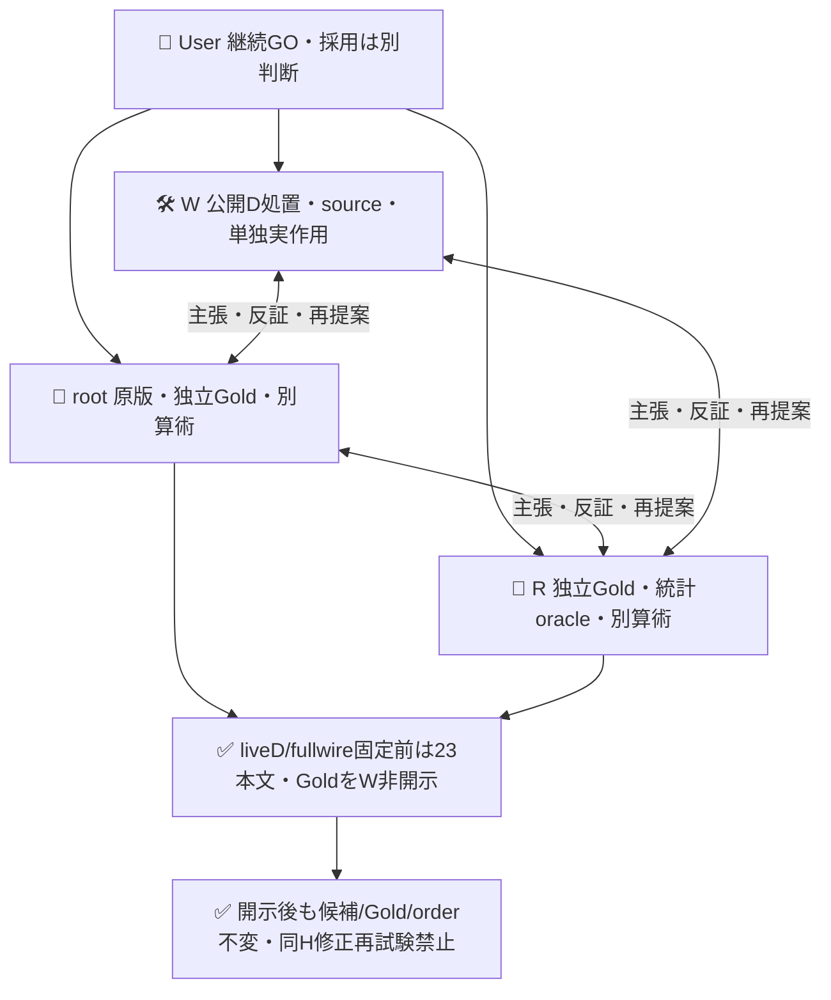
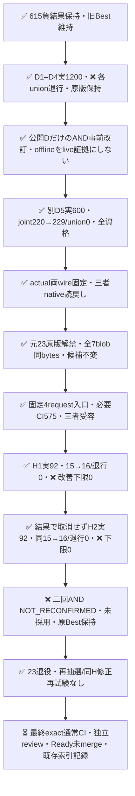

# 固定2呼出しAND戦略の開発と未使用23件の二回確認

固定したC2+C4 AND戦略は、封印していた実案件23件の両回で、既知完全正答15→16・観測軸退行0だった。ただしGold未決1を事前の最悪補完へ残すと改善下限は0で、両回とも `NOT_ESTABLISHED`、二回ANDは **`NOT_RECONFIRMED`**。正gain近似の受入条件は未達である。元Bestを維持し、候補は未採用・mergeなし。実行成功や既知一件改善を、改善近似成立へ読み替えない。

[PR615](https://github.com/roccho-org/ops/pull/615) の負結果を不変に保持し、その300件を開発Dへ退役した。D1–D4の全失敗を保存した後、追加計算を伴う固定二成分ANDをD5で検証し、実guard通過・actual fullwire固定・三者の独立読戻し後に初めて23本文/GoldをWへ開示した。開示後も候補/Gold/順序を変更せず、予定二回を正負によって取消さず完了した。23は確認後に退役し、修正して同じ23を再Hにしない。

## 二回の確認結果

|確認|元Best完全正答|AND完全正答|修復/破壊|Gold未決|事前の差下限/上限|退行上限|判定|
|---|---:|---:|---:|---:|---|---|---|
|[H1 run39458683962](https://github.com/roccho-org/ops/actions/runs/39458683962)|15/22既知|16/22既知|1/0|1/23|[0,2]/23|1/23|NOT_ESTABLISHED|
|[H2 run39459748987](https://github.com/roccho-org/ops/actions/runs/39459748987)|15/22既知|16/22既知|1/0|1/23|[0,2]/23|1/23|NOT_ESTABLISHED|

両回とも92attempt/POST/qualified、モデルID安定、Best/ANDとも23論理資格、技術unknown0。Eは両role23/23正答。Oは元Best TP7/TN8/FP0/FN7、AND TP8/TN8/FP0/FN6、Gold O null1。未決を除いた16/22だけで全23の性能を高く見せず、元の全分母と最悪包絡を維持した。両回の92組のrequest fieldsとnative choiceは全件同じだったが、別の物理receipt・repIDである。HTTP固有response IDは保持しておらず、同一性を主張しない。

母数は元frame323の一回SRSWORから封印した補集合23の条件付きcensusで、23を独立46例にしない。origin323は別属性。round3 alpha=1/160、二回×5tailの各tail=1/1600を継承しresetしなかった。censusの抽出誤差と、未決Gold・モデル変動・将来性能は別である。この区間を未来の期待性能CIや人口無退行の証明にしない。共有E等を利用するより鋭い補完が数学的に可能でも、事後にprimaryを変更して今回を救済しない。

### 原版とnative来歴

|確認|受容済source|request-only activation|job / actual鍵前検査|artifact / ZIP bytes / provider SHA256|
|---|---|---|---|---|
|H1|12e1cbdee8d752f3e2a6071710f56335504752f8|e5160d526eeb087e8cc0ba9c8496366dbbb74566|118752135989 / 575/575|12281593350 / 177255 / 1d2250f153bbe78573584c57395574f0a75f09b562195798b0540d8f5dc69c9b|
|H2|2e5a5aa7226cc9b6ee92803eecfb151e3cff5b0c|d2a8a675719ec2395e0a4e6688202b705c23b4cd|118755811146 / 576/576|12283115262 / 177769 / dab2397320600041c829f4f82af5fa50e05a6ff3e59a96de4b545cb7ca4706d0|

両runはattempt1/push/actor roccho-dev/専用branch、技術SUCCESS・全step成功。`results/reserve-and-pass1-20261020/` と `reserve-and-pass2-20261020/` に各原5fileとprovider/readbackを保持し、ZIP size/digest、実Git親・request-only差分、全request/資格/会計・canonical投影を照合した。root/Rも各自別ZIP・製品scorerをimportしない別算術で一致した。結合記録は `reconfirmation.json`。H1の意味結果を候補助言へ使わず、H2も同じ固定設定で完了した。

## 保持した開発の全失敗と成功D

baselineは機械的に元H1のBest O/sharedEを固定し、元H2は既知正答軸の保護unionだけに使った。Gold known293/null7は不変。Dのbaseline/Eは非同時の歴史aliasで、fresh E無退行を証明しない。

|開発|処置|完全正答（機械H1=220）|既知union軸破壊|物理POST|input/output|
|---|---|---:|---|---:|---:|
|[D1](https://github.com/roccho-org/ops/actions/runs/39436861326)|共通O補足C1|236|101O/289O|300|873992/9300|
|[D2](https://github.com/roccho-org/ops/actions/runs/39440524102)|短い手順へ全補足置換C2|230|101O|300|746792/9300|
|[D3](https://github.com/roccho-org/ops/actions/runs/39444326438)|役割明示の人工対照3例C3|230|101O|300|817592/9300|
|[D4](https://github.com/roccho-org/ops/actions/runs/39447516408)|元criteria＋label別短文C4|232|155O/230O|300|682592/9300|
|[D5](https://github.com/roccho-org/ops/actions/runs/39452206612)|固定C2+C4両qualifiedのAND|229|0|600|1429384/18600|

D1–D4は全300資格/model安定でもunion破壊で不受容。各原5file/provider/readback・source/activation/artifact/digestを `results/reserve-development1-20261020/` から `reserve-development5-20261020/` に保持し、同候補盲再送で救済しなかった。候補根拠は公開D/元 `split.mjs` rubricだけで、当時封印した23由来の意味助言を禁止した。見出し・時制・単語だけで判定せず、現実報告any1、抽象的な未達/未確認、混在本文を元意味のまま扱う一般処置であり、ケースID/正答lookup・Gold変更・外部真偽検証を足していない。

旧D2/C2＋D4/C4のoffline ANDは220→230/b10c0/union0だったが、非同時・事後の開発診断でlive guard証拠ではない。単回instruction配置変更も反証案に挙げ、実補完性を持つ二call戦略を追加資源とのtradeoff込みで選んだ。新D5は両成分を同時期に600新実測し、joint220→229/b9c0/union0・全資格でguardPASS。offline10修復をlive9へ混ぜない。例削除/短文化/label分割等を束ねた設定比較であり、誤答内部原因・各変更の孤立因果・Jev助言因果価値は証明しない。

D5 source df0は必要CI566/566・consumer/health・三者受容後に一度実行した。artifact12277619377/1500165B/SHA0d325a7b11503630ec0762e652f476f916338626ae8b3900bf19d50357167774を独立取得し、native164の `and-selection.json` にactual入力のBest/operator/両template proof/modelを固定した。全600原requestの固定body標準wireがproofに一致し、noFurtherCandidateChanges=true/adopted=false。root review5587847081・R5587861760の原版確認後にだけ23を解禁した。

## 評価契約・入力・資格の境界

元7fileはnative bb1eb1ed100fd639c5e336739f4e37cc60914913の `reserve-root-data/` から全bytes一致で保持した。corpusは `ops.sys1.real-case-corpus.v1` / round3 / frame23、元reserveIdsの全順序そのまま。再抽選・新API・補充・後付け除外なし。`prospective-plan.json` は原d678の6986bytesを保ち、追加計算への事前改訂は別 `prospective-and-plan.json` に記録した。原counter初稿末尾CRも不変で、H source12eの全diffcheckではその一箇所だけを指摘した。必要checkを弱めず、実Linux CI575成功を確認した。

root/Rはbody-only・arm予測盲検で独立初稿をnative凍結後に合議し、未決をnullで残した。自然分布はE yes23/no0、O yes14/no8/null1。E負例を含まず、候補既知の同モデル採点者なので完全盲検・Gold無謬でもない。Wは候補fullwire固定＋Dguard成立前には23本文/Gold/分布/類型ヒントを知らず、開示後は候補もGoldも変更していない。

`held-runtime.mjs` はreserve1/history6、reserve2/history7という固定入口。鍵前に元H native来歴・先行4FAIL・実D5全raw/projection/selection・実Git親/request-only結合を再生する。H2前はH1のnative success/failureと全raw/projectを照合し、意味FAILや普通の資格unknownを取消条件にしない。model drift等の技術停止guardは維持した。

各回bestO/c2O/c4O/sharedEの4物理×23=92。case順は原順、key順は `(caseIndex+repId-1)%4` の固定ローテーション。sharedEは回内一回だけ、回間は別実測。全attempt/post/flags/failure/answerにrepId、4key横断のmodel drift stop、全raw資格/attempt-partition検証を持つ。ANDは両成分資格成立時だけ導出し、他方noでも欠測を補完せず、短絡省略やnative確率/confidence/usageを捏造しない。既知退行・技術unknownを両方保持し、既知FAIL、model invalid、資格未完了の順でdispositionを整合させる。

新HのGold採点はprojectだけ、prepareはHの形式/出典検証と閉Dの再生で、provider stateはbodyだけ。既存標準client・厳格binary資格・15秒deadline・redirect拒否・同authを共有する。旧615/D保存入力へ新fieldを後付けせず、既定wireと全閉rawを再生する。新汎用executor、任意endpoint/callback、ledger、認証追加は作らない。元6stepのprepare GH_TOKENのみ/evaluate Org JEV_API_KEYのみ/always project-upload鍵なしを維持し、各実jobは全keylessを資格情報の前に実行した。job170分はD600最大150分とH92最大23分に保持余裕を持つ。

H2前の2eは原H1記録/closed test/READMEだけを追加し、effect closureは受容済み12eからbytes不変。policyの同一性証拠再用をその範囲に限定し、12e必要CI575/consumer/healthとH1実鍵前575、新current原版検証・三者受容を別に充足し、H2自体も鍵前576/576を実行した。旧CIをcurrent全head成功へ読み替えず、最終exactheadの全通常CI終端を別途必須にする。

## 物理費用と追加計算

PR616全実物理は **1984 POST/qualified、input4997082/output61504**。標準Jev APIへの外向けPOST数であり、内部provider試行/推論全数は未観測。provider `total_tokens` は1984件とも未提供で、保存する既知小計0は総量0を意味しない。生成役呼出し0、金額未知。全post/answer原eventsから一意な物理receiptだけを加算した。観測model ID一致も内部backend完全固定や将来安定性の証明ではない。

|H各回template|実POST/qualified|input|output|
|---|---:|---:|---:|
|bestO|23|51293|713|
|c2O|23|63069|713|
|c4O|23|58147|713|
|sharedE|23|50856|713|
|物理計|92|223365|2852|

H合計184/input446730/output5704、total184未知。論理運用相当は各回Best=E+bestO=102149、AND=E+c2O+c4O=172072（+68.45%）。その和はEを二重計上するので物理費用にしない。D5の非同時論理参照2016876対1180684（+70.82%）も物理新規O600とは別である。追加計算戦略の品質比較であり、単一Jev・同原価・料金/効率改善やcomponent応答独立性を主張しない。

## 完了状態と次の境界

この結果保持時点では、実測・原版・投影の自己再生は完了し、最終sourceの通常CI・独立review・Readyと索引記録は確認中。終端状態はmutable PR本文とexact review/run参照で閉じ、CI状態を追うだけのsource commitは増やさない。rootがOps523/ADRS520既存記録を担当し、Wは重複投稿しない。

改善効果の近似が一般に不可能だと結論したわけではない。今回は事前条件が成立しなかった。元323全件は300開発＋23確認として既使用になり、封印reserveは残らない。次の確認には、実際の新しい未使用案件と、候補/成績前に固定する母集団・抽出/Gold・受入・非reset alpha契約が必要。旧本文や単なる更新版をfreshと称さず、勝つための母集団選び直し・同H再測・最後だけの成功統計をしない。このPRはその次実証を実行済みとはしない。
