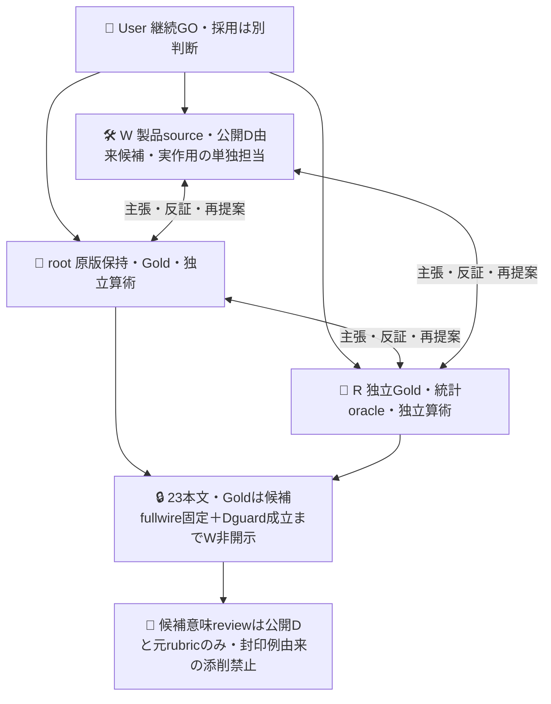
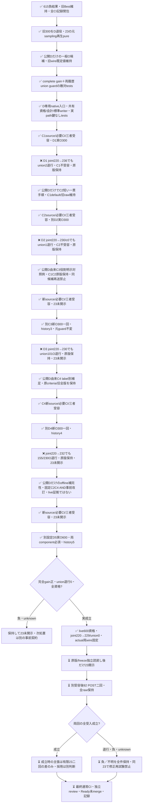

# Oの規範と現実報告を区別する次周

[PR615](https://github.com/roccho-org/ops/pull/615) は実案件300件の二回比較を保持して閉じた。正答は220→233/231だったが、既正答Oの退行が両回にあり採用条件は不成立。H1/H2の退行unionは101/155/196/289。元Bestを維持し、採用・mergeはしない。この300件を今回のDへ退役し、未使用評価とは呼ばない。

D1/D2/D3/D4は不受容の全原版を保持し、現在ANDのD5は開発guard通過・actual wire固定まで成立した。未使用23はまだ未実測。旧requestの既定値を保つ任意O補足引数、公開Dだけから作った一般O補足、Dの完全正答gain＋両履歴union退行guard、元samplingのreserve識別子再生とD専用native入口を実装した。各sourceの三者受容と必要CI実成功後に、それぞれ一度だけ実行した。モデル作用は新O1800、生成役呼出し0。reserve測定は未実行でH入口も未受容。Wは23本文・Gold・分布・類型を未読。私的Goldはroot/Rが独立初稿を凍結し、予測前に合議済みだがWへ未開示。

## 最初のD結果（不変の失敗記録）

[実run39436861326](https://github.com/roccho-org/ops/actions/runs/39436861326) はattempt1/技術SUCCESS、source4961ae1929cb3361f8ce4eeef6fda121f86e5256、request-only activation0334b78d90cdb30da383e19e008f3af9a8ce8fe5。原5fileは `results/reserve-development1-20261020/` に保持。artifact12271616717、1380509bytes、provider SHA256 d9869cdd291273b1f8867aefd7e8ee330c59e2b9862fe5be1d428a8bd9ea68a9 と自己取得ZIPを照合し、canonical全値再生が一致した。原runの再実行・書換えをしない。

実300attempt/POST/qualified、未試行0、技術unknown0、観測model IDは一致。既知Gold293件では機械H1 baseline220→candidate236、修復17/complete退行1（held-289）。補助union軸退行はheld-101 Oとheld-289 Oの2件。H1/H2どちらかの既知正答を保持する条件が不成立なので `DEVELOPMENT_GUARD_FAIL`。Gold O null7はそのまま。workflow SUCCESSを性能受容へ読み替えず、23を開かない。元Best維持・候補不採用。

新O物理300の既知usageはinput873992/output9300、各300call分。total_tokensは300件とも未提供であり、既知総額0ではない。歴史H1 E587492＋元O593192の論理運用相当input1180684に対し、新O＋同E歴史aliasは1461484（+280800/+23.78%）。これは非同時の組合せで、物理新規O300/input873992と分け、E aliasをHTTPへ二重計上しない。金額・将来の運用効率改善は未証明。同じ候補を再抽選・再送して救済しない。

## C2の処置とD2結果

三者の公開D101/289・元rubricに基づく反証で、C1の長い肯定列挙と後置の規範例外の競合を仮説とした。回答の理由は保持していないので誤答の内部原因を断定しない。C2は補足全体を短い一貫した判断手順へ置換した。規範・定義・受入条件の内部にある現在形/完了等の語だけを既達報告へ昇格せず、実操作・現状・未達・未確認の報告が本文内に一つでもあればyesとする。「具体的」「別箇所」「数値/成功/外部証拠」を要件にしない。構成・採用先の実際の状態報告は、規範形式という理由だけで除外しない。caseID/正答lookupやGold変更はしない。

旧C1を既定値に保持してD1全raw/inputをそのまま再生する。新C2だけinputの `candidateVersion:2` とsource固定のscopeで区別し、恣意的な入力scope文字列を信頼しない。native phase `development2` はhistory2/attempt1/request-only childへ限定し、実D1run39436861326のnative identityと原raw全値再生・Dguard不成立・技術全資格を先に確認する。D1の技術SUCCESSを意味FAILと混同せず、同じC1の再送ではなく実wireが異なるC2を一度だけ割り当てる。D2も元Best/H1機械primaryとH1/H2 unionを使い、C1の良い回答をbaselineへ選び直さない。

source60b65a4c9689131440049888dc491a2a20e86619の三者受容、必要CI実550/550・fresh consumer・repo-health成功後、request-only activation236fec7a12dd00b138f6fb0403b6808fdc7d6160から [D2 run39440524102](https://github.com/roccho-org/ops/actions/runs/39440524102) をattempt1で一度実行した。artifact12273995767/1357203B/provider SHA256 93405c2e49f1f52fb7621eda889c386b4d010602bd8563f1abffbef343723c4b を自己取得ZIPと照合し、原5file全値再生一致。保存先は `results/reserve-development2-20261020/`。

D2も300attempt/POST/qualified、技術unknown0、観測model ID一致。機械H1完全正答220→230、修復10/complete退行0、Goldnull7不変。ただしheld-101 OがH2だけで保護されていた既知正答を維持できず、補助union軸退行1で `DEVELOPMENT_GUARD_FAIL`。held-289を保持できたことや、H1比退行0だけでは受容しない。23未開示・C2不採用・元Best維持。

D2新O物理usageはinput746792/output9300、total_tokens300未知。歴史Eとの論理運用相当input1334284（元1180684比+13.01%）であり、非同時・金額不明。D1+D2実物理600、既知input1620784/output18600、provider total_tokensは600件未知。C2の小さいwireや単回使用量差を因果的効率改善と呼ばない。

予算はD1実300を消さず、新D2上限300＋将来H138を合わせseries技術上限738へ事前更新して実行した。各Dは90分/300上限、当時の入口はD1/D2のみ。Userの呼出予算なしというGOに新たな通算1000停止を足さない。次処置は公開D/元rubricだけから事前反証し、新source・必要CI・三者受容前の追加モデル作用0を維持する。H23は引き続き非開示。

## C3の事前対照例介入とD3結果

公開D101には完了形/現在形を使う受入条件があり、これを現実報告へ昇格した可能性を仮説とする。モデルの回答理由は保存していないので誤答原因の断定ではない。C3はC2手順を保ち、W作成の三つの短い一般対照例だけをO criteriaへ加える。実D本文・ID・正答一覧を例として貼らず、評価する300本文にも役割ラベルやhintを足さない。

- 受入要件（求める状態）：「修正が実装済みで検査が通っている」→no。
- 作業報告：「修正を実装し検査の通過を確認した」→yes。
- 進捗報告：「検査は未実施・未確認」→yes。

これらは文の働きの例で、見出しや時制を一律filterにしない。混在する抽象的な未達・未確認もyesの元意味を保つ。最初のno例も既達確認欄と読めるというR反証に従い「求める状態」と明示した。Choice4や非対称criteria rewriteを同時に混ぜず、元のbinary標準client/厳格資格で一つの提示方法変更を測る。鍵なしschema/wire/testsは例のラベルにモデルが従う実証ではない。D3の単回差もモデル揺らぎと分離した因果証明ではない。

旧C1既定/C2版2のfullwire・原input・D1/D2失敗をすべて再生する。C3だけ固定candidateVersion3、phase development3/history3/request-only child/attempt1へ限定し、先行D1/D2両native identity・全raw・技術全資格かつguardFAILを鍵前に再検査する。両実Git headのparentが各原sourceへ結合することを確認し、手転記SHA gateを増やさない。機械H1 primary/両履歴union/Goldnull7/旧Best Eは変更しない。

事前会計をD1/D2実600＋D3上限300＋将来H138＝1038へ更新した。これはUserの予算なしというGO内の各有限phase上限で、人工的な通算1000許可待ちを足さない。各Dは90分/300上限、Hはまだ実装受容外。現sourceの必要CI実成功と三者受容前の新作用0、Dguard独立成立とfullwire凍結前の23非開示を維持する。

source591ff0f590384bda62c240ed0f2201896f6bdd0aの三者受容と必要CI実553/553・fresh consumer・repo-health成功後、request-only activationdc6d65415c56e5f5e1fda5ec8c41a9202e062b26から [D3 run39444326438](https://github.com/roccho-org/ops/actions/runs/39444326438) をattempt1で一度実行した。artifact12274639682/1370935B/provider SHA256 950089446dd71e5a7e3b5653485c3422e27a484d40405b6ac8fcf47df65d7efb と自己取得ZIPを照合し、原5file全値再生一致。保存先は `results/reserve-development3-20261020/`。

D3も300attempt/POST/qualified、技術unknown0、観測model ID一致。機械H1完全正答220→230、修復10/complete退行0、Goldnull7不変。しかしheld-101 Oの補助union軸退行1が残り `DEVELOPMENT_GUARD_FAIL`。C2と総正答数は同じでも修復case集合は異なり、対照例介入の効果や内部原因を単発結果から断定しない。23未開示・C3不採用・元Best維持。同じC3を再送して救済しない。

D3新O物理usageはinput817592/output9300、total_tokens300未知。歴史E587492との論理運用相当input1405084（元1180684比+224400/+19.01%）であり、非同時・金額不明。D1+D2+D3実物理900、既知input2438376/output27900、provider total_tokensは900件未知。H138は予定上限であって実作用へ計上しない。次処置・source・phase契約は公開Dと元rubricに基づく三者反証を先に記録し、現C3の盲再送や23の先行開示にしない。

## C4の事前label別補足とD4結果

C1-C3はyes/no両criteriaへ同じ全判定手順を追記した。これがラベル間の区別を曖昧にした可能性は仮説に留まり、回答理由の保持がないため内部原因とは断定しない。C4は元targetRequestの各label criteriaをそのまま残し、追記部分だけを短いlabel専用補足へ置換する。yesは本文内の現実報告が一つでもあれば該当し、noは現実報告がなく規範・定義・受入条件等だけなら該当する相補的な記述。規範を含むだけでnoにせず、混在する抽象的な未達・未確認もyes。成功・具体性・数値・外部証拠や主subject一致を条件にしない。

root反証により、yes案の「対象について」を削除し、本文の周辺subjectや引用の実報告を狭めない。公開Dと元rubricだけに由来し、23由来の意味助言やcase lookupを用いない。C3の例削除・短文化・label分割を含む設定bundleなので、単独の非対称化の因果効果やモデル揺らぎから分離した効果を証明する比較ではない。元Best/E/instructions/binary/body/Gold/guardは不変で、元criteriaを変更せず各labelへ固定source文字列を付加する。

旧C1既定/C2/C3と全原raw/inputを保存し、版4だけcandidateVersion4・phase development4/history4/request-only child/attempt1へ限定。鍵前に先行三runすべてのnative来歴・全raw投影・資格完了/model安定かつguardFAILを再生する。機械H1 primary/両履歴unionを選び直さず、C3の同候補再送ではない。事前上限は実900＋新D4最大300＋将来H138＝1338、各D90分/300。必要sourceCI・三者受容前のD4作用0、実Dguard独立成立とfullwire凍結前の23非開示を維持する。Hは別source/data受容が必要。

source3d126035e814b18eb4fa4e5f23a0ce475962535fの三者受容と必要CI実556/556・consumer・health成功後、request-only activation9c9841dea220cffca817f73bbb01ef61d28a7d14から [D4 run39447516408](https://github.com/roccho-org/ops/actions/runs/39447516408) をattempt1で一度実行。artifact12276073305/1344912B/provider SHA256 8d71aef01f9087434c2a790fe1d4d633272bb3dcde1d24d73b9bf52db76090a8 と自己取得ZIPを照合し、原5file全値再生一致。保存先は `results/reserve-development4-20261020/`。

D4も300attempt/POST/qualified、技術unknown0、model ID安定、Goldnull7不変。機械H1完全正答220→232、修復14/complete退行2。held-101を修復してもheld-155 Oとheld-230 Oを壊し、同じ2件のunion退行で `DEVELOPMENT_GUARD_FAIL`。元Best維持/C4不採用/23未開示。表現bundleで結果が変わった観測であり、単独のlabel分割の因果や原因を証明しない。

D4物理新O usageはinput682592/output9300、total_tokens300未知。歴史Eとの非同時論理運用相当input1270084（元1180684比+7.57%）、金額や将来効率改善は未証明。実D1..D4計1200POST、既知input3120968/output37200、provider total_tokens1200未知。予定H138はまだ作用0。同C4再送をせず、次処置を公開D/元rubricに基づく別事前契約として三者で反証する。

## 固定C2＋C4のANDとD5実測・wire固定

公開の退役D原D2/C2とD4/C4を非同時にANDすると、完全正答220→230/b10c0/union退行0となる。W/root/Rが別算術で確認したが、これは開発仮説の選択根拠であり、新Dguard成立・H解禁の証拠ではない。ORはunion退行を残す。ANDは一方のyesを捨てるため見逃しを増やし得る。旧Oの混同行列はbaseline TP79/TN144/FP9/FN61、C2 89/144/9/51、C4 92/143/10/48、offline AND88/145/8/52、Goldnull7。元baselineを改善しても各componentのrecallより下がるtradeoffを隠さない。

単回O instructionsへの情報配置変更も反証案として比較した。そちらは小さく安価だが未測定の文言仮説で、ANDには公開D上の補完性という根拠があるため、次の別設定として固定2call ANDを採る。追加計算戦略全体の比較であり、単一Jevや同原価での改善・component独立性・孤立した因果効果を主張しない。旧usageによる非同時論理input2016876対1180684（+70.82%）という大きい原価tradeoffも、将来の実費や新effect値と区別する。

原 `prospective-plan.json` はd678同bytesのまま、別 `prospective-and-plan.json` に新物理会計と戦略を予測前・W23開示前に記録する。C2/C4の実requestをそのまま固定componentとして毎case両方必ず呼び、両qualifiedかつ両yesならderived O=yes、それ以外の両qualifiedならno。片方noでも短絡せず、片方invalid/欠落/未試行ならderived O=unknown。derived値にnative probability/confidence/model usageを捏造せず、元2receiptを保存する。既定単回C1-C4の全raw/default/guardを変えず、固定AND専用schema・薄い投影と既存recorder/資格を共有する。任意componentやcallback/endpointの汎用executorは作らない。

新D5は同時取得の新O600、論理300件、case indexでcomponent順を交互に固定。旧componentと同じpayloadが意図的に再登場する新戦略測定で、旧run再実行や全unique queryとは呼ばない。機械H1完全正答gain/両履歴union/Goldnull7/全600資格・300derived既知/model安定を維持する。phase development5/history5は先行4失敗すべてのnative来歴・raw・技術全資格と意味不受容を鍵前再生する。600×15秒=150分＋保持余裕でjob170分、元6step秘密境界は維持。

改訂した予定Hは元Best O/C2 O/C4 O/sharedEの4固定physical×23×2回＝184。元23の順序・census母数・origin323分離・Gold・j3/各tail1/1600・両回AND・全unknown・known退行0は変えない。E共有は回内だけ、componentの2答も独立標本ではない。新D600と原actual1200、将来H184のseries上限1984を事前記録する。新D/Hの必要source/check/三者受容は別で、D5実600は後述の結果として保持し、H実作用0・23非開示。元planのH138は旧単回戦略の履歴として残し、未実行を実費へ数えない。

source df0bdebb66bf513ecccdbaa37a015beb7fa5a939の三者受容と必要CI実566/566・consumer・health成功後、request-only activation3a8e6ebc54121d9433c550f70ad72284083b589dから [D5 run39452206612](https://github.com/roccho-org/ops/actions/runs/39452206612) をattempt1で一度実行。artifact12277619377/1500165B/provider SHA256 0d325a7b11503630ec0762e652f476f916338626ae8b3900bf19d50357167774 と自己ZIPを照合し、原5file全値再生一致。保存先は `results/reserve-development5-20261020/`。W/root/Rが各自原ZIP・別算術で一致した。

物理600attempt/POST/qualified・論理300derived既知、model安定、技術unknown0。機械H1完全正答220→229、修復9/complete退行0/union軸退行0、Goldnull7不変で `DEVELOPMENT_GUARD_PASS`。offline診断10修復をlive9修復へ流用せず、過去四失敗も残す。これはDの非同時歴史比較の入口通過だけで、未使用23の改善やfuture性能は未測定。

`and-selection.json` にlive D5 inputの元Best/operator/固定C2C4 fullproofとprovider来歴・実guardをそのまま固定した。原600requestすべてを同じ固定bodyへ置換した標準wireが保存proofと一致することを再検査し、候補変更なしを宣言。native freeze確認までW23未読・H未実行、採用/mergeなし。H actual data/schema/entry/必要CI/三者受容は別途必要。

D5物理newO600 usageはinput1429384/output18600、provider total_tokens600未知。原歴史Eとの非同時論理運用相当2016876（元1180684比+70.82%）、追加計算の代価であって料金/効率改善の証拠ではない。PR616実D1..D5計1800POST/input4550352/output55800、total_tokens1800未提供。H184は予定で実作用0、生成役呼出し0。新両componentが同時取得でも、歴史baseline O/Eを同時比較と称さない。

## 主張と反証を行う三者

旧O補足は現在の未達・未確認報告を拾えた一方、権限・branch・完了条件の規範定義を現実報告へ過包含した。C1-C3は両criteriaへ共通補足、C4はlabel別補足、次ANDは固定C2/C4二答の組合せで、一度に一つの戦略だけを検証する。設計や規範という形式だけで実報告を一律に除外せず、実権限状態、実操作、進行、未達・未確認の報告は元のO意味を保つ。外部真偽・成功・証拠リンクを要求しない。元BestのE、instructions、質問、binary protocolは変更せず、ANDの二componentも各々元binary応答を保つ。ケースIDや正答一覧をmodel入力へ渡さない。効果は追加計算を含む設定戦略全体のもので、Jev評価助言の因果価値とは称さない。

## 受入と知識境界

`prospective-plan.json` は私的data側で本文view前に固定したnative d67843c6d593582a908e509a217754ec5e2d68db の指定1fileと同bytes。初案e9cdは履歴へ保持。今回の製品sourceがその手順をすべて実装済みという意味ではない。

D300は機械的H1の元Best O/sharedEを歴史aliasとし、新O300だけを測る。primaryは既知Goldの完全E/O正答数の正gain。Oだけ改善してE誤答が残る一般反例をgainにしない（当該反例testはsynthetic履歴であり実Dで観測したものではない）。H2から都合のよいbaselineを選ばず、H1/H2いずれかで既知正答だった軸を壊さない補助guardへだけ使う。全300資格成立・model安定も必須。Gold O null7は変更せず全分母へ残す。歴史aliasは非同時比較であり、新E測定やfresh無退行の証拠にはならない。入口は実native APIの両run来歴、保存原版のrequest・資格・会計を再生してからDのGold-free入力を作る。効果stepはkeyless wire helperを呼ばず保存入力をsecret-safe比較し、元標準clientでbodyと固定設定だけを送信する。純粋guard単独を作用許可にしない。

資格再生と標準clientの記録部分を旧615入口と共有した。旧raw readerだけで新writerを検証したと見なさず、dummy keyとHTTPを外へ出さないfetch stubで標準writer実pathも検査する。全serialized wire・redirect拒否・15秒deadline・実post/flags順序・usage既知/欠損・確率和拒否・model drift・上限超過時追加HTTP0を確認。生産用endpoint/transport/retry/callback設定は追加しない。旧615保存input/rawは改変せず、旧writerのロジックを専用共有関数へ移した。新Dの欠測はunknownProtectedAxesと資格未完了へ、実誤答はknown regressionへ別保持し、混在でも片方を消さない。

D入口は専用branchでrequest-only child/attempt1/native履歴D1=1・D2=2・D3=3・D4=4・新AND D5=5へ限定。prepareのみGH_TOKEN、evaluateのみ既存Org JEV_API_KEY、project/uploadはalways原保持の元6step境界へ限定翻訳する。旧D300はjob90分だったが、新AND D600は15秒deadline最大150分＋検証/保持余裕で170分へ改訂する。各実作用前に新source必要CIを確認し、最終exacthead通常CIも別途閉じる。新component同士が同時でも、Dの元H1 baseline O/Eは歴史aliasのままで非同時。freshな比較証拠は将来Hだけである。

元frame323の一回SRSWORで封印したreserve23を、元reserveIdsの全順序そのままで使う。再抽選・新API・補充・後付け除外はしない。確認の母数は条件付き補集合23のcensus、originFrame323は別属性。旧300から学習した候補を旧323全体の未使用評価に見せない。本文開示前に一候補fullwireとDguardを固定する。

元planは単回候補のH138だった。新AND planではbestO/c2O/c4O/sharedEの4物理request×23×2回＝184上限とする。Eは各回内だけ共有、回間再利用なし。各回の正gain下限・sample最悪gain・既正答軸退行0・全資格をAND受入とし、片回平均/取消/再抽選で救済しない。round3 alpha=1/160、二回×5tailの各tail=1/1600を継承しresetしない。Goldnull/資格不明・未試行を全母数へ残す。これは有限23での二回差まで。23を独立46例にせず、旧323・Apps・未来の期待性能・Gold無謬を保証しない。一回の予定二回確認後は23も退役し、修正後に同じ23を再Hにしない。

最小共有の反証として、旧folder全bytes不変を目的にすると重複executorが増える。公開requestの任意引数と専用資格/writer共有を最小化し、既定fullwireと閉615/D1/D2/D3再生を実検査する。旧保存inputへ新fieldを後付けしない。新汎用executor、任意endpoint/callback、独自ledger、認証追加は作らない。厳格資格は維持し、最終exactheadの通常CIを成功確認するまで完了と呼ばない。
