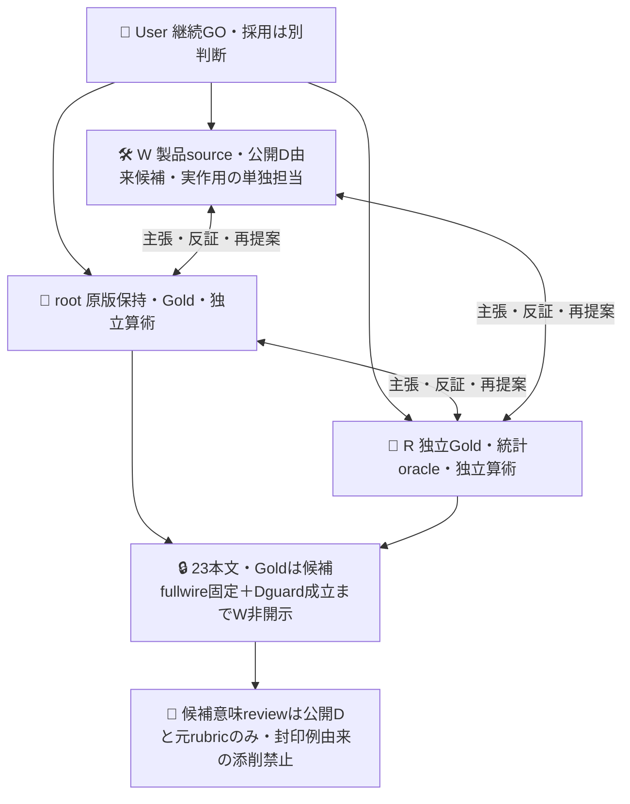
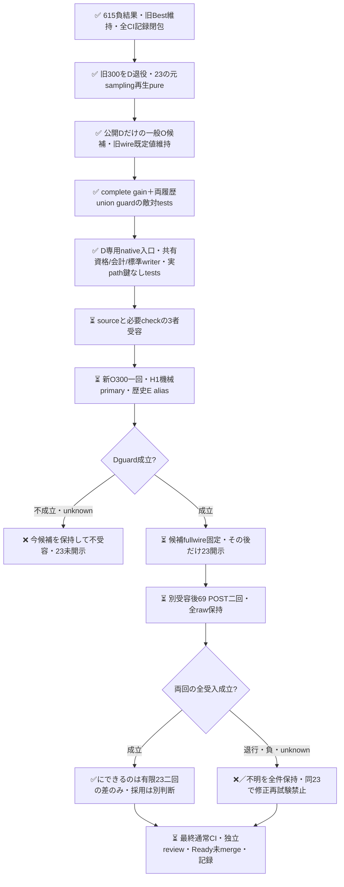

# Oの規範と現実報告を区別する次周

[PR615](https://github.com/roccho-org/ops/pull/615) は実案件300件の二回比較を保持して閉じた。正答は220→233/231だったが、既正答Oの退行が両回にあり採用条件は不成立。H1/H2の退行unionは101/155/196/289。元Bestを維持し、採用・mergeはしない。この300件を今回のDへ退役し、未使用評価とは呼ばない。

現在はD実行前。旧requestの既定値を保つ任意O補足引数、公開Dだけから作った一般O補足、Dの完全正答gain＋両履歴union退行guard、元samplingのreserve識別子再生とD専用native入口を実装した。旧H全rawの再生と新D全300入力サイズを検査し、関連63tests・境界selftest・diff checkが成功。新sourceの独立受容と必要CIは待機中。実D・reserve測定は未実行で、H入口は次slice。新モデル作用0、生成役呼出し0。Wは23本文・Gold・分布・類型を未読。私的Goldはroot/Rが独立初稿を凍結し、予測前に合議済みだがWへ未開示。

## 主張と反証を行う三者

旧O補足は現在の未達・未確認報告を拾えた一方、権限・branch・完了条件の規範定義を現実報告へ過包含した。今回一候補はO yes/no両criteriaへ同じ一般的区別を追加する。設計や規範という形式だけで実報告を一律に除外しない。実権限状態、実操作、進行、未達・未確認の報告は元のO意味を保つ。外部真偽・成功・証拠リンクを要求しない。元BestのE、instructions、質問、protocolは変更しない。ケースIDや正答一覧をmodel入力へ渡さない。効果は設定変更全体のもので、Jev評価助言の因果価値とは称さない。

## 受入と知識境界

`prospective-plan.json` は私的data側で本文view前に固定したnative d67843c6d593582a908e509a217754ec5e2d68db の指定1fileと同bytes。初案e9cdは履歴へ保持。今回の製品sourceがその手順をすべて実装済みという意味ではない。

D300は機械的H1の元Best O/sharedEを歴史aliasとし、新O300だけを測る。primaryは既知Goldの完全E/O正答数の正gain。Oだけ改善してE誤答が残る一般反例をgainにしない（当該反例testはsynthetic履歴であり実Dで観測したものではない）。H2から都合のよいbaselineを選ばず、H1/H2いずれかで既知正答だった軸を壊さない補助guardへだけ使う。全300資格成立・model安定も必須。Gold O null7は変更せず全分母へ残す。歴史aliasは非同時比較であり、新E測定やfresh無退行の証拠にはならない。入口は実native APIの両run来歴、保存原版のrequest・資格・会計を再生してからDのGold-free入力を作る。効果stepはkeyless wire helperを呼ばず保存入力をsecret-safe比較し、元標準clientでbodyと固定設定だけを送信する。純粋guard単独を作用許可にしない。

資格再生と標準clientの記録部分を旧615入口と共有した。旧raw readerだけで新writerを検証したと見なさず、dummy keyとHTTPを外へ出さないfetch stubで標準writer実pathも検査する。全serialized wire・redirect拒否・15秒deadline・実post/flags順序・usage既知/欠損・確率和拒否・model drift・上限超過時追加HTTP0を確認。生産用endpoint/transport/retry/callback設定は追加しない。旧615保存input/rawは改変せず、旧writerのロジックを専用共有関数へ移した。新Dの欠測はunknownProtectedAxesと資格未完了へ、実誤答はknown regressionへ別保持し、混在でも片方を消さない。

D入口は専用branchでrequest-only child一回/attempt1/native履歴1へ限定。prepareのみGH_TOKEN、evaluateのみ既存Org JEV_API_KEY、project/uploadはalways原保持の元6step境界へ限定翻訳する。300×15秒=75分にsource検証と保持余裕を足してjob90分、series技術上限438（D300＋将来69×2、現entryはDのみ）。実作用前に新source必要CIを確認し、最終exacthead通常CIも別途閉じる。

元frame323の一回SRSWORで封印したreserve23を、元reserveIdsの全順序そのままで使う。再抽選・新API・補充・後付け除外はしない。確認の母数は条件付き補集合23のcensus、originFrame323は別属性。旧300から学習した候補を旧323全体の未使用評価に見せない。本文開示前に一候補fullwireとDguardを固定する。

HはbestO/newO/sharedEの3物理request×23×2回＝138上限。Eは各回内だけ共有、回間再利用なし。各回の正gain下限・sample最悪gain・既正答軸退行0・全資格をAND受入とし、片回平均/取消/再抽選で救済しない。round3 alpha=1/160、二回×5tailの各tail=1/1600を継承しresetしない。Goldnull/資格不明・未試行を全母数へ残す。これは有限23での二回差まで。23を独立46例にせず、旧323・Apps・未来の期待性能・Gold無謬を保証しない。一回の予定二回確認後は23も退役し、修正後に同じ23を再Hにしない。

最小共有の反証として、旧folder全bytes不変を目的にすると重複executorが増える。今回は旧公開requestの任意引数だけを変更し、既定fullwireと閉615再生を実検査する。旧保存inputへ新fieldを後付けしない。新汎用executor、任意endpoint/callback、独自ledger、認証追加は作らない。厳格資格は維持し、最終exactheadの通常CIを成功確認するまで完了と呼ばない。
