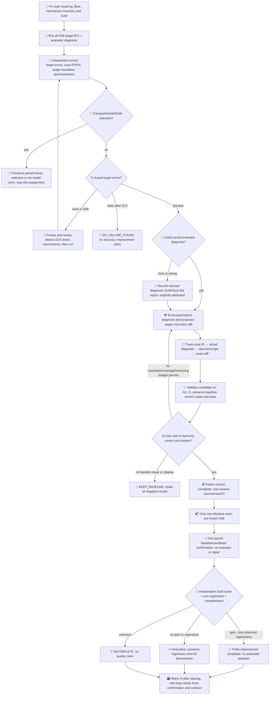
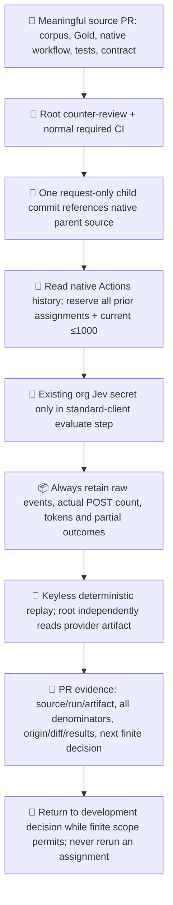
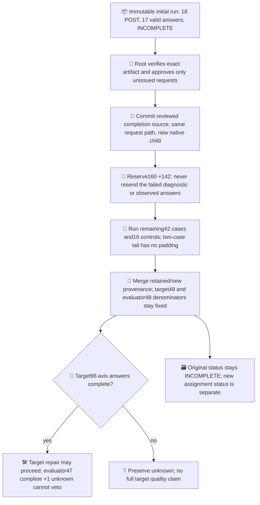
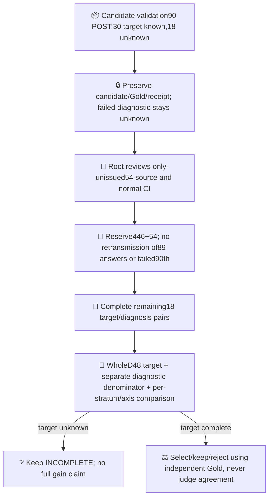
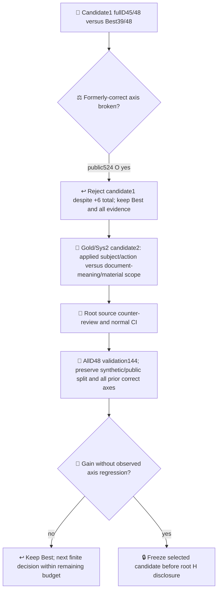
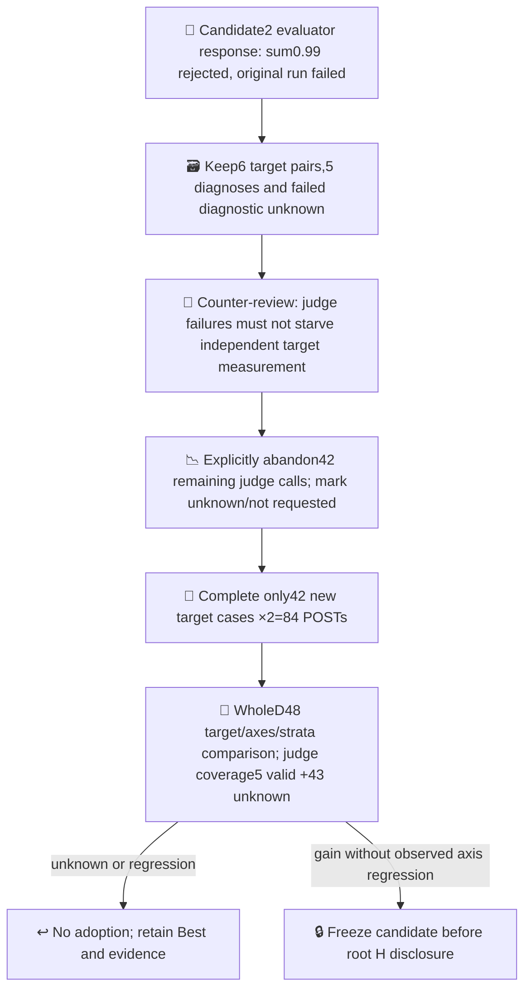
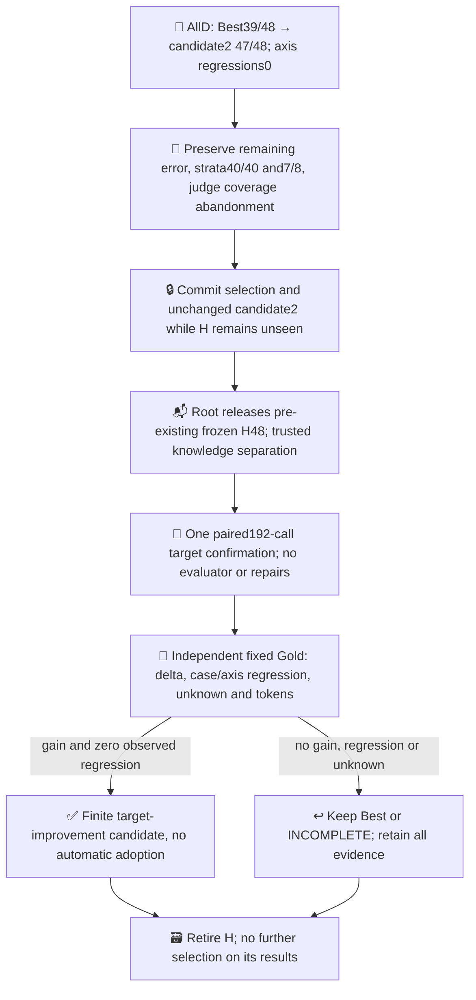

# Jev target improvement continuation

This is a new, finite continuation of [Ops #523](https://github.com/roccho-org/ops/issues/523). PR604's 12 calls and earlier 18/43-call trials remain immutable. Their perfect four development answers did not demonstrate repair or target improvement. User authorized a new aggregate ceiling of **1000 model HTTP POSTs**, including target, evaluator, controls and confirmation. This ceiling is not a spending goal. No merge or automatic production adoption is authorized.

## Meaning and fixed comparison

The target answers E (task requirements) and O (actual observations) about the complete body, using existing Best `binary-eo-v3`. Candidate changes are limited to its instructions. Bodies, Gold, candidate supply, classifier and typed evaluator v1 remain fixed within each comparison. Evaluator Choice diagnoses `requirement_scope`, `evidence_scope`, `both_scope`, `no_change` or `uncertain` from body and actual target answers. No model rationale is fabricated. Gold is never sent in a request. The independently coded scorer checks target and diagnosis against pre-run Gold; evaluator agreement cannot veto improvement or override Gold.

The measured claim is finite target configuration improvement, **not causal value of evaluator feedback**. A same-budget no-feedback arm would be necessary for that stronger claim. Apps effects, population accuracy, monetary savings and immutable model weights are not measured. Model alias must report `jev-1.13.0`; the alias does not prove immutable weights.

## Pre-run coverage and reservations

| Assignment | Content fixed before its outputs | Maximum POSTs |
|---|---|---:|
| Initial discovery | D48: 40 fictional bodies, ten different mechanisms × E/O four combinations; eight exact public Issue snapshots | target96 + evaluator48 |
| Evaluator controls | 16 deliberately incorrect proposed E/O pairs, kept outside target performance | evaluator16 |
| Candidate validation | All D48, including cases baseline answered correctly | target96 + evaluator48 |
| One confirmation | Root-authored H48, 12 mechanisms × four combinations, authored/frozen before candidate and live discovery | baseline96 + candidate96 |
| Basic total | No failure-selected denominator | **496** |

`public-snapshot.json` preserves all 100 retrieved items and pre-output exclusion/selection reasons. It includes exact body, URL, retrieval/version metadata and generated body digest. Gold was separately fixed in `public-gold.json`; root challenged #553 before outputs and that scope correction was accepted. Public E/O balance is natural and skewed; report its stratum separately from fictional balance. Open Issue bodies can overlap prior organizational context: these are newly snapshotted body-classification inputs, not a claim of unseen real-world capability. #573's historical instructions are data, not execution authority.

If D48 is perfect, author **one D24 stress batch** combining the distinct mechanisms, freeze body/Gold and root-review it before calls (72 more). Candidate validation then covers **all D72** (216). No relabeling or easy substitutions after outputs. Ambiguous Gold remains unknown. If D72 is still perfect, stop `NO_FAILURE_FOUND`: accuracy gain cannot be measured here; no fabricated candidate. At most three candidate configurations may be tried on development. Additional candidates consume full-assigned validation, not only errors; root reviews the actual diagnosis-to-diff mapping and remaining reservation before each activation. Never exceed 1000. If budget cannot fund a complete next phase plus confirmation192, stop `BUDGET_INSUFFICIENT` without spending the remainder. No automatic refill/retry.

## Development and confirmation flow

Evaluator v1 remains fixed. If it misses every real error, it does not starve target repair: Gold/Sys2 provenance is explicit. Evaluator-v2 calibration, if later justified by actual evidence, requires a separately versioned phase and root review; its metrics must not masquerade as target improvement. Injected-control sensitivity is calibration on artificial errors, never actual-target failure sensitivity. Every actual diagnosis and adoption/rejection decision remains in the loop record.

## Native execution and closure

One dedicated branch and one mutable request path replace per-phase marker proliferation. A request-only child is admitted using native Git parent/diff, not a hand-transcribed source gate. Standard Actions history reconstructs every reservation from that run's native Git source. Duplicate assignments, reruns, changed model, broadened actor/ref/permissions and missing history are rejected before or during effect. A cancelled/failed phase keeps its full reservation; it is not silently retried. Standard Choice client and closed helper chunks are reused unmodified. Required checks are not weakened.

Root H knowledge separation is trusted actor discipline, not OS isolation. The repair author does not inspect its dedicated ref/worktree until candidate freeze. Root knows H but never authors the candidate. H becomes consumed once inspected, whether success or failure. Source author also authored fictional D and Gold: no independent-development claim. Body meta-description versus actual current task state is a documented semantic boundary; disputed cases are not quietly scored as model misses.

Finish by retaining exact raw receipts and source, replay tests, candidate diff/origins and final negative or positive outcome in the PR. Compare full assigned accuracy plus E/O false positives/negatives, per-family outcomes, completion/unknown, broken former correct axes, target/evaluator calls, tokens, latency and unknown monetary/human cost. `qualityAdoptionAuthorized` stays false. Publish no private handoff or secret material.

## Initial partial run and explicit unissued-work completion

Initial native [run39356822518](https://github.com/roccho-org/ops/actions/runs/39356822518), attempt1, stopped at actual POST18: six target E/O pairs completed (five correct, one O false positive), five evaluator diagnoses (three matched, one false alarm, one missed error), and 42 target cases plus all16 controls unissued. Failure occurred on `condition-2`'s evaluator request. Its technical cause was not captured by the legacy helper; **unknown**, not an asserted rate-limit, transport or model-quality failure. The original receipt/status remains `INCOMPLETE`, accuracy null with assigned denominator48. Raw provider files are byte-preserved in `../results/target-discovery-20261020/` and replayed keylessly. Gold is unchanged.

Root independently retrieved and verified the ZIP and accepted **one explicit completion of only the unissued work**: 42 untouched cases × (E+O+diagnosis) +16 untouched controls = **142 new POSTs**. Observed17 valid answers are retained, never re-requested. Failed18th request is never resent and remains one diagnostic unknown. The original160 reservation remains; completion adds142, bringing conservative native reservations to302 (not actual302). This is not a refill of the failed assignment.

The completion report separately exposes `assignmentStatus` (did the new142 finish), `targetStatus` (are all48 target labels known) and `status` (full target/evaluator observation, still INCOMPLETE with the locked unknown). Success of the new CI assignment is not a claim that the original experiment completed. New HTTP count and retained run's18 count are separate; observed token/latency totals include retained valid responses with provenance, while unavailable usage for the failed call remains unknown. Future failures emit only allowlisted code/name/stage and numeric HTTP status, never error messages, headers or response bodies. No retry is added.

## Completed target baseline and candidate-1

[Completion39358339344](https://github.com/roccho-org/ops/actions/runs/39358339344), attempt1, finished142 new POSTs without reissuing any original request. Provider artifact12235814905 (119922-byte ZIP) was downloaded, provider digest/size verified and measurement replayed exactly. Actual series calls are18+142=160; conservative reservations302. Initial receipt remains unchanged. Full target baseline is known on48/48, while one actual diagnostic stays unknown.

| Observed target stratum | Correct / assigned | Limits |
|---|---:|---|
| Forty synthetic mechanism cases | 34/40 | Repair-author-written development, not independent confirmation |
| Eight public Issue snapshots | 5/8 | Natural skew; body classification only, not Issue completion |
| Combined development | 39/48 | E: FP3/FN0; O: FP4/FN3 |

Actual evaluator error detection is **0/9**: every wrong target answer received `no_change`. Among39 correct targets it supplied36 matching diagnoses, two false alarms and the locked unknown. Injected controls are separately2/16 matching; they do not change target39/48 or actual error sensitivity. These are different tasks/sets from PR603, so no cross-PR evaluator-quality gain is claimed.

`candidate-1-decisions.json` retains all48 actual diagnosis decisions:36 accepted no-change observations, nine rejected missed errors, two rejected false alarms, one unknown retained. **Useful evaluator repair advice:0.** Candidate-1 is explicitly **Gold/Sys2-led**. Its instruction supplement preserves the entire Best prefix and adds two general reading operations: ground quoted vocabulary/specimen/role-label material in its outer discourse before treating it as an applied requirement or real event; recognize asserted current negative implementation/verification/permission status even inside a proposal. It preserves real quoted logs/comments and functional responsibility tables to avoid fixing false positives by creating false negatives.

The nine-error-to-rule mapping and rejected false alarms are in `candidate-1.json`; no model-generated rationale is invented. No case ID, Gold label list or Issue-number rule is put in target instructions. At this proposal checkpoint the candidate was not validated; the plan was144-POST full-D48 validation under fixed evaluator v1, then one H, reserving302+144+192=638. Subsequent checkpoints below retain the actual failed/completed runs and regression rejection. No evaluator-caused repair is claimed.

## Partial candidate validation and remaining54

[Validation39359811930](https://github.com/roccho-org/ops/actions/runs/39359811930) stopped at90 actual POSTs:30 candidate target labels known (29 correct, one `html-4` O false positive),18 unknown. Its failed90th request was `inject-2`'s evaluator. Safe diagnostics show HTTP200 and a response-contract assertion; the exact failed invariant/value was not captured. This does not establish a rate limit, transport failure or a specific provider inconsistency. Original INCOMPLETE artifacts and all90 attempts remain unchanged in `../results/target-validation-20261020/`. Whole48 gain stays unknown; no population or full-development gain is inferred from29/30. Public Issue stratum is0 observed/8 assigned at that point.

Root accepted one explicit completion of **only unissued18 cases ×3=54 new POSTs** under unchanged candidate-1/evaluator v1, never resending observed89 valid answers or failed90th diagnostic. It reuses the same small completion pattern, including the two-case tail without padding. Candidate target48 and diagnostic47+1unknown remain separate. Conservative reservations become446+54=500; actual series calls before completion are160+90=250. The next whole-candidate comparison may use all48 target labels when known even though one evaluator answer stays unknown; H remains unopened.

Future provider receipts expose only bounded numeric/boolean flags: reported-model match, answer-key match, finite/range checks, probability sum and selected-versus-maximum probabilities. No raw model text, keys, response body, headers or secret are recorded. Existing model/key/sum/selected-maximum rejection checks remain unchanged. Local sum tolerance1e-5 and maximum tolerance1e-6 are explicit experiment tolerances.

Primary-source contract review (2026-10-20): [TypeSafe Choice response documentation](https://docs.typesafe.ai/primitives/choice) specifies a full distribution totaling one and selection of a maximum-probability option; [System One API](https://docs.typesafe.ai/api/system-one) identifies per-question answers and returned model. Thus the checks follow documented properties even though the compatibility client's narrower validator does not enforce sum/argmax. The vendor SDK's [issue15](https://github.com/typesafe-ai/typesafe-sdk-python/issues/15) contains first-hand inconsistency reports and a contributor acknowledging an API problem. Those reports do **not** identify the cause of our failed90th answer; no check is relaxed or probability mass inferred from them.

The official [OpenAPI ChoiceAnswer schema](https://api.typesafe.ai/openapi.json) uses an approximate total rather than specifying exact numerical precision, while also describing selection of a highest-probability option. It supplies no numerical error bound or rounding mechanism. Our1e-5 total tolerance therefore remains a local conservative requirement, not a vendor-guaranteed precision claim. This documentation ambiguity and the missing failed response values are recorded; neither justifies turning the failed diagnostic into a valid answer or changing rejection thresholds after observing results.

## Candidate-1 rejected; candidate-2 development proposal

[Remaining54 run39361251975](https://github.com/roccho-org/ops/actions/runs/39361251975) completed all new54 calls with the prior90/failed diagnosis unchanged. Provider ZIP123016bytes/artifact12237371554 was independently downloaded, digest/size checked and replayed. Full candidate-1 target accuracy is45/48; its evaluator still misses all three remaining wrong targets, with one locked unknown diagnosis. Actual series POSTs304; reservations500. Evidence and deterministic comparison are in `../results/target-validation-completion-20261020/`.

| Development stratum | Best | Candidate-1 | Change |
|---|---:|---:|---:|
| Synthetic |34/40|39/40|+5|
| Public Issue bodies |5/8|6/8|+1|
| Combined |39/48|45/48|+6|

Seven former wrong cases became correct, **but public-ops-524's O axis broke** (no→yes), so the pre-fixed gate returns `REGRESSION_KEEP_BASELINE`. Aggregate improvement does not override that rejection. Remaining candidate-1 mistakes: specimen HTML O false positive, document-meaning O false positive, completed-human-permission O false negative. E FP0/FN0; O FP2/FN1. H was not opened. Candidate-1 and its complete evidence are immutable; it is not adopted or used as the new Best.

Candidate-2 is another **Gold/Sys2-led** proposal. Its supplement replaces candidate-1's broad status emphasis with explicit priority for the outside use of quoted material and the subject of a reported state/action: an actual implementation status or completed human action differs from definitions of document meaning, permission boundaries or where observations should be recorded. Real quoted logs and functional responsibilities still count. The original Best prefix is unchanged; no ID/Issue lookup is in instructions. Its full48 diagnosis decision table keeps44 accepted no-change,3 rejected misses and1 unknown, with no useful evaluator repair advice claimed. At this proposal checkpoint it had not run; the plan was all D48 ×3=144 after source/CI review, reserving500+144+192=836 including H. The following checkpoint records the actual interruption and narrower future phase. No independent confirmation improvement is established.

## Candidate-2 probability rejection; target-only completion

[Candidate-2 run39362613357](https://github.com/roccho-org/ops/actions/runs/39362613357) stopped at18 actual POSTs. Six target labels are known and correct;42 remain unknown, so full accuracy/gain remain unknown. This time safe flags identify the rejected `condition-2/evaluator` response: HTTP200, model/key match true, five finite in-range probability values, total0.9900000000000001, selected probability0.56 equals maximum0.56, sum check false. The strict rejection remains in force. It is a response-total inconsistency under our unchanged qualification tolerance, **not a target semantic error or rate-limit inference**. The original failure/receipt and raw events are immutable in `../results/target-candidate2-validation-20261020/`.

After root counter-review, the next phase is deliberately narrowed to **only42 unissued target cases × E/O=84 POSTs**. Remaining42 evaluator calls are no longer requested; their original full-coverage plan is explicitly **ABANDONED**, not completed. Evaluator v1 already missed every observed actual error and now has a demonstrated invalid response. It cannot veto an independently measured Gold/Sys2-led target improvement by starving the target execution. No evaluator answer is invented, normalized or converted to `uncertain`.

This is one explicit target-only branch of the existing thin remainder loop. No new engine, error cache, query ledger or retry is added. The six existing target pairs and five valid diagnoses remain byte-preserved; failed18th diagnostic and previously failed exact queries are never reissued because **no new evaluator requests are made**. The completed-target comparison can cover all48 while evaluator coverage remains5 valid/1 rejected/42 not requested=43 unknown. `status` stays INCOMPLETE for the originally planned full observation; `targetStatus` and current84-call `assignmentStatus` are separate.

Conservative reservations are644+84=728 and one H192 would bring them to920, within1000. Actual series calls before this phase are322; the new maximum is84, not an obligation to consume unused budget. Candidate-2, Best, corpus, Gold, strict model/typed/probability checks and fixed evaluator v1 are unchanged. Abandoning remaining judge coverage means this phase cannot measure evaluator improvement, feedback effectiveness or a fully closed evaluator-driven repair; the claim under test is finite **target configuration** improvement.

## Whole-D target result and pre-confirmation freeze

[Target-only39364101877](https://github.com/roccho-org/ops/actions/runs/39364101877) completed84 new target calls, no new evaluator calls. Artifact12238426963 (118249-byte ZIP) was retrieved and provider digest/size verified; canonical replay and root's separate raw recount agreed. Existing six target pairs were retained exactly. All48 candidate-2 target labels are known: **47/48**, synthetic40/40, public Issue bodies7/8. E FP0/FN0; O FP0/FN1 (`public-ops-529` remains wrong). Compared with Best39/48, eight cases improved and **no formerly-correct case or E/O axis broke**. The development gate returns `DEVELOPMENT_CANDIDATE`. This is not independent confirmation or universal error-free performance.

Evaluator coverage remains5 valid,1 rejected,42 not requested=43 unknown. Original full judge coverage is abandoned, not satisfied. Original failed receipts remain unchanged. Repair was Gold/Sys2-led; evaluator-driven improvement is not proven. Actual series POSTs406, conservative reservations728; one H192 would bring actual maximum598 and reservations920.

`selection.json` selects and freezes **candidate-2 before the repair author reads root H**. Candidate-2 instructions remain exactly those tested, and no further candidate edits or D selection will occur after H is disclosed. Candidate-1 stays rejected, Best stays unchanged, production adoption remains unauthorized. Root independently accepted the full-D/axis/stratum result before H handoff. The native Git commit holding this selection is the freeze evidence; no manually copied source hash gate is added.

