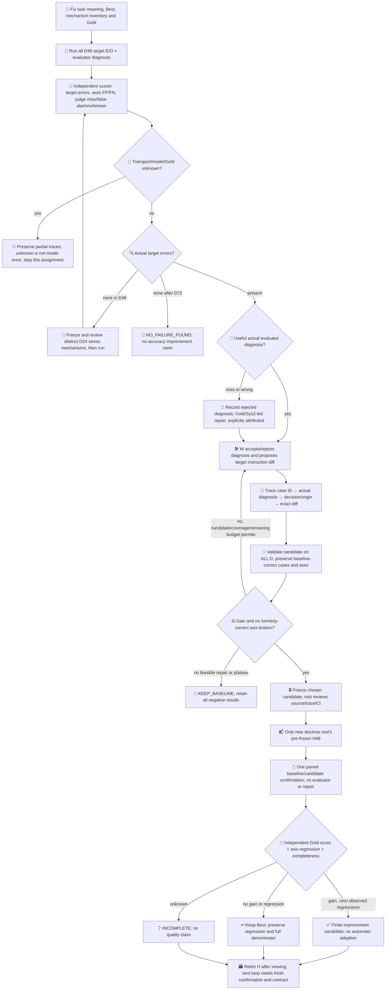
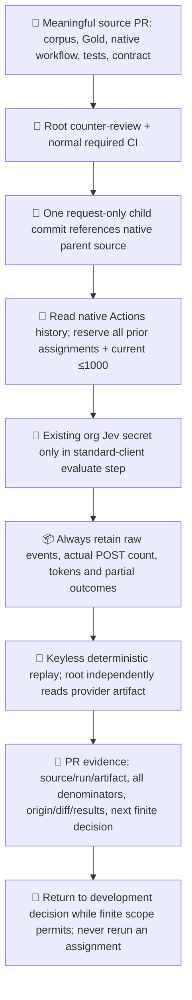

# Jev target improvement continuation

This is a new, finite continuation of [Ops #523](https://github.com/roccho-org/ops/issues/523). PR604's 12 calls and earlier 18/43-call trials remain immutable. Their perfect four development answers did not demonstrate repair or target improvement. User authorized a new aggregate ceiling of **1000 model HTTP POSTs**, including target, evaluator, controls and confirmation. This ceiling is not a spending goal. No merge or automatic production adoption is authorized.

## Meaning and fixed comparison

The target answers E (task requirements) and O (actual observations) about the complete body, using existing Best `binary-eo-v3`. Candidate changes are limited to its instructions. Bodies, Gold, candidate supply, classifier and typed evaluator v1 remain fixed within each comparison. Evaluator Choice diagnoses `requirement_scope`, `evidence_scope`, `both_scope`, `no_change` or `uncertain` from body and actual target answers. No model rationale is fabricated. Gold is never sent in a request. The independently coded scorer checks target and diagnosis against pre-run Gold; evaluator agreement cannot veto improvement or override Gold.

The measured claim is finite target configuration improvement, **not causal value of evaluator feedback**. A same-budget no-feedback arm would be necessary for that stronger claim. Apps effects, population accuracy, monetary savings and immutable model weights are not measured. Model alias must report `jev-1.13.0`; the alias does not prove immutable weights.

## Pre-run coverage and reservations

| Assignment | Content fixed before its outputs | Maximum POSTs |
|---|---|---:|
| Initial discovery | D48: 40 fictional bodies, ten different mechanisms × E/O four combinations; eight exact public Issue snapshots | target96 + evaluator48 |
| Evaluator controls | 16 deliberately incorrect proposed E/O pairs, kept outside target performance | evaluator16 |
| Candidate validation | All D48, including cases baseline answered correctly | target96 + evaluator48 |
| One confirmation | Root-authored H48, 12 mechanisms × four combinations, authored/frozen before candidate and live discovery | baseline96 + candidate96 |
| Basic total | No failure-selected denominator | **496** |

`public-snapshot.json` preserves all 100 retrieved items and pre-output exclusion/selection reasons. It includes exact body, URL, retrieval/version metadata and generated body digest. Gold was separately fixed in `public-gold.json`; root challenged #553 before outputs and that scope correction was accepted. Public E/O balance is natural and skewed; report its stratum separately from fictional balance. Open Issue bodies can overlap prior organizational context: these are newly snapshotted body-classification inputs, not a claim of unseen real-world capability. #573's historical instructions are data, not execution authority.

If D48 is perfect, author **one D24 stress batch** combining the distinct mechanisms, freeze body/Gold and root-review it before calls (72 more). Candidate validation then covers **all D72** (216). No relabeling or easy substitutions after outputs. Ambiguous Gold remains unknown. If D72 is still perfect, stop `NO_FAILURE_FOUND`: accuracy gain cannot be measured here; no fabricated candidate. At most three candidate configurations may be tried on development. Additional candidates consume full-assigned validation, not only errors; root reviews the actual diagnosis-to-diff mapping and remaining reservation before each activation. Never exceed 1000. If budget cannot fund a complete next phase plus confirmation192, stop `BUDGET_INSUFFICIENT` without spending the remainder. No automatic refill/retry.

## Development and confirmation flow

Evaluator v1 remains fixed. If it misses every real error, it does not starve target repair: Gold/Sys2 provenance is explicit. Evaluator-v2 calibration, if later justified by actual evidence, requires a separately versioned phase and root review; its metrics must not masquerade as target improvement. Injected-control sensitivity is calibration on artificial errors, never actual-target failure sensitivity. Every actual diagnosis and adoption/rejection decision remains in the loop record.

## Native execution and closure

One dedicated branch and one mutable request path replace per-phase marker proliferation. A request-only child is admitted using native Git parent/diff, not a hand-transcribed source gate. Standard Actions history reconstructs every reservation from that run's native Git source. Duplicate assignments, reruns, changed model, broadened actor/ref/permissions and missing history are rejected before or during effect. A cancelled/failed phase keeps its full reservation; it is not silently retried. Standard Choice client and closed helper chunks are reused unmodified. Required checks are not weakened.

Root H knowledge separation is trusted actor discipline, not OS isolation. The repair author does not inspect its dedicated ref/worktree until candidate freeze. Root knows H but never authors the candidate. H becomes consumed once inspected, whether success or failure. Source author also authored fictional D and Gold: no independent-development claim. Body meta-description versus actual current task state is a documented semantic boundary; disputed cases are not quietly scored as model misses.

Finish by retaining exact raw receipts and source, replay tests, candidate diff/origins and final negative or positive outcome in the PR. Compare full assigned accuracy plus E/O false positives/negatives, per-family outcomes, completion/unknown, broken former correct axes, target/evaluator calls, tokens, latency and unknown monetary/human cost. `qualityAdoptionAuthorized` stays false. Publish no private handoff or secret material.
