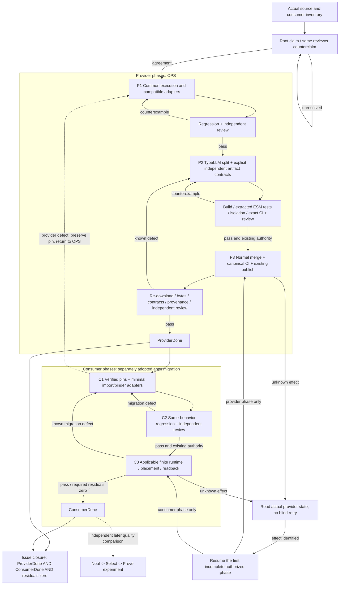

# Jev / TypeLLM: completed structure and closure

Scope: [OPS #564](https://github.com/roccho-org/ops/issues/564).
Design inputs: [provider structure](https://chatgpt.com/c/6ad331d2-b908-83ec-8bcf-1598a755b998)
and [consumer selection design](https://chatgpt.com/c/6ad32ce2-3570-83e8-baaa-13b132db714d).
This document describes the target and its verification; it is not a claim
that the target is already implemented, released or migrated.

## Responsibility equations

Let `s` be caller state, `Q` a nonempty map of question IDs to descriptors,
`A` the answer map, and `T` the bound transport.

```text
T(credential, request, cancellation, deadline) -> response | closed error
J(s, Q) = decode_Q(T(snapshot(model, s, Q)))
dom(A) = dom(Q)                         # new named API: no missing/extra slots
type(A[q]) = type(Q[q])                 # names bind answers; order does not
0 <= HTTP_calls(J(s, Q)) <= 1           # pre-dispatch refusal=0; dispatch=1
Single(s, q) = unwrap(V_legacy(J_wire(s, {live: q}, jev-latest)))
B(old_request) = old_output(J_wire(adapt(old_request)))
R(s, Q) = V_review(J_wire(s, Q, fixed_review_model))
G(context, schema) = V_typed(TypeLLM_transport(context, schema))
```

`J_wire` is the shared internal snapshot/send entry, not a second provider,
public profile framework or application decision engine. Single and named
typed APIs reuse their typed decoders; legacy envelope/error behavior does
not acquire the new named API's exact-answer-set contract. The Worker compatibility adapter and
Review retain the validation differences their existing contracts require.

```text
V_CLI:    all probability keys present, each value in [0,1]
V_Worker: optional/subset probability keys, finite values (legacy contract)
V_Review: fixed jev-1.13.0, own data, two choices, sum=1 and chosen argmax

deps(Jev_ESM) intersection TypeLLM = empty
deps(TypeLLM_ESM) intersection Jev = empty
```

The legacy CLI and Worker request `jev-latest`; Review keeps its fixed
model. Its model, usage and exact answer structure reach its own decoder
before adapter-specific normalization. Credential availability is not
successful authentication. No key is accepted as operation data by the new
named API.

## Completed dirtree

Only paths relevant to this change are shown. Existing repository tests and
release utilities are reused. `dist/` below denotes generated build outputs,
not a new checked-in source directory.

```text
ops/
├─ packages/
│  ├─ jev/
│  │  ├─ src/
│  │  │  ├─ core.mjs        # T + J_wire: one binding, snapshot, one POST
│  │  │  ├─ client.mjs      # J: Noul/Choice/Score; |Q| >= 1; single wrappers
│  │  │  ├─ batch.mjs       # B = adapt -> J_wire -> normalize; compatibility
│  │  │  └─ worker.mjs      # explicit independent Jev ESM exports
│  │  ├─ cli/index.mjs      # stdin -> J -> one stdout line; old exit classes
│  │  ├─ tests/             # J contract + legacy CLI/Worker counterexamples
│  │  ├─ package.json      # Jev public module surface
│  │  ├─ artifact.jsonl    # requires Jev capability only
│  │  └─ default.nix       # Jev CLI + ESM; legacy CLI-only TypeLLM symlink
│  ├─ jev-review/
│  │  ├─ jev.mjs           # R = J_wire + V_review; effect boundary unchanged
│  │  └─ tests/            # pinned model, budget and strict validation
│  └─ typellm/
│     ├─ src/typellm.mjs   # G: existing bounded transport + typed validation
│     ├─ cli/index.mjs     # TypeLLM credential -> G; no Jev import
│     ├─ tests/            # moved existing typed/transport/CLI regressions
│     ├─ package.json      # independent TypeLLM public module surface
│     ├─ artifact.jsonl    # requires TypeLLM capability only
│     └─ default.nix       # independent TypeLLM CLI + completed TypeLLM ESM
├─ tools/jev-provider-artifact.py  # reuse ZIP/contract/hash/provenance checks
├─ .github/workflows/jev-provider-release.yml  # one existing build/test/release
├─ flake.nix              # explicit outputs; no runtime package discovery
└─ dist/                  # GENERATED; existing release, no source fallback
   ├─ Jev ESM + its existing-style verified archive/manifest
   └─ TypeLLM ESM + its existing-style verified archive/manifest

apps/                     # consumer migration starts after ProviderDone
└─ existing voice-ui composition and verification paths
   ├─ artifact pins / import adapters  # verified Jev and TypeLLM artifacts
   ├─ existing judgment/completion     # application meaning stays in apps
   └─ existing tests / runtime proof   # same behavior before/after migration
```

No new HTTP framework, provider service, DB, queue, daemon, secret store or
current-state ledger is needed. TypeLLM already has its own transport; moving
it does not justify extracting a third common transport package. No CLI or
legacy source shim may accidentally make the new Jev ESM import TypeLLM.

## Public-entry transition

| Existing entry | Completed entry / transition |
|---|---|
| `askJevNoul`, `askJevChoice`, `askJevScore` | Preserve valid input/output/error/deadline contracts around shared execution |
| New `askJevQuestions` | `(state, named Q, bound provider)`; mixed types; exact answer names; strict typed decoding |
| `judgeNamedChoices` | Keep a compatibility adapter only while actual consumers require it; no independent send implementation |
| Review | Shared internal wire entry; existing fixed model, budget, decoder and authority |
| `jev/typellm`, `packages/jev/src/typellm.mjs` | Move implementation/public API to `packages/typellm`; enumerate actual source consumers before retiring an old entry |
| `.#jev/bin/typellm` | Existing Windows launcher requires it; retain a deprecated symlink to independent `.#typellm/bin/typellm`, outside the Jev ESM |
| Old `named-choices-and-typed/1` ZIP | Preserve old published bytes and pins; do not remove exports under the old contract |
| New independent ESMs | Explicit new contracts/exports; only deliberate consumer admission switches pins |

The new named API uses the existing strict CLI typed decoders. It does not
redefine the older Worker's weaker probability contract. Public named results
contain only model, typed answers, and optional finite nonnegative usage for
`input_tokens`, `output_tokens`, `total_tokens`. It exposes closed transport
error codes; legacy wrappers retain their existing error translation.

## Completed-state verification

Each row needs evidence for the exact source/artifact being accepted.

| ID | State being guaranteed | Required positive and destructive evidence |
|---|---|---|
| P1 | One named execution | Mixed Noul/Choice/Score and single wrappers; exactly one POST; reordered answers matched by ID; no automatic retry |
| P2 | Bound answer contract | Missing/extra answers, wrong types, unoffered choices, nonfinite/out-of-range values and wrong score legends are refused |
| P3 | Stable request | Caller mutation and provider mutation while awaiting cannot change sent criteria or the validation snapshot |
| P4 | Entry compatibility | CLI full probabilities and exit codes; Worker optional/subset finite probabilities and ten-second deadline; Review fixed model, own-data, sum/argmax and budgets |
| P5 | Failure and secrecy | Hung headers/body, cancellation, HTTP/JSON/network errors; keys/raw exception/error bodies absent from output; no retry |
| P6 | TypeLLM independence | Existing types, arrays, dependencies, bounds, HTTP/CLI tests pass after move; distinct credential binding; no Jev import |
| P7 | Real built outputs | Build both ESMs with existing pinned tools; verify/import/execute each extracted archive entry in isolation; no external imports or checkout/ambient resolution |
| P8 | Explicit distribution | New contract/exports/digest/provenance agree; wrong entry/hash/contract/source proof refused; existing release-admission checks preserved; old assets unchanged |
| P9 | Public provider completion | Required exact-head CI and independent review; normal authorized merge; canonical CI; existing publish; re-download and byte/contract/provenance comparison |
| C1 | Deliberate consumer adoption | Inventory affected consumers first; apps switches only to the verified public artifacts; old pins stay usable until their own migration |
| C2 | Equivalent consumer behavior | Existing Review/CLI/Worker consumer paths identified by inventory; applicable apps unit/integration/negative tests; Jev and TypeLLM bound separately; no source fallback |
| C3 | Consumer runtime evidence | Applicable finite real path/placement/readback using existing authorized identity and budget; fixtures do not substitute for live evidence |
| C4 | Migration closure | Exact provider artifacts + consumer revisions/runtime identified; independent review; unresolved required items = 0 |

Provider completion does not require apps to have switched. Consumer migration
does require the verified public provider completion. A source test, local ZIP,
CI artifact, API fixture or historical live receipt proves only its own stage.
No new paid call, credential, production effect or merge permission follows
from the verification table; use the existing applicable authority at that stage.

## Closure process graph



Unknown effects are not ordinary technical failures. Identify the actual
effect and the relevant phase before resuming; the two resume arrows above
are alternatives, not instructions to execute both. Missing external authority
or credentials retain the completed stages and a concrete owner/resume condition.
They do not restart a successful effect or manufacture a fallback route.

`ProviderDone = source + independent build + review/CI + public readback`.
`ConsumerDone = ProviderDone + deliberate adoption + regression + required runtime readback`.
`Done(#564) = ProviderDone AND ConsumerDone AND required residuals=0`.

The consumer selection design remains compatible with these modules:

```text
apps: requirements -> existing candidates -> existence (ordinary code)
     -> semantic fit (Noul) -> legal complete actions -> Select
     -> latest-state proof -> effect/readback -> goal check
     -> bounded continuation or stop
missing: classify -> generate only needed fields (TypeLLM) -> SAME fit checks
```

Noul availability is delivered by the provider; mandatory Noul-before-Choice
application behavior is not introduced by a compatibility migration. The
existing apps quality work must compare that behavior with its baseline
(candidate coverage, semantic errors, completed goals, latency and total cost).
No new threshold is invented here. Typed output is not semantic correctness;
one successful action or NONE is not goal completion.

## Implementation slices

P1 introduces the mixed named source API and the shared internal snapshot/send
entry used by the legacy single, Worker and Review adapters. It does not change
the existing combined artifact's exports or claim the TypeLLM split, public
supply or consumer migration. Those remain the subsequent provider and consumer
phases above.

P2 moves the existing TypeLLM implementation, CLI and tests into its sibling
package. The existing Windows launcher's actual `.#jev/bin/typellm` entry is
preserved by a CLI-only symlink to the independent derivation. No current
consumer of the old source/module alias was found; this source version ends
that alias while retaining immutable older releases.

The same existing release workflow builds two explicit outputs:

| Provider | Manifest / contract | Entry |
|---|---|---|
| Jev | `jev-provider/2` / `named-questions/1` | `jev.mjs` |
| TypeLLM | `typellm-provider/1` / `typed-completion/1` | `typellm.mjs` |

The release has exactly seven assets: both ZIPs, both checksum files, separate
Jev/TypeLLM provenance, and one common merged-PR proof. The fixed verifier's
default legacy mode remains available for existing combined releases. Each
new provider selection validates its own archive, source-input set and proof;
paired verification additionally requires the exact seven-asset set. Built
entry execution, canonical publication and independent public readback remain
separate acceptance stages even when the source is implemented.
