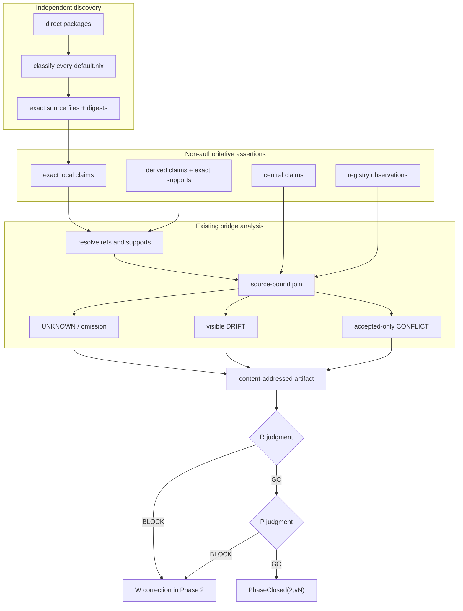

# Phase 2 — exact source-relation coverage

Phase 2 records why each direct `packages/*` directory exists while preserving the difference between repository text and accepted organization meaning.

It keeps these facts separate:

1. central repository claims;
2. package-local implementation claims;
3. registry observations;
4. explicit derived claims and their exact supports;
5. externally supplied accepted organization meaning.

No repository claim selects Current, creates `required`, changes a Gate, performs admission, or authorizes operation.

## Boundary

```text
DefaultNixUniverse
  = { packages/<p>/default.nix | p ∈ directDirs(packages) }

DiscoveredLocalSource(p)
  = absent
  | Nix attrset
  | raw JSON attrset
  | Nix lambda
  | evaluation error

DirectAssertion(a)
  = a.sourceRef resolves to an actual supported source statement
  ∧ a.sourceFileDigest binds the source file
  ∧ a.sourceDigest binds the canonical assertion
  ∧ a.supports = []

DerivedAssertion(a)
  = a.sourceRef starts with derived:
  ∧ a.relation = derived_from
  ∧ every support resolves to a direct assertion
  ∧ every support carries matching file and assertion digests

Complete(p)
  = every mandatory field has a substantive digest-bound assertion
  ∧ every discovered supported local source is represented

Phase2ReadyForReview
  = dom(Coverage) = directDirs(packages)
  ∧ DefaultNixUniverse is completely classified
  ∧ UNKNOWN = 0
  ∧ accepted CONFLICT = 0
  ∧ local-source omission = 0
  ∧ source-universe finding = 0
  ∧ source-relation finding = 0
```

`DRIFT` is evidence, not a selected winner.

```text
Phase2ReadyForReview != PhaseClosed
Phase2ReadyForReview != organization requirement
Phase2ReadyForReview != organization admission
Phase2ReadyForReview != operational adoption
```

Mandatory fields:

```text
position
purpose
contributionMechanism
responsibility
mustNotOwn
placement
input
output
dependency
requiredEvidence
lifecycle
```

## Independent source universe

Nix produces the mother set before the assertion collector runs:

```text
tools/contract-632-phase2-source-universe.nix
  direct package directories
  └─ default.nix
     ├─ absent
     ├─ ordinary Nix attrset
     ├─ raw JSON attrset
     ├─ Nix lambda
     └─ evaluation error
```

The collector cannot define its own mother set. A known source that cannot be evaluated or normalized becomes `UNKNOWN`; it cannot disappear from the result.

Raw JSON stored with a `.nix` suffix is classified before parsing. Other present files are evaluated as Nix. Exact source files are copied into the evidence bundle and digest-bound.

## Exact source relations

Direct assertions use only real source paths:

```text
ordinary or raw-JSON attrset
  → packages/<id>/default.nix#nix.attr.<actual.path>

bounded lambda metadata
  → packages/<id>/default.nix#nix.lambda.meta.description

registry observation
  → build/packages.jsonl#L<n>
```

Composite values never use invented paths such as `a+b`.

When two direct attrs contribute to the same semantic field, they remain separate assertions:

```text
checkPackageContract.evidence
checkPackageContract.guarantees

productScopePurposeContribution.contribution
productScopePurposeContribution.ultimatePurpose
```

A future combined assertion must be explicit:

```text
sourceRef = derived:<package>:<field>:<version>
relation  = derived_from
supports  = [
  { sourceRef, sourceFileDigest, sourceDigest },
  ...
]
```

The verifier resolves every direct ref against the copied source bytes and every derived support against a direct assertion. Nonexistent refs, absent supports and digest mismatches are rejected.

## Bounded lambda metadata

Phase 2 does not attempt general Nix-code or comment understanding. For lambda-form `default.nix`, it currently recognizes one standard explicit claim:

```text
meta.description = "literal text";
```

A literal description becomes a source-bound `purpose` assertion. An explicit but unsupported or unreadable description becomes a source-universe finding and blocks readiness. Lambdas with no supported explicit metadata remain classified but do not invent meaning.

## Actual tree

```text
roccho-org/ops
├── .github/workflows/
│   ├── contract-632-phase1.yml
│   └── contract-632-phase2-v4.yml
├── tools/
│   ├── contract-632-phase1-proof.py
│   ├── contract-632-phase1-proof-core.py
│   └── contract-632-phase2-source-universe.nix
└── packages/ops-package-contract-bridge/
    ├── README.md
    ├── PHASE2.md
    ├── contract/
    │   └── phase2-package-claims.v1.json
    ├── bin/
    │   └── ops-package-contract-bridge.mjs
    ├── src/
    │   ├── verify.mjs
    │   ├── phase2.mjs
    │   ├── phase2-universe.mjs
    │   └── phase2-v4.mjs
    └── tests/
        ├── e2e.mjs
        ├── phase2.mjs
        ├── phase2-universe.mjs
        └── phase2-v4.mjs
```

Generated finite evidence:

```text
contract-632-phase2-v4-bundle/
├── bundle-manifest.json
├── provenance.json
├── unit-receipt.json
├── workflow-readback.json
└── proof/
    ├── base-v2/...
    ├── local-source-universe.json
    ├── local-source-files/packages/<id>/default.nix
    ├── local-source-index-v4.json
    ├── local-source-assertions-v4.jsonl
    ├── source-universe-findings-v4.json
    ├── source-relation-findings.json
    ├── combined-source-assertions.jsonl
    ├── combined-package-field-coverage.jsonl
    ├── combined-unknown-checkpoints.json
    ├── combined-conflict-findings.json
    ├── combined-drift-findings.json
    ├── combined-local-source-omissions.json
    ├── phase2-v4-destructive-results.json
    ├── phase2-v4-receipt.json
    └── phase2-v4-verification.json
```

## Data flow



## Validation matrix

| Requirement | Positive evidence | Safe failure |
|---|---|---|
| Independent mother set | every direct package has a universe record | missing record rejects |
| Local forms classified | absent, attrset, raw JSON, lambda and error are explicit | unreadable known source becomes `UNKNOWN` |
| Direct refs are real | each attr path or lambda metadata path resolves | nonexistent or composite ref rejects |
| Composite meaning is explicit | direct attrs stay separate or derived claim names every support | missing support rejects |
| Supports are identity-bound | support carries source-file and assertion digests | support digest mismatch rejects |
| Lambda metadata retained | literal `meta.description` becomes purpose | omission blocks readiness |
| Claim differences visible | implementation differences remain `DRIFT` | no winner is selected silently |
| Accepted conflict bounded | only incompatible accepted assertions conflict | implementation drift is not mislabeled |
| Authority ceiling | all receipts have `authority=false` | repository claim cannot create `required` |
| Deterministic replay | source universe and bundle reproduce byte-for-byte | output drift fails comparison |
| Artifact integrity | copied sources and generated evidence are digest-bound | one-byte mutation rejects |

## Claim ceiling

```text
REPOSITORY_LOCAL_SOURCE_DISCOVERY_NOT_ORGANIZATION_MEANING
REPOSITORY_LOCAL_CLAIM_NOT_ORGANIZATION_REQUIREMENT
PACKAGE_EXACT_SOURCE_RELATIONS_CLOSED_NOT_ORGANIZATION_ADMISSION
```

`UNKNOWN=0` means each mandatory field has a source and every supported explicit local source is represented. It does not mean claims agree, every package is required, Phase 2 is independently closed, or any operational change is authorized.
