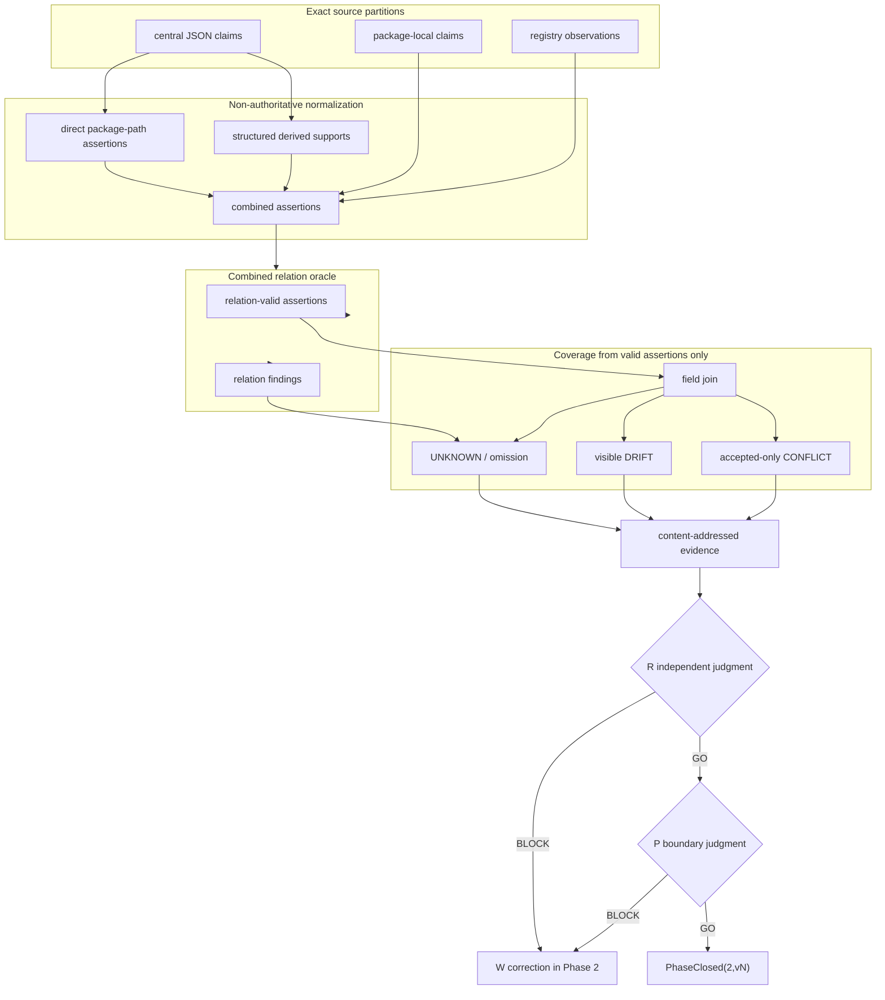

# Phase 2 — combined source-relation coverage

Phase 2 records why each direct `packages/*` directory exists while preserving the difference between repository text and accepted organization meaning.

It keeps these facts separate:

1. central repository claims;
2. package-local implementation claims;
3. registry observations;
4. explicit derived claims and their exact supports;
5. externally supplied accepted organization meaning.

No repository claim selects Current, creates `required`, changes a Gate, performs admission, or authorizes operation.

## Boundary

```text
CombinedAssertions
  = central claims
  + package-local claims
  + registry observations
  + derived claims
  + externally supplied accepted claims

DirectAssertion(a)
  = a.sourceRef resolves to an actual source statement
  ∧ a.sourceFileDigest binds that source
  ∧ a.sourceDigest binds the canonical assertion
  ∧ a.supports = []

DerivedAssertion(a)
  = a.sourceRef starts with derived:
  ∧ a.relation = derived_from
  ∧ every support resolves to a direct assertion
  ∧ every support carries matching source-file and assertion digests

RelationValid(a)
  = DirectAssertion(a) ∨ DerivedAssertion(a)

CoverageInput
  = { a ∈ CombinedAssertions | RelationValid(a) }

Complete(p)
  = every mandatory field for p has a substantive assertion in CoverageInput

Phase2ReadyForReview
  = dom(Coverage) = directDirs(packages)
  ∧ combined relation finding = 0
  ∧ unresolved support = 0
  ∧ UNKNOWN = 0
  ∧ accepted CONFLICT = 0
  ∧ local-source omission = 0
```

`DRIFT` is evidence, not a selected winner.

```text
Phase2ReadyForReview != PhaseClosed
Phase2ReadyForReview != organization requirement
Phase2ReadyForReview != organization admission
Phase2ReadyForReview != operational adoption
```

Mandatory fields:

```text
position
purpose
contributionMechanism
responsibility
mustNotOwn
placement
input
output
dependency
requiredEvidence
lifecycle
```

## Source partitions

Each direct relation is validated by its own exact oracle.

```text
central claim
  → phase2-package-claims.v1.json#/...
  → JSON Pointer resolves and value matches

registry observation
  → build/packages.jsonl#L<n>
  → line bytes, digest, entry/deps value match

literal package metadata
  → default.nix#ops.packageImplementationMetadata.v1[n].field
  → exact metadata block and value match

ordinary/raw-JSON Nix attrset
  → default.nix#nix.attr.actual.path
  → evaluated attr path and value match

bounded Nix lambda metadata
  → default.nix#nix.lambda.meta.description
  → explicit literal description and value match
```

Derived assertions are never accepted merely because their bytes are well-formed. Their supports must be structured objects:

```text
supports = [
  { sourceRef, sourceFileDigest, sourceDigest },
  ...
]
```

Each support must resolve to a direct assertion for the same package and match both digests.

## Placement correction

The old base representation produced 60 derived placement assertions supported by package-level refs that were not direct assertions. v5 removes those derivations and emits direct assertions instead:

```text
sourceRef = phase2-package-claims.v1.json#/packages/<n>/packageId
relation  = declares_package_path
value     = packages/<packageId>
```

The other derived fields remain explicit:

```text
responsibility
  ← purpose + contributionMechanism

mustNotOwn
  ← purpose + input + output
```

Their supports are normalized into digest-bound support objects before relation validation.

## Current implementation tree

```text
roccho-org/ops
├── .github/workflows/
│   └── contract-632-phase1.yml
│       ├── phase1-bundle
│       └── phase2-v5-bundle
├── tools/
│   ├── contract-632-phase1-proof.py
│   ├── contract-632-phase1-proof-core.py
│   └── contract-632-phase2-source-universe.nix
└── packages/ops-package-contract-bridge/
    ├── README.md
    ├── PHASE2.md
    ├── default.nix
    ├── contract/
    │   └── phase2-package-claims.v1.json
    ├── bin/
    │   └── ops-package-contract-bridge.mjs
    ├── src/
    │   ├── verify.mjs
    │   ├── phase2.mjs
    │   ├── phase2-v4.mjs
    │   └── phase2-v5.mjs
    └── tests/
        ├── e2e.mjs
        ├── phase2.mjs
        ├── phase2-v4.mjs
        └── phase2-v5.mjs
```

`phase2-v4.mjs` is the bounded local-source stage reused by v5. `phase2-v5.mjs` is the only current combined-relation closure. There is one evidence workflow; older result versions remain in immutable Git history and stored artifacts.

Generated finite evidence:

```text
contract-632-phase2-v5-bundle/
├── bundle-manifest.json
├── provenance.json
├── unit-receipt.json
├── workflow-readback.json
└── proof/
    ├── base-v4/...
    ├── combined-source-assertions-v5.jsonl
    ├── combined-source-relation-findings-v5.json
    ├── relation-valid-source-assertions-v5.jsonl
    ├── combined-package-field-coverage-v5.jsonl
    ├── combined-unknown-checkpoints-v5.json
    ├── combined-conflict-findings-v5.json
    ├── combined-drift-findings-v5.json
    ├── combined-local-source-omissions-v5.json
    ├── phase2-v5-destructive-results.json
    ├── phase2-v5-receipt.json
    └── phase2-v5-verification.json
```

## Data flow



## Validation matrix

| Requirement | Positive evidence | Safe failure |
|---|---|---|
| Complete combined mother set | central, local, registry, derived all enter one relation oracle | omitted partition cannot report closure |
| Central refs are real | JSON Pointer resolves and value matches | missing pointer/value mismatch becomes finding |
| Registry refs are real | exact line digest and entry/deps match | wrong line or value becomes finding |
| Local refs are real | metadata/attr/lambda source resolves | nonexistent ref blocks |
| Derived supports are structured | every support has ref and two digests | bare string or missing support blocks |
| Supports resolve | each support matches a direct assertion | unresolved support or wrong digest blocks |
| Placement has direct evidence | 60 direct package-path assertions | package-level phantom support rejects |
| Invalid relations cannot create coverage | coverage uses relation-valid assertions only | removing a required valid assertion creates `UNKNOWN` |
| Claim differences remain visible | implementation differences remain `DRIFT` | no winner is selected silently |
| Authority ceiling | all receipts have `authority=false` | repository claim cannot create `required` |
| Deterministic replay | source universe and bundle reproduce byte-for-byte | output drift fails comparison |
| Artifact integrity | all evidence is manifest-bound | one-byte mutation rejects |

## Claim ceiling

```text
REPOSITORY_LOCAL_SOURCE_DISCOVERY_NOT_ORGANIZATION_MEANING
REPOSITORY_LOCAL_CLAIM_NOT_ORGANIZATION_REQUIREMENT
PACKAGE_COMBINED_SOURCE_RELATIONS_CLOSED_NOT_ORGANIZATION_ADMISSION
```

`UNKNOWN=0` means all mandatory fields are supported by relation-valid assertions. It does not mean claims agree, every package is required, Phase 2 is independently closed, or any operational change is authorized.
