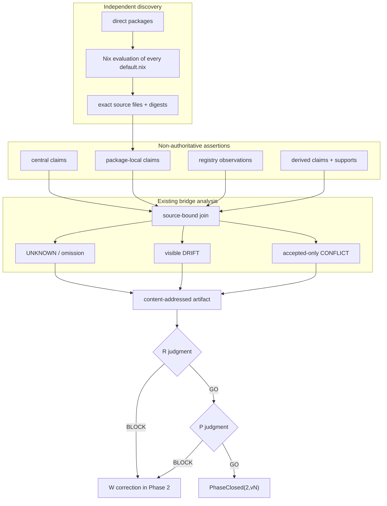

# Phase 2 — package purpose and source-universe coverage

Phase 2 records why every direct `packages/*` directory exists without promoting repository text into organization authority.

It preserves five different facts:

1. central repository claims;
2. package-local implementation claims;
3. registry observations;
4. explicit derived claims with supporting refs;
5. accepted organization meaning, when supplied by an external authority source.

No repository claim selects Current, creates `required`, changes a Gate, or performs admission.

## Boundary

```text
DefaultNixUniverse
  = { packages/<p>/default.nix | p ∈ directDirs(packages) }

DiscoveredLocalSource(p)
  = Nix-evaluated attrset or raw-JSON attrset at default.nix
  + exact source bytes and file digest

Assertions(p,f)
  = central claims
  + package-local claims discovered independently from the assertion parser
  + build/packages.jsonl observations
  + explicit derived claims
  + accepted assertions when externally supplied

Coverage(p,f) = every source-bound assertion for package p and field f

Complete(p)
  = every mandatory field has a substantive digest-bound assertion
  ∧ every discovered explicit local source is represented

Phase2ReadyForReview
  = dom(Coverage) = directDirs(packages)
  ∧ DefaultNixUniverse is completely classified
  ∧ UNKNOWN = 0
  ∧ accepted CONFLICT = 0
  ∧ local-source omission = 0
  ∧ source-universe finding = 0
```

`DRIFT` is preserved evidence. The bridge never selects a winner.

```text
Phase2ReadyForReview != PhaseClosed
Phase2ReadyForReview != organization requirement
Phase2ReadyForReview != organization admission
Phase2ReadyForReview != operational adoption
```

Mandatory fields:

```text
position
purpose
contributionMechanism
responsibility
mustNotOwn
placement
input
output
dependency
requiredEvidence
lifecycle
```

## Independent source universe

The source universe is produced by Nix before the JavaScript collector runs:

```text
tools/contract-632-phase2-source-universe.nix
  direct package directories
  └─ default.nix
     ├─ absent
     ├─ Nix attrset
     ├─ Nix lambda
     ├─ raw JSON attrset
     └─ evaluation error
```

The collector cannot define its own mother set. A known semantic source that cannot be evaluated or normalized becomes `UNKNOWN`; it cannot disappear from the result.

Raw JSON stored with a `.nix` suffix is detected by its byte prefix and decoded as JSON. Other files are evaluated as Nix. The exact source file is copied into the evidence bundle and digest-bound.

## Source binding

Every assertion contains:

```text
value
sourceClass
sourceRef
sourceFileDigest
sourceDigest
digestKind
applicability(repository, candidateSha, path)
claimCeiling
relation
supports
explicitNone
```

Examples:

```text
central claim
  → contract/phase2-package-claims.v1.json#/packages/<n>/<field>

Nix attrset claim
  → packages/<id>/default.nix#nix.attr.<field>

legacy metadata claim
  → packages/<id>/default.nix#ops.packageImplementationMetadata.v1[<n>].<field>

registry observation
  → build/packages.jsonl#L<n>

derived claim
  → derived:<packageId>:<field>:v1 + supports[]
```

A generated coverage row is never accepted as its own source.

## Actual tree

```text
roccho-org/ops
├── .github/workflows/
│   └── contract-632-phase1.yml
├── tools/
│   ├── contract-632-phase1-proof.py
│   ├── contract-632-phase1-proof-core.py
│   └── contract-632-phase2-source-universe.nix
└── packages/ops-package-contract-bridge/
    ├── README.md
    ├── PHASE2.md
    ├── contract/
    │   └── phase2-package-claims.v1.json
    ├── bin/
    │   └── ops-package-contract-bridge.mjs
    ├── src/
    │   ├── verify.mjs
    │   ├── phase2.mjs
    │   └── phase2-universe.mjs
    └── tests/
        ├── e2e.mjs
        ├── phase2.mjs
        └── phase2-universe.mjs
```

Generated finite evidence:

```text
phase2-proof/
├── base-v2/
│   ├── direct-packages.json
│   ├── source-assertions.jsonl
│   ├── local-source-index.json
│   ├── drift-findings.json
│   └── ...
├── local-source-universe.json
├── local-source-files/packages/<id>/default.nix
├── local-source-index-v3.json
├── local-source-assertions-v3.jsonl
├── source-universe-findings.json
├── combined-source-assertions.jsonl
├── combined-package-field-coverage.jsonl
├── combined-unknown-checkpoints.json
├── combined-conflict-findings.json
├── combined-drift-findings.json
├── combined-local-source-omissions.json
├── phase2-v3-destructive-results.json
├── phase2-v3-receipt.json
└── phase2-v3-verification.json
```

## Data flow



## Validation matrix

| Requirement | Positive evidence | Safe failure |
|---|---|---|
| Mother set independent from parser | all direct packages have a source-universe record | missing universe record rejects |
| All local file formats classified | absent/Nix attrset/Nix lambda/raw JSON are explicit | unreadable known semantic source becomes `UNKNOWN` |
| Exact source binding | source ref, file digest, assertion digest and applicability are separate | source byte mutation or wrong digest rejects |
| Local claims retained | every discovered semantic attr has an emitted assertion | discovered attr without normalization becomes `UNKNOWN` |
| Legacy attrset support | billing and functional-core metadata are recovered from actual Nix attrs | parser omission cannot silently pass |
| Raw JSON support | raw JSON `default.nix` is classified and collected | raw JSON is not imported as Nix |
| Claim differences visible | implementation differences remain `DRIFT` | no winner is silently selected |
| Accepted conflict bounded | only incompatible accepted assertions conflict | implementation drift is not mislabeled |
| Authority ceiling | all receipts have `authority=false` | repository claim cannot create `required` |
| Deterministic replay | source universe and proof bundle reproduce byte-for-byte | output drift fails comparison |
| Artifact integrity | copied source files and generated evidence are digest-bound | one-byte mutation rejects |

## Claim ceiling

```text
REPOSITORY_LOCAL_SOURCE_DISCOVERY_NOT_ORGANIZATION_MEANING
REPOSITORY_LOCAL_CLAIM_NOT_ORGANIZATION_REQUIREMENT
PACKAGE_SOURCE_UNIVERSE_CLOSED_NOT_ORGANIZATION_ADMISSION
```

`UNKNOWN=0` means every mandatory field has a source and every discovered local source is represented. It does not mean claims agree, that every package is required, or that Phase 2 is independently closed.
