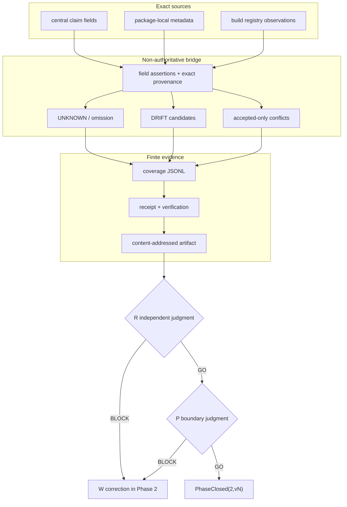

# Phase 2 — package purpose and provenance coverage

Phase 2 records why every direct `packages/*` directory exists while preserving the difference between:

- a central repository claim;
- a package-local implementation claim;
- a repository observation such as `build/packages.jsonl`;
- a derived package-specific explanation;
- accepted organization meaning;
- an unresolved value.

Nothing in this phase promotes a repository claim into organization authority.

## Boundary

```text
Assertions(p,f)
  = central claims
  + package-local metadata claims
  + registry observations
  + explicitly marked derived claims
  + accepted assertions when supplied

Coverage(p,f) = every source-bound assertion for package p and field f

Complete(p)
  = every mandatory field has at least one substantive, digest-bound assertion
  ∧ every explicit package-local source is collected

Phase2ReadyForReview
  = dom(Coverage) = directDirs(packages)
  ∧ unknown = 0
  ∧ accepted conflict = 0
  ∧ package-local omission = 0

DRIFT is visible evidence, not an automatically selected winner.
Phase2ReadyForReview != PhaseClosed.
Phase2ReadyForReview != organization requirement or admission.
```

Mandatory fields:

```text
position
purpose
contributionMechanism
responsibility
mustNotOwn
placement
input
output
dependency
requiredEvidence
lifecycle
```

## Source binding

Every assertion contains:

```text
value
sourceClass
sourceRef
sourceFileDigest
sourceDigest
digestKind
applicability(repository, candidateSha, path)
claimCeiling
relation
supports
explicitNone
```

`sourceRef` and `applicability.path` are separate:

- central claim fields point to an exact JSON Pointer in `contract/phase2-package-claims.v1.json`;
- registry observations point to an exact `build/packages.jsonl#L<n>` line;
- package-local metadata points to the exact `default.nix#ops.packageImplementationMetadata.v1[...]` field;
- derived responsibility/non-responsibility records list their supporting source refs;
- `sourceFileDigest` binds the containing source bytes;
- `sourceDigest` binds the canonical assertion.

A generated coverage row is never used as its own source.

## Package-specific role and non-role

The common responsibility and authority ceiling remain visible at `packages/*`.

Each package also receives package-specific derived assertions:

```text
responsibility
  = purpose + contributionMechanism

mustNotOwn
  = upstream input ownership
  + downstream output-consumer ownership
  + package implementation boundary
```

These rows are marked `derived_claim`; they are not presented as accepted meaning or package-local text. When package-local metadata provides a more specific responsibility or forbidden responsibility, both assertions remain visible.

## Package-local collection

The bridge collects explicit local sources without choosing a semantic winner:

```text
packages/<id>/default.nix
  └─ ops.packageImplementationMetadata.v1
     ├─ mission -> purpose
     ├─ responsibility -> responsibility
     ├─ forbiddenResponsibility -> mustNotOwn
     ├─ primaryTarget -> placement
     ├─ requiredOutputs -> output
     └─ requiredChecks -> requiredEvidence

build/packages.jsonl
  ├─ entry -> placement observation
  └─ deps -> dependency observation
```

If a source exists but its mapped assertion is omitted, Phase 2 returns `UNKNOWN` and records `local-source-omissions.json`.

## Actual tree

```text
packages/ops-package-contract-bridge/
├── README.md
├── PHASE2.md
├── contract/
│   └── phase2-package-claims.v1.json
├── bin/
│   └── ops-package-contract-bridge.mjs
├── src/
│   ├── verify.mjs
│   └── phase2.mjs
└── tests/
    ├── e2e.mjs
    └── phase2.mjs
```

Generated evidence:

```text
phase2-proof/
├── direct-packages.json
├── claim-source.json
├── registry-source.jsonl
├── implementation-claims.jsonl
├── source-assertions.jsonl
├── local-source-index.json
├── package-field-coverage.jsonl
├── unknown-checkpoints.json
├── conflict-findings.json
├── drift-findings.json
├── local-source-omissions.json
├── phase2-destructive-results.json
├── phase2-receipt.json
└── phase2-verification.json
```

## Responsibility graph



## Validation matrix

| Requirement | Positive evidence | Safe failure |
|---|---|---|
| Direct package coverage | exact package set and 11 fields each | missing or extra package stops |
| Exact source binding | ref, source-file digest and canonical assertion digest | wrong ref with stale digest or wrong digest rejects |
| Local claims retained | explicit metadata and registry rows appear in source index | local source omission becomes `UNKNOWN` |
| Package-specific role | derived package assertion plus local explicit claim when present | common text alone is not the only assertion |
| Claim differences visible | different implementation claims emit `DRIFT` | no winner is silently selected |
| Accepted conflict bounded | only incompatible accepted assertions with overlapping applicability conflict | implementation drift is not mislabeled as organization conflict |
| No authority escalation | `authority=false`, no required promotion | repository claim cannot create `required` |
| Deterministic replay | two runs are byte-identical | output drift fails `diff -r` |
| Artifact integrity | all evidence files are receipt-bound | one-byte artifact mutation rejects |

## UNKNOWN checkpoint

A missing field or omitted local source is returned with:

```text
packageId
field
searchedExactRefs
observedClaims
whyNoneCanBePromoted
requiredAuthorityDecision
resumeInput
```

`UNKNOWN=0` means that all mandatory fields have at least one exact source-bound assertion and all detected explicit local sources were collected. It does not mean all claims agree, nor that the organization requires the package. Differences remain in `drift-findings.json`.
