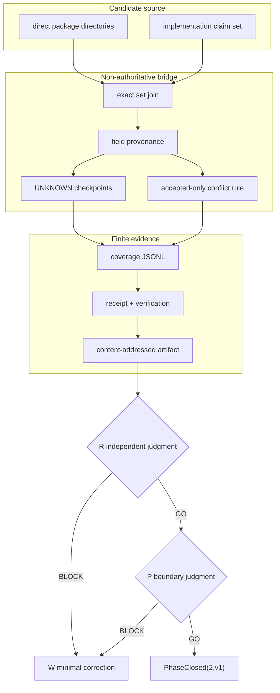

# Phase 2 — package purpose coverage

This phase records why every direct `packages/*` directory exists without turning repository text into organization authority.

## Boundary

```text
Claim(p) = checked-in repository implementation claim for package p
Coverage(p,f) = every source-bound assertion for mandatory field f
Complete(p) = every mandatory field has an allowed source for p.position

Phase2ReadyForReview
  = dom(Coverage) = directDirs(packages)
  ∧ every direct package occurs exactly once
  ∧ every mandatory field is substantive
  ∧ unknown = 0
  ∧ conflict = 0

Phase2ReadyForReview != PhaseClosed
Phase2ReadyForReview != organization requirement
Phase2ReadyForReview != organization admission
Phase2ReadyForReview != operational adoption
```

All expanded rows from `contract/phase2-package-claims.v1.json` are `implementation_claim`.
No row has `position=required`. A repository claim cannot promote a package into an organization requirement.

Mandatory fields:

```text
position
purpose
contributionMechanism
responsibility
mustNotOwn
placement
input
output
dependency
requiredEvidence
lifecycle
```

## Actual and completed tree

```text
packages/ops-package-contract-bridge/
├── README.md
├── PHASE2.md
├── contract/
│   └── phase2-package-claims.v1.json
├── bin/
│   └── ops-package-contract-bridge.mjs
├── src/
│   ├── verify.mjs
│   └── phase2.mjs
└── tests/
    ├── e2e.mjs
    └── phase2.mjs
```

Generated review evidence:

```text
phase2-proof/
├── direct-packages.json
├── claim-source.json
├── implementation-claims.jsonl
├── package-field-coverage.jsonl
├── unknown-checkpoints.json
├── conflict-findings.json
├── phase2-destructive-results.json
├── phase2-receipt.json
└── phase2-verification.json
```

`claim-source.json` is a byte copy of the checked-in DRY claim set. `implementation-claims.jsonl` expands its explicit common fields and package-specific fields without adding defaults.
`package-field-coverage.jsonl` is derived from the expanded claims and binds each field to:

```text
value
sourceClass
sourceRef
sourceDigest
applicability(repository, candidateSha, path)
claimCeiling
```

The bridge does not choose a winner across `accepted`, `implementation_claim`, or `observation`.
Phase 2 contains repository claims only. Accepted requirements remain an external authority input for later selected-scope proof.

## Responsibility graph



## Validation matrix

| Requirement | Positive check | Safe failure |
|---|---|---|
| All direct packages covered | exact set equality and one row per package | missing, extra, or duplicate package rejects |
| New bridge covers itself | bridge package is present in both direct set and claims | omission rejects |
| Meaning is substantive | purpose, contribution, responsibility and non-responsibility require substantive text | path/name-only becomes `UNKNOWN` |
| No missing defaults | list fields require explicit non-empty assertions | empty list becomes `UNKNOWN`; no `none` inference |
| Required authority preserved | repository rows are implementation claims and non-required | `required` from repository claim becomes `UNKNOWN` |
| Source classes closed | only declared source classes are accepted | unknown class rejects |
| Conflict rule bounded | only incompatible accepted assertions with overlapping applicability conflict | shared implementation responsibility is not a conflict |
| Exact evidence | every generated file is digest-bound by receipt | artifact tamper rejects |
| Deterministic replay | same source and candidate produce byte-identical output | any output drift fails comparison |
| Authority ceiling | receipt has `authority=false` and all effect/admission flags false | any true authority flag rejects |

## UNKNOWN checkpoint

A missing or insufficient field is not defaulted. It is returned as:

```text
packageId
field
searchedExactRefs
observedClaims
whyNoneCanBePromoted
requiredAuthorityDecision
resumeInput
```

The current candidate reaches zero UNKNOWNs using explicit implementation claims. This says the repository has explained each direct package. It does not say the organization has required each package.
