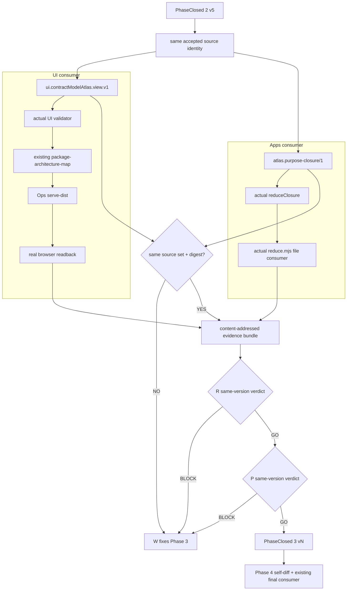

# Phase 3 — one source identity, two actual consumers

Phase 3 projects the already closed Phase 2 evidence into two different existing consumer contracts without creating a second authority:

1. `ui.contractModelAtlas.view.v1`, validated by the pinned UI core-port consumer and rendered through the existing Ops `package-architecture-map` viewer;
2. `atlas.purpose-closure/1`, consumed by the pinned Apps `reduceClosure` implementation and its file CLI.

The consumers do not share one schema. They share only the exact source-identity set and digest.

## Boundary

```text
AcceptedSource
  = Phase1.accepted current
  + Phase2.relation-valid assertions

ProjectionSourceIdentity(a)
  = sourceRef + assertion digest

UiProjection
  = UiProjector(AcceptedSource)
  |> ui.assertContractModelAtlasView
  |> package-architecture-map
  |> existing static viewer
  |> Ops serve-dist
  |> real browser readback

AppsProjection
  = AppsProjector(AcceptedSource, Phase2 DRIFT)
  |> apps.reduceClosure
  |> apps/reduce.mjs file consumer

SameSource
  = sourceSet(UiProjection) = sourceSet(AppsProjection)
  ∧ digest(sourceSet(UiProjection)) = digest(sourceSet(AppsProjection))
```

`SharedAtlasUI` evidence is a separate non-authoritative snapshot document. It is not claimed as the UI view contract, Apps closure contract, runtime state, or authority.

## Projection rules

| Source meaning | UI view | Apps Purpose Closure |
|---|---|---|
| accepted decision | decision element | root `purpose` |
| Package purpose / all 11 fields | package element with `contractFields` | package `purpose` + canonical aggregate `ideal` |
| Package dependency | edge or external-dependency diagnostic | retained in aggregate `ideal` |
| implementation observation vs declaration DRIFT | visible diagnostic | `current` + `ideal` + `gap` |
| claim-to-claim DRIFT | visible diagnostic | explicitly unprojected because no authoritative current/ideal direction |
| explicit work | no row unless present | `fill`; not invented |
| explicit result | no row unless present | `receipt`; not invented |
| explicit residual | no row unless present | `residual`; not invented |

All 11 Phase 2 fields remain in both projections. Unsupported DRIFT direction is counted and explained rather than hidden.

## Completed tree

```text
roccho-org/ops
├── .github/workflows/
│   ├── contract-632-phase1.yml
│   └── contract-632-phase3.yml
└── packages/ops-package-contract-bridge/
    ├── PHASE2.md
    ├── PHASE3.md
    ├── README.md
    ├── bin/
    │   └── ops-package-contract-bridge.mjs
    ├── src/
    │   ├── phase2.mjs
    │   ├── phase2-v4.mjs
    │   ├── phase2-v5.mjs
    │   ├── phase3.mjs
    │   ├── serve.mjs
    │   └── verify.mjs
    └── tests/
        ├── e2e.mjs
        ├── phase2.mjs
        ├── phase2-v4.mjs
        ├── phase2-v5.mjs
        └── phase3.mjs
```

Finite evidence:

```text
contract-632-phase3-bundle/
├── bundle-manifest.json
├── provenance.json
├── browser-receipt.json
├── browser-dom.html
├── browser.png
├── apps-cli-receipt.json
├── apps-cli-reduced.jsonl
├── served-latest.mmd
└── proof/
    ├── ui.contract-model-atlas.view.json
    ├── ui.contract-model-atlas.data-row.json
    ├── ui-consumer-receipt.json
    ├── package-architecture.inventory.json
    ├── apps.atlas-purpose-closure.input.jsonl
    ├── apps.atlas-purpose-closure.reduced.jsonl
    ├── shared-atlas-ui-snapshots.jsonl
    ├── mapping-coverage.json
    ├── append-invariants.json
    ├── phase3-destructive-results.json
    ├── consumer-identities.json
    ├── dist/{index.html,latest.mmd,maps/...}
    ├── phase3-receipt.json
    └── phase3-verification.json
```

## Completion equation

```text
Phase3ReadyForReview
  = PhaseClosed(1,v2)
  ∧ PhaseClosed(2,v5)
  ∧ UI actual validator PASS
  ∧ Apps actual reducer PASS
  ∧ Apps file CLI output = in-process reducer output
  ∧ SameSource
  ∧ all mandatory fields mapped
  ∧ unadmitted candidate leaves accepted projections unchanged
  ∧ accepted source change changes corresponding projection locations
  ∧ Fill = Receipt = Residual = 0 unless explicit records exist
  ∧ existing viewer served by Ops serve-dist
  ∧ real browser renders SVG and reads exact accepted decision/package labels
  ∧ authority = false
```

`Phase3ReadyForReview != PhaseClosed`. R and P must judge the same head/run/artifact.

## Validation matrix

| Requirement | Positive evidence | Safe failure |
|---|---|---|
| distinct consumer contracts | UI validator and Apps reducer both execute | schema substitution rejects |
| same source identity | exact set and digest equality | one digest mutation rejects |
| complete UI projection | 60 Package elements retain all 11 fields | missing target or authority field rejects |
| complete Apps input | purposes, aggregate ideals, observation/claim gaps form a closed DAG | missing purpose ref or authority=true rejects |
| no invented closure effects | `fill=receipt=residual=0` | explicit counts must match source rows |
| unadmitted candidate isolation | accepted UI/Apps bytes unchanged | any change blocks |
| accepted change visibility | decision paths and Apps bytes change | no corresponding change blocks |
| unknown relation | Phase 2 relation allow-list | unknown relation rejects |
| actual file consumer | Apps `reduce.mjs` output byte-equals projection output | mismatch rejects |
| actual viewer | existing package map and viewer | inventory/ref errors reject |
| actual Ops serve/browser | localhost serve + browser DOM/screenshot receipt | no SVG/source label rejects |
| deterministic replay | two bundle generations byte-equal | any output drift fails |
| artifact integrity | manifest binds all files | one-byte mutation rejects |

## Closure process



## Claim ceiling

```text
PACKAGE_PROJECTIONS_CONSUMED_NOT_ORGANIZATION_ADMISSION
```

This phase does not select accepted Current, resolve DRIFT winners, change Gate scope, migrate Apps, merge the PR, publish a Gov Release, or adopt operational state.
