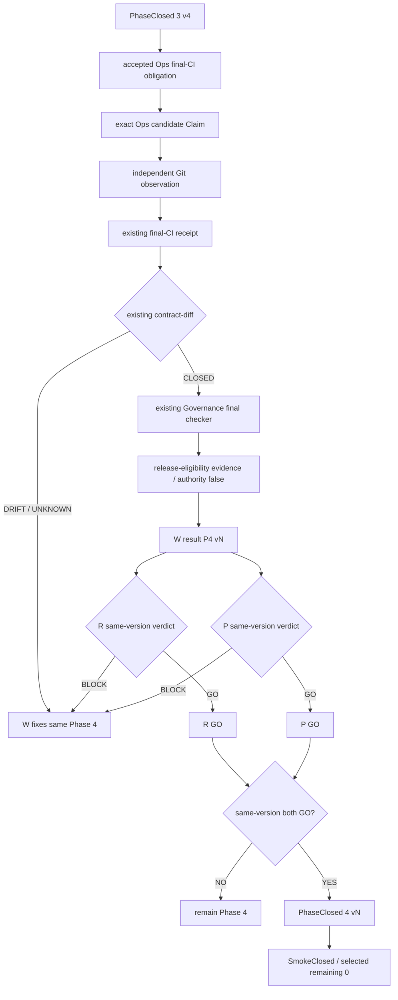

# Phase 4 — Ops self-diff consumed by the existing Governance final checker

Phase 4 selects the already accepted final-CI migration obligation for Ops. It does not promote a repository claim into authority.

```text
Accepted requirement
  = governance/accepted-final-ci-decision.v1.json
  + governance/selected-final-ci-rollout.v1.json
  + selected assertion ops.final-ci-migration-consumer.v1

Provider
  = exact Ops candidate governance/final-ci-claim.v1.json

Observer
  = exact Git checkout/tree/blob read by the selected proof workflow

Receipt
  = existing tools/check-final-ci-consumer.py output bound to the same candidate

Comparator
  = existing packages/contract-diff

Consumer
  = existing tools/check-package-final-scope-purpose-join.py
```

## Completion equation

```text
GateRequired
  = AcceptedRequirement ∩ {ops.final-ci-migration-consumer.v1}

EvidenceBound
  = provider.candidate = observation.candidate = receipt.candidate
  ∧ accepted requirement digest is exact
  ∧ source/blob digests are exact

DiffClosed
  = contract-diff(required, provided, observation, receipt) = CLOSED

NegativeSafe
  = drift -> OPEN
  ∧ missing observation -> OPEN
  ∧ stale candidate -> OPEN
  ∧ missing admission -> UNKNOWN

Phase4ReadyForReview
  = GateRequired
  ∧ EvidenceBound
  ∧ DiffClosed
  ∧ NegativeSafe
  ∧ existing final checker consumes the verified evidence
  ∧ release eligibility evidence has authority=false
  ∧ adoption=false
```

`Phase4ReadyForReview` is not merge, Gov Release publication, formal adoption, or operational adoption.

## Closure process



## Claim ceiling

```text
OPS_SELF_DIFF_CONSUMED_NOT_ORGANIZATION_ADMISSION
```
