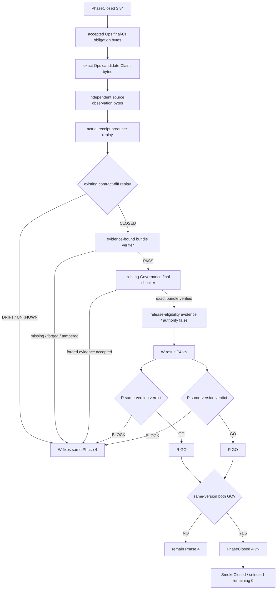

# Phase 4 — evidence-bound Ops self-diff consumed by the existing Governance final checker

Phase 4 selects the already accepted final-CI migration obligation for Ops. It does not promote a repository claim into authority.

```text
Accepted requirement
  = exact bytes of accepted decision + selected rollout

Provider
  = exact Ops candidate Claim bytes

Observer
  = exact independent source bytes at a fixed revision

Receipt
  = actual existing final-CI receipt producer replay

Comparator
  = actual existing contract-diff CLI/core replay over copied input/admission bytes

Consumer
  = existing Governance final checker invoking the exact pinned verifier
```

## Completion equation

```text
GateRequired
  = AcceptedRequirement ∩ {ops.final-ci-migration-consumer.v1}

EvidenceBound
  = all required source bytes are carried in the finite bundle
  ∧ source descriptor digest = carried bytes digest
  ∧ accepted Requirement is reconstructed from carried decision/rollout bytes
  ∧ provider Claim is reconstructed from carried Claim bytes
  ∧ actual receipt producer is replayed and output bytes are equal
  ∧ packet/admission are reconstructed from those bytes
  ∧ existing contract-diff is replayed for positive and all negative cases
  ∧ phase4-evidence.json equals the recomputed evidence object

DiffClosed
  = contract-diff(required, provided, observation, receipt) = CLOSED

NegativeSafe
  = drift -> OPEN
  ∧ missing observation -> OPEN
  ∧ stale candidate -> OPEN
  ∧ missing admission -> UNKNOWN
  ∧ evidence-absent two-file bundle -> REJECTED
  ∧ source tamper with refreshed transport hash -> REJECTED

ConsumerBound
  = existing final checker receives the whole exact bundle
  ∧ exact pinned Ops bound verifier is checked and executed
  ∧ accepted Governance source bytes are matched independently
  ∧ fabricated all-zero digest evidence is rejected

Phase4ReadyForReview
  = GateRequired
  ∧ EvidenceBound
  ∧ DiffClosed
  ∧ NegativeSafe
  ∧ ConsumerBound
  ∧ release eligibility evidence has authority=false
  ∧ adoption=false
```

`Phase4ReadyForReview` is not merge, Gov Release publication, formal adoption, or operational adoption.

## Finite bundle

```text
contract-632-phase4-bundle/
├── sources/
│   ├── governance/{accepted decision, selected rollout}
│   ├── ops/{Claim, receipt producer, comparator CLI/core, bound verifier}
│   └── observer/source
├── source-bindings.json
├── bound-verification.json
├── ops-final-ci-consumer-receipt.json
├── contract-diff-{input,admission,positive}.json
├── negative-*-{input,admission}.json
├── contract-diff-negative-*.json
├── run-scope.json
├── phase4-evidence.json
└── bundle-manifest.json
```

## Closure process



## Claim ceiling

```text
OPS_SELF_DIFF_CONSUMED_NOT_ORGANIZATION_ADMISSION
```
