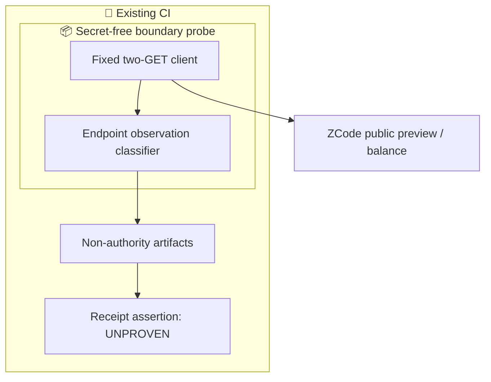
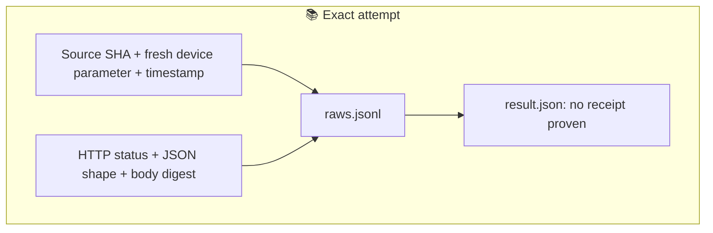

# ZCode: anonymous campaign boundary, not receipt proof

**Draft diagnostic. This is not an implementation that proves receipt.**
The requested assertion is: the 1024 campaign can be received without logging in,
API keys, existing cookies, OAuth/JWTs, or an authenticated device profile.
A free account is not an anonymous client.

## What inspection actually established

At upstream source commit `3c5b227649371507ddc4eb46ac5133afe6db1cab`:

- `docs/zai-start-plan-provider.md`, Manual claim interaction: preview is public;
  claim requires login and official-client security verification. Anonymous clicks
  only start login; after login the user confirms again.
- `packages/desktop/test/e2e/ui-shell/marketing-touch-anonymous.test.ts`, MTE-05:
  the anonymous banner opens login and submits **zero** claim requests. This is
  an upstream isolated-fixture test definition, not our production execution.
- The documented balance request uses a JWT and requires `X-Device-Mid`.
  Missing-device parameter errors, CAPTCHA, WAF, 429 and network failures cannot
  be relabelled as proof of an authentication requirement.

These are source facts, not a claim that the deployed desktop build or service
matches that commit. The cited locations and purpose chain are in `raws.jsonl`.

## Smallest truthful experiment

`probe.mjs` uses Node built-ins, makes at most two HTTPS GETs to the fixed official
preview/balance endpoints, and saves privacy-minimized observations. It has no
installer, model call, login, claim POST, CAPTCHA workaround, provider credential,
paid fallback, shell tool execution, cookie jar, redirect, retry, or background loop.
A fresh randomly generated device ID is an API parameter, not a user credential.
The app-version query parameter is documented context, **not** app execution.

Only an HTTP 401 JSON envelope is labelled `HTTP_AUTH_REJECTION`, scoped to the
sampled endpoint. All other responses remain `UNKNOWN`; even a 200 balance with
quota is not a fresh campaign grant. Body SHA-256 and length bind the received
bytes; raw bodies, response headers, tokens and user identifiers are not retained.
This deliberately limits independent payload analysis; the evidence is not a
replayable full production transcript.

| Check | Meaning | Exit |
|---|---|---|
| Classifier selftests | The bounded negative cases are classified correctly | 0 on success |
| Anonymous receipt gate | No receipt was demonstrated by this read-only experiment | 1 / UNPROVEN |
| Collection/output failure | Evidence incomplete or output directory already exists | 2 |

**There is intentionally no PASS branch for campaign receipt in this patch.**
This is an explicitly incomplete, non-merge-ready diagnostic, not an always-red
production requirement disguised as a finished solution. Do not merge it as an
anonymous-capability feature. Do not weaken the gate to make CI green.

To complete the original assertion would require a supported anonymous claim
route, the exact campaign identity, a fresh grant receipt, and independent quota
readback tied to the same grant and unauthenticated principal. None has been
established. Logged-in/free-account testing is a different assertion and is not
silently substituted here. Receiving quota and executing GLM are also separate.

## Execution and evidence

Run the Node test runner on `probe.test.mjs`. Run `probe.mjs` with exactly one new,
nonexistent output-directory path. The same entrypoints work outside Actions.
The workflow checks out the exact candidate SHA without persisting credentials,
uses a fresh HOME and an allowlisted environment for the probe, and preserves
artifacts even after the deliberately non-successful receipt gate. It never uses
`pull_request_target`, secrets, write permissions, or `continue-on-error`.
Node and OS versions are observed, not asserted to be bit-reproducible.

Artifacts: `raws.jsonl` (labelled design/source records, context and observations),
`disruptives.jsonl` (16 bounded negative fixtures), `result.json` (UNPROVEN verdict).
A green selftest is not live proof. Missing, cancelled or skipped live runs are
not success. CI evidence must be read back for the exact candidate SHA/attempt.
The default repository's existing workflow intent ledger registers the adapter;
this does not change governance or adopt any provider.

## Architecture

## Data flow

The improvement over an automatic CLI installer is to test the unsupported
assumption first, without maintaining another harness or granting credentials.
The experiment can refute a proposed shortcut; it cannot manufacture that shortcut.
